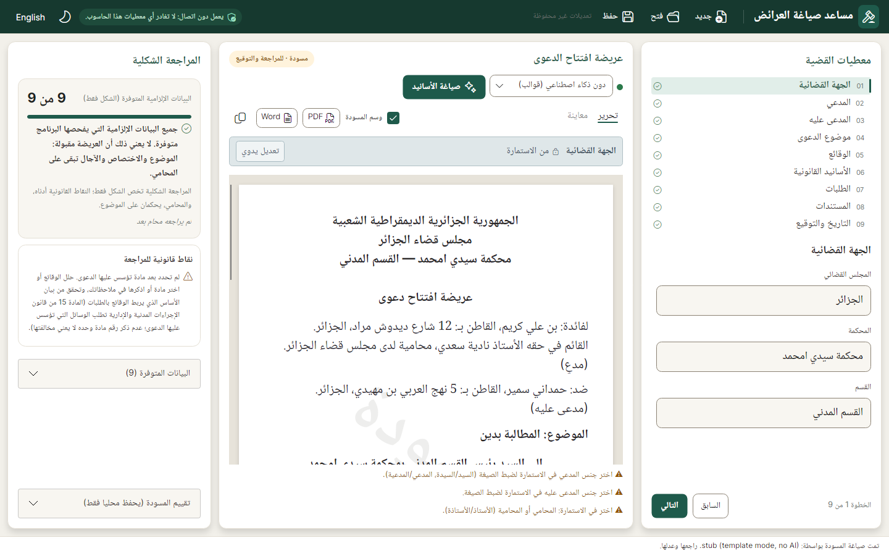
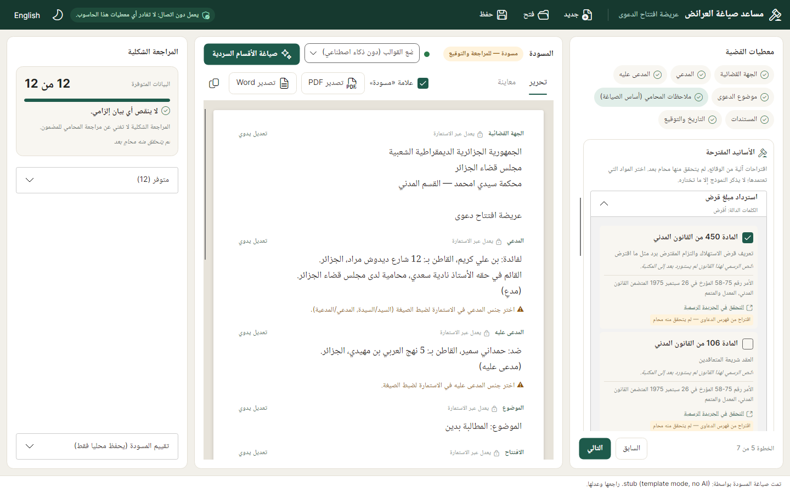
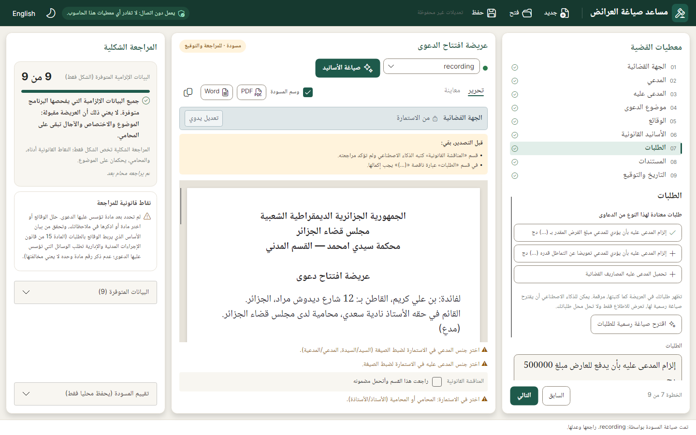
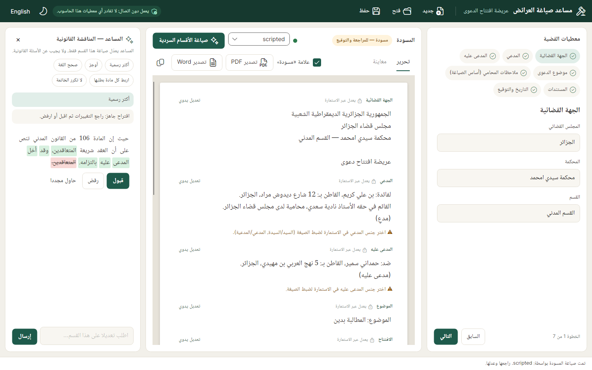
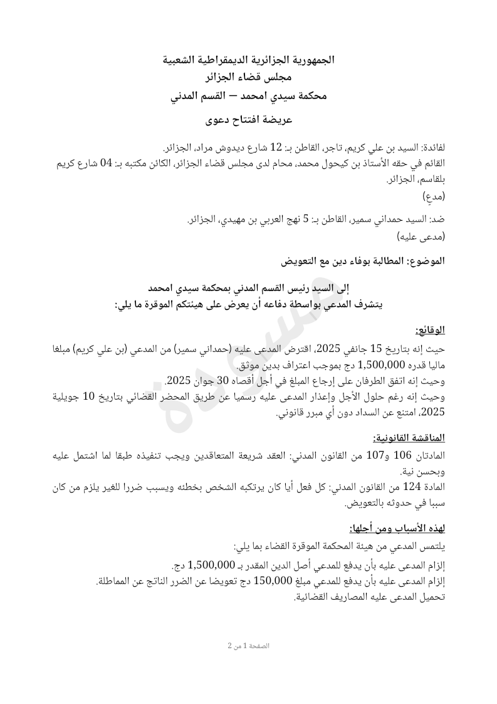
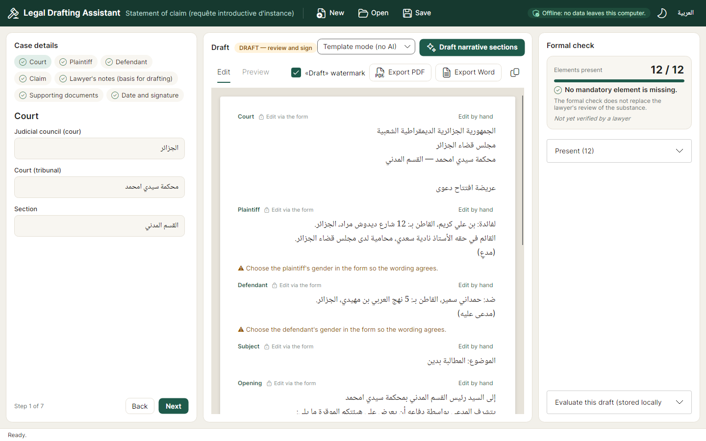
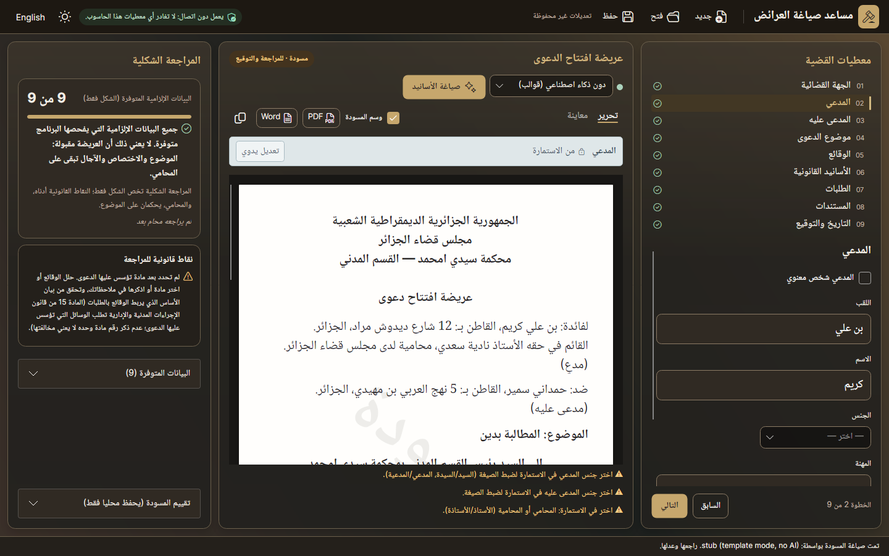

# dz-legal-assistant

An **offline desktop assistant that helps Algerian lawyers draft legal documents** in formal Arabic, and **checks that every element the law requires is present** before filing.

The lawyer fills in the case details, the application produces a structured first draft, and a deterministic **Form Engine** reports which mandatory elements (if any) are missing. Each finding cites the article it comes from. The lawyer reviews, edits and signs. The application **never** files anything and never presents its output as final.

> **Target 1 (this milestone):** one document type, the *requête introductive d'instance* (عريضة افتتاح الدعوى), checked against CPCA (Loi 08-09) arts. 8, 14, 15 and 17.
>
> ⚠️ **The legal rules are not yet verified by a lawyer.** Every rule is marked `verified: false` in the data and flagged in the UI. See [docs/LEGAL-VERIFICATION.md](docs/LEGAL-VERIFICATION.md) and the Arabic reviewer guide [docs/LEGAL-REVIEW-GUIDE.ar.md](docs/LEGAL-REVIEW-GUIDE.ar.md).

**Supported input: formal Arabic (الفصحى).** The facts, grounds and requests should be written in formal Arabic, the language the requête itself must be in (CPCA art. 8). The quality targets and benchmark scores are measured on formal Arabic only.
- **Proper names, company names and an occasional French legal term** are kept exactly as written.
- **Notes in Darija or mostly in French** are still accepted, never refused or cut.
  - The field shows a quiet note suggesting formal Arabic: «للحصول على أفضل نتيجة، اكتب هذا النص بالعربية الفصحى…».
  - Test cases written that way form a separate *robustness* group, reported apart and not counted in the scores.



**Try it without installing anything: https://dz-legal-assistant-ai.onrender.com.** The public web demo runs the same engine, law library and screens in the browser, with four fictitious sample cases. Its AI steps use the same model as the desktop (Gemma 3 4B), hosted, so it is not for real client data. See [docs/WEB-DEMO.md](docs/WEB-DEMO.md) (local run: `dotnet run --project src/DzLegal.Web`). The first visit after a quiet spell takes about a minute while the free server wakes up.

**Law texts:** 39 articles of the Civil Code, the CPCA and the Commercial Code are loaded from the official PDFs. A build script checks that each text matches the letters of its PDF page ([docs/LAW-LIBRARY.md](docs/LAW-LIBRARY.md)); that check is not a lawyer's review. Limits:
- the CPCA texts are the 2008 originals, not yet checked against the 2022 amendment (Law 22-13);
- the family and labour articles in the claim catalog have **no text loaded yet**: the app shows them as number only and refuses any quotation of them;
- a quotation is checked only against a loaded text.

## Principles

| Principle | How it is enforced |
|---|---|
| **Offline, no data leaves the machine** | The desktop app uses no cloud APIs and no telemetry (the public web demo is separate, see above). The only model endpoint allowed is a loopback address (`127.0.0.1`, `::1`, `localhost`), checked by `LoopbackGuard`, with the system proxy bypassed. See [docs/OFFLINE.md](docs/OFFLINE.md). |
| **Assistive, never autonomous** | A permanent "draft, review required" banner. The app only produces text for the lawyer to edit and sign. **Nothing AI-written leaves the app unreviewed:** each section the model wrote carries «راجعت هذا القسم وأتحمل مضمونه»; PDF, Word and copy are refused, with the reasons listed, until every AI section is ticked and no «(...)» placeholder remains. Editing a section does not count as reviewing it, and a redraft asks for a new review. Word exports carry a «مسودة» line in the page header while the draft option is on, and an "AI-assisted draft" note in the file properties. |
| **Grounded, not free-generating** | Identification, court, **facts**, dates and the signature block come from templates, deterministically, with grammatical gender taken from the form. Each facts line becomes a «حيث إن / وحيث إن» paragraph exactly as the lawyer wrote it. Small local models swapped lender and borrower when rewriting facts, so they no longer touch them. **The requests are the lawyer's own lines too**, numbered under the fixed formula «في الشكل… في الموضوع:»: model-written requests changed the relief in 9 of 15 audited drafts. The model writes only the legal grounds. If a section has no notes, the model is not called. |
| **Model output is checked** | Deterministic checks remove paragraphs copied from the prompt's worked example. They also flag foreign-script characters, stray Latin words, invented numbers, dropped numbers and legal qualifications the lawyer never used (for example «عقد المقاولة» in a loan case). Unusable answers are retried once, and otherwise replaced by the lawyer's notes. |
| **Verifiable** | The Form Engine is pure and deterministic. A 24-case corpus measures its accuracy per element, and CI requires 100%. |
| **Legal rules are data** | Elements, articles, templates and prompts live in `data/`. Changing a rule means editing JSON, not code. |

## Legal grounds: analysis of the facts

The legal grounds are often the hardest part for the lawyer. The form has three separate steps for them: **Facts → Legal grounds → Requests**.

In the **Legal grounds** step, **«حلّل الوقائع واقترح الأسانيد»** runs a three-stage analysis with the local model. It takes about 2–3 minutes on a CPU-only laptop (measured: 117–181 s on an Intel i5-1335U) and can be cancelled. While it runs, a panel shows each step, a timer and the model's words as they are written, so the lawyer never waits in silence. It also says how much time is left, from this computer's own earlier runs, and warns when the laptop is on battery or in power-saver mode. The analysis starts by itself when the lawyer leaves the **Facts** step (local model only; `analyseInBackground`), so it runs while the next steps are filled; nothing is relied on until the lawyer confirms the claim type. The same panel appears while the draft is written (the section being written is marked) and in the section assistant. To shorten the first wait, the app loads the model into memory in the background when it starts (local only; `ollama.warmUp`).
1. **Reading the facts.** The model states the legal relationship, the obligation breached and what is sought. It recognises claim types from the catalog, by id only, or answers `other` when none applies. It names no article.
2. **Gathering the candidates.** No model is involved. The candidates are the catalog articles of the recognised claim types, nothing else. **When no catalog claim type applies, there is no candidate and nothing is proposed**: the app abstains rather than guess. (A library-wide text search used to add candidates; an audit found it added only noise, so it is now only the lawyer's manual search.)
3. **Choosing articles.** The model chooses among those candidates only, by key. For each it gives a role (basis, proof, damages, procedure) and a short reason. Anything else it writes is discarded.

**What the lawyer sees:**
- the model's reading of the facts, labelled as the model's;
- **the exact articles it proposed**, each with its role, «تعليل النموذج», the official text (or "not loaded"), the official reference and source link;
- **nothing is ticked until the lawyer confirms the claim type.** «نعم، هذا نوع الدعوى» ticks the articles the catalog marks as required for that type; «ليس هذا» withdraws the proposals. Ticked articles appear under **«الأسانيد المعتمدة»**;
- an optional box for the lawyer's own arguments, and a search to add any article by number or words;
- if the facts change after the analysis, a banner asks to analyse again, and the ticks are kept.

**Requests and Documents steps:** they offer the usual requests and documents of the recognised claim types as one-click lines, plus any prerequisites (for example labour conciliation). In the Requests step, «اقترح صياغة رسمية للطلبات» asks the AI for a formal Arabic wording of the lawyer's lines (a help for notes that slipped into Darija or French; formal Arabic remains the supported input). The proposal is shown only if code confirms it kept the number of requests, every amount and number, and every alternative («أو»), with no amount spelled out in words; it replaces the lawyer's lines only when the lawyer accepts it.

**How the draft stays grounded:**
- The grounds are drafted from the ticked articles, plus the lawyer's own arguments.
- **Argued grounds, as Algerian petitions write them, with the law written by the code.** The code plans one paragraph per part the ticked articles play in the claim (the obligation and its breach, its proof, the compensation) and opens each with the articles and their one-line rule from the catalog («حيث إن المادتين 179 و186 من القانون المدني تقضيان بأنه…»); a "limit" article such as no interest on a private loan stays a warning, not a ground. The AI writes only how the facts meet the rule. An application that cites or quotes an article, or has a number found nowhere in the notes, is asked once more, then left as «(...)» for the lawyer, which blocks export.
- When no cited text is loaded, the model writes the grounds with the ticked articles' official texts as the only law it may cite or quote.
- Any other article in the result is flagged under the section, and so is any «…» quotation that doesn't match the official text. Either one triggers one automatic retry.
- Nothing is scraped or searched online; the texts come from the local law library ([docs/LAW-LIBRARY.md](docs/LAW-LIBRARY.md)).

> ⚠️ **Status:** the claim catalog (its claim types, articles and required flags) is not yet verified by a lawyer. An independent audit (October 2026) found errors in it and in the test expectations; corrections are under way.





## Section assistant

Each narrative section (grounds, requests) has a **✦ Assistant** button. It opens a panel where the lawyer asks for an edit of *that section only*: quick chips («أكثر رسمية», «أوجز», «صحح اللغة», «اربط كل مادة بطلبها», «لا تكرر الخاتمة») or a free instruction.
- The model's answer streams in as it is written, then appears as a **word-level diff** (added in green, removed struck out) with **Accept / Reject / Try again**.
- Every proposal goes through the same checks as a first draft: invented or dropped numbers, unexpected Latin words, legal terms the lawyer never used, non-Arabic or foreign-script text. Their hints show above the diff. A hard failure is retried once.
- It is not a chatbot: a legal question gets a fixed reply («المساعد يعدل صياغة هذا القسم فقط»), never an answer.
- Accepting keeps the old text in the section's history, so **Undo** restores it.

**Regeneration never destroys edits.** «صياغة الأقسام السردية» only fills sections that are empty or unchanged since the model wrote them. A section the lawyer edited keeps its text; its own **↻ Redraft** button asks for confirmation first, and the old text can be undone.

**Model status** is shown by a dot next to the provider. The app asks the local Ollama (`/api/tags`, loopback only) at startup and every 30 s, and says plainly when Ollama is not running or the model is not installed (`ollama pull gemma3:4b`).



## Output: preview, PDF and Word

The **Preview** tab shows the requête exactly as it prints: A4 pages rendered from the real PDF, right-to-left, in the bundled Noto Naskh Arabic font, with an optional diagonal «مسودة» watermark.
- **Export PDF** is for filing and printing.
- **Export Word (.docx)** produces right-to-left paragraphs set in Simplified Arabic, a font that ships with Windows, so the lawyer can keep editing in Word.

Each section's print layout (alignment, bold, size, spacing) is data, under `layout` in `definition.json`.



PDFs are generated with [QuestPDF](https://www.questpdf.com) under its Community license. It is free while the company's annual revenue stays under USD 1M; above that a commercial license is required. Word files are generated with the MIT-licensed Open XML SDK.

## Quick start

Prerequisite: [.NET 10 SDK](https://dotnet.microsoft.com/download) (the version is pinned in `global.json`).

```bash
dotnet build                                   # warnings are errors
dotnet test                                    # engine, drafting, providers, storage, UI (headless)
dotnet run --project src/DzLegal.Harness       # Form Engine accuracy report (exit 1 on any mismatch)
dotnet run --project src/DzLegal.Harness -- grounds --models gemma3:4b   # grounds analysis quality with a local model
dotnet run --project src/DzLegal.App           # the desktop app
```

The app starts in Arabic and uses the local model by default. **With no model installed,** choose **"وضع القوالب (دون ذكاء اصطناعي)" / "Template mode (no AI)"** in the toolbar. The draft is then built from the templates plus your own notes, and everything else works the same.

### Using the local model (optional, recommended)

1. Install [Ollama](https://ollama.com). It runs as a local process on `127.0.0.1:11434`.
2. `ollama pull gemma3:4b` (about 3.3 GB, one-time download). After that, no network is needed. With 16 GB RAM or a GPU, `qwen2.5:7b-instruct` writes better Arabic.
3. Optional, on Windows, recommended on 8 GB RAM: `powershell -ExecutionPolicy Bypass -File tools\model\New-TextOnlyModel.ps1`. It creates `dz-gemma3-4b-text` from the installed `gemma3:4b` (same language weights, nothing downloaded) without the image part the app never uses: about 0.8 GB less memory, identical answers. The app uses it automatically when it is installed.
4. Start the app and keep the default engine, "النموذج المحلي" / "Local model".

Recommended hardware: 16 GB RAM for 7B models (CPU-only works, at about a minute or more per section), or a GPU with 8 GB or more of VRAM. **On 8 GB RAM without a GPU, use `gemma3:4b`.** It was the best of the three models benchmarked on such a machine (about 4 minutes of drafting per requête on an Intel i5-1335U, plus 2–3 minutes for the grounds analysis). `qwen2.5:3b-instruct` is weaker and only worth using on machines too small for gemma. `qwen3:4b` is **not supported** there: it writes its English reasoning into the document and takes over 10 minutes per requête. To change a setting, **don't edit `appsettings.json`**. Create `appsettings.local.json` next to it (in the repo: `src/DzLegal.App/appsettings.local.json`; git ignores it) containing only the keys you want to change. For example:

```jsonc
{ "ollama": { "model": "qwen2.5:7b-instruct" } }
```

Shipped defaults: `defaultProvider` `"ollama"` (or `"stub"` for template mode), `language` `"ar"` (or `"en"`), and `ollama.endpoint` `"http://127.0.0.1:11434"`, `ollama.model` `"gemma3:4b"`, `ollama.timeoutMinutes` `10`.

A non-loopback `endpoint` is refused. Further optional keys: `temperature` (0.2), `maxTokens` (1000), `repeatPenalty` (1.1), and `"think": false` for reasoning models such as `qwen3`.

### Speed on a CPU-only laptop (8 GB)

What to expect from a 4B model on CPU: the first request after start-up loads the model (10–40 s). The app warms it up in the background and keeps it in memory for 15 minutes after the last request (`ollama.keepAlive`), then Ollama frees the memory; closing the app frees it at once. After that, most of the wait is the model **reading** the prompt, and then it writes a few words per second.

The app keeps prompts short and caps every answer. To see where the time goes on your machine, run either bench (below): its summary has a "Where the time goes" table with load time, prompt tokens and reading speed, answer tokens and writing speed, and time to the first word.

Things that help on the laptop:
- keep it plugged in, with the "best performance" power mode;
- close heavy applications (browsers with many tabs);
- in Ollama's environment, try `OLLAMA_FLASH_ATTENTION=1` and `OLLAMA_KV_CACHE_TYPE=q8_0` (less memory for the same model).

Models to compare against `gemma3:4b` on such a machine: `gemma3n:e2b` and `gemma3n:e4b`, which are built for on-device speed. Earlier runs ruled out `qwen2.5:3b-instruct` (weaker) and `qwen3:4b` (too slow, writes English reasoning).

### Comparing local models (drafting bench)

```bash
ollama pull gemma3:4b                                          # once, online
dotnet run --project src/DzLegal.Harness -- draft --models gemma3:4b --out bench
```

This runs the fictitious cases in `tests/drafting-cases/` through each model. For every model and case it writes the full document, the time per section, any retries or fallbacks, and the automatic issues. It also writes `bench/summary.md`. On a CPU-only machine, expect several minutes per case. Automatic checks cannot detect swapped roles or invented reasoning, so read the outputs too; each file ends with a checklist. Use `--models stub` to try it without any model. To measure the hosted model's correctness and stability over many runs (`--runs`, `--case`, `--models openrouter`), see [docs/ONLINE-TESTING.md](docs/ONLINE-TESTING.md).

### Packaging for a lawyer's Windows PC

```bash
dotnet publish src/DzLegal.App -c Release -r win-x64 --self-contained -o out/win-x64
```

The output folder has everything it needs: runtime, `data/` rules, fonts and `appsettings.json`. Copy it to the machine and run `DzLegalAssistant.exe`.

Never add `-p:OnlineTesting=true` here. That flag builds the temporary online testing version ([docs/ONLINE-TESTING.md](docs/ONLINE-TESTING.md)), which can send case data to OpenRouter.

## Demo walkthrough (for reviewers)

1. `dotnet run --project src/DzLegal.App`. Click **English** (top bar) if you don't read Arabic. The UI switches to left-to-right, while the document stays Arabic and right-to-left. The desktop starts in the charcoal/gold theme; the moon icon switches themes. See the [approved workbench implementation and validation](docs/UI-WORKBENCH-RELEASE.md).
2. Next to **Draft narrative sections**, choose **Template mode (no AI)** unless Ollama is installed.
3. **Left panel, Case details:** the form is split into 7 steps, shown as chips. Each chip turns ✓ (done), red (a mandatory element is missing) or amber (a recommendation). A missing field gets a red border and the article it comes from, for example «مطلوب — CPCA art. 15-2». Use **Next** and **Back**, or click a chip.
4. **Right panel, Formal check:** the score («10 من 12») and only the missing elements, expanded. Click one to jump to the step that fixes it. Present elements are folded away.
5. **Centre, Draft:**
   - **Edit** shows the sections on paper. Generated sections follow the form (🔒). Use **Edit by hand** to take one over, and **Restore from form** to give it back.
   - **Facts → Legal grounds → Requests:** in the Legal grounds step, **Analyse the facts** proposes articles from the official texts with the model's reasons. Tick the ones you rely on. The Requests step then offers the usual requests.
   - **Draft narrative sections** writes the grounds and requests, streaming the text as it comes. Sections you edited are kept.
   - **✦ Assistant** on a narrative section proposes an edit you accept or reject (needs Ollama; template mode only echoes the text). **Undo** and **↻ Redraft** are per section.
   - **Preview** shows the exact A4 pages. **Export PDF** and **Export Word** save the document, with or without the «مسودة» watermark.
6. Work is autosaved every 30 s and on close. The next start offers to restore it.
7. Keyboard shortcuts: Ctrl+N new, Ctrl+O open, Ctrl+S save, Ctrl+G draft, Ctrl+P export PDF.





## Repository layout

```
src/
  DzLegal.Domain/                 models + validating JSON loader (no dependencies)
  DzLegal.FormEngine/             deterministic compliance checker (no AI, no network)
  DzLegal.Drafting/               template rendering, grounded prompts, IModelProvider
  DzLegal.ModelProviders.Stub/    template mode (no model)
  DzLegal.ModelProviders.Ollama/  local model over loopback only
  DzLegal.Storage/                local JSON drafts + evaluation records
  DzLegal.Documents/              print layout → PDF (QuestPDF) and Word (Open XML), preview images
  DzLegal.Law/                    offline law library (official texts), full-text index, claim catalog, official-text parser
  DzLegal.Harness/                Form Engine accuracy report, drafting bench, `law import` maintainer tool
  DzLegal.App/                    Avalonia desktop shell (Arabic/English)
data/law/                         official texts to import (sources.json), imported codes, import reports — see docs/LAW-LIBRARY.md
data/document-types/requete-introductive/
  definition.json                 fields, sections, required elements (+ articles)
  templates/*.scriban             deterministic sections
  prompts/*.ar.txt                grounded prompts for narrative sections
tests/
  corpus/requete-introductive/    documents with known-correct outcomes
  DzLegal.*.Tests/                unit, integration and headless UI tests
docs/                             architecture, offline guarantees, rule updates, legal verification
```

## Further documentation

- [docs/ARCHITECTURE.md](docs/ARCHITECTURE.md): modules, data flow, design decisions.
- [docs/DEVELOPER-GUIDE.md](docs/DEVELOPER-GUIDE.md): for working on the code: which file does what, where every prompt lives, the runtime flows and recipes.
- [docs/UPDATING-LEGAL-RULES.md](docs/UPDATING-LEGAL-RULES.md): how to change rules, templates and prompts, add corpus cases, add a document type.
- [docs/OFFLINE.md](docs/OFFLINE.md): what "offline" means here and how to verify it.
- [docs/LEGAL-VERIFICATION.md](docs/LEGAL-VERIFICATION.md): the checklist for the practicing lawyer.
