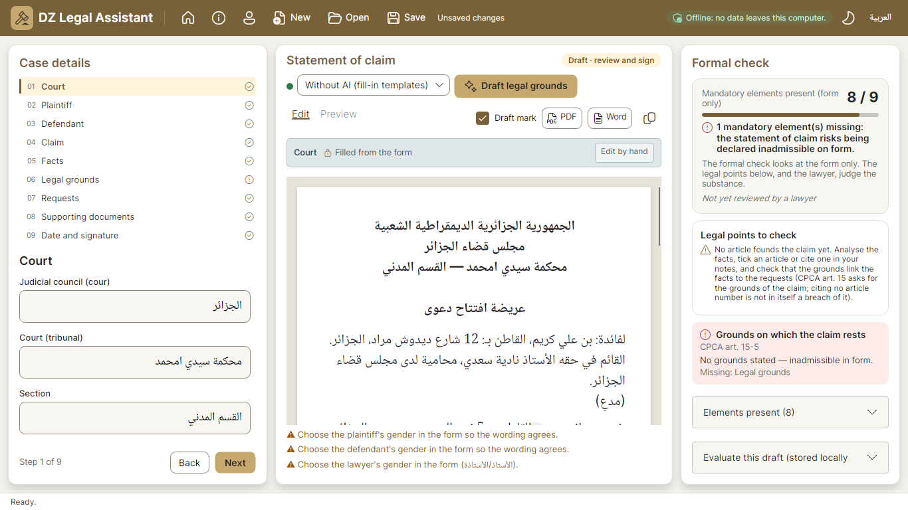
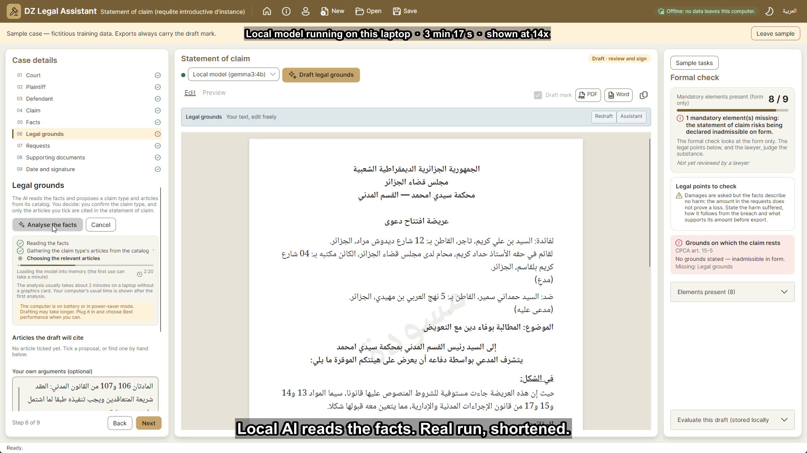
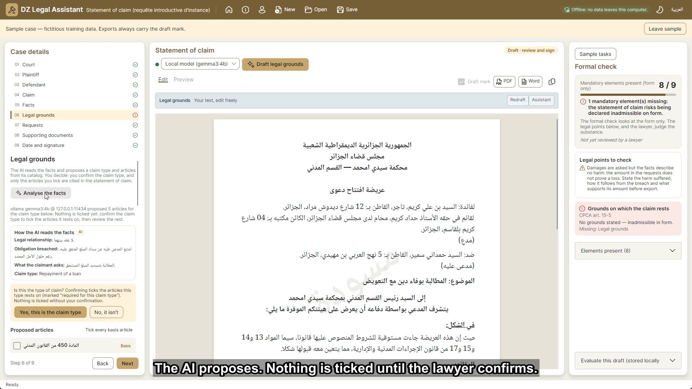
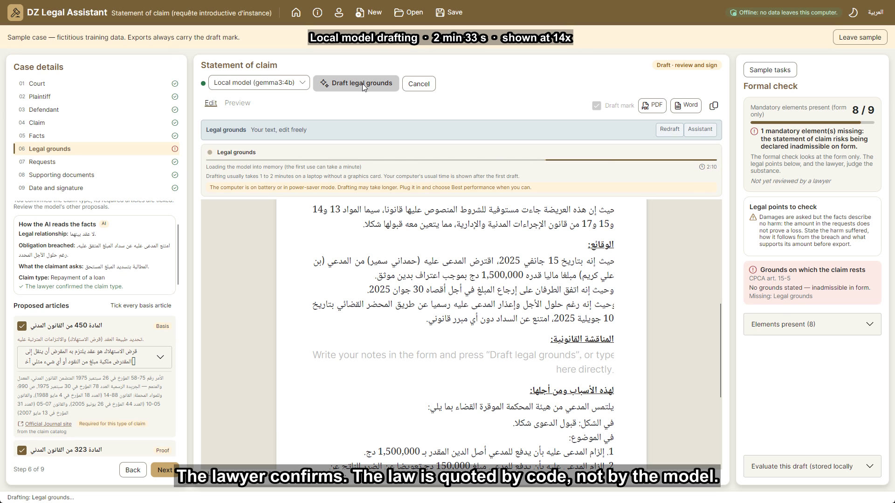
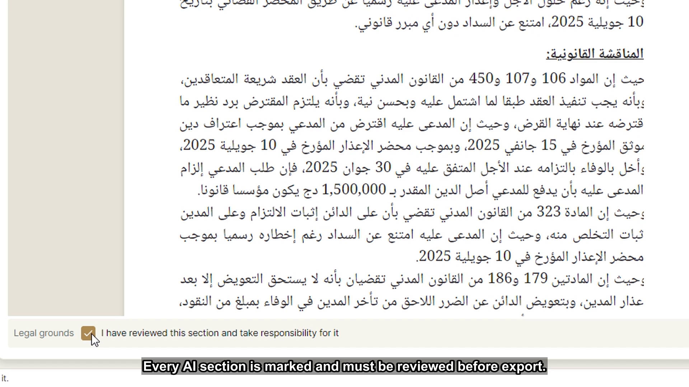
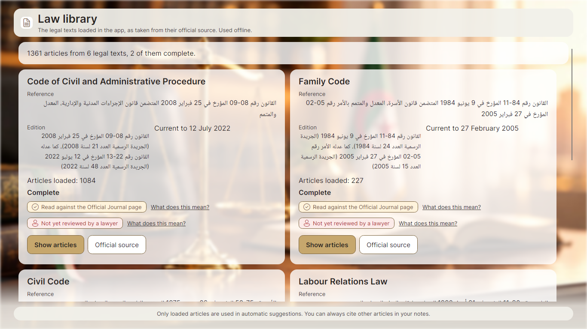

# DZ Legal Assistant

**The Grammarly for Algerian court petitions, which never leaves the lawyer's laptop.**

A desktop app that helps Algerian lawyers draft the *requête introductive d'instance* (statement of claim) in formal Arabic, checks that every element the law requires is present, and proposes the articles from the official texts. It runs offline: client files stay on the lawyer's own computer.

| ▶ [Live demo](https://dz-legal-assistant-ai.onrender.com) | ⬇ [Download for Windows](https://github.com/NinjaTraderCodes/dz-legal-assistant/releases/latest) | 🎬 [Demo video](https://drive.google.com/file/d/1zFbKYu2HWJIQ3-o1_QB_Zs6JGhvXqLFW/view?usp=sharing) | 📄 [Pitch deck](https://drive.google.com/file/d/1k9K6tWyQsFWDLof60efMlhcdFuaJivwY/view?usp=sharing) |
|---|---|---|---|



## The problem

In Algeria, a statement of claim that omits one element required by the Code of Civil and Administrative Procedure (CPCA) can be rejected on form, before a judge reads the case. Lawyers check these elements from memory, under time pressure. Finding the right articles for the facts takes most of the drafting time. And online AI tools are not an option: sending a client's file outside the office breaks professional secrecy.

## How it works

1. **The lawyer enters the case**: court, parties, facts and requests, in nine guided steps. The facts and requests stay exactly as the lawyer wrote them.
2. **The AI reads the facts** and proposes the type of claim and the articles, chosen only from the official texts loaded in the app.
3. **The lawyer confirms the claim type and ticks the articles.** Nothing is used before that confirmation.
4. **The app drafts the legal grounds.** The code quotes each rule from the official text; the AI writes only how the facts meet it. Every AI-written section is marked and must be reviewed before the petition can be exported.
5. **A rule engine, with no AI, checks every mandatory element** and names the article behind each missing one. Then the petition is exported to PDF or Word.

### The AI at work: a real run on a laptop

Frames from the [demo video](https://drive.google.com/file/d/1zFbKYu2HWJIQ3-o1_QB_Zs6JGhvXqLFW/view?usp=sharing), recorded live with the local model (Gemma 3 4B) on an ordinary laptop without a graphics card. The waits are real and shown sped up; the banner gives the true duration.

| | |
|---|---|
|  |  |
| **1. Reading the facts.** The local model reads the case and proposes the claim type (3 min 17 s on this laptop). | **2. The lawyer decides.** The AI's reading is shown with the question "Is this the type of claim?"; nothing is ticked before "Yes". |
|  |  |
| **3. Drafting the legal grounds** from the confirmed articles (2 min 33 s). The code quotes each rule; the AI links the facts to it. | **4. The lawyer reviews.** The AI-written section must be ticked "I have reviewed this section and take responsibility for it" before any export. |

The app also includes a first-run setup that fills the signature block of every petition, a guided tour, a sample case, help pages, and a law library showing each text's official source and how it was checked. It works in Arabic and English, in light and dark themes; the petition itself is always Arabic, right to left.



## Results so far

| What | Result |
|---|---|
| Automated tests | **937**, all passing |
| Form checks (rule engine, no AI) | **360 of 360** correct on 24 test petitions |
| Law texts | **1,361 articles** from 6 texts, including the complete Family Code and the complete CPCA |
| Claim types covered | **21**: civil, commercial, family and labour |
| 100 test cases written by a separate AI agent and never opened by the developers, online model (Nemotron 3 Ultra) | claim type right in **94%** (85 of 90); **67%** of cases fully right (60 of 90); **10 of 10** out-of-scope cases declined; 8 s per case |
| The same 90 cases, local model (Gemma 3 4B), claim type given | **36%** fully right (32 of 90), about 1 minute per case |

The local model is the weak point, which is why the lawyer confirms everything it proposes and why an online mode is next (below). Method and run records: [docs/HIDDEN-SET.md](docs/HIDDEN-SET.md).

## Try it

- **In the browser, nothing to install:** [the live demo](https://dz-legal-assistant-ai.onrender.com) runs the same engine, law library and screens, with four fictitious sample cases. Its AI uses a larger hosted model, so it is for fictitious data only.
- **On Windows 10 or 11:** download the zip from the [latest release](https://github.com/NinjaTraderCodes/dz-legal-assistant/releases/latest), unzip it and run `DzLegalAssistant.exe`. It works fully offline. Without a model, choose "Without AI (fill-in templates)" in the draft panel. For the AI, install [Ollama](https://ollama.com) and run `ollama pull gemma3:4b` once.
- **From the source code** (requires the [.NET 10 SDK](https://dotnet.microsoft.com/download)):

```bash
dotnet build                          # warnings are errors
dotnet test                           # all automated tests
dotnet run --project src/DzLegal.App  # the desktop app
dotnet run --project src/DzLegal.Web  # the web demo, locally
```

## Team

| Who | Role | What they did |
|---|---|---|
| **Hicham Benkaihoul** | Founder and developer | Defined the product and its legal pipeline, directed and reviewed the AI coding agents that wrote most of the code, ran the benchmarks and the test campaigns, and tested the app. |
| **Djihane Ben Djeddou** | UI/UX designer | Designed and built the lawyer's journey in the desktop app: the welcome screen, the setup, the lawyer's profile, the start screen, the guided tour with its sample case, the help pages and the law library, in Arabic and English, light and dark. |
| **Khouloud Otmane Cherif** | Legal reviewer | Master's in private law, works in an Algerian law office. Reviewed legal points of the drafting and answered the team's questions on Algerian civil procedure and claim types, which shaped the family claims. |

**AI tools used to build it.** Most of the code, tests and documentation were written by AI coding agents, directed and reviewed by the team: Claude Code (most of the app), OpenAI Codex (the law corpus, part of the workbench, the independent test cases) and OpenCode (the onboarding screens). The welcome image was generated with ChatGPT. Inside the desktop app, the only AI is the local model (Gemma 3 4B through Ollama); the web demo uses Nemotron 3 Ultra through OpenRouter.

**Tech stack.** C# and .NET 10; Avalonia (desktop interface); Blazor Server (web demo); QuestPDF (PDF) and Open XML SDK (Word); Scriban (templates); Ollama (local model); OpenRouter (the web demo's hosted model).

## Status and limits

- **The legal rules and the claim catalogue are not yet verified by a practising lawyer.** Every rule is marked unverified in the data and in the app; an independent audit in October 2026 found errors in the catalogue, and corrections are under way. Checklist: [docs/LEGAL-VERIFICATION.md](docs/LEGAL-VERIFICATION.md).
- **One document type so far:** the statement of claim. The Civil, Commercial and Labour codes are only partly loaded; the complete Civil Code is being checked against the Official Journal.
- **The app drafts; it does not decide.** It does not judge the merits or guarantee a result, and the lawyer reviews and signs every petition.
- **The web demo sends what is typed to a hosted model:** fictitious cases only. The desktop app sends nothing.

## What's next

- **Month 1:** an online mode for stronger AI, with client names hidden on the laptop before sending and a preview of exactly what is sent; executable legal rules reviewed with our legal reviewer.
- **Month 2:** version 1.0 as a Windows installer, with the complete Civil Code and the texts reviewed by a practising lawyer.
- **Month 3:** a pilot in five to ten law offices, measuring the time saved and the defects caught, and preparing the yearly subscription for the AI analysis and the law updates.

## Documentation

- [docs/PRODUCT-DETAILS.md](docs/PRODUCT-DETAILS.md): the full technical description: analysis, drafting, checks, exports, local model set-up, benches and repository layout.
- [docs/ARCHITECTURE.md](docs/ARCHITECTURE.md): modules, data flow and design decisions.
- [docs/DEVELOPER-GUIDE.md](docs/DEVELOPER-GUIDE.md): which file does what, where every prompt lives.
- [docs/OFFLINE.md](docs/OFFLINE.md): what "offline" means here and how to verify it.
- [docs/LAW-LIBRARY.md](docs/LAW-LIBRARY.md): the law texts and how each was checked.
- [docs/WEB-DEMO.md](docs/WEB-DEMO.md): the web demo and how to run it.
- [docs/HIDDEN-SET.md](docs/HIDDEN-SET.md): the independent test set and its results.

*Version 0.9.1. All data shown is fictitious. "The AI at work" frames come from a live recording with the local model; the other screens are rendered by the automated UI tests. PDFs are generated with [QuestPDF](https://www.questpdf.com) under its Community license; Word files with the MIT-licensed Open XML SDK.*
