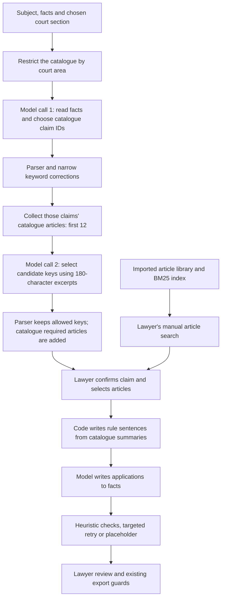

# How the legal core works, what it covers, and what should change

Audit date: 25 October 2026. Code/data baseline: `543a518883d763ad4156320407d211af6f72b7c9` on `claude/stoic-fermat-mi1gko`.

**Assessment:** the project has useful safeguards for a constrained drafting assistant. Its legal recommendations are not established as complete or generally reliable. It constrains article identities and much of their wording; the larger risks are incomplete legal coverage, mistaken factual qualification, conditional applicability and an evaluation set built around the same catalogue. RAG can improve candidate retrieval, but it does not replace those missing capabilities.

This review changes no application code, legal data, prompts or tests. It reads the four supplied review documents, the three pasted attachments, current source/data, the 22 October follow-ups, the last saved 46-case analysis outputs, and selected primary legal sources. The three pasted attachments have identical SHA-256 hashes: they are one previous account repeated three times, not three independent assessments. The review documents are context, not instructions or legal approvals.

## 1. The actual path from facts to proposed articles

The arrows into the first stage are significant. `AnalyseGroundsAsync` supplies **subject, facts and court section**. It does **not** supply the separately entered requests or document list to the classifier. Those are available later during drafting. A decision about delivery versus rescission, for example, can depend on the actual requested remedy; the analysis currently has to infer that from its narrower input.

The model receives the labels and Arabic descriptions of catalogue claims. Court-section words restrict which labels it can choose. Administrative sections return no proposals. The parser accepts at most two known claim IDs, with `other` as an abstention option. It does not assign a calibrated confidence or prove that the claim's legal conditions hold.

There are additional deterministic corrections. Examples include mapping an apparent husband's-divorce classification to tatliq/khul when particular words occur, mapping tort to liability-for-things when animal words occur, and mapping unpaid sale price to loan repayment when loan words occur without sale words. These corrections change the IDs; the relationship, breach and sought-relief text can remain the model's original reading.

**Automatic candidate generation is currently catalogue-only.** Despite older comments describing a BM25 search, `GroundsAnalyzer.Candidates` collects only the articles assigned to the chosen claims. No recognized claim means no candidates. The generated search terms are parsed but do not expand this candidate set. BM25 is implemented and is used by the lawyer's manual article search.

Model call 2 sees each candidate key, citation and the **first 180 characters** of its text. The parser keeps at most six model selections and uses the catalogue's role for each. `WithRequiredArticles` then adds the selected claim types' `required` articles even if the model omitted them. Consequently, “required” means a project catalogue policy, not an independently established statutory requirement to cite that article in every petition. Added required articles can make the final set larger than six.

The lawyer confirms the proposed claim type; confirmation ticks its required articles. Other selections and manual library search remain available. This is a valuable human control, but confirming a category is not the same as validating every associated article, date regime or factual condition.

Sources: [analysis implementation](../src/DzLegal.Drafting/GroundsAnalyzer.cs), especially `AnalyseAsync`, `Candidates`, `Corrected`, `ParseSelection`; [UI orchestration and confirmation](../src/DzLegal.Presentation/ViewModels/MainWindowViewModel.Grounds.cs); [BM25 index](../src/DzLegal.Law/ArticleIndex.cs); [manual search](../src/DzLegal.Law/ArticleSearch.cs).

## 2. What writes the legal discussion

The selected articles and articles cited in the lawyer's own notes become `LegalText` objects. The planner groups them by catalogue roles: basis, proof, damages/prerequisites, and other cited grounds. Procedure/limit articles are generally kept out of the discussion unless the notes call for them; these requirements therefore need a separate workflow/checking mechanism.

The code writes the opening rule sentence from the catalogue's `why.ar` summaries. The model writes the application to the facts. The code also supplies the request-based closing. It checks for several known failure modes—unexpected numbers/dates, article mentions, quotations, selected role reversals, unsupported terminology and other issues—and retries a rejected paragraph before leaving `(...)`.

This separation reduces the opportunity for the model to invent article numbers or restate statutory wording from memory. It also makes the quality of the **human-maintained summary** crucial. A deterministic sentence can omit an exception or misapply a rule just as consistently as it can reproduce the intended text. No general test of all legal elements, exceptions and evidence establishes that the application follows from the facts.

An unloaded article mentioned in the lawyer's notes can also enter the plan by number only for a covered code. The system is therefore not universally limited to fully loaded, lawyer-verified article text. An article with no catalogue summary can be cited without a substantive rule sentence.

Sources: [planning and assembly](../src/DzLegal.Drafting/ArguedGrounds.cs), particularly `RuleSentence`, `Plan`, `Assemble`, `Problem`; [conversion of selected/cited articles](../src/DzLegal.Presentation/ViewModels/MainWindowViewModel.Grounds.cs), `LegalTextsForDrafting` and `LegalTextsOf`; [export blockers](../src/DzLegal.Presentation/ViewModels/MainWindowViewModel.cs), `UpdateExportBlockers`.

## 3. Actual library and catalogue inventory

Counts were recomputed from the current JSON and the library was loaded successfully through the production loader.

| Legal text | Loaded articles | Recorded consolidation date | Scope |
|---|---:|---|---|
| Civil Code | 29 | 13 May 2007 | Partial |
| Commercial Code | 4 | No `consolidatedAsOf`; edition says 2007 | Partial |
| CPCA | 6 | 23 April 2008; original text | Partial |
| Family Code | 25 | 27 February 2005 | Partial |
| Individual Labour Disputes Law | 7 | 7 February 1990 | Partial |
| Labour Relations Law | 10 | 10 July 1996 | Partial |
| **Total** | **81** | | **All six are partial** |

There are **20 claim types**: civil 9, commercial 3, family 6 and social 2. They contain **84 article associations**, referencing **53 distinct articles**. All 53 are loaded; there are no unresolved catalogue references. Another **28 loaded articles** have no claim-catalogue association and cannot be introduced by the current automatic candidate stage solely because they are in the library. Some serve other purposes, including formal checks, so this is not a count of 28 mandatory omissions from every recommendation.

**Verified counts: 0/20 claims, 0/6 codes, 0/81 articles.** This is the stored review status, not an assertion that all their contents are wrong. The supplied review pages contain questions and no submitted cases; they are not evidence of completed review. The short “مراجعة نصوص المواد” file contains the introduction to a comparison task rather than the article-by-article comparison itself; the short “مراجعة البحث القانوني” file similarly does not contain the underlying numbered research questions or answers.

The pages' references to 39 imported articles describe the earlier three-code set. The later family/labour imports account for the additional 42. Some repository documentation also mixes historical states; code and recomputed data take precedence here.

The loader checks identities, canonical numbers, duplicate entries, non-empty text, known code references and loaded/repealed article consistency. Some transcriptions have folded source-text matching; others are marked as transcribed from page images. These are useful integrity checks. They do not establish comprehensive current-law coverage, the absence of later amendments, or applicability to a particular case. Older edition dates also do not by themselves prove that every included provision is outdated.

Sources: [code JSON](../data/law/codes), [claim JSON](../data/law/claims), [source manifest](../data/law/sources.json), [library loader](../src/DzLegal.Law/LawLibraryLoader.cs), [catalogue validation](../src/DzLegal.Law/LegalKnowledgeLoader.cs). Machine-readable [inventory](../redteam-output/core-logic-review-2026-10-25/inventory.json).

## 4. Known coverage gaps already relevant to advertised categories

These are concrete reasons not to claim completeness, rather than an attempt to enumerate all Algerian law.

| Gap | Current repository state | Consequence |
|---|---|---|
| Animal and building/fire liability | Civil 139 and 140 absent; dog/wall test cases expect 138 | A catalogue-correct result can omit the more specific statutory rule |
| Labour filing deadline | CPCA 504 absent | A formally populated petition does not establish that its filing deadline was met |
| Commercial lease transition | Commercial 187 bis loaded; 187 bis 1 absent | The system cannot retrieve that transition article; selection needs contract-date/regime qualification |
| Hidden defects in sale | Civil 379 absent; no dedicated claim branch | Nearest-category selection can confuse warranty and fraud |
| Limitation review | Civil 308 and 309 absent | The library is insufficient for even these proposed limitation checks; exceptions/interruption require further modelling |
| Special regimes and mixed claims | Traffic, medical/public-entity, inheritance and other boundaries are not comprehensively modelled | Four broad litigation areas are not an exhaustive list of supported causes of action |

I inspected the original source-page images for Civil 138–140, Commercial 187 bis/187 bis 1, and CPCA 504. The Civil Code publication expressly separates animal liability in 139 and fire/building rules in 140. The commercial amendment contains the distinct transition provision. CPCA 504 specifies a six-month period from delivery of the non-conciliation report; the Supreme Court's published 2021 decision also addresses the consequences of trying to restart that period with a second report. These examples establish meaningful coverage gaps. They do not constitute exhaustive certification of all amendment chains as of 2026.

Primary sources: [JO 78/1975, printed pp. 997–998 / PDF pp. 9–10](https://www.joradp.dz/FTP/jo-arabe/1975/A1975078.pdf), [JO 11/2005, p. 9](https://www.joradp.dz/FTP/jo-arabe/2005/A2005011.pdf), [JO 21/2008, p. 41](https://www.joradp.dz/FTP/jo-arabe/2008/A2008021.pdf), [Supreme Court decision 1488919, 7 October 2021](https://coursupreme.dz/decision/%D9%85%D9%84%D9%81-%D8%B1%D9%82%D9%85-1488919-%D9%82%D8%B1%D8%A7%D8%B1-%D8%A8%D8%AA%D8%A7%D8%B1%D9%8A%D8%AE-07-10-2021/). The official [2022 CPCA amendment](https://www.joradp.dz/FTP/jo-arabe/2022/A2022048.pdf) also needs to be incorporated into a provision-by-provision version/coverage ledger rather than treated as covered merely because its publication is listed in a source note.

The earlier [16 October legal research](../legal-research/00-SUMMARY.md) had already identified several of these concerns. Its 39-article import observation is historical—family/labour texts have since been added—but the identified animal, deadline and transition gaps remain in current product data. Adding texts and resolving their applicability are separate tasks.

## 5. Category completeness and suitability

The 20 labels are a project catalogue of practical drafting situations. There is no demonstrated basis for calling them the complete Algerian action taxonomy, or even an exhaustive set for the four named areas. The application currently packages one introductory-petition definition; other document/procedure types are separate work.

The more important issue is the depth of each supported label. A commercial lease category combines landlord eviction and tenant indemnity across potentially different date regimes. Maintenance combines wife/child entitlement. A delivery category is available only in the commercial area although the requested performance can arise in an ordinary civil sale. A broad things-liability label is used for ordinary objects, animals and collapsed buildings. These require conditional branches, not merely more synonyms.

Court routing, factual relationship, cause of action, requested remedy and applicable version should be separate dimensions. Currently a court-section word can remove the correct claim from the allowed list. The `rent-shop-civil-words` fixture, for example, expects the commercial-lease-eviction category and 187 bis/173 for unpaid rent without supplying the date/regime facts necessary to justify that combination. That expected result needs legal review; matching it is not conclusive legal success.

The two researchers' pages ask the right unresolved questions: applicable text/version; article roles and qualified summaries; mandatory prerequisites and sanctions; documentary/practice conventions; missing adjacent regimes; and independently written cases. Those questions should become versioned review records, not be considered answered by the existing unit-test suite.

## 6. What the 22 October material establishes

I read `bench-03`, `bench-g1` and `bench-g2`, and recomputed the results from the last saved case files in `bench-grounds-after/run-1..3`. The latter folders contain runs started earlier and updated on/through 22 October. Directory timestamps alone do not identify a clean experiment. Run 1's summary appends older attempts and an engine-off attempt, so pooling every summary row would be wrong.

| Evidence | Observation | What it establishes |
|---|---|---|
| Last saved full analysis runs, 46 cases each | 43/46, 43/46 and 42/46 exact first claims: 93.5%, 93.5%, 91.3% | Performance against these developer-written category labels |
| Same saved analysis runs | Expected-article recall 51/68, 51/68, 50/68: 75%, 75%, 73.5% | Even catalogue-based classification success is not complete expected-article recovery |
| Same runs | Four out-of-catalogue fixtures declined in each run | Success on those four fixtures, partly aided by deterministic exclusions |
| `bench-g1`, tatliq-harm, 3 runs | Final category tatliq in all three; raw model category **tort-damages in all three** | The correction works on this repeated case; raw classifier understanding did not improve |
| `bench-g2`, things-dog, 3 runs | Final category liability-for-things in all three; raw model category **tort-damages in all three** | The animal correction works on this repeated case; the expected article remains 138, with 139 absent |
| `bench-03`, rent, 3 runs | Roles no longer reversed in the saved final drafts; one retry; no reported fallback | Targeted regression improvement on the known rent example |

The full saved runs repeatedly miss commercial supplies, tatliq-harm and things-dog; run 3 additionally misses loan-no-section. Applying the **current classifier parser/corrections only** to those cached raw answers gives 45/46 labels in each run. This is an offline replay on known tuning cases, **not a fresh model run, article-selection rerun or independent accuracy estimate**. It must not be presented as a new 97.8% generalisation result.

Two further qualifications matter:

1. The follow-up “model recall” measures the **second call's article selections**, not whether the first call understood the claim correctly. The raw traces expose that distinction.
2. The drafting bench starts from article citations already placed in the fixture's grounds notes. It does **not** run article discovery followed by drafting as one end-to-end task. A good debt/rent draft therefore does not validate the recommendation pipeline.

The stored rent drafts still include clumsy phrases and a commencement date restated as a contract date. Current code has specific spelling/phrase corrections for two of the recorded clumsy forms, so the historic text is not a prediction of the next run. The underlying factual-linking limitation remains reproducible, as below.

Sources: [rent follow-up summary](../bench-03/summary.md), [tatliq follow-up](../bench-g1/summary.md), [dog follow-up](../bench-g2/summary.md), [full run 1](../bench-grounds-after/run-1/summary.md), [run 2](../bench-grounds-after/run-2/summary.md), [run 3](../bench-grounds-after/run-3/summary.md); [evaluator definitions](../src/DzLegal.Harness/GroundsEvaluator.cs), [draft bench](../src/DzLegal.Harness/DraftBench.cs). Parsed [evidence and counts](../redteam-output/core-logic-review-2026-10-25/benchmarks.json).

## 7. Reproduced engineering weaknesses in the current code

These are deterministic audit probes against production methods. No model was called and no product file was edited.

**A. A correction can introduce an error.** Starting with the model label `tort-damages`, I supplied an assault description followed by: `لا يتعلق النزاع بكلب أو بحيوان.` The current correction changes the label to `liability-for-things`. It notices the animal words but not their negation. This directly demonstrates why adding more broad keyword overrides can improve familiar cases while harming unseen ones. Prefer evidence-backed conditional rules with negative examples, or mark an ambiguity for review rather than silently rewriting the category.

**B. Reusing a real date in the wrong factual role passes the guards.** The rent fixture says the lease starts on `01/03/2024`. Its document list does not supply a contract-signing date. I assembled an argument that also calls the contract itself dated `01/03/2024`; the current production assembler reports no problems and rejects no paragraph. A date's presence in the inputs does not prove that it belongs to the asserted event. This is a synthetic reproduction of the same kind of assertion in the saved rent outputs, not a new live model result.

**C. A relevant clause can be outside the excerpt.** Loaded Family article 53 is 557 characters. The text's harm clause starts around character 542; candidate selection receives only the first 180 characters plus an ellipsis. The model is asked to assess a harm-based claim without seeing that clause in its candidate excerpt. Retrieval should supply the relevant paragraph with necessary qualifications, rather than an arbitrary prefix.

**D. Imported text can remain unreachable by automatic recommendation.** Family article 52 is loaded and found by manual article search. The husband's-divorce candidate set is only 48 and 49. The classifier/candidate boundary, not a missing vector database alone, determines this omission. Similarly, search terms with no recognised claim produce zero automatic candidates.

**E. Candidate order can suppress the second claim.** Loan plus unpaid-rent catalogue references have a 15-article union; only the first 12 are offered, dropping 467 bis, 324 bis 1 and 119 in that ordering. This is a capacity/order probe, not proof that every combined case needs all those articles. Required-article injection partly repairs omissions after selection, but it does not give the second model the missing context. Candidate allocation should cover recognised issues and roles before applying a budget.

**F. Important inputs and versions are outside analysis freshness.** The classifier and `FactsHash` use subject/facts/court section, not the requests, documents, catalogue/library version, prompt version or model version. Requests can change while the old analysis is still labelled fresh. Other mechanisms do withdraw AI review after case changes; that is distinct from analysis freshness and does not resolve the missing analysis input.

**G. Catalogue summaries are executable legal content.** For example, the current short 179 summary does not include the full exception/notice framework; commercial lease rules require version-specific qualification. The catalogue schema stores a role, a required flag and prose—not explicit applicability predicates, exceptions, evidence or effective-date branches. The generator can reliably reproduce an incomplete summary. Retrieval alone will not make that summary conditional.

Probe [source](../redteam-output/core-logic-review-2026-10-25/Probe/Program.cs), [results](../redteam-output/core-logic-review-2026-10-25/probes.json). Reproduce from the repository root with `dotnet run -c Release --project redteam-output/core-logic-review-2026-10-25/Probe` after running the inventory/benchmark parsing scripts in that directory.

## 8. What the passing tests mean

Rechecked during this audit: Law **86**, Drafting **369**, Form Engine **67**—**522 passing tests**, zero failures. The Form Engine harness again matches **360/360 labelled element checks** across 24 cases.

These are positive engineering results. They establish behaviour against the implemented specifications and fixture labels. They do not independently establish that every label, article mapping, summary, sanction or coverage assumption is legally correct. The dog's current expected 138 and the commercial lease fixtures illustrate why an internally consistent test can still encode an incomplete legal answer.

Likewise, “wrong law = 0” in the draft bench primarily means no detected wrong quotation/uncited-article problem. It does not mean zero wrong qualification, zero unsupported factual inference, or zero missing authority. Formal presence of information is separate from legal sufficiency, admissibility and success on the merits.

There are no submitted independent hold-out cases in the supplied reviewer pages. Repeating a tuned fixture three times measures stability on that fixture. It does not create three independent legal cases or measure performance over an unknown case distribution.

## 9. Does this need RAG?

The application already augments generation with external project data and has a local BM25 retriever. It is not currently an open legal-research or dense-vector RAG system: automatic candidates are a fixed catalogue expansion, while the full-text index serves manual search. There is no need for online case-data search to introduce retrieval.

My recommendation is **a measured local retrieval stage plus explicit applicability/evidence handling**, while preserving deterministic citation identities and the lawyer's review. The original [RAG paper](https://arxiv.org/abs/2005.11401) describes generation augmented with retrieved external knowledge; this is a retrieval capability, not a completeness or legal-validity certificate. The recommended design below is an engineering judgement based on the repository findings.

| Failure | Retrieval can help | Additional requirement |
|---|---|---|
| Article is loaded but not mapped to the chosen claim | Yes: broaden candidates beyond catalogue membership | Relevance evaluation and issue-specific ranking |
| Article is absent, obsolete or unreviewed | Cannot retrieve absent/corrected knowledge | Curated current corpus, amendment provenance and legal review |
| A critical exception/ground lies after character 180 | Yes: clause-level retrieval with surrounding qualifications | Preserve the whole rule/exception context |
| Roles or dates are reassigned | Limited; source passages can provide evidence | Typed facts linked to spans and semantic checks |
| Wrong remedy or temporal regime | May retrieve both regimes | Explicit case facts, applicability branches and unresolved-state handling |
| Overfitting or incorrect benchmark expectations | No | Independent expert-labelled hold-out cases |

Do not simply restore unrestricted BM25 mixing into the same tiny, partial corpus. The current code records that an earlier mixed-search experiment added noise. That is evidence about that corpus, query strategy and evaluation, not evidence that all retrieval is unsuitable. Start with the existing BM25 baseline, exact-citation search and catalogue seeds; compare a hybrid semantic retriever/reranker only after a trustworthy evaluation set exists. No particular vector database, agent framework or model download is required to make the first improvements.

## 10. Recommended order of work

1. **Define a supported scope and correct the reference answers.** Review the dog/wall and commercial lease fixtures first. Record whether each supported branch has reviewed text, applicability, prerequisites, exceptions, temporal regime and independent examples. Keep unsupported branches identifiable rather than forcing the nearest label.
2. **Make the current rule content reviewable and versioned.** Separate article transcription verification from claim-to-article relevance and the exact generated summary. Address 139/140, 504, 187 bis 1 and other confirmed gaps relevant to the chosen scope. Preserve `verified:false` until the relevant review actually occurs. Additional imports alone do not complete this step.
3. **Use explicit case facts, remedies and evidence.** Include the actual requests and document facts in analysis. Represent claimant/respondent roles, legal relationship, alleged breach, remedy, dates with event meanings, disputed/unknown facts and supporting spans. Require an explicit unresolved state when decisive information is absent. A structured format helps validation; it does not by itself make a 4B model reason correctly.
4. **Replace silent broad corrections with tested, explainable decisions.** Add negation, quoted text, counterclaims, mixed causes and role-reversal counterexamples. Preserve raw and corrected classifications separately; record the rule and evidence for every correction. Avoid allowing a guessed category alone to imply that all default articles apply.
5. **Expand local candidate retrieval under those constraints.** Union catalogue seeds, reviewed paragraph/cross-reference links and evaluated lexical/semantic retrieval. Keep in-force dates and source versions attached. Allocate the context budget across issues and include relevant exceptions. Use full short articles or relevant clauses with surrounding context instead of the first 180 characters.
6. **Draft and check against an evidence plan.** Link each legal element to a supplied fact/evidence span or mark it missing. Keep deterministic citations and reviewed rule wording. Check the meaning of a date/amount/party relation, not merely that its token appears somewhere. Use domain-appropriate paragraph plans; procedural requirements need their own checklist/eligibility workflow rather than always being printed as argument.
7. **Run one end-to-end evaluation on an untouched expert set.** Measure raw classification, corrected classification, candidate recall, selection recall before/after defaults, applicability/exception accuracy, factual faithfulness, missing authority, abstention, final drafting and export behaviour separately. Include nearby out-of-scope cases, minimal contrasts and a held-out set that is not used to tune the rules. Save immutable run IDs with commit/data/prompt/model/settings hashes; avoid appending different attempts into one ambiguous summary.

The first implementation package should focus on classification inputs/freshness, the reproduced negation/date failures, and corrected legal-coverage fixtures. The retrieval comparison should follow with a frozen evaluation set. Replacing the whole system or adding a large agent stack is not justified by the present evidence.

## 11. Boundaries of this audit

This is an engineering assessment with targeted checks of primary legal sources. It does not certify every imported article, decide every legal-review question, prove the absence of all 2026 amendments or provide a filing-ready legal opinion. No real-model benchmarks were rerun; the dated results are saved observations and the current-code replay is labelled as such. Four source-page images were rendered from existing research PDFs and visually inspected. Product packages and runtime dependencies were not changed.

All reproducible audit evidence is under `redteam-output/core-logic-review-2026-10-25/`. The application, tests, legal data and prompts remain unchanged from the baseline commit.
