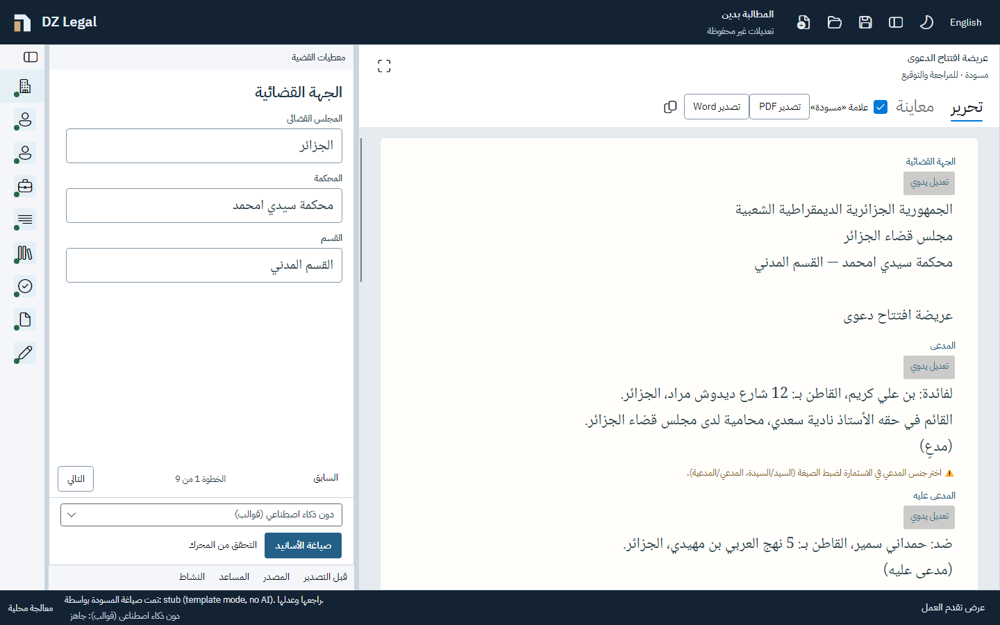
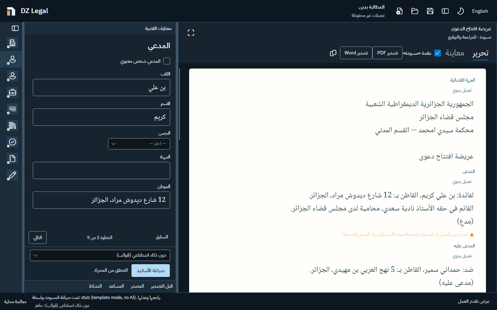

# R3 workbench implementation

Branch: `codex/r3-workbench`, based on `origin/claude/stoic-fermat-mi1gko` at `dfc2e96a08cd3e465741f766acdc92bd8b859c1d` (fetched before branching).

## Progress

1. Workbench shell: implemented. The draft stays on the physical right, with a compact outline below 1500 logical pixels, three preview splitters, persistent layout, four tools, and the existing case commands.
2. Help, typography, contrast and the complete rendering matrix: implemented; proof and remaining physical-device checks are described below.
3. Command palette, separate draft window and web parity: implemented. Final verification and acceptance limits are described below.

The step checkpoints are separate commits. No drafting, legal, storage, document renderer, provider, rule, prompt or corpus files have been changed. Claim confirmation and article selection still call the original commands and setters.

## Capability inventory

| Existing capability | Location in the workbench |
| --- | --- |
| New / Open / Save and save-state text | Title bar; existing Ctrl+N/O/S shortcuts |
| Search and navigation | Title-bar search / Ctrl+K, with all main actions and case sections in Arabic and English |
| Separate live draft | Draft-header detach button / command palette; close or dock returns it to the primary pane |
| Save first / continue / cancel | Persistent replace bar below the title bar |
| Autosave and recovery | Existing timer and close handling; persistent recovery bar |
| Every field, conditional field, choice and boolean | Outline → selected editor section |
| Whole over-long text and its blocking note | Original field binding and note directly below the field; no control MaxLength |
| Previous / next and completion state | Outline icons/status and editor footer |
| Local engine selection and readiness check | Editor footer; model status also in the status bar |
| Analysis and cancellation | Legal grounds editor; existing command and activity view |
| Automatic analysis after Facts | Existing selected-step behavior; background activity notice |
| Claim confirmation / rejection | Original legal grounds cards and commands |
| Article selection, manual search and official text | Grounds editor and Source tool, using the existing article template |
| Journal Officiel reference, provenance and source link | Article card; unavailable text stays visible as text |
| Suggested request/document insertion | Requests / Supporting documents editor sections |
| Request wording suggestion and rejection | Requests editor section; unchanged suggestion-only behavior |
| Drafting and cancellation | Editor footer and existing Ctrl+G shortcut |
| Real activity steps, stream, elapsed time, history estimate and battery note | Activity tool, in-place activity views, status bar estimate/battery |
| Section being written | In the draft next to the section heading |
| Draft editing, manual override, restore from form, undo and redraft confirmation | Draft paper, by section |
| AI authorship and review checkbox | Every AI-written section, always visible |
| Section assistant, shortcuts, streaming, proposal diff and accept/reject/retry | Section Assistant button → Assistant tool |
| Formal completeness and legal checks | Before export tool; original findings/navigation commands |
| Proactive export blockers and blocked-export details | Draft notice/count and Before export tool; refusal opens the tool without focusing it |
| Actual PDF preview pages and watermark | Draft toolbar |
| PDF / Word / copy | Draft toolbar, through the original export guards; Ctrl+P retained |
| Draft evaluation form and save | Before export tool |
| Arabic/English and light/dark | Title bar; existing view model and localization |

All original XAML command names are still bound in the desktop shell or its shared templates. The only added view-model state concerns interface navigation and pane visibility. Layout changes are absent from the case fingerprint.

## Shell design decisions

- An explicitly LTR outer grid fixes the physical pane order. Inner panes follow the interface language. Legal inputs and paper editors remain explicitly RTL.
- Draft maximization changes column widths and visibility and keeps the same controls and section objects.
- All three native GridSplitters use `ShowsPreview=true`, minimum sizes, keyboard increments and double-click reset. Paper reflows on release, rather than at every pointer position.
- The tools strip stays visible when its content is closed. Tool content scrolls in short panels, keeping evaluation and assistant actions reachable.
- Layout JSON lives at `%LOCALAPPDATA%/DzLegalAssistant/settings/workbench-layout.json`, separate from drafts and recovery. It contains only pane widths/height, outline state, tool visibility and last tool. Invalid, oversized or unreadable preferences silently use defaults. Failed preference writes do not change case save status.
- Optional field explanations now use a permanent label and an information control. Hover, keyboard focus and click open the adjacent disclosure; Escape closes it. Required/missing/over-long notes remain separate, permanently visible text.

## Verification at the shell checkpoint

The original baseline passed a Release build with zero warnings and all 665 tests. The shell adds nine cases (674 total), including actual preference failures, keyboard splitter movement, pane geometry in both interface directions, stable editor identity through maximization/theme/language, and export refusal without focus theft.

RenderingTests retain the original assertions for save-first, missing fields, real preview images, analysis, live generation, requests, assistant acceptance and bidi order. Two legitimate structural updates were needed:

- Named controls in the shared DraftWorkspaceView are found through its visual descendants when they are outside the window namescope; window-owned names continue to use FindControl.
- The old assertion that an RTL form sits on the right is replaced by the R3 requirement that the draft sits physically to the right of the form.

No tests were skipped, removed or weakened. Full build/test results are recorded again at each subsequent checkpoint.

## Step 2: polish and proof

IBM Plex Sans Arabic Regular/Medium/SemiBold is bundled with its OFL licence. The document retains the bundled Noto Naskh Arabic. Plex includes the Latin glyphs used by the English interface; the original mixed Arabic/French/digits bidi test still passes.

The former window styles have been replaced with one application token/style set. The paper has fixed ink/annotation colours in both themes; in particular a dark-theme warning can no longer become pale yellow on white paper. All interface body text is at least 14 logical pixels and secondary text at least 12.5. The matrix tests assert the latter on every visible TextBlock. Buttons have an explicit native control template and hover/pressed/focus/disabled states. Transitions are disabled throughout, which also satisfies reduced-motion preference without polling it during generation. No blur or paper shadow is used.

The engine chooser moved into a keyboard-accessible flyout in the editor footer. The editor heading and previous/next actions share one row; step position moved to the status bar. Narrative boxes fit the available editor height in complete text lines. A geometry assertion specifically checks that the Facts box fits its viewport with tools open. Model readiness stays permanently in the status bar. Each splitter resets only its own dimension. Assistant proposals scroll into view after arrival without moving focus.

[Open the offline screenshot gallery](images/r3/index.html). It contains 256 losslessly compressed PNGs: 16 states × 2 client sizes × 2 render scales × 2 languages × 2 themes. States include empty, filled, analysis running/completed, generation, blockers, review, refused/completed export, unsaved work, recovery, errors, unavailable model, template mode, source and assistant. They use the fictitious first drafting-case fixture and controlled providers for deterministic streaming states. Export-done completes the template's legal-ground placeholder with that fixture's original notes, as a lawyer editing the section, before invoking the real PDF and Word exporters.

Every frame was inspected in contact sheets; the smallest Facts, blocked-export and drafting frames were also inspected at full size. The captures use Avalonia Headless with actual Skia drawing and SetRenderScaling(1/1.25), not scaled browser mockups. They certify client-layout geometry at those scales, not a physical multi-monitor Windows DPI transition.

The added matrix cases assert pane geometry, legal RTL, minimum type sizes, real streaming/writing state, permanent safety bars, actual export bytes and the unchanged export refusal. HelpTests exercises focus, hover, click and Escape. The engine-flyout test exercises focus, keyboard selection and dismissal. The existing screenshot helper now uses the supported PNG encoder overload, removing its old obsolete-API warning suppression.

Step 2 checkpoint: full Release build **0 warnings / 0 errors**; full suite **692 passed, 0 failed, 0 skipped** (App 137; Web 24; Drafting 369; FormEngine 67; Documents 6; Law 86; Storage 3).

### Measured contrast

The [complete 84-pair contrast table](R3-CONTRAST.md) is computed from the committed sRGB tokens using WCAG relative luminance. Text pairs have a minimum of **4.89:1**; interactive edges/focus colours have a minimum of **3.32:1**. HairlineBrush is decorative; interactive edges use ControlBorderBrush. Paper/diff annotations are measured separately from the surrounding dark chrome. Native platform popups and operating-system adorners have not all been pixel-sampled.

### Native Windows review and limits

The actual native executable was launched with an isolated fictitious profile, through DZLEGAL_REVIEW_HOME, and a separate review copy of the binary. The ordinary profile remains the default when that variable is absent. The real engine picker, language switch, recovery offer, layout JSON, outline navigation and Arabic text entry were exercised with Windows accessibility and keyboard input. Ollama reported gemma3:4b installed and ready; local warm-up and drafting commands were exercised on the review profile.

**The complete physical-app keyboard-only and mouse-only empty-case → PDF/Word runs are not certified.** The external Windows automation initially mishandled Unicode/control modifiers, and its foreground-target guard subsequently stopped runs when another application held focus. Review scripts were corrected rather than changing application/legal behavior to accommodate them. The full fictitious-case exports and refusal paths are verified in the native-layout integration tests, with in-memory file pickers. That is useful evidence, but it does not replace exercising both physical Windows save dialogs. A full gemma3:4b case run, every physical splitter drag limit, and the full physical DPI matrix remain manual acceptance checks.

Autosave/recovery behavior is exercised by the original safety tests and by all 16 matrix recovery configurations. Layout failure/round-trip and keyboard sizing are covered separately. No claim of testing a second 8 GB machine, a screen reader, or graphics drivers is made.

## Step 3: command palette, separate draft and browser workbench

Ctrl+K and the title-bar search open a native owned command palette. It filters Arabic or English labels, ranks exact section matches before actions that contain the same word, supports arrows / Enter / Escape, and delegates to the existing commands. It includes case files, analysis/drafting/cancellation, export/copy, preview/edit, appearance, pane controls, tools, all nine case groups, section override/restore/undo/redraft/assistant, and the relevant proposal/confirmation/recovery actions. It adds no legal decisions or confirmation rules.

The draft header can open an owned window with the shared DraftWorkspaceView template, bound to the **same MainWindowViewModel and SectionViewModels**. The primary view stays mounted, hidden, preserving its editor instances and scroll/caret state. A second presentation observes those objects live; it is not a second draft or a second case. This deliberately avoids moving a live Avalonia visual between two layout managers, which failed during development. Closing the window or choosing Dock returns to the original pane. PDF, Word, copy and Ctrl+P use the original guard; repeated blocked export also reopens the review tools. Closing the main window closes its palette and draft window before the existing autosave/disposal path.

Chrome case/save text is intentionally limited to one line with an ellipsis and a full tooltip when space is short. The complete value remains in its editor. The command search uses the same disclosure of its full label. The command palette list uses the workbench surface rather than Fluent's default grey background.

The browser demo now has the same fixed physical pane order, compact/expanded outline icons, three resizers, four lower tools, permanent status, draft focus, quiet help and Ctrl+K palette. Dragging draws a preview line; widths change on release. Arrow keys resize and double-click resets. Layout-only preferences live in **dzlegal.workbench.layout** in browser localStorage, separate from the existing **dzlegal.case** recovery envelope. Null, malformed or out-of-range layout data falls back to defaults. The palette traps Tab, restores the previous focus on Escape, and is centered physically in both interface directions.

Existing sample selection and the guide remain in the Samples menu; the guide starts closed. New/Open/Save, browser downloads, clipboard, replace confirmation, storage recovery, source cards and preview pages retain their existing services. At phone width, Case/Draft/Checks tabs remain available; Checks contains the four tools, and opening the section assistant or refusing export brings those tools into view. Browser fields keep the pre-existing three-times field-length transport ceiling and the existing over-length note/guard; desktop inputs retain full over-long values without a control MaxLength. Both are explicitly legal RTL.

The native app retains Arabic as its default. The demo retains its pre-existing English opening language for judges; `?lang=ar` or the language switch selects Arabic. This is an intentional difference between the two launch experiences.

The web UI uses bundled Plex/Naskh and the desktop palette. Superseded green/purple palette definitions and sub-12.5px type declarations were removed. Narrative fields fit complete text lines. No CDNs, dependencies on a hosted UI library, animations, blur or heavy shadows were added. Program.cs, /healthz, model gates and server configuration are unchanged. This branch has not been deployed to Render.

### Final verification

Release build: **0 warnings / 0 errors**. Full suite: **697 passed, 0 failed, 0 skipped** (App 142; Web 24; Drafting 369; FormEngine 67; Documents 6; Law 86; Storage 3). The five added PowerFeaturesTests cover palette navigation and real export refusal in all language/theme combinations, shared live draft state, preservation of primary editors, guarded exports from the floating window, repeated refusal, and docking. Existing tests were not skipped or weakened.

The native [offline gallery](images/r3/index.html) was regenerated from the final workbench test run and reviewed in all 16 state contact sheets. [Power-feature captures](images/r3/power/index.html) show both palettes/themes and the separate draft. These use actual Avalonia rendering, not a browser reconstruction of the desktop.

The independent [browser review script](../tests/DzLegal.Web.Tests/Browser/workbench-review.cjs) runs against a local demo with hosted API-key variables empty. It exercises 16 size/scale/language/theme configurations, actual PDF and Word downloads, unreviewed-AI export refusal, exact section search, focus restoration, help focus/hover/pinning/Escape, preview-only dragging, keyboard sizing/reset of all resizers, preference restoration, save-first, an empty case and invalid preference fallback. A further four 390px phone configurations check all three mobile tabs. The browser audit of the exported state found **zero axe WCAG A/AA findings in each of the 16 configurations**; this is not a screen-reader certification or an audit of every possible content state. The reviewed states made no external HTTP requests and raised no browser page errors. Both GET and HEAD /healthz returned 200.

[Browser screenshots](images/r3/web/index.html) and [recorded observations](R3-BROWSER-REVIEW.json) are included. Browser 125% uses a reduced CSS viewport and device scale factor, not a physical Windows monitor. The normal hosted demo still requires its existing server connection; the no-CDN guarantee does not turn Blazor Server into an offline web application.

To reproduce the browser run, install/use Playwright and Chromium in your test environment, set PLAYWRIGHT_MODULE and CHROMIUM_PATH to their existing locations (and AXE_PATH for the audit), start the local Web project, then run `node tests/DzLegal.Web.Tests/Browser/workbench-review.cjs`. Output defaults to the ignored redteam-output/r3-web-qa folder. Only fictitious values from the first drafting-case fixture are used. [Asset licences and provenance](R3-ASSET-LICENSES.md) are recorded separately.

## Outstanding verification

The physical checks listed above remain. Smooth operation on a separate 8 GB laptop and a hardware graphics/scaling matrix cannot be inferred from headless rendering. The existing section-assistant send command does not itself apply the over-long-field refusal used by the other AI commands; legal/command behavior has been preserved within the requested scope, so this pre-existing discrepancy is recorded rather than changed here.

The browser New-case review also exposed a pre-existing view-model ordering issue: after exporting a draft that cites articles, New clears the form and narrative but can leave the previous narrative's article-review hints visible until the next refresh. StartNew calls OnInputChanged (and its review-hint calculation) before SyncSections replaces the narrative text. Neither method was modified on this branch. The `empty` browser frames deliberately retain this observation. Correcting those review calculations is outside the permitted interface-state-only changes and needs a separate behavior fix; the stale warning has not been hidden by the new UI.
