# Visual spot-check: CPCA (delivery 2)

20 current versions drawn at random (seed 20261027) from `data/law/corpus/cpca/articles.json`, each beside the official printed article cropped from the hashed evidence column crops (the region OCR located, with a margin). For a version amended by Law 22-13 in part, both the 2008 page (kept paragraphs) and the 2022 page are shown.

Inspected by: Claude (AI) visual reading of the official page images; not a lawyer or human verification.

## Article 53 — `cpca:53@law-08-09` — checked

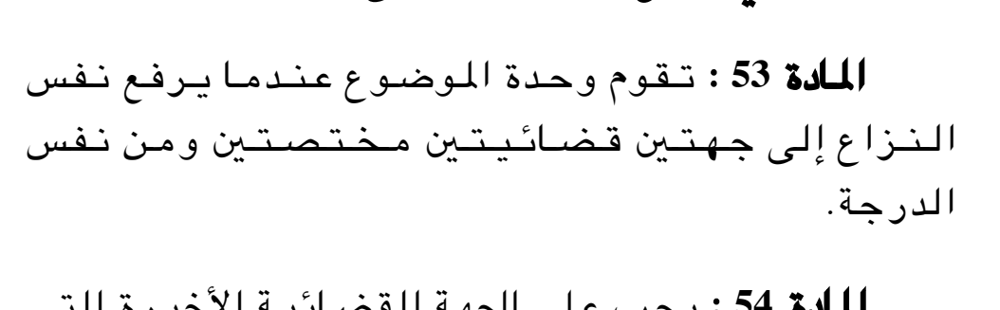

Cut from crop `a2008021-008-left` (SHA-256 `cabdfdcb56ec36cf779f6d22397edcc9453fb089d221fdba87993bb01bcfa194`); this image SHA-256 `5b808d9b8a3ed4843afd3871589c729f53dbb2e0a4a52af24acf54de7c8f53ab`.

Canonical text:

> تقوم وحدة الموضوع عندما يرفع نفس النزاع إلى جهتين قضائيتين مختصتين ومن نفس الدرجة.

Inspection: 28 Oct 2026, Claude (AI) visual reading: every word, digit and negation of the canonical text matches the printed article; paragraph breaks match.

## Article 57 — `cpca:57@law-08-09` — checked

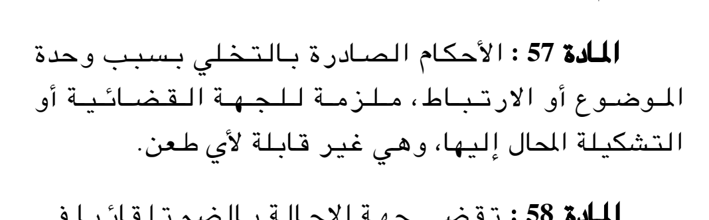

Cut from crop `a2008021-009-right` (SHA-256 `830e7b316e2a7e239009d4d7ba899cc0fbba0be6d188d0234d7c688ff84ac799`); this image SHA-256 `2646fc5b4a0e75298e60a19b9f1ae307977965b3a534af6e15c1265387b17ce9`.

Canonical text:

> الأحكام الصادرة بالتخلي بسبب وحدة الموضوع أو الارتباط، ملزمة للجهة القضائية أو التشكيلة المحال إليها، وهي غير قابلة لأي طعن.

Inspection: 28 Oct 2026, Claude (AI) visual reading: every word, digit and negation of the canonical text matches the printed article; paragraph breaks match.

## Article 84 — `cpca:84@law-08-09` — checked

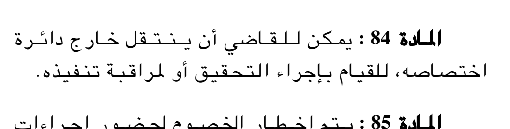

Cut from crop `a2008021-010-left` (SHA-256 `f1ff2a63dd6a3fb5f50575e654cb6510eb7ba0bc8071e2b4523d3cefd7abb137`); this image SHA-256 `754a663915afc97d0640502feb28f6a5f62523654e97f7c235cdcaf6d6db853c`.

Canonical text:

> يمكن للقاضي أن ينتقل خارج دائرة اختصاصه، للقيام بإجراء التحقيق أو لمراقبة تنفيذه.

Inspection: 28 Oct 2026, Claude (AI) visual reading: every word, digit and negation of the canonical text matches the printed article; paragraph breaks match.

## Article 103 — `cpca:103@law-08-09` — checked

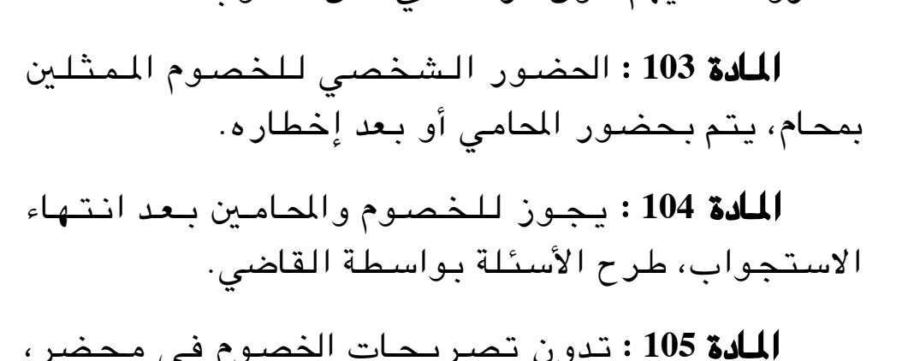

Cut from crop `a2008021-011-left` (SHA-256 `bc9b244fbe469e9be77bf152b522ac7bd30d3b6c9fc3a6f5e0441caed9a67162`); this image SHA-256 `1dc39081051a3e2efcef5167ec4ba00f4492afc9dbeceae5221ff16cce5dc73c`.

Canonical text:

> الحضور الشخصي للخصوم الممثلين بمحام، يتم بحضور المحامي أو بعد إخطاره.

Inspection: 28 Oct 2026, Claude (AI) visual reading: every word, digit and negation of the canonical text matches the printed article; paragraph breaks match.

## Article 161 — `cpca:161@law-08-09` — checked

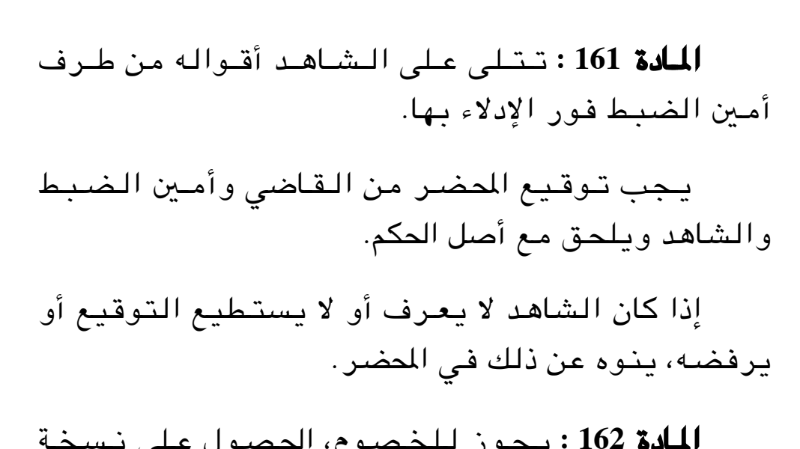

Cut from crop `a2008021-016-right` (SHA-256 `99318c06f277b2e45c50145ab18f448627f7952eb7c1c37f80b3c897d36628b2`); this image SHA-256 `ab57cfc73e13f9aedf8a2021a62c1f273891edeb25edcd279fc4f37e451fd7f1`.

Canonical text:

> تتلى على الشاهد أقواله من طرف أمين الضبط فور الإدلاء بها.
>
> يجب توقيع المحضر من القاضي وأمين الضبط والشاهد ويلحق مع أصل الحكم.
>
> إذا كان الشاهد لا يعرف أو لا يستطيع التوقيع أو يرفضه، ينوه عن ذلك في المحضر.

Inspection: 28 Oct 2026, Claude (AI) visual reading: every word, digit and negation of the canonical text matches the printed article; paragraph breaks match.

## Article 208 — `cpca:208@law-08-09` — checked

Cut from crop `a2008021-019-right` (SHA-256 `1a8ede5dafa80110eb279520bdf7392d578eaa637f23cbb6bee90f40b9bf4ad4`); this image SHA-256 `eb85fce2a820b2f9fa94a13fd840761da434d586dfbd33e9caa14ab8474cccf1`.

Canonical text:

> يمكن للقاضي، ولحسن سير العدالة، أن يأمر بفصل الخصومة إلى خصومتين أو أكثر.

Inspection: 28 Oct 2026, Claude (AI) visual reading: every word, digit and negation of the canonical text matches the printed article; paragraph breaks match.

## Article 266 — `cpca:266@law-08-09` — checked

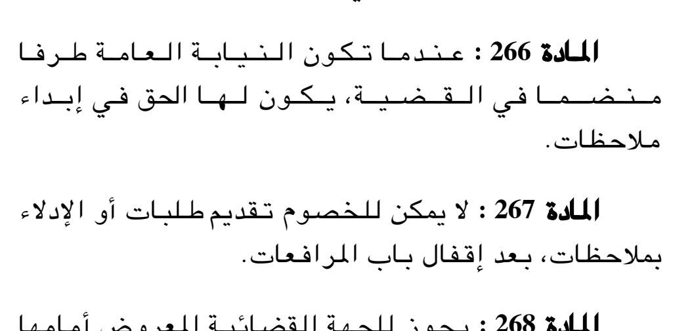

Cut from crop `a2008021-023-left` (SHA-256 `1113d0e3741e548184fa43a6f1122b542e2270ce99465be0fe7d78b6b49511bb`); this image SHA-256 `94db57da349ef693b8bbe63764bb1e5232a782b3909067547ceb0e0f40e3e4be`.

Canonical text:

> عندما تكون النيابة العامة طرفا منضما في القضية، يكون لها الحق في إبداء ملاحظات.

Inspection: 28 Oct 2026, Claude (AI) visual reading: every word, digit and negation of the canonical text matches the printed article; paragraph breaks match.

## Article 314 — `cpca:314@law-08-09` — checked

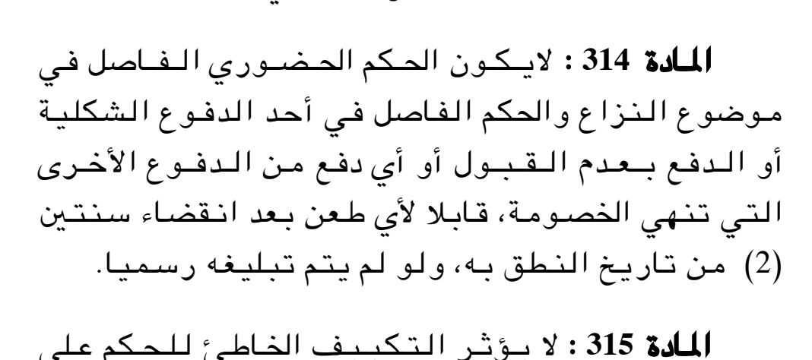

Cut from crop `a2008021-027-right` (SHA-256 `e79d9912db60b0b73ba2c53afa363ed708961d93969474de8c473c7004153497`); this image SHA-256 `cda692150afa03a060028834341b00def3a5daa85763528bf1280f9e8c6ec656`.

Canonical text:

> لايكون الحكم الحضوري الفاصل في موضوع النزاع والحكم الفاصل في أحد الدفوع الشكلية أو الدفع بعدم القبول أو أي دفع من الدفوع الأخرى التي تنهي الخصومة، قابلا لأي طعن بعد انقضاء سنتين (2) من تاريخ النطق به، ولو لم يتم تبليغه رسميا.

Inspection: 28 Oct 2026, Claude (AI) visual reading: every word, digit and negation of the canonical text matches the printed article; paragraph breaks match.

## Article 385 — `cpca:385@law-08-09` — checked

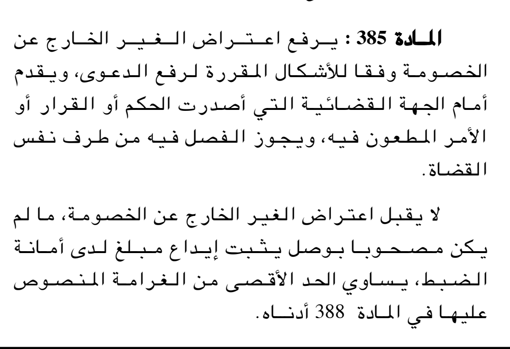

Cut from crop `a2008021-032-left` (SHA-256 `728dfe11cb2a1a2f29dfe32a61c8d112d72746196994b6cf62912aafbd1ed0fb`); this image SHA-256 `e862ede196ef98788681aed938f3a2cf343d6ad883e19974ca88a6b90d31ec65`.

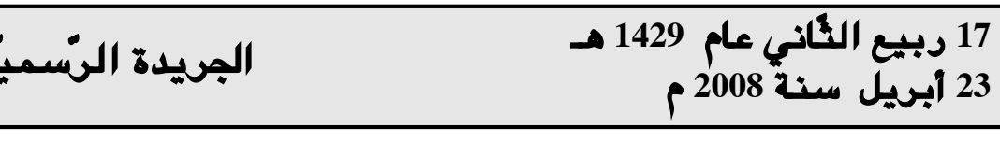

Cut from crop `a2008021-033-right` (SHA-256 `8967e70b9efeccef321d3afbf6bb0f4e9658c630cf6e9248dfd9c1afffd4df4b`); this image SHA-256 `d4958d1531e2756c408630bcb6edd5e79598d75b5fd79c369e697cb26d4fe077`.

Canonical text:

> يرفع اعتراض الغير الخارج عن الخصومة وفقا للأشكال المقررة لرفع الدعوى، ويقدم أمام الجهة القضائية التي أصدرت الحكم أو القرار أو الأمر المطعون فيه، ويجوز الفصل فيه من طرف نفس القضاة.
>
> لا يقبل اعتراض الغير الخارج عن الخصومة، ما لم يكن مصحوبا بوصل يثبت إيداع مبلغ لدى أمانة الضبط، يساوي الحد الأقصى من الغرامة المنصوص عليها في المادة 388 أدناه.

Inspection: 28 Oct 2026, Claude (AI) visual reading: every word, digit and negation of the canonical text matches the printed article; paragraph breaks match.

## Article 391 — `cpca:391@law-08-09` — checked

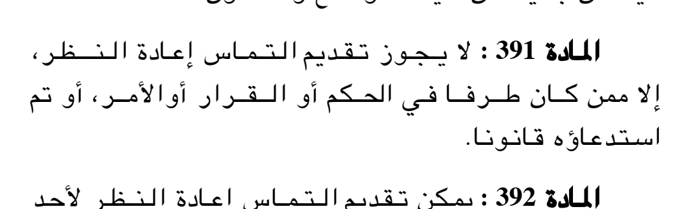

Cut from crop `a2008021-033-right` (SHA-256 `8967e70b9efeccef321d3afbf6bb0f4e9658c630cf6e9248dfd9c1afffd4df4b`); this image SHA-256 `81f99973311a855c1c7cfb283310b90ba7b10079f2f5cff9c32b1e4e32a5840b`.

Canonical text:

> لا يجوز تقديم التماس إعادة النظر، إلا ممن كان طرفا في الحكم أو القرار أو الأمر، أو تم استدعاؤه قانونا.

Inspection: 28 Oct 2026, Claude (AI) visual reading: every word, digit and negation of the canonical text matches the printed article; paragraph breaks match.

## Article 425 — `cpca:425@law-08-09` — checked

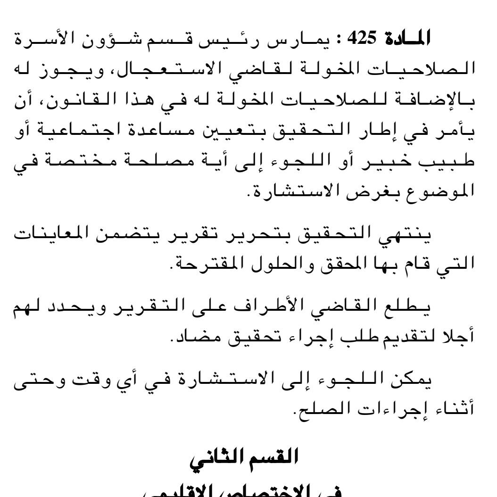

Cut from crop `a2008021-036-left` (SHA-256 `a03c53f3cb06058f176fc84ee21fff6966845fc0151798fa45deaa652e4d3df8`); this image SHA-256 `007dbc1e502508883877ef25f88dbd8b56af08e66d50eefcc510eabb0bba1a6c`.

Canonical text:

> يمارس رئيس قسم شؤون الأسرة الصلاحيات المخولة لقاضي الاستعجال، ويجوز له بالإضافة للصلاحيات المخولة له في هذا القانون، أن يأمر في إطار التحقيق بتعيين مساعدة اجتماعية أو طبيب خبير أو اللجوء إلى أية مصلحة مختصة في الموضوع بغرض الاستشارة.
>
> ينتهي التحقيق بتحرير تقرير يتضمن المعاينات التي قام بها المحقق والحلول المقترحة.
>
> يطلع القاضي الأطراف على التقرير ويحدد لهم أجلا لتقديم طلب إجراء تحقيق مضاد.
>
> يمكن اللجوء إلى الاستشارة في أي وقت وحتى أثناء إجراءات الصلح.

Inspection: 28 Oct 2026, Claude (AI) visual reading: every word, digit and negation of the canonical text matches the printed article; paragraph breaks match.

## Article 466 — `cpca:466@law-08-09` — checked

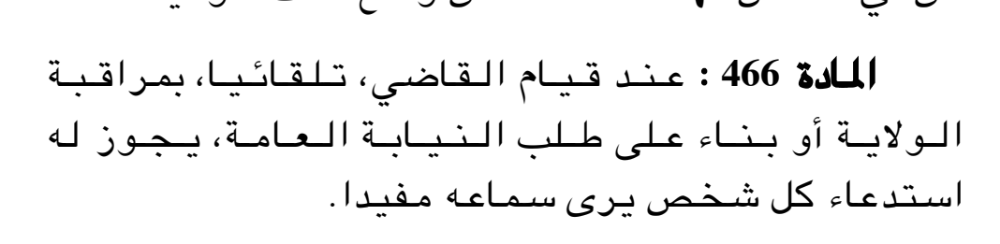

Cut from crop `a2008021-039-right` (SHA-256 `b08927de24de66f641f5753e8d6e2b9418bc8cfe9924986f098b90979a1bc431`); this image SHA-256 `782c7d29dcac867c1067744502aaa3cb25c70dfc5969e26ddde90b59afb566f0`.

Cut from crop `a2008021-039-left` (SHA-256 `2bd5554e7b29c3f5515955b1e9d70465dfe256366621081ebd361705d17fa7f8`); this image SHA-256 `365fa16ff68a00a6ae3077fd32c6770a2610686888951c844b1a8a330e957c22`.

Canonical text:

> عند قيام القاضي، تلقائيا، بمراقبة الولاية أو بناء على طلب النيابة العامة، يجوز له استدعاء كل شخص يرى سماعه مفيدا.
>
> وفي الحالات الأخرى، يكون التكليف بالحضور على عاتق المدعي.

Inspection: 28 Oct 2026, Claude (AI) visual reading: every word, digit and negation of the canonical text matches the printed article; paragraph breaks match.

## Article 477 — `cpca:477@law-08-09` — checked

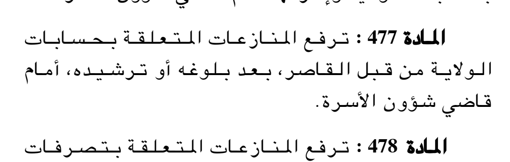

Cut from crop `a2008021-040-right` (SHA-256 `421f216eb5b42fff96d9c2a82612e6d5b63a1514fea5b0e2bebf4aefa5b79cff`); this image SHA-256 `e40316020c91d38f9596ebea73189d46c7131ced40f9fc8a10f49b5b93f6f14e`.

Canonical text:

> ترفع المنازعات المتعلقة بحسابات الولاية من قبل القاصر، بعد بلوغه أو ترشيده، أمام قاضي شؤون الأسرة.

Inspection: 28 Oct 2026, Claude (AI) visual reading: every word, digit and negation of the canonical text matches the printed article; paragraph breaks match. The final full stop after «الأسرة» was inserted from the print in the review (the Ministry HTML lacks it).

## Article 524 — `cpca:524@law-08-09` — checked

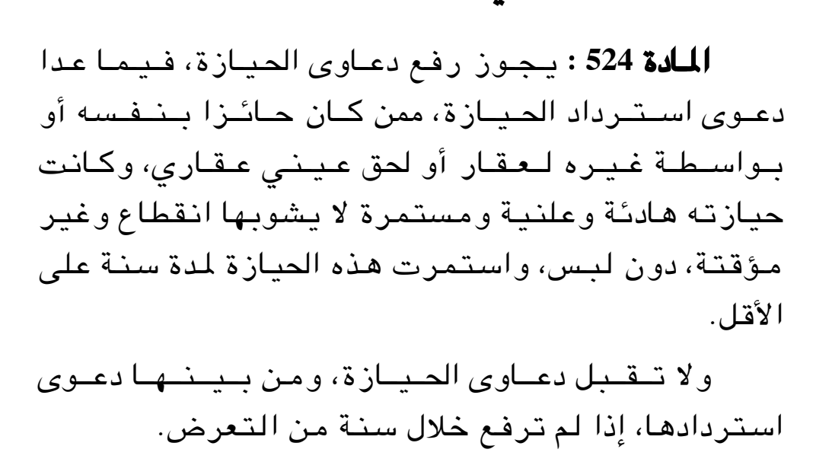

Cut from crop `a2008021-043-right` (SHA-256 `640689f0e063fe0da4fb87af19fbb40f872d7101ccbd6cc747ecb8c176a308f8`); this image SHA-256 `1b2ec78283942515c2d38226e1d4b93661e63f23182bea053ee9b7d182bffa40`.

Canonical text:

> يجوز رفع دعاوى الحيازة، فيما عدا دعوى استرداد الحيازة، ممن كان حائزا بنفسه أو بواسطة غيره لعقار أو لحق عيني عقاري، وكانت حيازته هادئة وعلنية ومستمرة لا يشوبها انقطاع وغير مؤقتة، دون لبس، واستمرت هذه الحيازة لمدة سنة على الأقل.
>
> ولا تقبل دعاوى الحيازة، ومن بينها دعوى استردادها، إذا لم ترفع خلال سنة من التعرض.

Inspection: 28 Oct 2026, Claude (AI) visual reading: every word, digit and negation of the canonical text matches the printed article; paragraph breaks match.

## Article 829 — `cpca:829@law-08-09` — checked

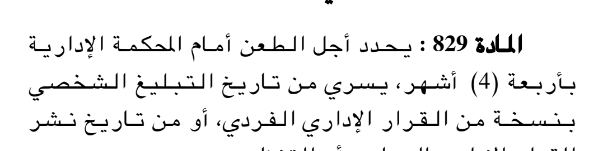

Cut from crop `a2008021-078-right` (SHA-256 `583159bf5c39b446ae514ce48a1eb3eab8d5d06a3b2a2d9603f17ad4029d3de2`); this image SHA-256 `a8ded10d3c62ac551e66734b600b5342ffc4b7d485f590e0479a153ca137fb46`.

Canonical text:

> يحدد أجل الطعن أمام المحكمة الإدارية بأربعة (4) أشهر، يسري من تاريخ التبليغ الشخصي بنسخة من القرار الإداري الفردي، أو من تاريخ نشر القرار الإداري الجماعي أو التنظيمي.

Inspection: 28 Oct 2026, Claude (AI) visual reading: the crop shown cuts off the last printed line («القرار الإداري الجماعي أو التنظيمي.»); every word, digit and negation visible matches the canonical text. The last line was confirmed by the OCR comparison, not by this inspection.

## Article 855 — `cpca:855@law-08-09` — checked

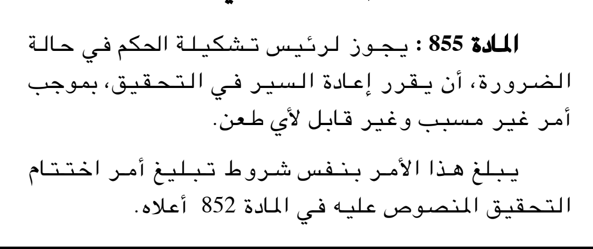

Cut from crop `a2008021-080-right` (SHA-256 `6904cbea59504e155e5a61001a4e64c7692759560c4a2fa4d39df710820fd992`); this image SHA-256 `3a2656b18c824eb4481de67dc7a196ec673b2e18e0626c05d790dc17c71789d6`.

Canonical text:

> يجوز لرئيس تشكيلة الحكم في حالة الضرورة، أن يقرر إعادة السير في التحقيق، بموجب أمر غير مسبب وغير قابل لأي طعن.
>
> يبلغ هذا الأمر بنفس شروط تبليغ أمر اختتام التحقيق المنصوص عليه في المادة 852 أعلاه.

Inspection: 28 Oct 2026, Claude (AI) visual reading: every word, digit and negation of the canonical text matches the printed article; paragraph breaks match.

## Article 858 — `cpca:858@law-08-09` — checked

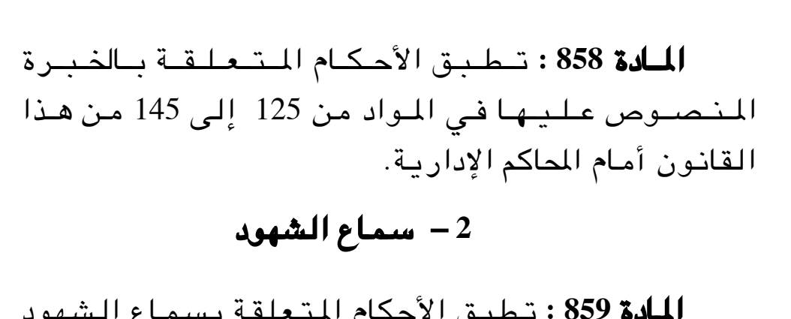

Cut from crop `a2008021-080-left` (SHA-256 `de158b0813606b81df446d61d8a887b40724db0857df1097bf63d4d784a2a825`); this image SHA-256 `953c35c09186d31ade3e9531f5a92fc26c5f7913bc6c6abaa7f1a46d76d280ae`.

Canonical text:

> تطبق الأحكام المتعلقة بالخبرة المنصوص عليها في المواد من 125 إلى 145 من هذا القانون أمام المحاكم الإدارية.

Inspection: 28 Oct 2026, Claude (AI) visual reading: every word, digit and negation of the canonical text matches the printed article; paragraph breaks match.

## Article 881 — `cpca:881@law-08-09` — checked

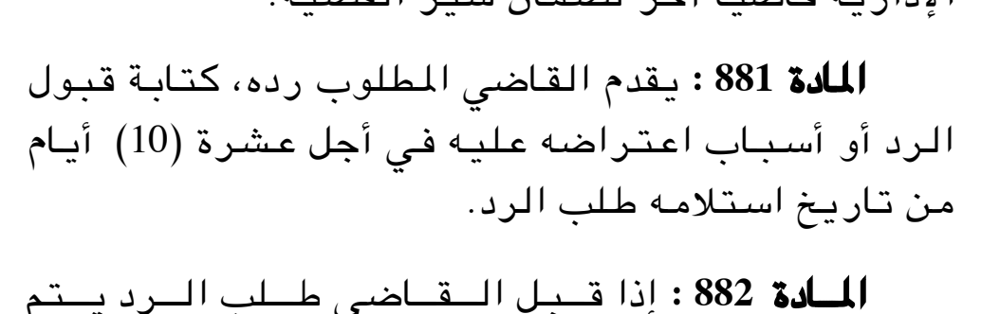

Cut from crop `a2008021-081-left` (SHA-256 `5510f4dc76f938c482cda39a8c6af655f76517458cde4a62181b6b137a0e7c00`); this image SHA-256 `75a8b24aafe722824460b5f4da4b3a04c71b0a18451fc04b860df5d50ae3af1a`.

Canonical text:

> يقدم القاضي المطلوب رده، كتابة قبول الرد أو أسباب اعتراضه عليه في أجل عشرة (10) أيام من تاريخ استلامه طلب الرد.

Inspection: 28 Oct 2026, Claude (AI) visual reading: every word, digit and negation of the canonical text matches the printed article; paragraph breaks match.

## Article 996 — `cpca:996@law-08-09` — checked

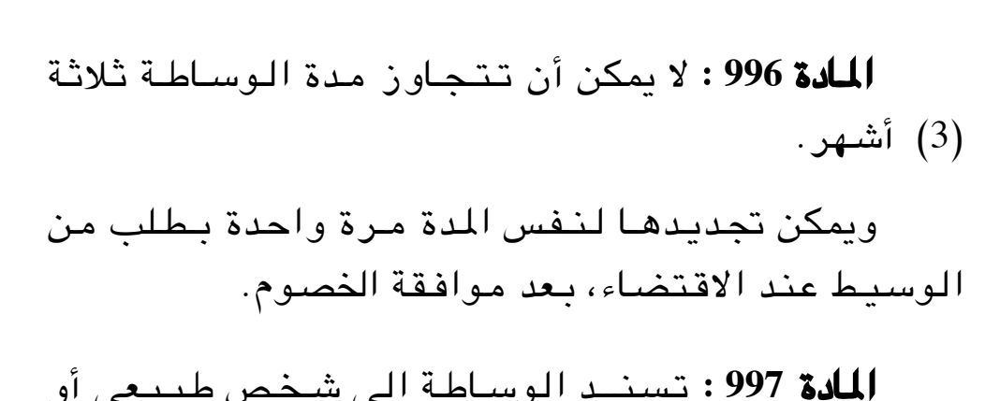

Cut from crop `a2008021-090-right` (SHA-256 `dbcca9990cd5072ec9bcfe9ea512966a9a7a6f9322e569ae92584e5e41688c70`); this image SHA-256 `4e752df5bde7225a4acfd05fd2e208f2a622c6ddafb9dad74d50c98ab2f7e5f7`.

Canonical text:

> لا يمكن أن تتجاوز مدة الوساطة ثلاثة (3) أشهر.
>
> ويمكن تجديدها لنفس المدة مرة واحدة بطلب من الوسيط عند الاقتضاء، بعد موافقة الخصوم.

Inspection: 28 Oct 2026, Claude (AI) visual reading: every word, digit and negation of the canonical text matches the printed article; paragraph breaks match.

## Article 1001 — `cpca:1001@law-08-09` — checked

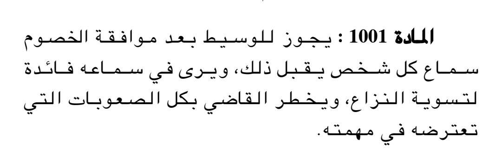

Cut from crop `a2008021-090-right` (SHA-256 `dbcca9990cd5072ec9bcfe9ea512966a9a7a6f9322e569ae92584e5e41688c70`); this image SHA-256 `c9c7005dfe0d29b712ef92f78988379c140fb3dca727cf784c16ad357ef16efa`.

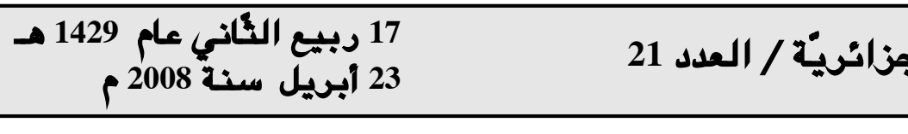

Cut from crop `a2008021-090-left` (SHA-256 `0f42e1fb771010b12a69217c50e3909adee3675d8627731d9a9e6451f432ce73`); this image SHA-256 `dffa0a6c16012ddf6be839d7a132334425083c42d588151ff813f6676ac18198`.

Canonical text:

> يجوز للوسيط بعد موافقة الخصوم سماع كل شخص يقبل ذلك، ويرى في سماعه فائدة لتسوية النزاع، ويخطر القاضي بكل الصعوبات التي تعترضه في مهمته.

Inspection: 28 Oct 2026, Claude (AI) visual reading: every word, digit and negation of the canonical text matches the printed article; paragraph breaks match.
