# Family current-candidate visual sample

20 articles drawn without replacement from 232 identities, seed `20261028`. [Open the side-by-side comparison](comparison.html). Source crops are included beside this file.

All ten generated review sheets were actually read by Codex (AI) on 28 October 2026. The 20 sampled bodies' words, figures, negation and paragraphing match their identified source. This is not human/lawyer verification or a claim of whole-code completion.

15 unchanged bodies use the current Ministry print; five amended bodies use the amending JO. The known art. 178 continuation is included. Source selection and printed-vocalization limits are in `inspection.json`; the other Family QA remains open.

The sample was retained after the guarded correction to unsampled article 42: all 20 selected texts and paragraphs replay unchanged. The population update and prior selection hash remain recorded. The Ministry-source readings of sampled articles 135, 151 and 203 do not settle their separately recorded original-JO edition conflicts; those candidates are now explicitly unsettled.

## Article 151

Source: `family-consolidated-bilingual`. All body words, figures and Arabic paragraph breaks match the identified official source; surrounding labels/headings are outside the body.

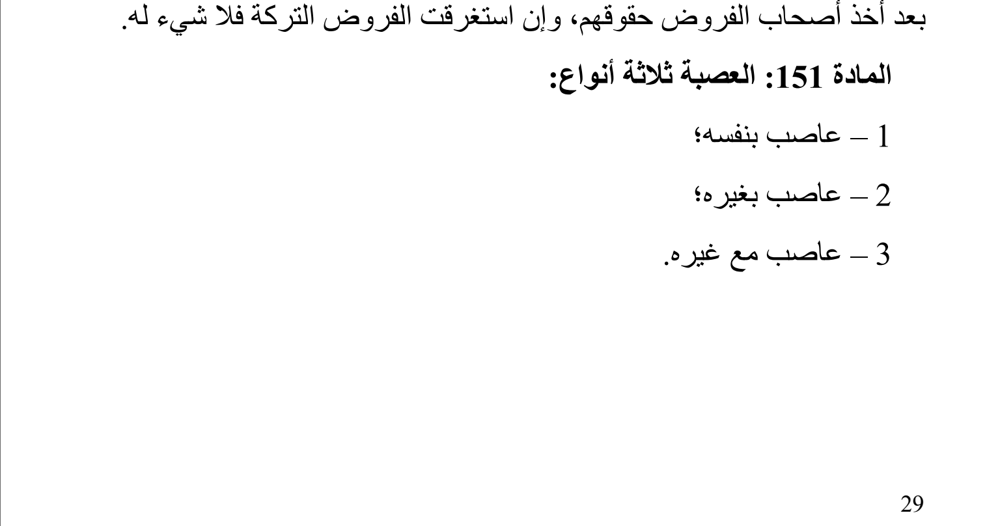

> العصبة ثلاثة أنواع:
>
> 1 – عاصب بنفسه؛
>
> 2 – عاصب بغيره؛
>
> 3 – عاصب مع غيره.

## Article 135

Source: `family-consolidated-bilingual`. All body words, figures and Arabic paragraph breaks match the identified official source; surrounding labels/headings are outside the body.

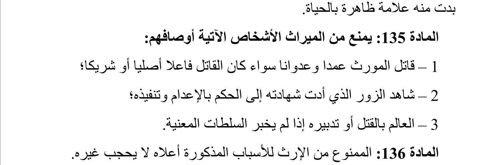

> يمنع من الميراث الأشخاص الآتية أوصافهم:
>
> 1 – قاتل المورث عمدا وعدوانا سواء كان القاتل فاعلا أصليا أو شريكا؛
>
> 2 – شاهد الزور الذي أدت شهادته إلى الحكم بالإعدام وتنفيذه؛
>
> 3 – العالم بالقتل أو تدبيره إذا لم يخبر السلطات المعنية.

## Article 169

Source: `family-consolidated-bilingual`. All body words, figures and Arabic paragraph breaks match the identified official source; surrounding labels/headings are outside the body.

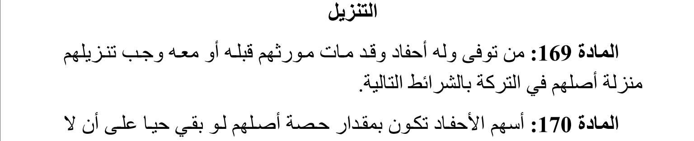

> من توفى وله أحفاد وقد مات مورثهم قبله أو معه وجب تنزيلهم منزلة أصلهم في التركة بالشرائط التالية.

## Article 178

Source: `family-consolidated-bilingual`. The final distribution line on PDF37 continues the paragraph on PDF36; joined candidate confirmed.

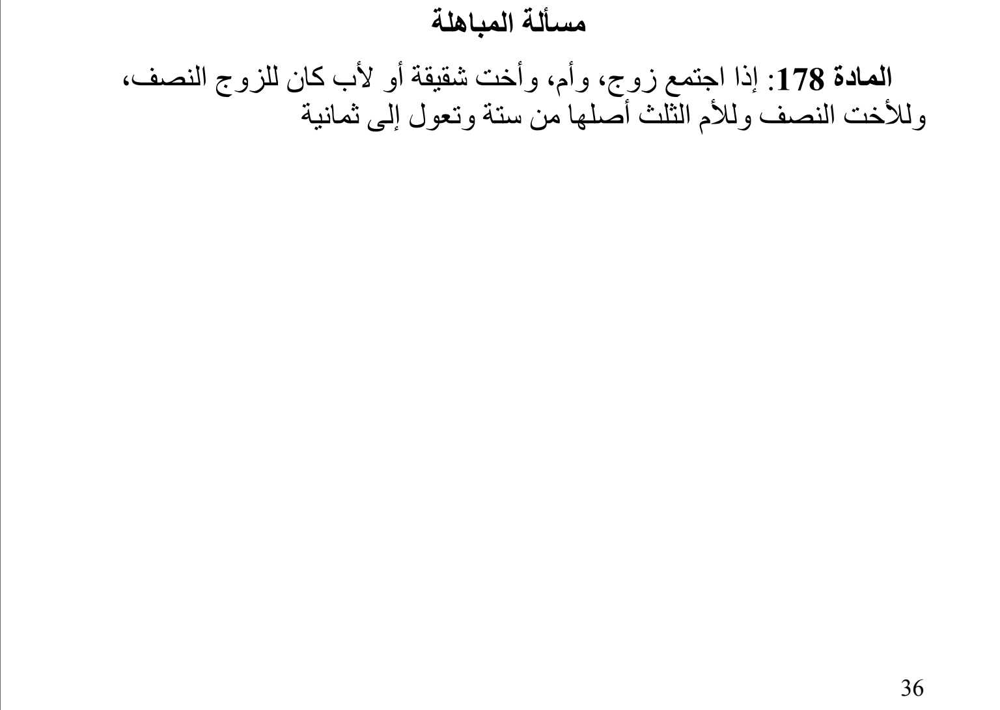

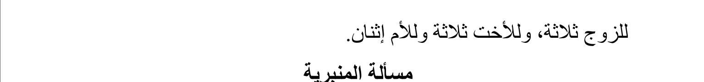

> إذا اجتمع زوج، وأم، وأخت شقيقة أو لأب كان للزوج النصف، وللأخت النصف وللأم الثلث أصلها من ستة وتعول إلى ثمانية للزوج ثلاثة، وللأخت ثلاثة وللأم إثنان.

## Article 142

Source: `family-consolidated-bilingual`. All body words, figures and Arabic paragraph breaks match the identified official source; surrounding labels/headings are outside the body.

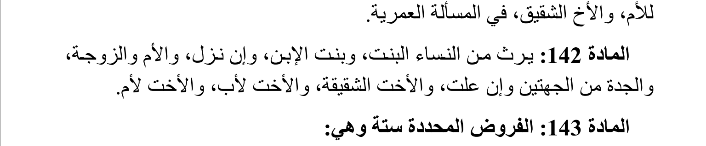

> يرث من النساء البنت، وبنت الإبن، وإن نزل، والأم والزوجة، والجدة من الجهتين وإن علت، والأخت الشقيقة، والأخت لأب، والأخت لأم.

## Article 8 مكرر 1

Source: `A2005015`. All body words, figures and Arabic paragraph breaks match the identified official source; surrounding labels/headings are outside the body.

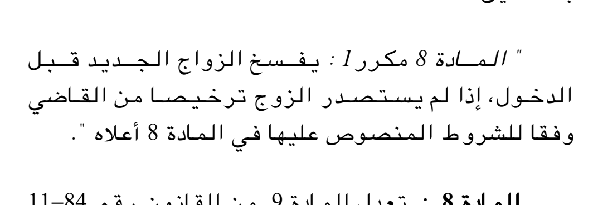

> يفسخ الزواج الجديد قبل الدخول، إذا لم يستصدر الزوج ترخيصا من القاضي وفقا للشروط المنصوص عليها في المادة 8 أعلاه.

## Article 141

Source: `family-consolidated-bilingual`. All body words, figures and Arabic paragraph breaks match the identified official source; surrounding labels/headings are outside the body.

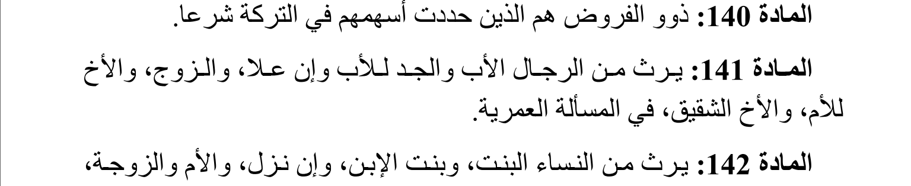

> يرث من الرجال الأب والجد للأب وإن علا، والزوج، والأخ للأم، والأخ الشقيق، في المسألة العمرية.

## Article 168

Source: `family-consolidated-bilingual`. All body words, figures and Arabic paragraph breaks match the identified official source; surrounding labels/headings are outside the body.

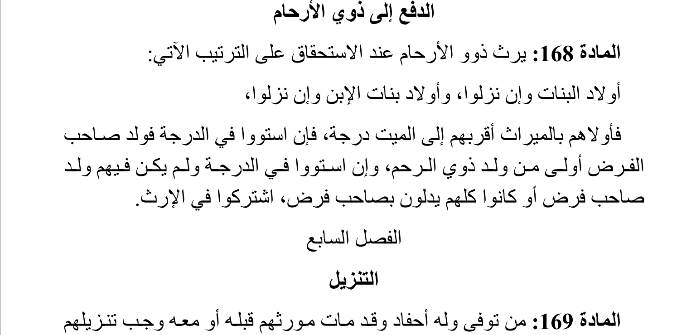

> يرث ذوو الأرحام عند الاستحقاق على الترتيب الآتي:
>
> أولاد البنات وإن نزلوا، وأولاد بنات الإبن وإن نزلوا،
>
> فأولاهم بالميراث أقربهم إلى الميت درجة، فإن استووا في الدرجة فولد صاحب الفرض أولى من ولد ذوي الرحم، وإن استووا في الدرجة ولم يكن فيهم ولد صاحب فرض أو كانوا كلهم يدلون بصاحب فرض، اشتركوا في الإرث.

## Article 49

Source: `A2005015`. The JO confirms the corrected initial alif spelling in the time-limit clause.

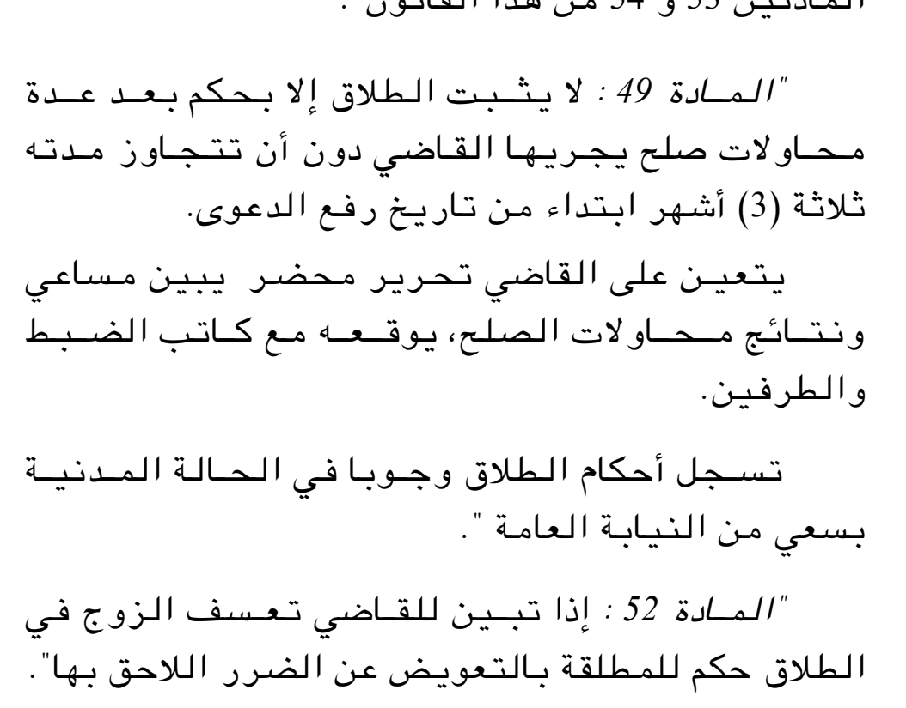

> لا يثبت الطلاق إلا بحكم بعد عدة محاولات صلح يجريها القاضي دون أن تتجاوز مدته ثلاثة (3) أشهر ابتداء من تاريخ رفع الدعوى.
>
> يتعين على القاضي تحرير محضر يبين مساعي ونتائج محاولات الصلح، يوقعه مع كاتب الضبط والطرفين.
>
> تسجل أحكام الطلاق وجوبا في الحالة المدنية بسعي من النيابة العامة.

## Article 8

Source: `A2005015`. The JO clearly reads the corrected husband word, not the erroneous Ministry marriage word.

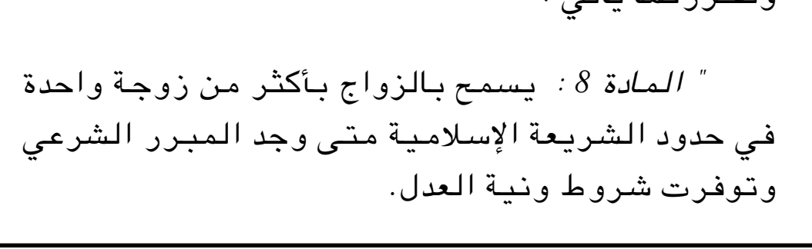

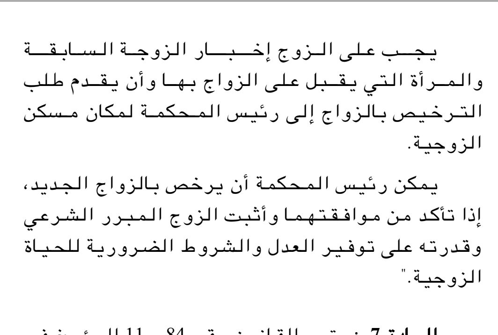

> يسمح بالزواج بأكثر من زوجة واحدة في حدود الشريعة الإسلامية متى وجد المبرر الشرعي وتوفرت شروط ونية العدل.
>
> يجب على الزوج إخبار الزوجة السابقة والمرأة التي يقبل على الزواج بها وأن يقدم طلب الترخيص بالزواج إلى رئيس المحكمة لمكان مسكن الزوجية.
>
> يمكن رئيس المحكمة أن يرخص بالزواج الجديد، إذا تأكد من موافقتهما وأثبت الزوج المبرر الشرعي وقدرته على توفير العدل والشروط الضرورية للحياة الزوجية.

## Article 120

Source: `family-consolidated-bilingual`. All body words, figures and Arabic paragraph breaks match the identified official source; surrounding labels/headings are outside the body.

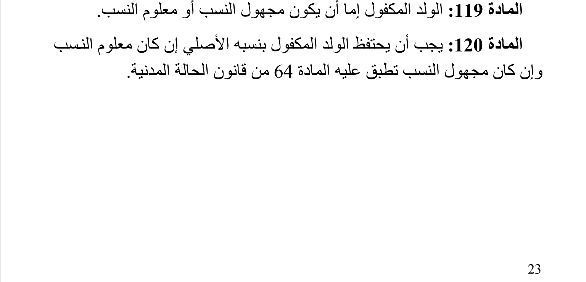

> يجب أن يحتفظ الولد المكفول بنسبه الأصلي إن كان معلوم النسب وإن كان مجهول النسب تطبق عليه المادة 64 من قانون الحالة المدنية.

## Article 131

Source: `family-consolidated-bilingual`. All body words, figures and Arabic paragraph breaks match the identified official source; surrounding labels/headings are outside the body.

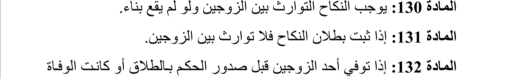

> إذا ثبت بطلان النكاح فلا توارث بين الزوجين.

## Article 32

Source: `A2005015`. All body words, figures and Arabic paragraph breaks match the identified official source; surrounding labels/headings are outside the body.

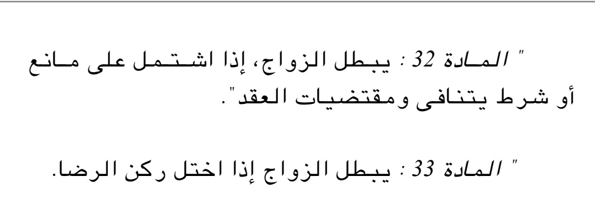

> يبطل الزواج، إذا اشتمل على مانع أو شرط يتنافى ومقتضيات العقد.

## Article 203

Source: `family-consolidated-bilingual`. All body words, figures and Arabic paragraph breaks match the identified official source; surrounding labels/headings are outside the body.

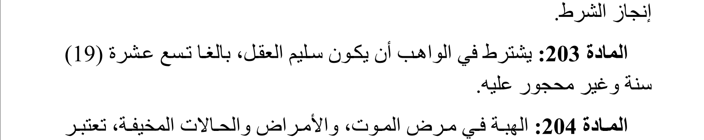

> يشترط في الواهب أن يكون سليم العقل، بالغا تسع عشرة (19) سنة وغير محجور عليه.

## Article 60

Source: `family-consolidated-bilingual`. All body words, figures and Arabic paragraph breaks match the identified official source; surrounding labels/headings are outside the body.

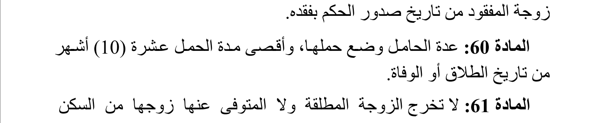

> عدة الحامل وضع حملها، وأقصى مدة الحمل عشرة (10) أشهر من تاريخ الطلاق أو الوفاة.

## Article 2

Source: `family-consolidated-bilingual`. All body words, figures and Arabic paragraph breaks match the identified official source; surrounding labels/headings are outside the body.

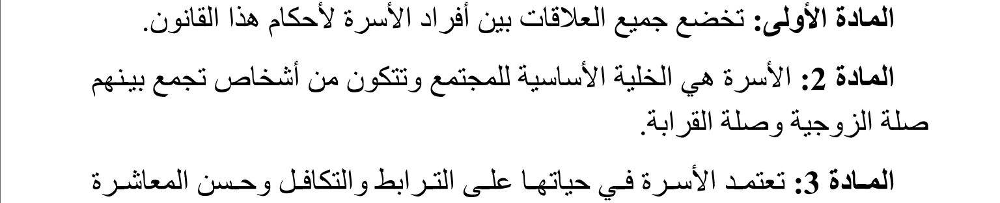

> الأسرة هي الخلية الأساسية للمجتمع وتتكون من أشخاص تجمع بينهم صلة الزوجية وصلة القرابة.

## Article 110

Source: `family-consolidated-bilingual`. All body words, figures and Arabic paragraph breaks match the identified official source; surrounding labels/headings are outside the body.

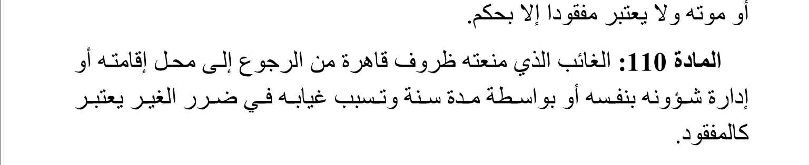

> الغائب الذي منعته ظروف قاهرة من الرجوع إلى محل إقامته أو إدارة شؤونه بنفسه أو بواسطة مدة سنة وتسبب غيابه في ضرر الغير يعتبر كالمفقود.

## Article 53 مكرر

Source: `A2005015`. All body words, figures and Arabic paragraph breaks match the identified official source; surrounding labels/headings are outside the body.

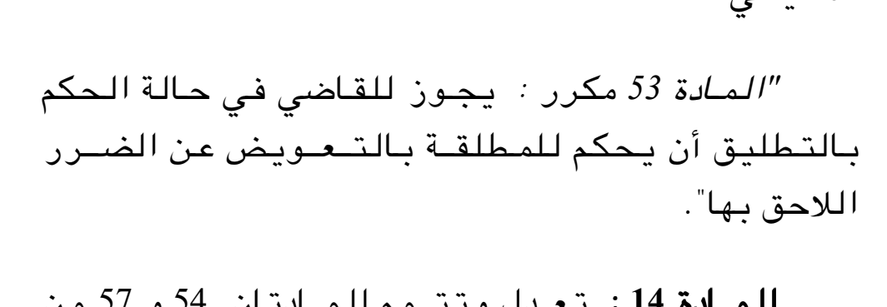

> يجوز للقاضي في حالة الحكم بالتطليق أن يحكم للمطلقة بالتعويض عن الضرر اللاحق بها.

## Article 145

Source: `family-consolidated-bilingual`. All body words, figures and Arabic paragraph breaks match the identified official source; surrounding labels/headings are outside the body.

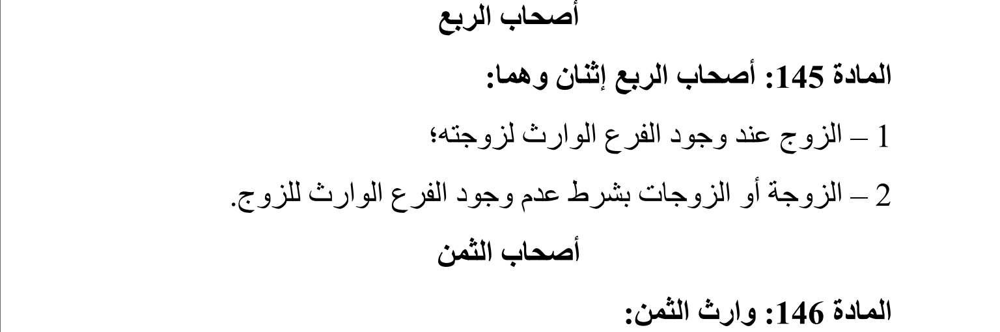

> أصحاب الربع إثنان وهما:
>
> 1 – الزوج عند وجود الفرع الوارث لزوجته؛
>
> 2 – الزوجة أو الزوجات بشرط عدم وجود الفرع الوارث للزوج.

## Article 204

Source: `family-consolidated-bilingual`. All body words, figures and Arabic paragraph breaks match the identified official source; surrounding labels/headings are outside the body.

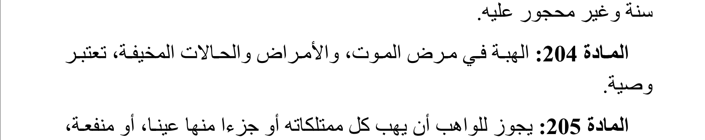

> الهبة في مرض الموت، والأمراض والحالات المخيفة، تعتبر وصية.
