# Visual spot-check: priority

Each article's canonical text beside the official page crop it was checked against. Inspected by: Claude (AI), visual reading; not a lawyer or human verification.
Crops are copies of hashed evidence images (`tools/law-corpus/.cache/evidence/extractions`); hashes in each row.

## civil-code 124 — `civil-code:124@law-05-10` — checked

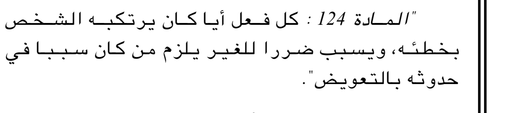

Crop `civil-124-current-05-10`, SHA-256 `08a3285ca21c3b836c76b322771b323377275da8ffe68ddd65d5b87cc1a2dd3e`

Canonical text:

> كل فعل أيا كان يرتكبه الشخص بخطئه، ويسبب ضررا للغير يلزم من كان سببا في حدوثه بالتعويض.

Decision: Law 05-10 art. 35, JO 44/2005 page 23, right column, 300 and 600 dpi. Read every word; the mark after بخطئه is a comma (Tesseract read ؛); في dotted in this 2005 typesetting. Closing full stop printed after the amending law's closing quotation mark, kept as for other quoted bodies. The text layer of this issue uses a legacy Latin-glyph font encoding and is not used as text. AI reading, not a lawyer or human verification.

## civil-code 138 — `civil-code:138@ordinance-75-58` — checked

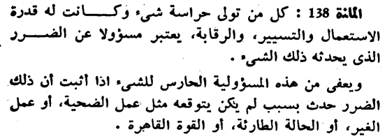

Crop `civil-138-original`, SHA-256 `c4d8afd33579dd47c57072aa58b708abf91e3686c5ad8ee16a53d1ab6464f0ea`

Canonical text:

> كل من تولى حراسة شىء وكانت له قدرة الاستعمال والتسيير، والرقابة، يعتبر مسؤولا عن الضرر الذى يحدثه ذلك الشىء.
>
> ويعفى من هذه المسؤولية الحارس للشىء اذا أثبت أن ذلك الضرر حدث بسبب لم يكن يتوقعه مثل عمل الضحية، أو عمل الغير، أو الحالة الطارئة، أو القوة القاهرة.

Decision: JO 78/1975 page 9, 600 dpi line by line: dotless تولى، شىء، الذى، ويعفى as printed; all commas and both final full stops agree. AI reading, not a lawyer or human verification.

## civil-code 139 — `civil-code:139@ordinance-75-58` — checked

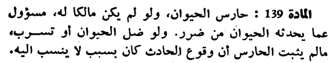

Crop `civil-139-original`, SHA-256 `b1669b8f64e0444e01555a366f0f04a2f9b95556129852ce82698c3c9b055398`

Canonical text:

> حارس الحيوان، ولو لم يكن مالكا له، مسؤول عما يحدثه الحيوان من ضرر. ولو ضل الحيوان أو تسرب، مالم يثبت الحارس أن وقوع الحادث كان بسبب لا ينسب اليه.

Decision: JO 78/1975 page 9, 600 dpi: مالم printed as one word; full stop after ضرر; اليه without hamza; final full stop. AI reading, not a lawyer or human verification.

## civil-code 140 — `civil-code:140@ordinance-75-58` — checked

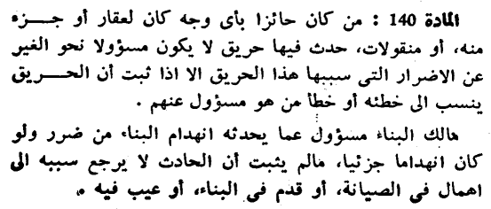

Crop `civil-140-original-a`, SHA-256 `67f312d122366f8d0e575df06302f73412bdbda74d636d423ade077485808424`

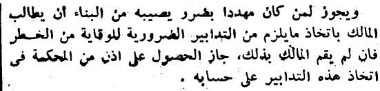

Crop `civil-140-original-b`, SHA-256 `62c438d17603bfa14370287809c93b5240f8f7cf095797fd57fa936846ab929a`

Canonical text:

> من كان حائزا بأى وجه كان لعقار أو جزء منه، أو منقولات، حدث فيها حريق لا يكون مسؤولا نحو الغير عن الاضرار التى سببها هذا الحريق الا اذا ثبت أن الحريق ينسب الى خطئه أو خطأ من هو مسؤول عنهم.
>
> مالك البناء مسؤول عما يحدثه انهدام البناء من ضرر ولو كان انهداما جزئيا، مالم يثبت أن الحادث لا يرجع سببه الى اهمال فى الصيانة، أو قدم فى البناء، أو عيب فيه،
>
> ويجوز لمن كان مهددا بضرر يصيبه من البناء أن يطالب المالك باتخاذ مايلزم من التدابير الضرورية للوقاية من الخطر فان لم يقم المالك بذلك، جاز الحصول على اذن من المحكمة فى اتخاذ هذه التدابير على حسابه.

Decision: JO 78/1975 pages 9-10 at 400 and 800 dpi. Settles the earlier quarantine: no mark between الخطر and فان (line break). Corrections read from the image: «مايلزم» printed as one word; «فان» without hamza (the hamza of أن in the same paragraph is clearly printed); paragraph 2 ends with the comma glyph «،» (same shape as the commas after الصيانة and البناء on that line, unlike the round full stop after عنهم) — a printing slip kept as published. فى dotless throughout. AI reading, not a lawyer or human verification.

## civil-code 308 — `civil-code:308@ordinance-75-58` — checked

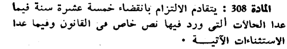

Crop `civil-308-original`, SHA-256 `768b085d29132761de842ca217508eae87660fe646c96775a9c1ca88cc62eeb4`

Canonical text:

> يتقادم الالتزام بانقضاء خمسة عشرة سنة فيما عدا الحالات التى ورد فيها نص خاص فى القانون وفيما عدا الاستثناءات الآتية.

Decision: JO 78/1975 page 19, 600 dpi; التى checked at 1200 dpi: the mark over its alef is a broken alef top, not a separate hamza glyph; فى dotless; الآتية with madda. AI reading, not a lawyer or human verification.

## civil-code 309 — `civil-code:309@ordinance-75-58` — checked

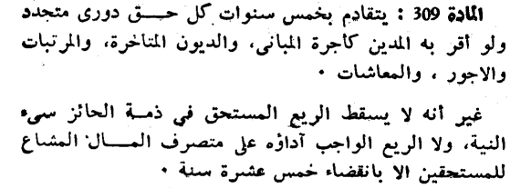

Crop `civil-309-original`, SHA-256 `e27e35611e5c2aea0cd5c47c2955890ee3012289fb0c2fb9d47797bead23b96c`

Canonical text:

> يتقادم بخمس سنوات كل حق دورى متجدد ولو أقر به المدين كأجرة المبانى، والديون المتأخرة، والمرتبات والاجور، والمعاشات.
>
> غير أنه لا يسقط الريع المستحق في ذمة الحائز سىء النية، ولا الريع الواجب آداؤه على متصرف المال المشاع للمستحقين الا بانقضاء خمس عشرة سنة.

Decision: JO 78/1975 page 19 at 600 and 1200 dpi. Two corrections to the earlier candidate, both read from the image: «في ذمة» has two clear dots under the yeh (candidate had فى); «آداؤه» carries a madda, unlike the hamza of أقر in the same article (candidate had أداؤه). المتأخرة shows its hamza. AI reading, not a lawyer or human verification.

## civil-code 379 — `civil-code:379@ordinance-75-58` — checked

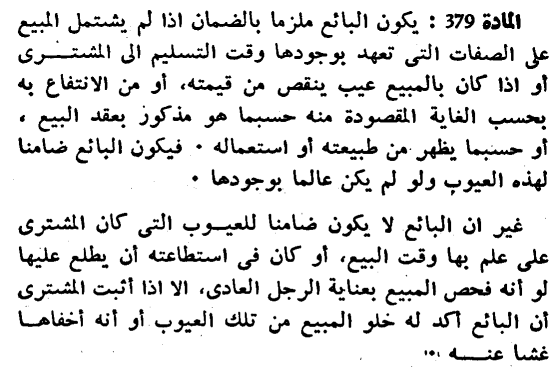

Crop `civil-379-original`, SHA-256 `96880790b74c473e41e38764a4b9ab5a0cb5e00c66a7c52658d9cae4e4506634`

Canonical text:

> يكون البائع ملزما بالضمان اذا لم يشتمل المبيع على الصفات التى تعهد بوجودها وقت التسليم الى المشترى أو اذا كان بالمبيع عيب ينقص من قيمته، أو من الانتفاع به بحسب الغاية المقصودة منه حسبما هو مذكور بعقد البيع، أو حسبما يظهر من طبيعته أو استعماله. فيكون البائع ضامنا لهذه العيوب ولو لم يكن عالما بوجودها.
>
> غير ان البائع لا يكون ضامنا للعيوب التى كان المشترى على علم بها وقت البيع، أو كان فى استطاعته أن يطلع عليها لو أنه فحص المبيع بعناية الرجل العادى، الا اذا أثبت المشترى أن البائع آكد له خلو المبيع من تلك العيوب أو أنه أخفاها غشا عنه.

Decision: JO 78/1975 page 24, 600 and 1200 dpi. One correction read from the image: «آكد» carries a madda, unlike the hamza of أن at the start of the same line (candidate had أكد). The final mark after عنه is a full stop; the two hairline ticks beside it are much thinner than this font's comma and are print specks. AI reading, not a lawyer or human verification.

## cpca 2 — `cpca:2@law-08-09` — checked

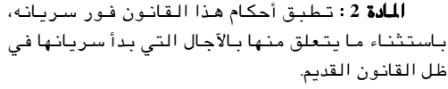

Crop `cpca-2-original`, SHA-256 `9722bdab31acb5a9817357b10c796c6779ac029a989a8ca73dcfb15121f8e534`

Canonical text:

> تطبق أحكام هذا القانون فور سريانه، باستثناء ما يتعلق منها بالآجال التي بدأ سريانها في ظل القانون القديم.

Decision: Read every word, the comma after سريانه and the final full stop on the JO 21/2008 page 3 crop (2x). Agrees with the Ministry HTML text of article 2. AI reading, not a lawyer or human verification.

## cpca 504 — `cpca:504@law-08-09` — checked

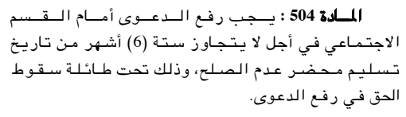

Crop `cpca-504-original`, SHA-256 `4e0f447aeb4236fb5a7dbe78b6c568a135ed2b7e64245609967114dac8c73cfc`

Canonical text:

> يجب رفع الدعوى أمام القسم الاجتماعي في أجل لا يتجاوز ستة (6) أشهر من تاريخ تسليم محضر عدم الصلح، وذلك تحت طائلة سقوط الحق في رفع الدعوى.

Decision: Read every word, ستة (6), the comma after الصلح and the final full stop on the JO 21/2008 page 41 crop (2x). AI reading, not a lawyer or human verification.

## commercial-code 187 مكرر — `commercial-code:187-bis@law-05-02` — checked

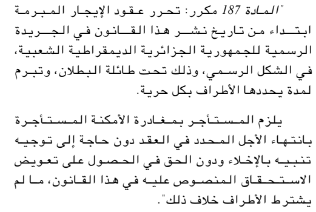

Crop `commercial-187-bis-introduced`, SHA-256 `f3000ee6861bd2b678712d4b5bf141b57af6496fbe58cf2c4d744e87fd6fa66f`

Canonical text:

> تحرر عقود الإيجار المبرمة ابتداء من تاريخ نشر هذا القانون في الجريدة الرسمية للجمهورية الجزائرية الديمقراطية الشعبية، في الشكل الرسمي، وذلك تحت طائلة البطلان، وتبرم لمدة يحددها الأطراف بكل حرية.
>
> يلزم المستأجر بمغادرة الأمكنة المستأجرة بانتهاء الأجل المحدد في العقد دون حاجة إلى توجيه تنبيه بالإخلاء ودون الحق في الحصول على تعويض الاستحقاق المنصوص عليه في هذا القانون، ما لم يشترط الأطراف خلاف ذلك.

Decision: Both paragraphs read word by word on JO 11/2005 page 9 (2x): three commas in paragraph 1, ما لم in two words, closing full stop printed after the closing quotation mark of the amending law (kept, as for all quoted article bodies). AI reading, not a lawyer or human verification.

## commercial-code 187 مكرر 1 — `commercial-code:187-bis-1@law-05-02` — checked

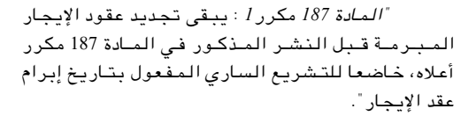

Crop `commercial-187-bis-1-introduced`, SHA-256 `0f1dceb03063f63a319bbf16b02ab702dada9395143eba45adeaa52cd029a6d9`

Canonical text:

> يبقى تجديد عقود الإيجار المبرمة قبل النشر المذكور في المادة 187 مكرر أعلاه، خاضعا للتشريع الساري المفعول بتاريخ إبرام عقد الإيجار.

Decision: Single paragraph read on JO 11/2005 page 9 (2x), including the cross-reference «المادة 187 مكرر» and the comma after أعلاه. AI reading, not a lawyer or human verification.
