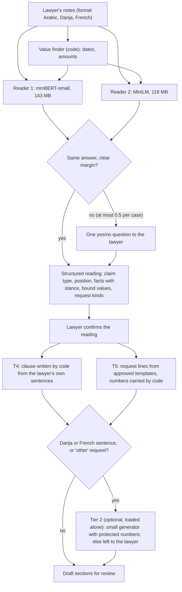

Research and invention parts complete; Part 7 (measurements) closed on 13 November 2026

# DZ Legal Assistant: independent audit and architecture review

**Brief:** `docs/briefs/FABLE-ARCHITECTURE-BRIEF.md` (10 November 2026). **Repository state examined:** commit `4544e32` of `claude/case-file-site`, identical in code to the default branch `claude/stoic-fermat-mi1gko` (`ed06cd1`); the branches `codex/model-setup` (`cf86f36`) and `codex/law-corpus` (`9b60990`) read without change. **Written:** 10 to 13 November 2026; no existing file was changed.

**What this file holds.** Research and invention in Parts 1 to 6; measurement in Part 7. Part 1 audits the product; Part 2 studies model size; Part 3 lists the product's atomic decisions; Part 4 gives the arithmetic of training; Part 5 surveys the state of the art; **Part 6** asks whether a complete system under 1 GB can match Gemma 4 E4B on the product's language tasks, proposes architectures and the experiments that would prove or refute the one recommended. **Part 7**, added afterwards, measures Arabic-first small models and five encoders on the owner's laptop and answers one question: is any ready-made model under 1 GB good enough today? The verdict on the product, the decisions and the roadmap are the owner's and are not in this file.

**How to read the labels.** **[K]** known: a source is given (a file and line at `4544e32`, a law article quoted from the repository's library, or a web page with its link and date). **[E]** estimated: the arithmetic is shown. **[S]** speculated: reasoning without evidence yet. Legal statements are quoted in Arabic from the repository's library (`data/law/codes/*.json`, whose CPCA and Family Code are complete) or from a source the research units read; anything not verified that way is marked `TO CONFIRM WITH A PRACTISING LAWYER`. Court decisions and real cases are never used; every case mentioned is fictitious.

**How the research was done.** I read the pipeline code, the prompts, the catalogue, the committed run summaries and 10 of the 24 committed drafts myself, and recomputed the statistics from the committed per-case lines. Research units, each writing a file of evidence, covered the rest:
- seven audit units of the repository (A01, A02, A08 to A12);
- four practice units and two statistics units on Algerian courts (B-P1 to B-P4, B-S2, B-S3), the statistics re-checked cell by cell by a verifier;
- seven legal-family units, six of them re-checked by an independent verifier against a second source (B-L2 to B-L7; the check of B-L1 did not finish);
- fifteen state-of-the-art units (C01 to C15); for thirteen of them separate verifiers re-fetched the sources and matched the quotations (not yet for C04 and C05);
- for Part 6 (11 November 2026): six research units on models of 1.5B parameters or less, distillation and synthetic data, task reformulation, size and memory, and Arabic evidence (D1 to D6), with a second-agent check of their sources; a prior-art search (D7) and a red-team review (D8) of the architectures.

Unit ids appear in citations below ("A08-05", "C06 §2.4"). The unit files are working papers kept outside the repository; every fact this report relies on is restated here with its own source. Four earlier project reports by other agents (on the local model, speed, CPU architecture and harness techniques, 14 to 18 October 2026) were read with the owner's permission and are cited as unpublished project reports.

**What I could not do.** In Parts 1 to 6 I ran no model and no measurement on the laptop: every timing and memory figure there comes from the project's committed summaries or the earlier reports. Part 7 is different: it is measured, on the owner's laptop, between 11 and 13 November 2026, and says for each figure whether it was taken on battery or on mains. I did not open the hidden test sets, only their summaries.

---

## Part 1. Audit: is it ready for production?

### 1.1 Coverage against real practice

**What exists.** [K] Algeria publishes no national count of first-instance cases by court section. The ONS yearbook gives only national totals: 702,180 civil cases on the roll in 2013 (pending plus registered), 573,993 judged, and 62,126 administrative cases on the roll (ONS, *Annuaire statistique* no. 31, ch. XI, table 1, https://www.ons.dz/IMG/pdf/administrative.pdf, accessed 10 Nov 2026). The Supreme Court publishes appeals split only into civil and criminal: civil-side appeals were 20,703 of 103,028 registered in 2025 (unit B-S3, coursupreme.dz statistics page, accessed 10 Nov 2026). But the Ministry of Justice publishes **per-court tables by section** on the websites of the judicial councils (`cour-<wilaya>.mjustice.dz`). Unit B-S2 found usable first-instance tables for five councils (35 court-periods) and pooled the four recent groups: Béjaïa 2025, Mascara first half of 2025, Tizi Ouzou January to September 2026 and M'sila first quarter of 2026. Together they hold 38,212 registered civil-side cases [K for each table; E for the pooling]:

| Section | Share of registrations (pooled) | Median over 27 courts | Range over 27 courts |
|---|---|---|---|
| Family affairs | 38.0 % | 38.9 % | 19.3 to 75.9 % |
| Real estate | 28.4 % | 24.4 % | 7.8 to 52.7 % |
| Civil | 18.2 % | 19.8 % | 6.9 to 41.4 % |
| Urgent proceedings | 7.2 % | 3.8 % | 0 to 22.6 % |
| Social | 6.5 % | 2.3 % | 0 to 28.0 % |
| Commercial (and maritime) | 1.8 % | 1.2 % | 0 to 6.2 % |

Caveats [K]: four regions only; registrations, not lawyers' filings (family cases are often filed without a lawyer at first instance, since CPCA art. 10 makes a lawyer compulsory only on appeal and cassation); the Béjaïa section rows miss 9.8 % of the council's own civil-side total; several councils' sites show copied tables from other councils (the "Biskra 2023" table is Béjaïa's), so every figure must be checked against the issuing council (B-S2 §0 items 5 and 6). Administrative cases go to separate courts; in 2013 they were 8 % of civil plus administrative cases on the roll (62,126 / 764,306) [E]. A lawyer is compulsory before the administrative court («تمثيل الخصوم بمحام وجوبي أمام المحكمة الإدارية، تحت طائلة عدم قبول العريضة», CPCA art. 826) and not at ordinary first instance (art. 10), so administrative work is a larger share of a lawyer's drafting than of the courts' registrations [S] (B-P4).

**Which frequent claim types are missing from the 21** [K facts, S ranking; units B-P1, B-P2, B-P3]:
- **Family:** divorce by mutual consent, filed by a **joint petition** (CPCA art. 428: «في حالة الطلاق بالتراضي يقدم طلب مشترك في شكل عريضة وحيدة موقعة من الزوجين»), about 14,000 to 22,000 a year [E: 93,402 divorces in 2023 (ONS, from Ministry of Justice data) × the 31 % left after unilateral 42 % and khul' 27 % (Minister of Justice, 2021 to mid-2025), split between mutual consent and tatliq at the 2018 or 2009 ratios]; proof of marriage (an NGO-attributed estimate of «نحو 40 ألف قضية» a year, low reliability); housing for the custodian (Family Code art. 72); revision of maintenance (art. 79); interim measures by **order on petition** (Family Code art. 57 مكرر: «يجوز للقاضي الفصل على وجه الاستعجال بموجب أمر على عريضة في جميع التدابير المؤقتة ولا سيما ما تعلق منها بالنفقة والحضانة والزيارة والمسكن», `data/law/codes/family-code.json`). In a husband's divorce (42 % of divorces) the wife's lawyer files no statement of claim at all: her claims come as counter-claims in a reply (CPCA art. 25).
- **Real estate** (the second section by volume): partition of co-owned and inherited property (Family Code art. 181 makes it judicial when an heir is a minor), possession actions (one-year bar, CPCA art. 524), ownership and revendication, pre-emption, annulment of published deeds, validation of a conservatory seizure (CPCA art. 662, 15 days). None is among the 21.
- **Civil:** traffic-accident compensation (Ordinance 74-15, with amounts fixed by the annexed scale, so drafting it as `tort-damages` under art. 124 cites the wrong law; B-L3; 26,272 accidents, 35,556 injured and 3,740 deaths in 2024, much of it decided by the criminal court), insurance, medical liability.
- **Commercial:** since Law 22-13 the **specialised commercial courts** (12 raised to 25 by Executive Decree 26-133 of 30 March 2026, Ministry of Justice release of 24 Sep 2026) hear companies, banks against traders, maritime, insurance, international trade and IP, «دون غيرها»; a claim there needs a prior non-conciliation record (CPCA art. 536 مكرر 4). Payment orders (CPCA arts. 306 to 309) for written, fixed, due debts.
- **Social:** the 21 cover the two main individual claims; the preceding complaint to the labour inspectorate is not drafted (37,078 individual complaints and 29,997 non-conciliation records in 2025, press report of the labour minister's figures, 19 July 2026, checked only through a summarising fetch).

**Which of the 21 look rare** [S]: annulment of a sale for fraud (hard to prove; and a published land deed belongs to the real-estate section, CPCA art. 515); liability for things outside motor vehicles; contract damages without rescission. **Which are routed to the wrong section by the product's own examples** [K]: unpaid rent of a dwelling or professional premises (CPCA art. 512-10: «في إيجار السكنات والمحلات المهنية») and annulment of a published deed (art. 515) belong to the real-estate section, while the samples and the hint write «القسم المدني» (B-P1 §3.2). CPCA art. 32 para. 6 limits the harm to a transfer between sections.

**What share of a typical lawyer's statements of claim the product handles today.** [E] Share of civil-side and administrative registrations whose claim type is among the 21 and whose vehicle is a statement of claim, by section; low and high are my judgement from the units above, not measurements:

| Section | Share of registrations (rescaled with 8 % administrative) | Part covered by the 21, low to high | Contribution, low to high |
|---|---|---|---|
| Family | 35.0 % | 0.45 to 0.70 (husband's divorce, khul', tatliq, maintenance, custody, visitation; not mutual consent, proof of marriage, housing, interim orders) | 15.7 to 24.5 |
| Real estate | 26.1 % | 0.10 to 0.30 (rent of dwellings, occupiers, published-deed fraud) | 2.6 to 7.8 |
| Civil | 16.7 % | 0.35 to 0.65 (debts, contracts, tort; not traffic, insurance, medical) | 5.9 to 10.9 |
| Urgent | 6.6 % | 0 to 0.10 | 0 to 0.7 |
| Social | 6.0 % | 0.50 to 0.80 | 3.0 to 4.8 |
| Commercial | 1.7 % | 0.30 to 0.60 | 0.5 to 1.0 |
| Administrative | 8.0 % | 0 | 0 |
| **Total** | 100 % | | **about 28 to 50 %** |

A second route, family only: husband's divorces, khul' and tatliq in 2023 were about 72,900 to 79,400 [E: 93,402 × (0.42 + 0.27 + 0.09 to 0.16)]; against about 570,000 civil cases judged a year (2013, the last national figure), that is 12.8 to 13.9 % of all civil cases from the three divorce types alone, consistent with the low end of the family row (different years; registrations and judgments mixed) [E].

**But "of a covered type" is not "handled".** Every one of the 21 is at the project's own lowest coverage level (`docs/COVERAGE-MATRIX.md`: "Today every row is level 1"), none is lawyer-verified, and §1.2 shows each type misses a deadline, a precondition or a competent-court rule. So today the product can help with the drafting of roughly a third to a half of a general practitioner's first-instance filings, and can be trusted, without the lawyer re-checking the law, for none of them. **The cheapest way to replace this estimate**: ask 10 practising lawyers for the claim type, section and vehicle of their last 30 filings (300 data points; a one-page form; a day of their time in total).

### 1.2 Legal completeness

[K] The six codes of the library hold 1,361 articles: the CPCA (1,084) and the Family Code (227) complete, the Civil Code **29 articles** (consolidated as of 13 May 2007, from a government compilation hosted by WIPO, not from the Journal Officiel), the Commercial Code 4, Law 90-11 10 articles consolidated to 1996 ("later amendments not searched"), Law 90-04 7 articles; every code `verified: false` (`data/law/codes/*.json`; A10). The library was cut to the catalogue: all 127 catalogue references resolve, and nothing else of the Civil Code is there.

**Is a 29-article Civil Code enough?** No. Seven legal-family units (B-L1 to B-L7) read what each claim type needs. Their verifiers re-checked the quotations against a second source; tallies: contract remedies 87 of 95 items confirmed, 2 wrong, 6 unverifiable; leases 89 of 97, 3 wrong, 5 unverifiable; labour 56 of 64, 2 wrong, 6 unverifiable; family units 90+ confirmed with additions. What every family lacks [K, from the units; articles outside the library quoted there from the corpus branch or the government compilation]:

| Need | Missing from catalogue and library | Effect on a filed claim |
|---|---|---|
| **Limitation and forfeiture** | Civil Code 308 (15 years), 309 (5 years, wages and periodic sums), 312 (one year for merchants' supplies to non-merchants and workers' pay, with an oath); 101 (5 and 10 years for annulment for fraud); 133 (15 years from the harmful act, for both tort types); CPCA 504 (six months after the labour non-conciliation record: in the library, in no catalogue entry); CPCA 524 (one year for possession) | A late claim is drafted as if timely; harm 5. |
| **Preconditions** | Formal notice for rescission (119 requires «بعد اعذاره المدين»; 180, 181 on its form and exceptions); conciliation before the specialised commercial court (CPCA 536 مكرر 4, «تحت طائلة عدم قبول الدعوى شكلا»); mediation in the commercial section (CPCA 534); labour conciliation (Law 90-04 art. 19, with its exclusion of public servants) | An inadmissible or premature claim; harm 4 to 5. |
| **Competent court and section** | CPCA 40 («دون سواها»), 426 (family territory: the marital home, the custodian's place, the maintenance creditor's domicile), 512 and 515 (real-estate section), 536 مكرر (specialised commercial court); CPCA 800 and 807 (a claim against the State, a wilaya, a commune or an administrative public body goes to the administrative court, as a matter of public order, except damage by their vehicles, art. 802) | Wrong court; at best a transfer, at worst inadmissibility before a court competent «دون غيرها»; harm 3 to 5. |
| **Proof** | Civil Code 333 to 336 (writing above 100,000 DA; beginnings of proof), Commercial Code 30 used against non-merchants | A claim that cannot be proved as pleaded; harm 4. |
| **Conditions inside the basis articles** | Family Code 53 grounds with their durations; 53 مكرر is a discretion («يجوز للقاضي … عن الضرر اللاحق بها»), not an entitlement; Law 90-11 73-3 (burden on the employer, in the library but not in the catalogue) | Wrong or weaker grounds; harm 3 to 4. |
| **Documents** | CPCA art. 8 para. 2: documents «باللغة العربية أو مصحوبة بترجمة رسمية … تحت طائلة عدم القبول»; French invoices are common in commercial debts [S] | Inadmissible exhibits; harm 4. |
| **Lender and party types** | Civil Code 456 (credit institutions may stipulate interest) against the catalogue's required 454 («لا تطلب فوائد»); merchant status (Commercial Code 1, 4) | A bank's loan drafted with no interest; harm 4. |

**Legal errors no automatic check would catch** (examples from the units, all fictitious; harm on this report's scale):
- A debt under Civil Code 312 (a shop's supply to a household two years ago) drafted as a live claim (5).
- A loan repayable in December 2027 sued in November 2026 as if due (5).
- A bank's claim against a trading company filed at the commercial section, or at the specialised court without the non-conciliation record (5).
- A labour claim filed seven months after the non-conciliation record (5): showcase draft 07 is in exactly this position (§1.3).
- Rescission requested with «لم يوجه أي إعذار» in the facts: the notice check is silenced by the word and does not run for rescission at all (4).
- Interest asked as «تعويض عن التأخير بنسبة 8% سنويا»: passes the interest-word check (4).
- A tatliq on art. 53 ground 1 before the conditions of the ground are met (failure to pay maintenance after a judgment ordering it, «بعد صدور الحكم بوجوبه») (4).
- A claim against a commune or a public hospital drafted as `tort-damages` for the civil section: the administrative court is competent as a matter of public order (CPCA arts. 800, 807) (5).
- A dog bite or a wall collapse drafted under art. 138 (custodian of a thing) where arts. 139 and 140 govern, the collapse making the owner, not the custodian, liable (4).
- Custody housing claimed against the mother when the father is the plaintiff, contrary to art. 72 (3).

[S] The units count 9 to 10 of each family's errors as deterministic rules over a handful of structured answers (dates, party status, lender type, object type, document language). None of them needs a language model.

### 1.3 The pipeline, component by component

All paths are at commit `4544e32` (identical to `claude/case-file-site`). For each component: what it is for, how it fails, how we would know, and whether it should exist. Findings marked A01-… and A02-… come from two audit units of this review; I re-read the code behind the ones I cite (export blockers, request-line dropping, the basis-article button, the CPCA articles).

**What the shipping app asks a model, in one sentence.** [K] Two calls per analysis (claim type, then a choice among at most 12 catalogue articles; `src/DzLegal.Drafting/GroundsAnalyzer.cs:42-51`) and one to three calls per draft (one application clause per grounds paragraph; `src/DzLegal.Drafting/ArguedGrounds.cs:305-325`). The facts and the requests in the document are the lawyer's own text, rendered by templates (`DraftingService.cs:62-64`). The fact reader behind the headline accuracy figures ("Alpha-01", `ClaimFactReader.cs:62` "harness only") is not in the app.

| # | Component | What it is for | How it fails | How we would know | Keep, replace or delete |
|---|---|---|---|---|---|
| 1 | Form and rule engine (`definition.json`, 38 fields, 15 elements) | Admissibility in form (CPCA arts. 8, 14, 15, 17) | It displays; it never blocks: export blockers are an unreviewed AI section, a «(...)», three substance kinds and over-long fields, none reads the formal report [K] (`MainWindowViewModel.cs:347-372`). No deadline, no prior step, no court or territory check, one party per side (A01-F01, F04, F05). A request line starting «في الشكل» is dropped whole, with any relief on it [K] (`TemplateRenderer.cs:106-111`). | "360 of 360" is a regression suite written with the engine from one base document (A01-F11); there is no lawyer-written defective petition. | **Keep and extend**: it is the right kind of component. Add deadline, prior-step, court and party rules; make the mandatory elements block export with a logged override. |
| 2 | Reading call (claim type) | Recognise which of the 21 claim types the facts describe | The local model chooses among the types of the section's area only (2 to 9 + «other»), so a wrong section hides the right type (0 of 18 on mismatching sections, comment at `GroundsAnalyzer.cs:171-177`) [K]. Code then rewrites the answer on keywords (animal → liability for things; «تطليق»/«خلع» → tatliq/khul; civil status → none; `:307-345`) [K], which A02 shows misfires on negated words (A02-02, 06, 07). There is no way to pick a claim type by hand: every use of the catalogue goes through `_analysis.ClaimIds` (`MainWindowViewModel.Grounds.cs:212-227`) [K], so in "Without AI" mode the catalogue's articles, usual requests and documents are unreachable. | Development cases 44/44 (Gemma 4 E4B) and 39/44 (Gemma 3 4B); the local model's claim reading was never run on a hidden set (A02-12). | **Replace by a pick list** (section, then at most 9 types, each with a one-line description). A model may pre-select; it must not be required. |
| 3 | Candidates and selection call | Choose the articles that ground the claim | The candidates are the confirmed type's own catalogue articles (`:269-294`); the role is the catalogue's, not the model's (`:494-496`); the required ones are added whatever the model says (`:141-156`). So the call chooses which *optional* catalogue articles to tick. It costs about 60 s (SPEED and CPU reports, October). | My recount on the 40 development cases with a claim type: a plain lookup (required + basis articles of the type) recalls **61 of 64** reference articles at no cost; the app's two calls recall 48 of 64 (Gemma 4 E4B) and 45 of 64 (Gemma 3 4B) (notes 03 §3) [E]. The reference is the catalogue itself, so the comparison mainly shows that the call is asked to rediscover a table. | **Delete the call.** Replace it by the catalogue entry plus explicit conditions ("art. 179 when damages are requested in a contract claim"), reviewed by a lawyer. |
| 4 | Grounds drafting (argued path) | Write the «المناقشة القانونية» | The code writes the rule sentence, the citation and the closing; the model writes one application clause per paragraph [K] (`ArguedGrounds.cs:305-342, 816-849`). The rule sentence is the catalogue's one-line `why.ar`, not the official text (`:36-88`) [K]; 16 of 127 of those lines are usage notes, and draft 08 states one of them as the content of Civil Code art. 119 (§1.2). The plan is positional: the first request and the first request with «تعويض» get a paragraph (`:140-197`); in 4 of the 6 two-request showcase cases one substantive request is never grounded [E]. About a dozen regex guards refuse known failure shapes (`Problem`, `:901-967`); unseen shapes pass, for example a conclusion «مما يوجب …» (draft 01) that the conclusion filter (`:487`) does not list. | What the model adds: 923 content words over 24 committed drafts, 76 % word-for-word from the facts section, in 25 to 39 s per draft [E] (notes 03 §4). Nobody has measured how lawyers rate the clauses. | **Keep the code-written frame; change its source and its plan.** Rule sentence from a lawyer-verified rule text per article (or the official text quoted); one paragraph per request; the application clause from a template over confirmed facts, with the model as an optional rewriter. |
| 5 | Grounds drafting (classic path) | Fallback when no article is ticked | The model writes the whole grounds; two attempts, then the lawyer's notes verbatim (`DraftingService.cs:188-234`) [K]. | Not measured separately. | **Delete** once every draft goes through a plan. |
| 6 | Narrative checks (`NarrativeChecks.cs`) | Catch corruption, invented numbers, the commonest role reversal | By its own summary "other meaning stays the lawyer's review" (`:71-74`) [K]: a correct-looking sentence with the wrong polarity, the wrong event for a date, or an omitted decisive fact passes. Role reversal is detected for lease, loan and sale verbs only (`ArguedGrounds.cs:671`). | Hostile cases in the October harness report; no measured recall on unseen errors. | **Keep** as a backstop; most of its work disappears if the clause is templated. |
| 7 | Substance checks (`SubstanceChecks.cs`, 11 kinds) | Flag legal points: interest on a private loan, damages without notice, tort article in a contract claim | Keyword tests over free text (`:265-269`) [K]. «لم يوجه أي إعذار» contains a notice word, so it *silences* the missing-notice warning (`:146-149`). The claim-type input can be the model's unconfirmed guess, which switches warnings off (A02-03). Only 3 of 11 kinds block export (`:64-65`). | No test of their recall on unseen notes. | **Keep the rules, change their input**: run them on structured answers (notice served: yes / no / date), where they become exact. |
| 8 | Requests formaliser (`RequestsFormaliser.cs`) | Offer a formal Arabic wording of Darija or French request lines | Optional, checked (same count, same numbers, «أو» kept), never applied automatically [K] (`:7-21`). | Not measured on a hidden set. | **Keep** as an optional model task. |
| 9 | Alpha-01 fact reader (`ClaimFactReader.cs`) | Read, per confirmed claim type, whether each element is stated, denied or disputed, and bind dates and amounts | Bench only. Its failures (32 of 90 on v2 for Gemma 4 E4B) have no path into the document today. | Hidden sets v1 and v2 (§1.4). | **Decide what it is for.** As an interview pre-fill that the lawyer confirms, it is useful; as an unconfirmed reader it would put its errors into the checks. |
| 10 | Law library (`data/law/codes`) | Official text of every cited article | Civil Code 29 articles (partial, consolidated as of 13 May 2007), Commercial Code 4, labour laws 10 + 7, all partial; CPCA 1,084 and Family Code 227 complete; every code `verified: false` [K] (notes 04). Nothing brings a change of the law to an installed app. | The corpus branch (`codex/law-corpus`) documents checked records for 274 Civil Code identities (A10 unit, pending). | **Keep; finish the corpus; add a signed update channel.** |
| 11 | Local model and runtime | Run the two analysis calls and the drafting calls offline | Gemma 4 E4B is a 6.58 GB pull (weights 5.49 GB + vision 0.99 GB + draft helper 0.10 GB; `codex/model-setup`); the app's analysis run peaked at 8.27 GiB model + app working set (Gemma 4 E4B) and 9.54 GiB (Gemma 3 4B) [K] (`docs/baselines/2026-11-09-alpha-03-app-grounds-stage-1/summary.md`). An October measurement put the same Gemma 3 at 4.43 GiB private with a bounded prompt cache and 3.06 GiB text-only (LOCAL-MODEL-REPORT, unpublished). | Measured peaks exist; no 8 GB machine was ever measured. | **Keep as an optional tier**; ship text-only builds and a bounded cache before any other memory work. |
| 12 | Benches and baselines | Measure | §1.4. | — | Keep; change what they measure. |

**The chain, reading → analysis → drafting.** [K] Today the lawyer's facts and requests go into the document verbatim, so a misread fact cannot reach the filed text through the facts section. The model's errors reach the document by three routes only: (1) a wrong claim type, confirmed by a lawyer in a hurry, which ticks that type's required articles and selects the wrong rule sentences (A02-01; the confirmation is not even needed for the "tick basis articles" button, `MainWindowViewModel.Grounds.cs:241-250`); (2) the application clause, where a wrong polarity or a wrong event survives the guards; (3) the warnings, which key on the unconfirmed claim type (A02-03). The code's own errors reach it by four more: the catalogue paraphrase stated as the article's content, an ungrounded request, an unconditional «في الشكل» paragraph asserting compliance with arts. 13, 14, 15 and 17 (A01-F10; it appears in every committed draft), and the absence of any deadline or vehicle check.

**A route the product never mentions.** [K] CPCA art. 306 offers the creditor of a sum of money «مستحق وحال الأداء ومعين المقدار وثابت بالكتابة، لا سيما الكتابة العرفية المتضمنة الاعتراف بدين … أو فاتورة مؤشر عليها من المدين» a payment order on petition to the president of the court, decided «خلال أجل أقصاه خمسة (5) أيام» (art. 307) (`data/law/codes/cpca.json`, arts. 306-307). Two of the twelve showcase cases (01, a notarised acknowledgment of debt; 09, an invoice and a receipt) look like such debts. Whether a lawyer would choose the order there is a judgement (an opposition reopens the dispute) — `TO CONFIRM WITH A PRACTISING LAWYER` — but a tool that drafts only the statement of claim should at least say the faster route exists.

### 1.4 The measurement

Everything below is recomputed from committed summaries with a script (`stats.py`, kept with the research notes); no hidden case was opened.

**What is measured.** [K] The headline ("Cases with every detail right", README) scores the Alpha-01 reader, which is not in the app, on cases written in formal Arabic, 3 to 10 sentences, by AI agents (`docs/HIDDEN-SET.md`, rules 1 and 5). The app's own steps were measured only on the 46 development cases used to build them. So the headline measures a component the lawyer never meets, on a genre lawyers do not write (no Darija, no French, no long notes, no real notes).

**How uncertain the figures are.** [E] Wilson 95 % intervals:

| Figure | Value | 95 % interval |
|---|---|---|
| Hidden v2, Gemma 4 E4B, claim type given | 58/90 = 64.4 % | 54.2 to 73.6 |
| Hidden v2, Gemma 3 4B | 39/90 = 43.3 % | 33.6 to 53.6 |
| Hidden v2, Gemma 4 E2B / Gemma 3n E2B | 41/90, 42/90 | 35.7 to 55.8; 36.7 to 56.9 |
| Hidden v1, Nemotron (online), given / read | 64/90, 60/90 | 61.0 to 79.5; 56.4 to 75.5 |
| Claim type read (Nemotron) | 85/90 | 87.6 to 97.6 |
| Out-of-scope declined | 10/10 | 72.2 to 100 |
| App drafts "right", stage 2 | 11/12 | 64.6 to 98.5 |
| App claim type, development, Gemma 4 / Gemma 3 | 44/44, 39/44 | 92.0 to 100; 76.0 to 95.0 |

- **One comparison is solid.** v2 is the only pair with per-case lines committed for both models. Both right 36, only Gemma 4 E4B 22, only Gemma 3 4B 3, neither 29: exact McNemar p = 0.00016; difference 21.1 points, 95 % 11.1 to 31.1 by case and 12.6 to 29.2 when the bootstrap resamples claim types (21 clusters) [E].
- **Nothing else between local models is.** 39, 41 and 42 of 90 cannot be told apart. With 90 paired cases and the observed share of discordant cases (0.278), the smallest difference detectable with 80 % power is about **16 points**; 180 cases detect about 11, 400 about 7 [E].
- **Per claim type, nothing.** Four or five cases each; Gemma 4 E4B gets 1 of 4 on three types and 4 of 4 on others. No statement "type X is weak" is supported.
- **Single passes.** Every hidden run is one pass at temperature 0.2; run-to-run variance is unmeasured. On the 44 development cases, three single passes of the same model on different dates gave 42, 43 and 39 (A02-13); the last followed a prompt change, so noise and the change cannot be told apart.
- **Safety claims need far more cases.** Zero harmful errors in n cases bounds the true rate at about 3/n: 12 drafts → up to 22 %; 90 cases → 3.3 %; 300 → 1 % [E].

**What "fully right" hides.** [K] Of Gemma 4 E4B's 32 failures on v2, 24 lines are polarity, and **17 cases fail only because a fact the notes call disputed was read as stated** (from the committed per-case lines). Without that class the score would be 75/90 (83 %). Whether that class matters depends on a legal question nobody has asked: does a claimant's statement of claim change when the notes say the defendant denies a fact? If the claimant pleads the fact either way, half of the "critical errors" are not critical for this document. The other 15 failed cases (16.7 %, Wilson 10.4 to 25.7) carry errors that would change a document or a decision: a non-event asserted (notice served when the notes deny it, twice), a forbidden reading, a date or amount on the wrong event (5 cases), a missing decisive event. "Fully right" weights a mis-bound amount and a harmless stance label the same; it also says nothing about what the lawyer catches.

**What production-grade evaluation would look like.** [S, with the arithmetic above]
1. **Measure the product, not a component.** Score the document the lawyer would file, after the steps the lawyer actually does, against a lawyer's reference: wrong law, wrong or missing request, wrong amount or date, missed deadline or precondition, inadmissible form. Weight by the harm scale of this report (5: could make a filed claim wrong, late or inadmissible unnoticed).
2. **Measure detection, not only accuracy.** Seed known errors into drafts and measure what proportion lawyers catch in an ordinary review, with time taken. A design whose errors are caught 99 % of the time beats a more accurate one whose errors are invisible.
3. **Size the set for the decision.** Non-inferiority of a cheaper design against the current one, with the observed discordance, one-sided 5 %, power 80 %: **172 paired cases for a 10-point margin, 687 for 5 points** (238 and 952 at 90 % power) [E]. Report a 95 % interval with every figure, clustered by claim type.
4. **Make the set look like practice.** Weight claim types by their real frequency (Part 1.1), and include Darija and French notes, long notes, document-led facts and out-of-catalogue cases in the shares lawyers produce them.
5. **Lawyer-judged drafting.** Two practising lawyers grade each grounds paragraph blind to its source (template, Gemma 3, Gemma 4, a human junior) on correctness, sufficiency and register; agreement reported as Cohen's κ; disagreements adjudicated by a third. Forty cases × four sources × two lawyers is about 320 paragraph judgements, a few days of paid lawyer time.
6. **Keep the hidden-set discipline** the project already has (independent author, one run per frozen version, summary only) and add repeated passes (three per model) so that run-to-run noise is known.

### 1.5 Ranked findings

Ranked by harm to a lawyer or the lawyer's client, on this scale: **5** could make a filed claim wrong, inadmissible, late or lost without the lawyer noticing; **4** wrong or missing legal content that a careful review would catch but an ordinary one may miss; **3** misleads the lawyer's or the team's judgement, or costs significant time; **2** quality or efficiency loss; **1** cosmetic. Cost: **S** under 2 days, **M** under 2 weeks, **L** more. "Source" names the audit unit (A…, B…) or this report's own reading (R); I re-read the code or the law behind every finding of harm 4 or 5.

| # | Finding | Evidence | Harm | Fix | Cost |
|---|---|---|---|---|---|
| 1 | **No deadline is ever computed.** Limitation and forfeiture periods are in no catalogue entry; the six-month forfeiture after the labour non-conciliation record is in the library and used by nothing. A showcase draft dated more than twelve months after its record is reported "formally complete, legal points: none". | `data/law/codes/cpca.json`, art. 504: «في أجل لا يتجاوز ستة (6) أشهر من تاريخ تسليم محضر عدم الصلح، وذلك تحت طائلة سقوط الحق في رفع الدعوى»; `docs/baselines/2026-11-09-alpha-03-app-draft-stage-2/outputs/07-wages__gemma3-4b.md` (minute of 20/09/2025, petition of 01/10/2026). R, A01-F01, A09-1, B-L1, B-L7 | 5 | One date question per deadline (date of the record, of the due date, of the disturbance); a rule per claim type; block export with a logged override. Load Civil Code 308, 309, 312, 101. | S to M |
| 2 | **Preconditions are absent.** Prior conciliation before the specialised commercial court, the formal notice before rescission, mediation in the commercial section, the labour conciliation and its exclusions: none is checked; the notice check runs only when damages are asked and is silenced by «لم يوجه أي إعذار». | CPCA art. 536 مكرر 4 (`cpca.json`): «يسبق قيد الدعوى إجراء الصلح …»; Civil Code art. 119 «بعد اعذاره المدين»; `SubstanceChecks.cs:146-149`. A01-F06, A08-07, B-L1, B-L2, B-P3 | 5 | Prerequisites per claim type as yes/no/date questions; checks on the answers, not on keywords. | S |
| 3 | **The sentence that states the law is the catalogue's paraphrase.** 3 of 61 civil and commercial one-line rules are wrong and 11 broader than the article; 22 of 66 family and labour ones are labels or drop a condition; draft 08 states a usage note as the content of Civil Code art. 119; Family Code 53 مكرر is rendered as an entitlement while the text says «يجوز للقاضي». | `ArguedGrounds.cs:36-88`; `data/law/claims/civil.json` (unpaid-rent, art. 119); `family-code.json`, art. 53 مكرر. R, A08-01 to 03, A09-2, A09-3, A11-F1 | 4 | Rule sentence = a verbatim clause of the article (a clause index in the catalogue); loader test that every rule is a span of its article; lawyer sign-off per line. | S to M |
| 4 | **The wrong court or section is never caught.** Territory, section and the specialised commercial court are unchecked; the product's own samples file a dwelling lease and a published-deed annulment at the civil section, which CPCA arts. 512-10 and 515 assign to the real-estate section. | `cpca.json` arts. 40, 426, 512, 515, 536 مكرر; `src/DzLegal.Web/Samples/rent.json`, `land.json`. A01-F04, B-P1 §3.2, B-L5 | 4 | Ask the connecting fact (property location, marital home, defendant's domicile, party type); show the rule; warn on mismatch. | S |
| 5 | **Missing mandatory elements never block export**, and the «في الشكل» paragraph asserts compliance with arts. 13 to 17 even when the engine reports one missing. | `MainWindowViewModel.cs:347-372`; `form.scriban:6`. A01-F02, A01-F10 | 4 | Block on the art. 15 elements with a named override; print the form paragraph only when they are present. | S |
| 6 | **A request line can disappear.** A line starting «في الشكل» or containing «قبول الدعوى شكلا» is dropped whole, with any relief written on it; and only the first request (and the first with «تعويض») gets a grounds paragraph: 4 of 6 two-request showcase cases leave a substantive request ungrounded. | `TemplateRenderer.cs:106-111`; `ArguedGrounds.cs:140-197`; drafts 05, 06, 08, 12. A01-F07, A11-F3, R | 4 | Strip the formula only; map every non-cost request to a paragraph and warn on unmapped ones. | S to M |
| 7 | **Catalogue gaps that change the law applied**: Civil Code 139 and 140 (animals, buildings) absent while the bench's own reference expects them; the commercial lease mixes lessor and lessee; abusive dismissal lacks 73-3 (burden on the employer, in the library); a bank's loan gets «لا تطلب فوائد» against art. 456; 11 of 21 types have no required article. | `civil.json`, `commercial.json`, `social.json`; `tests/grounds-cases/cases.json` (things-dog). A08-05, A08-06, A09-5, B-L1, A02-22 | 4 | Lawyer review of the 21 entries with the unit tables as the checklist; split forked types by one question. | M |
| 8 | **Installed copies cannot learn that the law or the catalogue changed**, and "Current to" shows the last amendment date, not the date amendments were last searched; the labour texts are consolidated to 1996 with later amendments not searched. | `docs/OFFLINE.md:18` "update checks: None exist"; `labour-relations.json` notes. A12-F1, A10-1, A10-2, A09-21 | 4 | Signed, versioned data pack installed on a click or from a file; show the search date per code; check Law 90-11 against later amendments. | M |
| 9 | **One plaintiff and one defendant only**; minors, heirs, co-owners and representatives cannot be expressed, while the engine still answers "present". Partition (all co-owners must be parties) is out of reach. | `definition.json` (one `plaintiff.*`, one `defendant.*` block). A01-F05, B-P1 | 4 | Repeatable party blocks with capacity and representation. | M |
| 10 | **The claim type comes only from the model**, filtered by the section the lawyer typed, then rewritten by keyword rules that misfire on negations; the catalogue (articles, usual requests, documents) is unreachable without the AI; a wrong confirmed type ticks its required articles. | `GroundsAnalyzer.cs:171-181, 307-345`; `MainWindowViewModel.Grounds.cs:212-250`. R, A02-01, A02-02, A02-05, A02-09 | 4 | A pick list (section, then type); the model as an optional pre-selection; delete the keyword corrections. | S to M |
| 11 | **Legal warnings are keyword tests over free text**, polarity-blind, and keyed to the unconfirmed claim type: a loan misread as a sale switches off the interest warning. | `SubstanceChecks.cs:131-157, 265-269`. R, A02-03 | 4 | Run the same rules on structured answers. | S |
| 12 | **A decisive fact can vanish from the application clause** (fraud, non-payment) and no check sees it; automatic checks reported 0 issues on 24 committed drafts in which the audit counted 55 defects. | drafts 05 and 09 (Gemma 3 4B); stage-2 `summary.md`. A11-F5, A11-F9 | 4 | Template the clause over confirmed facts, or check that each paragraph's decisive fact is present; keep a manual read sheet per bench. | M |
| 13 | **Documents in French without official translation** are inadmissible (CPCA art. 8 para. 2), and commercial claims list invoices and statements with no translation note. | `cpca.json`, art. 8; `commercial.json` requiredDocuments. B-L1 | 4 | A language field per document and a warning. | S |
| 14 | **The headline accuracy measures a reader that is not in the app**, on formal-Arabic cases written by AI agents; 90 cases detect only differences above about 16 points; half the "critical errors" are one class whose legal weight nobody has asked. | §1.4. R, A02-12, C14 | 3 | Measure the product end to end on lawyer-like cases; weight by harm; size sets for the decision. | M |
| 15 | **Nothing is verified by a lawyer**: 0 of 15 form elements, 0 of 21 claim types, 0 of 6 codes; the flag gates nothing and tests pin it false. | `definition.json`; `data/law/claims/*.json`; `GroundsTests.cs:214`. A01-F12, A08-19, A10-7 | 3 | One paid lawyer review (about 4 hours for the 118 catalogue articles, A10), recorded per entry with name and date. | S |
| 16 | **The faster vehicles are never offered**: payment order for written, fixed, due debts (CPCA arts. 306 to 309); orders on petition for interim family measures (Family Code art. 57 مكرر); the joint petition for mutual-consent divorce (CPCA art. 428). | `cpca.json`; `family-code.json`. R, B-P1, B-P2 | 3 | One vehicle question before drafting; templates for the two short petitions. | M |
| 17 | **8 GB was never measured**; the app analysis run peaked at 8.27 to 9.54 GiB model + app working set; warm-up starts at launch with no RAM check. | stage-1 `summary.md`. A12-F4, Part 2 | 3 | Text-only build, bounded cache, lazy embeddings; one run on a physical 8 GB laptop. | M |
| 18 | **Privacy rests on a model name**: an alias pointing to a cloud model would pass the loopback guard. | `LoopbackGuard.cs:79-85`. A12-F3 | 3 | Check the model is a local blob before the first prompt (the set-up branch has the check). | S |
| 19 | **The recovery copy can be lost** when two instances run (one autosave file, no single-instance guard). | `Composition.cs:199`; `Safety.cs:208-211`. A12-F6 | 3 | Single-instance mutex; one recovery file per case. | S |
| 20 | **Pinned model manifests broke one day after pinning**; with no update channel, installed copies hide Download. | `codex/model-setup` `docs/MODEL-SETUP-IMPLEMENTATION.md:154, 162`. A12-F5 | 3 | Ship the model inventory as a separately updatable signed file. | M |
| 21 | **Client data is kept in plaintext indefinitely** (evaluations, recovery copies, party names in the recent-cases list) with no delete path. | `EvaluationRecord.cs:27-28`; `RecentCasesStore.cs:58`. A12-F9 | 2 | Retention control; never store party names in the list; recommend disk encryption. | S |
| 22 | **Licence duties not met for Gemma 3** (use restrictions in an enforceable agreement, a Notice file) if the product installs or packs it; QuestPDF's Community licence excludes public bodies whatever their revenue. | `C01-google-gemma-terms`; `THIRD-PARTY-NOTICES.txt`. A12-F11, A12-F12 | 2 | Product terms; prefer Gemma 4 (Apache 2.0); a licence decision before any public-sector pilot. | S |

## Part 2. Model size

### 2.1 First, what the model is for

The brief asks for "the smallest system with at least Gemma 4 E4B's accuracy on our tasks". [K] The product has five model tasks, and they differ:

| Task | Where it runs | Measured for E4B | What the smallest reliable mechanism is |
|---|---|---|---|
| T1 claim type | app, analysis call 1 | 44/44 on development cases; never on a hidden set with a local model | **A pick list.** The lawyer knows the claim type; the local model already chooses among at most 9 because the section filters the list (§1.3). |
| T2 article choice | app, analysis call 2 | final recall 48/64 on development cases, about 60 s per call (October) | **A lookup** in the confirmed type's catalogue entry: 61/64 at no cost (§1.3); plus conditions a lawyer signs. |
| T3 application clause | app, draft | 11/12 drafts "right" by automatic checks; 25 s per draft | A template over confirmed facts, or a small rewriter; **unmeasured** either way (lawyer grading needed, §1.4). |
| T4 fact reading (Alpha-01) | bench only | 58/90 = 64.4 % [54.2, 73.6] fully right on hidden v2; 21 s per case | Questions the lawyer answers (6.1 per case on average) with an optional pre-fill by a model or encoders. |
| T5 request wording | app, optional | not measured | An optional rewriter, checked by code (exists). |

So **for T1 and T2 the smallest system with at least E4B's accuracy has no model at all** [K for T2 on development cases; S for T1, which depends on the lawyer clicking the right type]. The question of model size matters only for T3, T4 and T5, and for T4 only if the product keeps free notes as its input. The options below are for those tasks.

### 2.2 The options, layer by layer

Facts used throughout [K]: the laptop decodes Gemma 4 E4B at 11.0 tok/s and reads prompts at 63.1 tok/s (hidden v2 summary); useful memory read 18.7 GB/s with one 16 GB module (SPEED-REPORT, unpublished, 17 Oct 2026). Decoding on CPU is bound by memory bandwidth, so speed scales with the bytes of weights read per token (C07 §2.4). Peaks are model private memory unless said otherwise.

| # | Option | Size on disk | Peak RAM | Latency on the i5-1335U | 8 GB machine | Accuracy risk | Evidence | Licence |
|---|---|---|---|---|---|---|---|---|
| 0 | **Today: `gemma4:e4b` (Ollama)** | 6.58 GB (weights 5.49 + vision 0.99 + draft helper 0.10) | 7.97 GiB (hidden v2 batch); 8.73 GiB in the app analysis run, 8.27 GiB model + app working set | T4 21 s per case; analysis 56 s per case; draft 25 s | **Does not fit**: the model alone needs about as much as the machine has | reference | v2 summaries; stage-1 and stage-2 summaries; `codex/model-setup` inventory | Apache 2.0 |
| 1 | **Drop the vision part** (text-only GGUF registered from a local file) | 5.59 GB | [E] about −1 GB if the projector is resident (not verified) | same | No | **None for text** [S]: the product never sends an image | C06 §2.2; C07 §2.6; the owner's October measurement on Gemma 3: 4.13 → 3.06 GiB private text-only | Apache 2.0 |
| 2 | **Bound the prompt cache** | 0 | October, Gemma 3 4B: 7.17 → 4.43 GiB private with a 256 MiB cache (`LLAMA_ARG_CACHE_RAM`) | prefix reuse kept within the cache | helps | none | LOCAL-MODEL-REPORT (unpublished, 15 Oct 2026); C07 §2.3 (default host cache 8,192 MiB) | — |
| 3 | **Lazy per-layer embeddings** (llama.cpp load option) | 0 | −1.21 GB (7.37 → 6.16 GB RSS for E4B Q4_K_M) | writing 8 to 11 % slower | helps | none (same weights) | C07 §2.6, llama.cpp's own test; Ollama does not expose it | MIT |
| 4 | **Re-quantised text-only E4B builds** | naive Q4_0 4.59 to 5.16 GB; Unsloth UD-Q4_K_XL 4.22 GB; **UD-Q2_K_XL 3.22 GB** (only the two embedding tables at 2 bits) | [E] roughly proportional to the file | about the same (the embedding tables are looked up, not multiplied) | **Borderline** (3.22 GB) | Measured against BF16 by Unsloth (vendor): naive Q4_0 top-1 agreement **90.94 %** (mean KLD 0.0378); UD-Q4_K_XL 98.54 %; embeddings-only 2-bit **98.76 %** (KLD 0.0010). No figure exists for the shipped Ollama Q4_K_M | C05 §2.1, §2.4 (S4); C06 §2.3 | Apache 2.0 |
| 5 | **Vocabulary trimming** to Arabic + Latin + byte tokens (164,692 of 262,144 kept) | 3.74 GB (Q4_0 text-only); about 3.0 GB with an 80,000-token keep set | [E] proportional to the file | about the same (trimming is a size lever, not a speed lever) | **Borderline** with options 2 and 3 [E: 3.7 GB weights, lazy table, bounded cache] | **Low**: with a merge-closed keep set, logits on kept tokens are bit-identical; MMLU 56.95 → 56.95 in one public trim of E2B [K]; at temperature 0.2 sampling renormalises [S] | C06 §2.4 (precedent S12; Ushio et al.) | Apache 2.0 |
| 6 | **Google's mobile LiteRT-LM build** (int2/int4) | 2.97 GB text-only file | 9,372 MB on Windows (Lunar Lake), 2.2 GB stated for mobile | 173 tok/s prefill, 16.8 tok/s decode (Lunar Lake) | No on Windows | **Unknown**: no Arabic score for the int2 parts | C06 §2.5; C07 §2.7 | Apache 2.0 (runtime and weights) |
| 7 | **Gemma 4 E2B** text-only | 2.84 to 3.35 GB | 5.09 GiB model + app (full tag) | T4 7 s per case | **Yes**, with margin | **Fails the bar on T4**: 41/90 [35.7, 55.8], requests found 63 %; but position 93 %, decisive events 93 %, dates 89 %, stance 85 %, and 36 unreadable answer lines against 3 (format, not comprehension) | `docs/HIDDEN-SET.md:137`; C06 | Apache 2.0 |
| 8 | **E2B with its answers constrained to the closed set** (schema or grammar per question) | as 7 | as 7 | as 7 | Yes | **The cheapest open question.** Constraints make output valid but do not fix judgements; constraints that narrow the answer to the set of possible answers gave the most consistent gains (up to 17.4 % on 1.7B to 32B models); a grammar that removes the abstain option cost up to 29.5 points of abstention | C08 §3 items 1 to 4; the team's own `format` result (126/138) was on a different task | MIT (llama.cpp, Ollama) |
| 9 | **Gemma 3 4B** text-only | 2.50 GB | 3.06 GiB private (October) | T4 28 s per case | Yes | Fails the bar: 39/90 | v2 summary; LOCAL-MODEL-REPORT | Gemma Terms (redistribution needs the use restrictions in an enforceable agreement and a Notice file; A12-F12) |
| 10 | **Encoders for T1 and T4 pre-fill** (claim-type classifier, element tagger, date and amount binder, stance classifier) | 0.12 to 0.35 GB int8 (multilingual-e5-small 118 MB; mmBERT-small 140M; EmbeddingGemma 2 text-only 304 MB) | under 1 GB | about 40 ms per 128-token sequence for a BERT-base in INT8 on this exact CPU (OpenVINO) | **Yes** | **High until trained**: zero-shot e5-small got the claim type on 26/46 (October); fine-tuned encoders read "did not happen" far worse than "happened" (F1 about 58 to 61 against 96); no benchmark binds dates and amounts to events | C03 §3; C10 §3; LOCAL-MODEL-REPORT | MIT / Apache 2.0 (avoid ARBERT, MARBERT: research only; avoid XNLI-trained NLI models: CC BY-NC data) |
| 11 | **A fine-tuned 0.3 to 1B generator** for T3 and T5 (Gemma 3 270M or 1B, Jais-3-0.9B) | 0.3 to 0.8 GB | about 1 to 2 GB | [E] 3 to 10 times faster writing than E4B (bandwidth scaling) | Yes | **Unknown**: needs checked training data (Part 4) | C09 §3 (small fine-tuned models beat zero-shot giants on narrow tasks); C02 (Jais-3-0.9B GGUF 0.67 GB) | Gemma Terms (270M, 1B) or Apache 2.0 (Jais 3) |
| 12 | **Speculative decoding** | +0.1 GB | +0.1 GB | [K] already on: the `gemma4:e4b` tag carries a 78M drafter and sets `draft_num_predict: 3`, so the team's E4B speeds were probably measured with it; n-gram drafting is not reachable through Ollama | — | none (same output distribution, though one report saw token changes at temperature 0) | C07 §2.1, §2.4 | Apache 2.0 |

**What the measured peaks mean for 8 GB** [E]: Windows 11 and the app use about 3 to 4 GB on an 8 GB laptop [S: not measured here]. The model must then fit in about 4 GB. Today's E4B tag does not; Gemma 3 text-only (3.06 GiB) and E2B do; E4B fits only with options 1, 2, 3 and 5 together, and that combination has never been run.

**Download** [E]: the owner's line delivered about 0.6 to 1.0 MB/s on 9 Nov (4.59 GB in two hours). Today's E4B is about 2 to 3 hours; options 4 and 5 (3.2 to 3.7 GB) about 1 to 1.7 hours; options 10 and 11 (0.1 to 0.8 GB) minutes.

### 2.3 Quantisation below 4 bits

- **Which 4-bit file matters more than the bit count** [K]. Against BF16, the "naive" E4B Q4_0 (5.15 GB) agrees on the next token 90.94 % of the time; Unsloth's mixed UD-Q4_K_XL (4.22 GB) 98.54 %; a build that puts only the two embedding tables at 2 bits (3.22 GB) 98.76 % (C05 S4, vendor measurement). Nobody has measured the build the product ships (Ollama Q4_K_M) [K, not found]. [S] A 9 % next-token disagreement would matter for copying dates and amounts and for one-word judgements; which side of that gap the shipped build sits on is worth one bench run.
- **Arabic loses more** [K]: under calibration-free nf4, Gemma 4 E4B lost 11.4 points on an Arabic benchmark against 4.3 in English (C05 S10, a single independent author); non-Latin scripts lose more in two other studies (S9, S11). [E] In relative terms 23.5 % against 6.6 %. [S] Part of the 58/90 may be quantisation loss specific to Arabic; untested.
- **3 and 2 bits for the whole model** [K]: on English 8B models Q3_K_M costs about 2 % of a benchmark mean, Q3_K_S 5.7 % (9.3 GSM8K points); Q2_K cut a 3B model's ARC from 0.741 to 0.542 (C05 S7, S8). An importance matrix helps (S6) but is usually calibrated on English text, which hurts Arabic most (S11). [E] Small models lose more, so 2 % at 3 bits is a floor here. The owner's October tests already rejected the tested Q3 profiles for Gemma 3 (CPU-ARCHITECTURE-REPORT, unpublished). **Not advisable** without a v3 run.
- **Ternary (1.58 bits)** [K]: BitNet b1.58 2B4T is English only; Bonsai 2 Ternary 4B (from Qwen3.5-4B, Apache 2.0, 1.21 GB, upstream llama.cpp) is the only multilingual-parent ternary model found, with no published Arabic score (C05 S13, S16). BitNet Distillation keeps a classification task within 0.1 point of FP16 at 0.6 to 4B but needs 10B tokens of continued pre-training on eight datacentre GPUs (S15): cloud work, and its data are English. [S] Worth one bench run as a reader, not as the Arabic writer.
- **Speed** [E]: decoding is bandwidth-bound, so 2-bit weights might decode 1.3 to 1.8 times faster than 4-bit on this laptop, not the 2.4 to 6.2 times bitnet.cpp reports against F16 (C05 §2.6); prompt reading, which dominates the product's calls, gains less.
- **KV cache** [S]: at a 4,096 context the cache is a small share of the peak; quantising it saves a few hundred MB at most, and one report saw a q4_0 cache make decoding 65 % slower (C07 §2.5). Keep the default.

### 2.4 My answer

1. **For the two calls the app makes today, the smallest system is no model.** The pick list and the lookup are at least as accurate on the evidence we have (T2: 61/64 against 48/64), cost 0 bytes and run in milliseconds. [K for T2; S for T1.] The experiment that could prove this wrong: lawyers pick from the list on v3 cases, with a pass mark set in advance.
2. **For T4, if the product keeps free notes, the smallest system with E4B's accuracy is E4B itself, made smaller where it is cheap**: text-only; the two embedding tables at 2 bits (the 3.22 GB build that agrees with BF16 on 98.76 % of next tokens, against 90.94 % for the naive Q4_0); optionally an Arabic + Latin vocabulary on top; lazy per-layer embeddings; a bounded prompt cache. About 3.2 GB to download and an estimated 4 to 6 GiB at peak [E]; the transformer blocks are untouched, so the accuracy risk is the embedding precision and sampling over a smaller vocabulary [S]; to be confirmed on hidden set v3 against the unchanged E4B, non-inferiority margin 5 points (687 paired cases at 80 % power, §1.4) or 10 points (172 cases).
3. **Below that, the cheapest bet is E2B with closed-set answers** (option 8): it already understands the cases about as well as Gemma 3 4B and fails mostly on format. One v3 run settles it.
4. **Encoders and a small fine-tuned generator** (options 10, 11) are the only routes under 1 GB, and both need labelled data a lawyer has checked. They are a training project (Part 4), not a configuration change.
5. **The vision part should never have been downloaded.** Removing it is the one change with no accuracy risk at all.

## Part 3. The atomic decisions

Every decision the product makes, listed before any architecture is judged. The architectures for the language tasks are in Part 6.

I wrote this table before reading the pipeline in depth (frozen 10 Nov 2026, 21:45) and then checked it against the code. Columns: does the decision need language understanding (LU)? the smallest mechanism that makes it reliably; could the lawyer make it faster with one well-designed question? Today's mechanism is added after the table.

| # | Decision | LU? | Smallest reliable mechanism | Lawyer faster? |
|---|---|---|---|---|
| D1 | Competent court and section (matter and territory) | no | rule table over claim type, domiciles, location of property; quote CPCA | yes, with the rule shown |
| D2 | Is a statement of claim the right vehicle (payment order, joint petition, urgent petition, administrative petition)? | no | rule table over claim type and a few facts | yes |
| D3 | Claim type (cause of action) | only if inferred from notes | searchable pick list of the catalogue; a classifier may pre-select | yes: the lawyer knows it |
| D4 | In scope or not | no | falls out of D3 ("other" = generic path) | yes |
| D5 | Parties, capacity, representation (legal entity, minor, heirs) | no | form fields and rules | n/a (form) |
| D6 | The plaintiff's role in the legal relation | no | implied by D3; else one question | yes |
| D7 | Which elements of the cause of action happened, with date, amount, document | only if read from notes | per-claim structured questions (claim-elements.json); or extraction then confirmation | yes, per element |
| D8 | Stance of each fact (stated, denied, disputed) | only if inferred | one toggle per decisive fact; first ask a lawyer whether it changes the claimant's text at all | yes |
| D9 | Decisive against background facts | no | element mapping | n/a |
| D10 | Facts that defeat the claim (limitation elapsed, payment, missing notice) | no | date arithmetic and checklists | n/a |
| D11 | Which articles ground the claim | no | catalogue: required set by claim type, conditional articles by decision table over facts and requests | lawyer ticks extras |
| D12 | Role of each article | no | catalogue data | n/a |
| D13 | Text of each article | no | library, quoted by code | n/a |
| D14 | Is the article current | no | corpus metadata, an update channel, lawyer verification | n/a |
| D15 | Preconditions met (formal notice, conciliation, notice period, publication) | no | checklist questions and dates | yes |
| D16 | Deadlines (limitation, forfeiture) | no | date arithmetic | n/a |
| D17 | What is requested | no | the claim type's standard requests plus free lines, amounts as fields | yes |
| D18 | Requests match grounds, grounds match facts | no | typed mapping request kind, article role, element | n/a |
| D19 | Is the request legally available (interest between individuals, penalty in a civil claim) | no | rules | n/a |
| D20 | Amount consistency (parts and total, monthly and total, words and digits) | no | arithmetic | n/a |
| D21 | Wording of the facts | only to formalise Darija or French | the lawyer's own lines verbatim, or templates over structured answers; optional model as a rewriter | n/a |
| D22 | Wording of the rule sentence | no | official text or a lawyer-verified one-line rule | n/a |
| D23 | Wording of the application sentence (rule to facts) | generation, but formulaic | template realisation from elements; or a model that may only copy spans | n/a |
| D24 | Wording of the requests | no | templates plus the lawyer's lines | n/a |
| D25 | Agreement and party designations | no | template features | n/a |
| D26 | Language quality of free text | yes, lightly | flag, do not rewrite silently | n/a |
| D27 | Mandatory elements present | no | rule engine (exists) | n/a |
| D28 | Order, layout | no | templates (exist) | n/a |
| D29 | Attachments complete for the claim type | no | checklist | yes |
| D30 | Safe to export | no | blockers plus the lawyer's review | lawyer |
| D31 | Is the argument sound | judgement | the lawyer; code can check structure only | lawyer |
| D32 | Is the knowledge verified and current | no | governance: verification flags, update channel | n/a |
| D33 | Ask or decide silently | no | ask when stakes are high or readers disagree | n/a |

**Reading.** Language understanding is needed only where the product insists on free notes as input (D3 claim type, D7 elements, D8 stance) and where it writes or rewrites text (D21, D23, D26). Every high-stakes decision (D1 court, D2 vehicle, D10 defeating facts, D11 articles, D14 to D16 currency, preconditions and deadlines, D18 and D19 coherence and availability of the requests, D27 mandatory elements) is a rule over structured facts.

**What the code does today for each group** [K]:
- D3: a model call among the types of one area (§1.3, row 2); no manual pick.
- D7, D8: nothing in the app (the lawyer's facts go in verbatim); a bench-only reader exists (Alpha-01) and `data/law/claim-elements.json` already lists, per claim type, 3.6 facts and 2.6 requests on average (6.1 questions per case, at most 10).
- D11, D12: a model call over the catalogue entry, the role taken from the catalogue, required articles forced (§1.3, row 3).
- D13: the official text is shown and passed to the model; the sentence in the grounds is the catalogue's one-line rule (§1.3, row 4).
- D1, D2, D10, D14, D15, D16, D18, D19, D29: absent, except keyword warnings for notice, interest and harm, and an article 17 tick box.
- D27, D28: the form engine (displayed, not enforced).
- D21, D24, D25: templates and the lawyer's text.
- D23: the model, one clause per paragraph, fenced by regex guards.

## Part 4. Training on this machine

Machine: Intel Core i5-1335U (2 performance cores, 8 efficient cores, 12 threads, 15 W base power), 16 GB in one module, no discrete GPU [K] (owner's earlier reports). Useful memory read measured at 18.7 GB/s with four threads (SPEED-REPORT, unpublished, 17 Oct 2026) [K].

### 4.1 What the CPU can sustain

[K] Intel rates the i5-1335U at **208 GFLOPS** peak (its export-compliance figure; C15 S5). Training frameworks on a 15 W laptop CPU reach a fraction of peak (memory-bound layers, power limits, throttling); I plan with **0.04 to 0.10 TFLOP/s sustained** [E]. [K] Tooling is thin: mainline llama.cpp fine-tuning is full-weight FP32, "very much WIP", about 24 GB for a 1B model; CPU LoRA exists only as an unmerged pull request opened 27 Oct 2026 (C15 S2, S3). Realistic local training means PyTorch on CPU. The cheapest measurement that replaces my range with a figure: one hour timing 200 training steps of a 110M encoder at sequence length 256 on mains power.

Training compute ≈ 6 × parameters × tokens for full training (C15 S1); for LoRA the frozen weights still pay the forward pass and most of the backward pass, so I use ≈ 4 × parameters × tokens [E].

### 4.2 Four regimes, with the arithmetic

| Regime | Size and data (assumed) | Compute | Time at 0.04 to 0.10 TFLOP/s | Verdict |
|---|---|---|---|---|
| Small encoder, fine-tuned (claim type, element tagging, stance) | 110M parameters; 2,000 labelled examples × 256 tokens × 3 epochs = 1.5M tokens | 6 × 1.1e8 × 1.5e6 = **1.0e15 FLOP** | 3 to 7 hours | **Feasible in a day.** Memory under 2 GB. |
| Same, larger set | 20,000 examples × 256 × 3 = 15M tokens | 1.0e16 | 28 to 69 hours | Feasible in a week. |
| LoRA on a 0.5B generative model | 10,000 examples × 1,000 tokens = 10M tokens, one epoch | 4 × 5e8 × 1e7 = **2.0e16** | 2.3 to 5.8 days | **About a week**; memory 3 to 4 GB in bf16. |
| LoRA on a 4B generative model | same 10M tokens | 4 × 4e9 × 1e7 = **1.6e17** | 19 to 46 days | **Out of reach in practice**: 4B weights in bf16 need 8 GB plus activations; 4-bit training on CPU is poorly supported. |
| Distillation into a 0.5B to 1B student | as the LoRA rows, on teacher outputs; the teacher's generation is a separate (hosted) cost | as above | as above | The student side is the LoRA row; the decisive costs are the teacher's terms and a lawyer's check of the data (4.4). |
| From scratch, 100M | 20 tokens per parameter = 2B tokens | 6 × 1e8 × 2e9 = **1.2e18** | 140 to 350 days | **Out of reach**; and 2B tokens of licensed Algerian legal Arabic do not exist. |
| From scratch, 1B | 20B tokens | 1.2e20 | decades | Out of reach. |

**The cut-off** [E]: on this laptop, anything above about 1e16 FLOP (a week) is a poor use of the only development machine. Encoders of 100 to 300M parameters, and LoRA on models up to about 0.5B, are the ceiling.

### 4.3 Rented GPU, separately

[K] Prices listed on 9 to 16 Nov 2026: RunPod RTX 4090 $0.89/h, L4 $0.59/h, A100 PCIe from $1.19/h (community); Lambda A100 40 GB $1.99/h (C15 S7, S8). LoRA on a 1.5B model runs at 500 to 628 tokens/s on an 8 GB RTX 4060 (C15 S4). [E] Assuming 0.1 PFLOP/s sustained on one A100-class GPU (my assumption, about 1,000 to 2,500 times the laptop), the 4B LoRA row (1.6e17) takes about 27 minutes, about **one US dollar** of rental; the 0.5B row about 3 minutes. Every fine-tune this report considers costs **under 50 US dollars of compute**, evaluations and failed runs included. Compute is not the constraint. The constraints are **data a lawyer has checked** and **the teacher's terms**. Privacy holds because training data are fictitious cases only (the brief's fifth non-negotiable); no case data leave the laptop.

### 4.4 Data, licences and starting points

[K] Teacher terms (C15, C09):
- OpenAI, Anthropic and the Gemini API forbid using their outputs to develop competing models; OpenAI's exception covers only classifiers that are not distributed (C15 S10 to S12). A distributed drafting model trained on their outputs is excluded.
- A student trained on Gemma 3 outputs is a "Model Derivative" under the Gemma Terms (use restrictions travel with it). Gemma 4 is Apache 2.0 (C15 S13; C09 S16).
- Nemotron 3 / 3.5 weights are under OpenMDW-1.1, which places no restriction on outputs, but NVIDIA's hosted trial API (and OpenRouter's free Nemotron endpoints, which point to it) is limited to internal testing and forbids competing uses (C15 S14, S16). So outputs of a self-hosted Nemotron, or a paid endpoint whose terms allow it, may serve as teacher data; the free trial endpoint may not.
- Llama requires "Llama" at the start of a distributed model's name if trained on its outputs (C15 S15). DeepSeek's platform terms expressly allow distillation (C15 S15). Qwen2.5-3B is non-commercial (C15 S15).

[K] Data:
- Algerian legislation and court decisions are excluded from copyright by art. 11 of Ordinance 03-05 (JO no. 44 of 23 July 2003) (C12 S1, S2); whether that text is unamended: `TO CONFIRM WITH A PRACTISING LAWYER`. The texts exist only as PDFs, older issues need OCR (C12 S4, S13, S14).
- No public annotated Algerian legal corpus exists for the product's tasks (C12 S4 and own search). AlgerianLegalBench (CC BY 4.0, 244 questions) is the only Algerian-law evaluation set found (C12 S3).
- So training data must be **synthetic fictitious cases**, generated by a teacher whose terms allow it, and checked by a practising lawyer (the brief allows this). [E] Encoder tasks need little: fine-tuned 125M to 435M encoders beat zero-shot GPT-4 on four classification studies, with gains levelling off between 200 and 500 examples (C09 S2); 2,000 checked examples at about 2 minutes each is about 67 hours, close to two lawyer-weeks.

[K] Arabic starting points (C03, C02, C06):
- multilingual-e5-small: MIT, 118M, 118 MB int8 ONNX, 512-token limit (C03 S8, S16).
- AraBERT: licence allows redistribution with notice, derivatives under the same licence (C03 S12). ARBERT/MARBERT: research only, commercial use needs permission (C03 S13).
- mmBERT small/base: 140M / 307M (C03 S4). Horizon-Labs multilingual zero-shot (141M / 308M): Apache 2.0, trained without XNLI (C03 S3). The popular mDeBERTa XNLI model was trained partly on CC BY-NC data (C03 S1, S2).
- EmbeddingGemma 2: Apache 2.0, 271M text-only, a 304 MB q8_0 build (C03 S5, S6).
- Generative: Gemma 4 E2B text-only 2.8 to 3.4 GB GGUF, Apache 2.0 (C06); Jais-3-0.9B Apache 2.0, 0.67 GB Q4_K_M (C02 S1); Gemma 3 270M and 1B (Gemma Terms).
- [K] Ollama 0.40.15 refuses LoRA adapters: a fine-tune must ship as a full GGUF, while llama-server can apply GGUF LoRA adapters per request (C09 S14, S15).

### 4.5 What a trained model would replace

[S, derived from Part 1.3] A trained encoder (claim type, element tagging with stance, date and amount binding) would replace the reading call and pre-fill the questions the lawyer confirms; a trained 0.5 to 1B generator would at most rewrite the application clause. Neither replaces a legal decision: the articles, the deadlines, the vehicle and the court are rules, and Part 1.3 shows the article choice already loses to a lookup.

## Part 5. State of the art, 2025 to 2026

### 5.1 What the literature changes for this product

One paragraph per topic; the sources follow in 5.2. "Directly" means the source measures our model, our laptop or our legal system; "indirectly" means a close analogue.

- **Small generative models (C01, C02).** Gemma 4 E4B (2 April 2026, Apache 2.0) has the best published multilingual score of permissive models of 4B or less (MMMLU 76.6); Qwen3.5-4B (February 2026, Apache 2.0, 2.74 GB Q4_K_M) is level (76.1) and untested by the team. On an Arabic benchmark (SILMA's ABB) E4B scores 7.94/10 against 6.37 for Gemma 3 4B, matching the team's 58 against 39. The only permissive Arabic-trained models under 4 GB are Jais-3 (3.7B and 0.9B, scored only in high-reasoning mode, which costs minutes per call on this CPU) and IBM's granite-4.0-h-3b-ar. No generative model under 5B has a published Algerian Darija score. Nothing in this literature measures "disputed against stated" reading: only the team's own bench can rank models on it.
- **Quantisation (C05).** Which 4-bit file matters more than the bit count: against BF16, E4B's naive Q4_0 agrees on 90.94 % of next tokens, a build with only the embedding tables at 2 bits (3.22 GB) on 98.76 % (vendor measurement); nobody has measured the shipped Q4_K_M. Arabic loses more than English under quantisation (11.4 against 4.3 points for E4B under nf4, one author). Whole-model 3- and 2-bit quantisation costs at least 2 % and up to 27 % on small models; the only multilingual-parent ternary model (Bonsai 2, 4B) has no Arabic score; BitNet Distillation needs datacentre GPUs and English data.
- **Arabic rule-based tools (C04).** Most Arabic morphological analysers are not shippable: CAMeL Tools' MSA database is GPL v2, Farasa and MADAMIRA non-commercial, Stanza's Arabic models trained on CC BY-NC-SA data. Usable: the Snowball Arabic stemmer (BSD-3, compiles to C#), Lucene.NET's Arabic analyser (Apache 2.0, pre-release), CLDR's ar-DZ month names (جانفي … ديسمبر, Unicode licence). Microsoft Recognizers-Text and Duckling cover Arabic dates and numbers only partly and miss the Algerian month names; the product's own code already handles them. For dates and amounts the product needs no external library.
- **Shrinking by structure (C06).** 58.6 % of today's 6.58 GB E4B download is the unused vision part or vocabulary-indexed tables; vocabulary trimming with a merge-closed keep set leaves logits on kept tokens bit-identical; Gemma 4 E2B is not nested inside E4B, so nested models save nothing in this stack.
- **CPU inference (C07).** The `gemma4:e4b` tag already runs speculative decoding (a 78M drafter); prompt reading, not writing, dominates the product's calls, so prefix reuse and faster prefill are the levers; lazy per-layer embeddings save 1.2 GB of peak memory for 8 to 11 % slower writing; a llama.cpp change of 3 November 2026 raised E4B prefill 1.66 times on Apple silicon (unverified on x86).
- **Constrained generation (C08).** Grammars and schemas make output valid, not right; constraining answers to the set of possible answers gives the most consistent gains; removing the abstain option costs up to 29.5 points of abstention.
- **Distillation and fine-tuning (C09, C15).** Small fine-tuned models beat large prompted ones on narrow tasks after about 100 to 500 labelled examples; a 4B QLoRA on 12,000 Arabic inheritance cases matched Gemini-2.5-flash. Compute is cheap; teacher terms and checked data are the constraints (Part 4).
- **Encoders (C03, C10).** A BERT-base encoder runs in 40 ms per 128-token sequence in INT8 on this exact CPU. Fine-tuned encoders beat few-shot models by about 40 F1 points on event-argument extraction, but read "did not happen" much worse than "happened", and no model has a "disputed" label. Several popular Arabic encoders and NLI models are non-commercial.
- **Grounded legal drafting (C11).** Closed-book models invent legal authority at high rates (58 to 88 % on US case questions); on a Saudi law three large models fabricated 60 to 77 % of article citations with high confidence. Checking that a cited authority exists is easy; checking that it supports the proposition is hard (wrong-pinpoint errors caught 37 to 61 % of the time). This supports quoting law by code, and warns that the residual risk is the right article cited for something it does not say: exactly the catalogue-paraphrase finding of Part 1.
- **Arabic and Algerian legal NLP (C12).** Algerian laws and court decisions are excluded from copyright (Ordinance 03-05, art. 11); the texts exist only as PDFs; no annotated Algerian legal corpus exists for the product's tasks; AlgerianLegalBench (244 questions, CC BY 4.0) is the only Algerian-law evaluation set found.
- **Expert systems and guided interviews (C13).** Docassemble (MIT) asks questions by dependency satisfaction; Catala (Apache 2.0) encodes statutes as rules with exceptions. The evidence on structured forms is mixed (one study: completeness up from 66 to 81 %; another: down from 68.7 to 54.3 with a constraining form). A model drafting the interview and a human reviewing it was the best authoring method in one study.
- **Evaluation (C14).** Below a few hundred items, normal-approximation error bars are too narrow; paired comparisons are the default; legal experts grading free text agree only moderately (QWK 0.49); in a seeded-error study professionals **missed two thirds of erroneous AI drafts**; AI drafts increased physicians' reading time by 21.8 %. Review by the lawyer is a weak safeguard unless the screen makes errors visible.

### 5.2 Sources

Every source below was opened in this session (10 and 11 November 2026) and its quoted passage matched against the fetched page; a second agent re-fetched the sources each topic's conclusions rest on ("Re-checked"), except for C04 and C05, whose check did not finish ("no check yet"). Dates are the publication dates stated by the source.

#### Algerian practice, statistics and law (used in Part 1)

| Source | Link | Date | How directly it applies |
|---|---|---|---|
| ONS, Annuaire statistique no. 31, ch. XI, table 1 (Ministry of Justice data) | https://www.ons.dz/IMG/pdf/administrative.pdf | covers 2010 to 2013 | Direct: national civil and administrative totals; no split by section |
| Béjaïa council, annual activity of the courts, by section | https://cour-bejaia.mjustice.dz/النشاط_القضائي_السنوي_للمحاكم | 2023 to 2025 tables | Direct: first-instance registrations by section |
| Mascara council, activity of the courts | https://cour-mascara.mjustice.dz/النشاط_القضائي_للمحاكم_معسكر | first half of 2025 | Direct |
| Tizi Ouzou council, judicial activity | https://cour-tiziouzou.mjustice.dz/النشاط-القضائي | January to September 2026 | Direct |
| M'sila council, court pages | https://cour-msila.mjustice.dz/محكمة_بوسعادة | first quarter of 2026 (headers disagree) | Direct |
| Supreme Court statistics | https://coursupreme.dz/en/statistics/ | 2014 to first half of 2026 | Indirect: civil against criminal appeals only |
| Akhbar El Watane, «وزير العدل: الخلع يمثل 27 بالمائة من إجمالي قضايا الطلاق» | https://akhbarelwatane.dz/وزير-العدلالخلع-يمثل-27-بالمائة-من-إجما/ | 9 Oct 2025 | Direct: shares of divorce types, 2021 to mid-2025 |
| ONS, Démographie algérienne 2020 à 2023, no. 1030 | https://www.ambassade-algerie.ch/decouvrir-l-algerie/04/demographie_algerienne2020_2023.pdf | undated (population at 1 Jan 2025) | Direct: 93,402 divorces in 2023 |
| Ministry of Justice, «تنصيب المحاكم التجارية المتخصصة» | https://www.mjustice.gov.dz/ar/تنصيب-المحاكم-التجارية-المتخصصة-2/ | 24 Sep 2026 | Direct: 12 → 25 specialised commercial courts, Executive Decree 26-133 |
| Aljazair Alyoum, labour inspectorate results | https://www.aljazairalyoum.dz/%D8%A8%D8%A7%D9%84%D8%AA%D9%81%D8%B5%D9%8A%D9%84-%D9%87%D8%B0%D9%87-%D9%87%D9%8A-%D8%AD%D8%B5%D9%8A%D9%84%D8%A9-%D9%86%D8%B4%D8%A7%D8%B7-%D8%A7%D9%84%D9%85%D9%81%D8%AA%D8%B4%D9%8A%D8%A9-%D8%A7%D9%84/ | 19 Jul 2026 | Direct, but checked through a summarising fetch only |
| The repository's law library (CPCA, Family Code complete; others partial) | `data/law/codes/*.json` at `4544e32`; sources in `data/law/sources.json` | CPCA consolidated to 12 Jul 2022; Family Code to 27 Feb 2005 | Direct: every Arabic quotation of law in this report not otherwise sourced |

#### 01. Small generative models

| Id | Source | Link | Date | How directly it applies | Re-checked |
|---|---|---|---|---|---|
| C01-S1 | Gemma 4 model card | https://ai.google.dev/gemma/docs/core/model_card_4 | page "Last updated 2026-07-30 UTC" (page carries a banner that the documentation moved to … | direct (the model the product already uses). | confirmed |
| C01-S2 | Gemma 4 launch blog | https://blog.google/innovation-and-ai/technology/developers-tools/gemma-4/ | Apr 02, 2026. | direct (licence and release date of the current model). | confirmed |
| C01-S3 | Gemma 4 Technical Report (arXiv 2607.02770v2) | https://arxiv.org/abs/2607.02770 | submitted 2 Jul 2026, v2 24 Jul 2026 (ID, title "Gemma 4 Technical Report" … | direct. Explains why the E4B download (5.49 GB weights in the brief) is far larger than a plain 4B model: about 2.8B … | confirmed |
| C01-S4 | Ollama library, gemma4 tags | https://ollama.com/library/gemma4/tags | undated page ("Updated 4 weeks ago"). | direct (download size is a measured constraint for the users). | partly confirmed |
| C01-S5 | Gemma 3 model card | https://ai.google.dev/gemma/docs/core/model_card_3 | undated in the text extracted. | direct (current default model) and indirect for 270M/1B (too weak on these numbers for T3/T4). | confirmed |
| C01-S6 | Gemma Terms of Use | https://ai.google.dev/gemma/terms | "Last modified: April 1, 2026". | direct for Gemma 3 4B and Gemma 3n if the app ships or installs them; not for Gemma 4 (Apache 2.0, S1, … | confirmed |
| C01-S7 | Gemma 3n model card | https://ai.google.dev/gemma/docs/gemma-3n/model_card | undated; HF repo google/gemma-3n-E4B-it created 2025-06-03 (HF API). | indirect. Superseded by Gemma 4 E2B/E4B, same per-layer-embedding design, shorter context, Gemma Terms instead of Apache. | confirmed |
| C01-S8 | Qwen3.5-4B model card | https://huggingface.co/Qwen/Qwen3.5-4B | citation "February 2026"; HF repo created 2026-02-27. | direct. The only ≤4B Apache-licensed model found whose published multilingual score (76.1) is level with Gemma 4 E4B (76.6, S1). The team … | confirmed |
| C01-S9 | Phi-4-mini-instruct model card | https://huggingface.co/microsoft/Phi-4-mini-instruct | "Release date: February 2025". | indirect. Permissive and lists Arabic, but its own multilingual score is the lowest of the 3B to 4B candidates found. | confirmed |
| C01-S10 | SmolLM3-3B model card | https://huggingface.co/HuggingFaceTB/SmolLM3-3B | HF repo created 2025-07-08. | indirect. One of very few cards giving Arabic-only numbers; they place SmolLM3 below Qwen3 4B in Arabic. | confirmed |
| C01-S11 | LFM3-1.7B model card (with LFM2-2.6B and LFM2.5-1.2B-Instruct cards) | https://huggingface.co/LiquidAI/LFM3-1.7B | HF repo created 2026-10-23 (release date not stated in the card text read). | indirect. Arabic is a listed language in every LFM generation; sizes (0.7 to 1.1 GB) suit 8 GB machines and slow lines. | confirmed |
| C01-S12 | LFM Open License v1.0 | https://huggingface.co/LiquidAI/LFM2-2.6B/raw/main/LICENSE | undated. | direct for licence screening. Redistribution allowed; commercial use free only below USD 10 million annual revenue. | confirmed |
| C01-S13 | Granite-4.0-Micro model card (with Granite-4.2-3B card) | https://huggingface.co/ibm-granite/granite-4.0-micro | "**Release Date**: October 2nd, 2025"; Granite-4.2-3B "August 25, 2026". | indirect. Permissive and Arabic-listed, but its published multilingual score (55.14) is far below Gemma 4 E4B (76.6) and Qwen3.5-4B (76.1). | confirmed |
| C01-S14 | Llama 3.2 Community License (with model card) | https://raw.githubusercontent.com/meta-llama/llama-models/main/models/llama3_2/LICENSE | "Llama 3.2 Version Release Date: September 25, 2024"; card "Model Release Date: Oct 24, … | indirect. Redistribution allowed with attribution duties; Arabic is not an officially supported language; superseded by newer models. | confirmed |
| C01-S15 | LFM2 Technical Report (arXiv 2511.23404) | https://arxiv.org/abs/2511.23404 | submitted 28 Nov 2025 (ID, title "LFM2 Technical Report" and month agree). | direct for relative speed on an x86 laptop CPU in one framework (llama.cpp, the engine under Ollama). | confirmed |
| C01-S16 | Evaluation of Small Language Models for Arabic Language Processing (arXiv 2606.21460) | https://arxiv.org/abs/2606.21460 | 19 Jun 2026 (ID, title and month agree). | background. The only 2026 Arabic small-model comparison found, but it covers none of Gemma 4, Gemma 3 4B, Qwen3.5, LFM, Granite or … | confirmed |

#### 02. Arabic language models

| Id | Source | Link | Date | How directly it applies | Re-checked |
|---|---|---|---|---|---|
| C02-S1 | Jais-3-3.7B and Jais-3-0.9B model cards, with the official GGUF repositories | https://huggingface.co/inception42/Jais-3-3.7B | undated | **direct**. This is the only Arabic-centric model family with sizes under 4B, an Apache-2.0 licence and official GGUF builds under 4 GB. | confirmed |
| C02-S2 | Jais 3 technical report (arXiv) | https://arxiv.org/abs/2611.10224 | undated | **direct** as background for S1. The training is aimed at agentic use (tools, terminal, files), not at reading short notes. | confirmed |
| C02-S3 | granite-4.0-h-3b-ar model card (IBM Research and MBZUAI) | https://huggingface.co/ibm-research/granite-4.0-h-3b-ar. | undated | **direct**. It is compared head to head with the app's current gemma3:4b, and it is small and Apache-2.0. | confirmed |
| C02-S4 | Arabic Broad Benchmark (ABB) and SILMA's Arabic LLM Leaderboard (ABL) result files | - | undated | **direct**. This is the only independent leaderboard found that scores both of the app's models and the Arabic-centric candidates on one scale. | confirmed |
| C02-S5 | Falcon-H1-Arabic announcement (TII) | https://huggingface.co/blog/tiiuae/falcon-h1-arabic. | undated | **indirect**. The weights could not be found publicly. | confirmed |
| C02-S6 | SILMA-Kashif-2B-Instruct-v1.0 model card | https://huggingface.co/silma-ai/SILMA-Kashif-2B-Instruct-v1.0 | undated | **indirect**. RAG question answering is not the product's tasks T1–T4, and the vendor itself restricts its use. | confirmed |
| C02-S7 | Atlas-Chat-2B model card and paper | https://huggingface.co/MBZUAI-Paris/Atlas-Chat-2B. | undated | **indirect**. Moroccan Darija is close to Algerian Darija, but the model is weaker on MSA than the current model. | confirmed |
| C02-S8 | Gemma Terms of Use (Google) | https://ai.google.dev/gemma/terms. | undated | **direct** for licences. SILMA Kashif, Atlas-Chat and Nile-Chat are Gemma derivatives. They can be redistributed only under these pass-through conditions. | confirmed |
| C02-S9 | Hugging Face Hub API records: licence tags, gating and GGUF sizes for the remaining candidates | https://huggingface.co/api/models/<repo> | undated | **direct** for the licence and size filters. | confirmed |
| C02-S10 | "Evaluation of Small Language Models for Arabic Language Processing" (arXiv) | https://arxiv.org/abs/2606.21460 | undated | **indirect**. | confirmed |
| C02-S11 | Swan and ArabicMTEB (arXiv) | https://arxiv.org/abs/2411.01192. | undated | **indirect**. This is the benchmark to consult before replacing E5 for claim-type retrieval (the team's E5 run gave 37 of 46 in … | confirmed |
| C02-S12 | BALSAM (arXiv) | https://arxiv.org/abs/2507.22603. | undated | **background**. | confirmed |
| C02-S13 | DziriBERT (arXiv and model card) | https://arxiv.org/abs/2109.12346 | undated | **indirect**. It is an encoder, not a generator. At most it could serve as a Darija-aware classifier or embedder. | confirmed |
| C02-S14 | Algerian Darija evaluation and adaptation resources (Hugging Face, community) | - | undated | **indirect**. This is the only Algerian-specific LLM test set and adaptation found, and neither has published scores. | confirmed |
| C02-S15 | AMIYA shared task at VarDial 2026 (ACL Anthology) | https://aclanthology.org/2026.vardial-1.1.pdf. | undated | **background**. The first dialectal language-modelling shared task leaves Algeria out. | confirmed |
| C02-S16 | AlgerianLegalBench (Hugging Face dataset) | https://huggingface.co/datasets/himibraa/AlgerianLegalBench. | undated | **indirect**. It tests retrieval and question answering about Algerian law, not reading the facts of a case. Its foreign-law trap set matches … | confirmed |

#### 03. Arabic and multilingual encoders

| Id | Source | Link | Date | How directly it applies | Re-checked |
|---|---|---|---|---|---|
| C03-S1 | mDeBERTa-v3-base-xnli-multilingual-nli-2mil7 (model card) | https://huggingface.co/MoritzLaurer/mDeBERTa-v3-base-xnli-multilingual-nli-2mil7 | undated | **direct** for T4 (stance: stated / denied / absent as entailment / contradiction / neutral). It is the only candidate the repository … | confirmed |
| C03-S2 | XNLI licence file | https://raw.githubusercontent.com/facebookresearch/XNLI/main/LICENSE | undated | **direct** for the licence of S1 and of any NLI model fine-tuned on XNLI. | confirmed |
| C03-S3 | Horizon-Labs multilingual-zeroshot-base (model card, v1.3) | https://huggingface.co/Horizon-Labs/multilingual-zeroshot-base | undated | **direct** as the licence-clean alternative to S1 for an NLI pair judge. | confirmed |
| C03-S4 | mmBERT paper (arXiv 2509.06888) | https://arxiv.org/abs/2509.06888 | undated | **indirect**: a licence-clean (MIT, Hub tag) backbone for fine-tuning a stance or claim-type classifier; it is the backbone of S3. It also … | confirmed |
| C03-S5 | EmbeddingGemma 2 paper (arXiv 2610.37364) and model card | https://arxiv.org/abs/2610.37364 | undated | **direct** for T1 (claim-type shortlist by similarity) and for any retrieval over the law library. EmbeddingGemma 1 (`google/embeddinggemma-300m`) is under the Gemma … | partly confirmed |
| C03-S6 | Ollama library, embeddinggemma-2 tags | https://ollama.com/library/embeddinggemma-2/tags | undated | **direct**: the product already ships Ollama, so a text-only embedder can run in the same runtime, on 127.0.0.1, without a second inference … | confirmed |
| C03-S7 | Swan and ArabicMTEB (arXiv 2411.01192) | https://arxiv.org/abs/2411.01192 | undated | **direct** for choosing an embedder: raw Arabic MLMs (AraBERT, CAMeLBERT, ARBERT) are poor sentence embedders without sentence training; multilingual-e5 is strong in … | confirmed |
| C03-S8 | multilingual-e5-small (model card) | https://huggingface.co/intfloat/multilingual-e5-small | undated | **direct**: it is the embedder the team already tried for T1 (`docs/LOCAL-READER-SEED.md:94`, 37 of 46 in the top three). | confirmed |
| C03-S9 | BGE-M3 (model card) | https://huggingface.co/BAAI/bge-m3 | undated | **indirect**: dense + sparse retrieval over long law texts; too large to be a first addition on 8 GB machines. | confirmed (light) |
| C03-S10 | OpenVINO 2026 performance benchmarks (data file and FAQ) | https://docs.openvino.ai/2026/_static/benchmarks_files/data/graph-data-ov.json | undated | **direct**: the exact target CPU and a 12-layer, 768-wide encoder of the same shape as mDeBERTa-v3-base, mmBERT-base and e5-base. | confirmed |
| C03-S11 | Sentence Transformers documentation, "Speeding up Inference" | https://sbert.net/docs/sentence_transformer/usage/efficiency.html | undated | **direct** for the runtime choice (ONNX Runtime vs OpenVINO vs Ollama/llama.cpp) for an encoder. | confirmed |
| C03-S12 | AraBERT software licence | https://raw.githubusercontent.com/aub-mind/arabert/master/arabert/LICENSE | undated | **direct** for licence: redistribution is allowed with the notice, but derivatives must use the same licence. | confirmed |
| C03-S13 | ARBERT & MARBERT repository README | https://raw.githubusercontent.com/UBC-NLP/marbert/main/README.md | undated | **direct** for licence: ARBERTv2, MARBERTv2 and models built on them (Swan-Small) cannot be shipped without written permission. | confirmed |
| C03-S14 | GLiNER2.5 Multi (model card) and GLiNER2 paper (arXiv 2507.18546) | https://huggingface.co/fastino/gliner2.5-multi-v1 | undated | **direct**: the team measured it zero-shot and it failed (2 of 40, 13 s per case, 2.97 GB peak; `docs/LOCAL-READER-SEED.md:95`); fine-tuning it … | confirmed (light) |
| C03-S15 | GATE-Reranker (OSACT7, LREC 2026) | https://aclanthology.org/2026.osact-1.5/ | undated | **indirect** (T2 article choice among at most 12 candidates is small enough not to need a reranker; calibration matters for an "unsure" … | confirmed (light) |
| C03-S16 | Hugging Face Hub API metadata (licence tags, parameter counts, file listings) | https://huggingface.co/api/models/<repo> | undated | **direct** (licence and download size of every candidate). | confirmed (sample) |

#### 04. Arabic morphology and rule-based recognisers

| Id | Source | Link | Date | How directly it applies | Re-checked |
|---|---|---|---|---|---|
| C04-S1 | CAMeL Tools: code licence and data catalogue 1.6 | https://raw.githubusercontent.com/CAMeL-Lab/camel_tools/master/LICENSE | undated | **direct** for the licence question. The code is MIT; the MSA morphology database it needs is GPL v2 (or LDC-licensed); there is … | no check yet |
| C04-S2 | farasapy README (Farasa licence) | https://raw.githubusercontent.com/MagedSaeed/farasapy/master/README.md | undated | **direct**: Farasa cannot be shipped in a product without a separate licence from QCRI. | no check yet |
| C04-S3 | MADAMIRA non-commercial licence (Columbia Technology Ventures) | https://inventions.techventures.columbia.edu/licenses/madamira-non-commercial--108 | undated | **direct**: not redistributable in a product; Java; no release since 2019. | no check yet |
| C04-S4 | UD Arabic-PADT (the training data of Stanza's Arabic models) | https://raw.githubusercontent.com/UniversalDependencies/UD_Arabic-PADT/master/README.md | undated | **direct**: Stanza code is Apache 2.0, but its Arabic model is trained on CC BY-NC-SA data; shipping it in a paid product … | no check yet |
| C04-S5 | SinaTools README and PyPI metadata | https://raw.githubusercontent.com/SinaLab/sinatools/main/README.rst | undated | **indirect**: MIT code but Python, and the licences of the separately downloaded data and models (morphology lexicon, NER models) are not stated … | no check yet |
| C04-S6 | PyArabic licence and features | https://raw.githubusercontent.com/linuxscout/pyarabic/master/LICENSE | undated | **indirect**: it has the one feature no .NET package was found to offer (Arabic number words → numbers, number phrases in text), … | no check yet |
| C04-S7 | Snowball Arabic stemmer, licence and C# target | https://snowballstem.org/algorithms/arabic/stemmer.html | undated | **direct**: BSD-licensed, generates C#, no data files; can be shipped offline. One of the two authors (Abdelkrim Aries) has an `esi.dz` address, … | no check yet |
| C04-S8 | Lucene.NET ArabicAnalyzer (API docs and NuGet) | https://lucenenet.apache.org/docs/4.8.0-beta00017/api/analysis-common/Lucene.Net.Analysis.Ar.ArabicAnalyzer.html | undated | **direct**: Apache 2.0, pure .NET, offline. Gives normalisation, stop words and light stemming, i.e. keyword matching that tolerates prefixes (و، ف، ب، … | no check yet |
| C04-S9 | Microsoft Recognizers-Text README (support table) | https://raw.githubusercontent.com/microsoft/Recognizers-Text/master/README.md | "test specs coverage OK, but support pending"). | **direct**: the only maintained .NET, MIT, offline entity recogniser with any Arabic. For this product it does not cover currency (dinars) and … | no check yet |
| C04-S10 | Recognizers-Text Arabic pattern files | https://raw.githubusercontent.com/microsoft/Recognizers-Text/master/Patterns/Arabic/Arabic-DateTime.yaml | "SolarMonthRegex: !simpleRegex def: (?<month>يناير/فبراير/مارس/أبريل/مايو/يونيو/يوليو/أغسطس/سبتمبر/أكتوبر/نوفمبر/ديسمبر)" | **direct**: Recognizers-Text would miss Algerian month names and dinar amounts without new patterns. | no check yet |
| C04-S11 | Duckling (Meta): Arabic dimensions and month rules | https://raw.githubusercontent.com/facebook/duckling/main/Duckling/Dimensions/AR.hs | undated | **indirect**: Haskell (would ship as a separate HTTP server process), no Algerian months, no Arabic money. | no check yet |
| C04-S12 | Unicode CLDR 49: Arabic (Algeria) locale data | https://raw.githubusercontent.com/unicode-org/cldr-json/main/cldr-json/cldr-dates-full/main/ar-DZ/ca-gregorian.json | undated | **direct**: an authoritative, redistributable reference list for Algerian month names and number punctuation (e.g. «150.000,00 دج»), usable as a test oracle. | no check yet |
| C04-S13 | NET globalization and ICU (Microsoft Learn) | https://learn.microsoft.com/en-us/dotnet/core/extensions/globalization-icu | 18`). | **direct**: `CultureInfo.GetCultureInfo("ar-DZ").DateTimeFormat.MonthNames` should return CLDR's Algerian names on the target laptop with no bundled data; the app already uses `ar-DZ` (`src/DzLegal.Presentation/Loc.cs:18`). | no check yet |
| C04-S14 | NET digits: NumberFormatInfo.NativeDigits and regex `\d` | https://learn.microsoft.com/en-us/dotnet/api/system.globalization.numberformatinfo.nativedigits?view=net-10.0 | undated | **direct**: Eastern Arabic digits must be mapped to ASCII before `int.Parse`/`DateTime.Parse`; a .NET regex `\d` already matches ٠–٩ (unless `RegexOptions.ECMAScript`), so a … | no check yet |
| C04-S15 | NSAR: negation and speculation corpus for Arabic reviews (IJACSA 2022) | https://www.open-access.bcu.ac.uk/13503/1/Annotated%20Corpus%20with%20Negation%20and%20Speculation%20in%20Arabic%20Review%20Domain%20NSAR.pdf | undated | **indirect**: shows that a short cue list covers explicit negation, that scope and implicit negation need more than a word match, and … | no check yet |
| C04-S16 | Annotating Attribution Relations in Arabic (LREC 2018, L18-1632) | https://aclanthology.org/L18-1632.pdf | undated | **indirect**: the cue classes (reporting verb قال/أكد/أخبر, adverbial مضيفا, adjective واصفا, particle أن) are the same anchors a rule would use to … | no check yet |

#### 05. Quantisation, down to ternary

| Id | Source | Link | Date | How directly it applies | Re-checked |
|---|---|---|---|---|---|
| C05-S1 | Gemma 3 QAT launch post | https://developers.googleblog.com/en/gemma-3-quantized-aware-trained-state-of-the-art-ai-to-consumer-gpus/ | 18 April 2025. | **direct.** `gemma3:4b` is one of the two models the product uses. | no check yet |
| C05-S2 | Gemma 4 QAT launch post | https://blog.google/innovation-and-ai/technology/developers-tools/quantization-aware-training-gemma-4/ | 5 June 2026. | **direct.** It covers `gemma4:e4b`. | no check yet |
| C05-S3 | Gemma 4 E4B QAT Q4_0 GGUF model card and file list | https://huggingface.co/google/gemma-4-E4B-it-qat-q4_0-gguf | undated; released with S2 in June 2026. | **direct.** | no check yet |
| C05-S4 | Unsloth documentation, Gemma 4 QAT | https://unsloth.ai/docs/models/gemma-4/qat. | page says "Last updated 2 months ago" (about September 2026). | **direct.** These are measured numbers for the exact model the product uses, and they include an embedding-only 2-bit build. | no check yet |
| C05-S5 | Ollama library tags and FAQ | https://ollama.com/library/gemma4/tags | tag pages undated; FAQ as of October 2026. | **direct.** It covers the product's engine and models. | no check yet |
| C05-S6 | llama.cpp importance-matrix pull request and quantize README | https://github.com/ggml-org/llama.cpp/pull/4930 | 14 January 2024. | **indirect.** The numbers are for English Wikipedia perplexity on a 7B model. | no check yet |
| C05-S7 | arXiv 2601.14277 | https://arxiv.org/abs/2601.14277 | v1, 11 January 2026 (ID, title and month agree). | **indirect.** It uses an English 8B model and no imatrix, and stops at 3 bits. | no check yet |
| C05-S8 | arXiv 2607.08734 | https://arxiv.org/abs/2607.08734 | v1 9 July 2026, v2 21 August 2026. | **indirect.** It shows 2-bit post-training quantisation at the 3B scale, the closest size to the product's models. | no check yet |
| C05-S9 | arXiv 2407.03211 (EMNLP 2024 Findings) | https://arxiv.org/abs/2407.03211 | v2, 12 October 2024 (v1 July 2024). | **indirect.** The models are 8B to 103B and the method is GPTQ or W8A8 rather than GGUF, and Arabic is not in … | no check yet |
| C05-S10 | arXiv 2608.09941 | https://arxiv.org/abs/2608.09941 | the abstract page says "Submitted on 21 Jun 2026", but the 2608 ID means … | **direct on model and language**, but not on format. nf4 is a calibration-free bitsandbytes format, not Q4_K_M or QAT. | no check yet |
| C05-S11 | arXiv 2608.11786 | https://arxiv.org/abs/2608.11786 | 12 August 2026. | **indirect.** It is 3-bit GPTQ, not GGUF, and its own limitations say the authors "make no claim beyond the evaluated setting". | no check yet |
| C05-S12 | arXiv 2502.02631 | https://arxiv.org/abs/2502.02631 | v2, 13 October 2025 (v1 February 2025). | **background.** It is research QAT at pre-training scale and is not something a two-person team runs. | no check yet |
| C05-S13 | BitNet b1.58 2B4T (model card and technical report) | https://huggingface.co/microsoft/bitnet-b1.58-2B-4T | report v2, 25 April 2025; weights April 2025. | **background.** It is English only, so it cannot write formal Arabic. | no check yet |
| C05-S14 | bitnet.cpp repository README | https://raw.githubusercontent.com/microsoft/BitNet/main/README.md | the latest news item is 23 July 2026. | **indirect.** The speed-ups are against full precision (F16), not against the Q4 the product already uses. | no check yet |
| C05-S15 | arXiv 2510.13998 | https://arxiv.org/abs/2510.13998 | v1, 15 October 2025 (ID, title and month agree). | **indirect but pertinent.** MNLI is the same kind of task as T4's stated / denied / disputed decision. | no check yet |
| C05-S16 | PrismML Ternary Bonsai (launch post and Bonsai 2 Ternary 4B GGUF card) | https://prismml.com/news/ternary-bonsai | undated | **direct as a candidate.** It is a ternary 4B model with a multilingual parent and an open licence, and it runs in … | no check yet |

#### 06. Structural shrinking: text-only, vocabulary trimming, nested models, progressive delivery

| Id | Source | Link | Date | How directly it applies | Re-checked |
|---|---|---|---|---|---|
| C06-S1 | Hugging Face file listing: ggml-org Gemma 4 E2B and E4B GGUF (with a range-request check) | https://huggingface.co/api/models/ggml-org/gemma-4-E4B-it-GGUF/tree/main?recursive=true | repos created 2026-04-01, last modified 2026-11-08. Licence: apache-2.0 (card metadata). | direct. These are the exact sizes of text-only Gemma 4 builds that llama.cpp and Ollama load. | confirmed |
| C06-S2 | Hugging Face file listings: unsloth GGUFs of Gemma 3 4B, Gemma 3n E2B/E4B and Gemma 4 E2B/E4B | https://huggingface.co/api/models/unsloth/<repo>/tree/main?recursive=true | Gemma 3 4B repo 2025-03-12 (modified 2025-08-14); Gemma 3n 2025-06-26; Gemma 4 2026-04-01 (modified … | direct (exact sizes). | confirmed |
| C06-S3 | Hugging Face file listings: Google's official QAT Q4_0 GGUFs | https://huggingface.co/api/models/google/gemma-4-E4B-it-qat-q4_0-gguf/tree/main?recursive=true | - Gemma 4 E4B QAT repo: created 2026-05-01, modified 2026-07-17, apache-2.0, not gated. | direct. "QAT Q4_0" is larger than a plain Q4_0 because its vocabulary tables are kept at Q6_K (S5). | confirmed |
| C06-S4 | Ollama registry manifests (what `ollama pull` actually downloads) | https://registry.ollama.ai/v2/library/gemma4/manifests/e4b | undated (live manifest; layer `from` tag `gemma4-validation-20260929`). | direct. It confirms the brief's 6.58 GB and 3.35 GB, and that the vision part is a separate layer. | confirmed |
| C06-S5 | GGUF tensor tables, read from file headers (own measurement) |  | undated | direct. It answers "what share of the file are the per-layer embeddings" with exact numbers. | confirmed (5 of 6 rows re-measured) |
| C06-S6 | Gemma 4 Technical Report (arXiv 2607.02770) | https://arxiv.org/abs/2607.02770 | undated | direct (architecture facts). | confirmed |
| C06-S7 | Gemma 4 model overview, Google AI for Developers | https://ai.google.dev/gemma/docs/core | undated | direct. This is the "mobile text-only builds" the brief mentions: a column of memory figures for LiteRT-LM builds, not a separate GGUF. | confirmed |
| C06-S8 | Google blog, "Gemma 4 QAT models: Optimizing model compression for mobile and laptop efficiency" | https://blog.google/innovation-and-ai/technology/developers-tools/quantization-aware-training-gemma-4/ | undated | indirect. The sub-1 GB figure excludes the per-layer embeddings, which are memory-mapped from disk but still part of the download. | confirmed |
| C06-S9 | LiteRT-LM documentation: Gemma 4 page and overview | https://developers.google.com/edge/litert-lm/models/gemma-4 | undated | direct. A Google runtime with a published Windows x64 CPU benchmark of Gemma 4. | confirmed |
| C06-S10 | litert-community Gemma 4 E4B and E2B LiteRT-LM model cards and file listings | https://huggingface.co/litert-community/gemma-4-E4B-it-litert-lm | undated | direct. These are the official "mobile" files and their sizes. | confirmed |
| C06-S11 | Ushio, Zhou, Camacho-Collados, "An Efficient Multilingual Language Model Compression through Vocabulary Trimming" (arXiv 2305.15020) | https://arxiv.org/abs/2305.15020 | undated | indirect. Small encoder-decoder models (≤ 611M parameters), not Gemma, but it is the base method and includes Arabic. | not re-checked |
| C06-S12 | brishen/gemma-4-E2B-it-enja (vocabulary-pruned Gemma 4 E2B, English and Japanese) | https://huggingface.co/brishen/gemma-4-E2B-it-enja | undated | direct. It is the closest public precedent (Gemma 4, PLE, merge-closed keep set, measured with no change). | confirmed |
| C06-S13 | ugonfor/gemma-4-E2B-it-en (the "5.10B to 3.99B" lead) | https://huggingface.co/ugonfor/gemma-4-E2B-it-en | undated | direct. The lead is verified; Arabic tokens were among those dropped. | not re-checked |
| C06-S14 | thanglq150188/gemma-4-E2B-mini (vocabulary-pruned Gemma 4 E2B with a GGUF for llama.cpp) | https://huggingface.co/thanglq150188/gemma-4-E2B-mini | undated | direct. It is the only evidence found that a vocabulary-pruned Gemma 4 GGUF loads in llama.cpp. | not re-checked |
| C06-S15 | Kim and Kim, "Optimizing Korean-Centric LLMs via Token Pruning" (arXiv 2604.16235) | https://arxiv.org/abs/2604.16235 | undated | indirect. Gemma 3 was among the models; a side effect (less language mixing) is relevant to Arabic output. | not re-checked |
| C06-S16 | Google Developers Blog, "Introducing Gemma 3n: The developer guide" | https://developers.googleblog.com/en/introducing-gemma-3n-developer-guide/ | //ai.google.dev/gemma/docs/gemma-3n (`C06/gdev-gemma3n.html`, "Last updated 2025-11-01 UTC"). | indirect. MatFormer Mix-n-Match exists only for Gemma 3n (Gemma Terms); see §2. | not re-checked |

#### 07. CPU inference, prefix caching, speculative decoding

| Id | Source | Link | Date | How directly it applies | Re-checked |
|---|---|---|---|---|---|
| C07-S1 | Ollama source: how Ollama 0.40 launches llama-server | https://raw.githubusercontent.com/ollama/ollama/main/llm/llama_server.go | main branch as of 2026-11-10 (after v0.40.16 of 2026-11-09). Accessed 2026-11-10. | **direct** — this is the code path that runs the product's model on Windows (manifest says `"runner":"llamacpp"`, S2). | confirmed |
| C07-S2 | Ollama `gemma4:e4b` tag: manifest and tag page | https://registry.ollama.ai/v2/library/gemma4/manifests/e4b | tag "Updated 1 month ago" (≈ October 2026). Accessed 2026-11-10. | **direct** — it answers "what is the draft part": a 78 M-parameter Gemma 4 *assistant* (MTP drafter) at Q8_0, enabled by default … | confirmed |
| C07-S3 | Ollama documentation (Modelfile, API, FAQ) | https://raw.githubusercontent.com/ollama/ollama/main/docs/modelfile.mdx | undated (main, Nov 2026). Accessed 2026-11-10. | **direct** (options the app can send today). | confirmed |
| C07-S4 | Ollama release notes (GitHub releases API) | https://api.github.com/repos/ollama/ollama/releases?per_page=100 | per release (below). Accessed 2026-11-10. | **direct** (version history of the engine in use). | confirmed |
| C07-S5 | llama.cpp server README | https://raw.githubusercontent.com/ggml-org/llama.cpp/master/tools/server/README.md | master, undated (Nov 2026). Accessed 2026-11-10. | **direct** for what llama-server can do; **indirect** for the product because Ollama exposes only part of it (S1). | confirmed |
| C07-S6 | llama.cpp `common/common.cpp`: default thread count | https://raw.githubusercontent.com/ggml-org/llama.cpp/master/common/common.cpp | master, Nov 2026. Accessed 2026-11-10. | **direct** — with no `num_thread` (S1 + repo), the product runs 10 threads mixing 2 P-cores and 8 E-cores. | confirmed |
| C07-S7 | llama.cpp `docs/speculative.md` | https://raw.githubusercontent.com/ggml-org/llama.cpp/master/docs/speculative.md | master, Nov 2026. Accessed 2026-11-10. | **indirect** — prompt-lookup style (n-gram) drafting exists in llama-server but Ollama passes only the model's own draft type (S1). | not re-checked |
| C07-S8 | llama.cpp PR #24282 "mtp: support for gemma-4 E2B and E4B assistants" | https://github.com/ggml-org/llama.cpp/pull/24282 | undated | **direct** — this is the code that lets the Ollama tag's `gemma4-assistant` draft run in llama.cpp. | not re-checked |
| C07-S9 | llama.cpp Discussion #22735 (Gemma 4 assistant/drafter support) | https://github.com/ggml-org/llama.cpp/discussions/22735 | undated | **indirect** (GPU, E2B, a forum post) but it is the only public measurement of Ollama's own MTP path with a grammar-constrained extraction … | not re-checked |
| C07-S10 | llama.cpp PR #31356 "gemma4: graph optimizations (massive gains on pp for E2B and E4B)" | https://github.com/ggml-org/llama.cpp/pull/31356 | undated | **direct** for prompt reading (T1, T2, T4 are prompt-heavy); arrives in Ollama only once Ollama vendors a llama.cpp build at or after … | confirmed |
| C07-S11 | llama.cpp PR #27794 "llama: model_loader: add TENSOR_READ_LAZY" | https://github.com/ggml-org/llama.cpp/pull/27794 | undated | **direct** to the 8 GB-RAM lawyers. | confirmed |
| C07-S12 | Google AI Edge: LiteRT-LM Gemma 4 page and the `litert-community/gemma-4-E4B-it-litert-lm` model card | https://ai.google.dev/edge/litert-lm/models/gemma-4 | undated (current Nov 2026; README "What's New: v0.19.0"). Accessed 2026-11-10. | **indirect** — a second engine with a C++ API (stable) and Windows CLI; numbers are the only vendor-published x86 laptop CPU figures … | confirmed |
| C07-S13 | Google blog "Accelerating Gemma 4: faster inference with multi-token prediction drafters" | https://blog.google/innovation-and-ai/technology/developers-tools/multi-token-prediction-gemma-4/ | undated | **background** — explains what the 99 MB draft layer is and that it is redistributable. | confirmed |
| C07-S14 | OpenVINO 2026 release notes and CPU thread-scheduling guide | https://docs.openvino.ai/2026/about-openvino/release-notes-openvino.html | 2026.2 = 28 May 2026, 2026.4 = 16 Sep 2026; guide undated. Accessed 2026-11-10. | **indirect** — alternative engine; Intel's own default for this core ratio is to use E-cores too. | confirmed |
| C07-S15 | ONNX Runtime GenAI releases | https://api.github.com/repos/microsoft/onnxruntime-genai/releases | v0.15.0 2026-07-30, v0.16.0 2026-09-22, v0.17.0 2026-09-28, v0.19.0 2026-11-04. Accessed 2026-11-10. | **indirect** — the only one of the three alternative engines with a first-party .NET binding the app could call in-process [S: the … | confirmed |
| C07-S16 | "Edge LLM Inference Benchmark: LFM2.5-1.2B on a 2021 Consumer Laptop" | https://github.com/andiekobbietks/edge-llm-benchmark-vivobook | undated | **indirect** — closest public measurement to the target class (15-28 W U-series, Iris Xe, 8 GB, Windows, Ollama 0.40.x), but a 1.2B … | not re-checked |

#### 08. Grammar-constrained and structured generation

| Id | Source | Link | Date | How directly it applies | Re-checked |
|---|---|---|---|---|---|
| C08-S1 | Tam et al., "Let Me Speak Freely?" (arXiv 2408.02442; EMNLP 2024 Industry) | https://arxiv.org/abs/2408.02442 | undated | **indirect.** Two lessons carry: constraints help when the answer space is closed (classification), and field order decides whether the model reasons before … | confirmed |
| C08-S2 | Will Kurt (.txt), "Say What You Mean: A Response to 'Let Me Speak Freely'" | https://blog.dottxt.ai/say-what-you-mean.html. | //blog.dottxt.ai/`). | **background**, the main rebuttal. | not re-checked |
| C08-S3 | Geng, Cooper, Moskal et al., "JSONSchemaBench" (arXiv 2501.10868) | https://arxiv.org/abs/2501.10868 | undated | **indirect.** Ollama's engine is the llama.cpp one evaluated here (S7). | not re-checked |
| C08-S4 | MaskBench README (guidance-ai/jsonschemabench, `maskbench/`) | https://github.com/guidance-ai/jsonschemabench/tree/main/maskbench | undated | **direct** for CPU cost. These are the only published per-mask timings found for the llama.cpp grammar engine that Ollama uses. | confirmed |
| C08-S5 | llama.cpp documentation: GBNF guide and LLGuidance page | https://raw.githubusercontent.com/ggml-org/llama.cpp/master/grammars/README.md | undated | **direct.** These are the rules a per-input schema must obey. | confirmed |
| C08-S6 | llama.cpp source at tag b12111 (the commit pinned by Ollama v0.40.15) | - | undated | **direct.** | confirmed |
| C08-S7 | Ollama v0.40.15 source: how `format` reaches the grammar; what the API exposes | - | undated | **direct.** The installed engine can take a **per-request JSON schema** whose `enum`s and `pattern`s are built from the case. That is the … | confirmed |
| C08-S8 | Lee, D'Antoni, Berg-Kirkpatrick, "The Format Tax" (arXiv 2604.03616) | https://arxiv.org/abs/2604.03616 | undated | **indirect.** | confirmed |
| C08-S9 | Nguyen, Silva, Aghasaryan et al., "Constrained Decoding: Harmful or Beneficial?" (arXiv 2610.35328) | https://arxiv.org/abs/2610.35328 | undated | **direct in principle.** Its "validity constraint" (mask the answers that cannot be right, given the task) is the class this unit looks … | confirmed |
| C08-S10 | Chavan, "Constrained Decoding Eliminates Structural Failures in Small LLMs but Reveals a Scale-Dependent Semantic Gap" (arXiv 2609.23742) | https://arxiv.org/abs/2609.23742 | undated | **direct for the size class.** It is the same 3–4B range as gemma3:4b and gemma4:e4b, and the same split between "wrong kind … | confirmed |
| C08-S11 | Janghoon Lee, "Repair, Not Improvement: Decomposing Constrained Decoding in Tool-Call Abstention" (arXiv 2608.13959) | https://arxiv.org/abs/2608.13959 | undated | **direct for the "unsure" answer.** A grammar can delete the abstaining answer. If "absent" or "unsure" is not a legal output, the … | verbatim confirmed, application **wrong* |
| C08-S12 | Park, Wang, Berg-Kirkpatrick et al., "Grammar-Aligned Decoding" (arXiv 2405.21047; NeurIPS 2024) | https://arxiv.org/abs/2405.21047. | undated | **direct as a risk.** Greedy masking can push a model into a legal but unintended continuation. For a per-input number grammar, that … | confirmed |
| C08-S13 | Zhang, Gao, Liu et al., "When Copying Is Hard: Copy-Constrained Decoding for Exact Span Reproduction" (arXiv 2610.28393; GitHub … | https://arxiv.org/abs/2610.28393 | undated | **indirect.** Even 4B–8B models often fail to copy spans exactly. A naive hard "copy only from the source" mask did **not** improve … | confirmed |
| C08-S14 | "Guaranteeing Faithful Evidence Extraction in Speculative Retrieval-Augmented Generation" (CHyD, arXiv 2609.10046) | https://arxiv.org/abs/2609.10046. | undated | **indirect.** It shows that a hard span constraint gives a guarantee about *what is quoted*, not about *whether it is the right … | not re-checked |
| C08-S15 | txt engineering blog, 2026: "Your enum has 10,000 values. The model needs 6." and "Comparing the Quality of … | https://blog.dottxt.ai/external-constraints.html | .txt. | **indirect.** | not re-checked |
| C08-S16 | Licences of the engines (GitHub licence API) | https://api.github.com/repos/<repo>/license | undated | **direct.** All of them allow redistribution. Nothing new needs shipping for the Ollama route, because the grammar engine is already inside the … | confirmed |

#### 09. Distillation and task-specific fine-tuning

| Id | Source | Link | Date | How directly it applies | Re-checked |
|---|---|---|---|---|---|
| C09-S1 | Distilling step-by-step | https://arxiv.org/abs/2305.02301 | undated | indirect but close. ANLI and e-SNLI are natural-language-inference tasks (does the text support, contradict, or not settle a claim), the same shape … | confirmed |
| C09-S2 | Fine-tuned "small" LLMs still beat zero-shot generative models in classification | https://arxiv.org/abs/2406.08660 | undated | indirect. Encoder classifiers, English and German, social-science labels; but "stance" is the closest analogue to T4's disputed-vs-stated error. | confirmed, 1 wording issue |
| C09-S3 | Break-even point: about 100 labelled samples | https://arxiv.org/abs/2402.12819 | undated | indirect (classification, English) but it is the best learning-curve evidence found, and it accounts for run-to-run variance. | confirmed except "8 models" |
| C09-S4 | LoRA Land: 310 LoRA fine-tunes against GPT-4 | https://arxiv.org/abs/2405.00732 | undated | indirect. Shows the gain is broad for narrow tasks; also warns: "Most instances where fine-tuning was worse than the base model were … | confirmed |
| C09-S5 | UniversalNER: targeted distillation for extraction | https://arxiv.org/abs/2308.03279 | undated | indirect. Evidence that a student trained only on teacher-written labels can beat the teacher on extraction; English. | confirmed (spot check) |
| C09-S6 | Arabic legal reasoning: Qwen3-4B with QLoRA equals Gemini-2.5-flash | https://arxiv.org/abs/2604.16396 | undated | direct on language and domain shape (Arabic, legal rules, a 4B model, structured JSON output, judgement steps). Closest published analogue to T1/T4 … | confirmed, caveat missing |
| C09-S7 | Arabic: limited-data fine-tuning learning curve | https://pmc.ncbi.nlm.nih.gov/articles/PMC12507264/ | undated | indirect (Arabic, but social-media classification; models fine-tuned through a cloud API or 27B). Gives the Arabic learning-curve shape: most gain by about … | confirmed except one number claim |
| C09-S8 | Google's official Gemma fine-tuning guides (QLoRA and full fine-tune) | https://ai.google.dev/gemma/docs/core/huggingface_text_finetune_qlora | undated | direct (official recipe for the exact model families). | confirmed |
| C09-S9 | Gemma 3 270M announcement | https://developers.googleblog.com/en/introducing-gemma-3-270m/ | undated | direct for the claim that Google designs 270M for task fine-tuning; the SK Telecom result is anecdotal. | confirmed (spot check) |
| C09-S10 | Unsloth Gemma 4 training page | https://unsloth.ai/docs/models/gemma-4/train | undated | direct (training hardware for E2B/E4B). | confirmed (spot check) |
| C09-S11 | NuExtract 2.0 (2B, 4B, 8B) | https://huggingface.co/numind/NuExtract-2.0-2B | undated | indirect; superseded by S12. The `verbatim-string` and `enum` types match T4 (copy dates and amounts; pick one of four stances). | confirmed |
| C09-S12 | NuExtract3 (4B) — compared head-to-head with Gemma 4 E4B | https://huggingface.co/numind/NuExtract3 | undated | direct as evidence that a 4B extraction-specialised fine-tune beats the product's current model on extraction, and as a licence-clean candidate. | confirmed |
| C09-S13 | LFM2-Extract (350M, 1.2B) and the LFM Open License | https://huggingface.co/LiquidAI/LFM2-1.2B-Extract | undated | indirect. Shows synthetic-data training of a sub-2B extractor with Arabic, and gives a licence that would allow a small vendor to redistribute. | confirmed, one sentence is on the model  |
| C09-S14 | Ollama no longer accepts LoRA adapters | current | undated | direct. On Ollama 0.40.15 a fine-tune can only ship as a full, already-quantised GGUF (`FROM ./model.gguf`), never as a small adapter on … | confirmed |
| C09-S15 | llama.cpp: LoRA adapters as GGUF, per request | https://raw.githubusercontent.com/ggml-org/llama.cpp/master/tools/server/README.md | undated | direct. Calling llama-server on 127.0.0.1 instead of Ollama keeps one base model and lets the app switch small task adapters per request … | confirmed |
| C09-S16 | Licences for fine-tunes and distilled students | https://ai.google.dev/gemma/terms | undated | direct. A fine-tune of Gemma 3, and any student trained on Gemma 3 outputs, is a "Model Derivative" under the Gemma Terms; … | confirmed |

#### 10. Encoder extraction, stance, few-shot classifiers

| Id | Source | Link | Date | How directly it applies | Re-checked |
|---|---|---|---|---|---|
| C10-S1 | SetFit: "Efficient Few-Shot Learning Without Prompts" (arXiv 2209.11055) | https://arxiv.org/abs/2209.11055 | undated | **direct** for T1 (21 claim types): tells how many labelled notes a contrastive few-shot classifier needs (8 per class is the paper's … | confirmed |
| C10-S2 | FastFit: "When LLMs are Unfit Use FastFit" (arXiv 2404.12365, NAACL 2024 demo) | https://arxiv.org/abs/2404.12365 | undated | **direct** for T1: built for "many semantically similar classes", which is the claim-type problem (21 types, several near neighbours). | confirmed |
| C10-S3 | potion-multilingual-128M (Model2Vec) model card and Hub metadata | https://huggingface.co/minishlab/potion-multilingual-128M | undated | **direct** for T1 as a near-free text vector (no transformer at run time) under which a small trained classifier head sits. | confirmed |
| C10-S4 | Model2Vec repository README and results page (training and speed tables) | https://raw.githubusercontent.com/MinishLab/model2vec/main/README.md | undated | **direct** for T1: a static-embedding classifier loses about 0.8 point to a fine-tuned small transformer on average and beats SetFit at 1,000 … | confirmed |
| C10-S5 | TextEE: "Benchmark, Reevaluation, Reflections, and Future Challenges in Event Extraction" (arXiv 2311.09562, ACL Findings 2024) | https://arxiv.org/abs/2311.09562 | undated | **indirect**: the clearest controlled comparison of fine-tuned small extractors against in-context generative extraction (gap of about 40 F1 points). The LLM error … | confirmed |
| C10-S6 | PAIE: "Prompting Argument Interaction for Event Argument Extraction" (arXiv 2202.12109, ACL 2022) | https://arxiv.org/abs/2202.12109 | undated | **indirect**: the pattern the product needs for binding: role-specific span selectors over the input plus a one-to-one (bipartite / Hungarian) assignment of … | not re-checked |
| C10-S7 | MAVEN-Fact: "A Large-scale Event Factuality Detection Dataset" (arXiv 2407.15352) | https://arxiv.org/abs/2407.15352 | undated | **direct** for T4: this is the task "stated / denied / uncertain" for events, measured at scale. Even with 112k training events, … | confirmed |
| C10-S8 | Hossain et al., "An Analysis of Natural Language Inference Benchmarks through the Lens of Negation" (EMNLP 2020) | https://aclanthology.org/2020.emnlp-main.732 | undated | **direct** for T4: an NLI judge trained on standard NLI data does not reliably read negation; negation-rich training helps short pairs, barely … | confirmed (numbers present, table mappin |
| C10-S9 | Vrabcová, Kadlčík, Sojka, Štefánik, "Negation: A Pink Elephant in the Large Language Models' Room?" (arXiv 2503.22395) | https://arxiv.org/abs/2503.22395 | undated | **background**: the generative models the product uses (4B) sit in the weaker size group; the repository already cites this paper (`docs/LOCAL-READER-SEED.md:181`). | not re-checked |
| C10-S10 | Abbes et al., "Small Encoders Can Rival Large Decoders in Detecting Groundedness" (arXiv 2506.21288) | https://arxiv.org/abs/2506.21288 | undated | **direct** for the "absent" judgement of T4 (is this element supported by the notes at all?): a fine-tuned 355M encoder matches a … | confirmed |
| C10-S11 | Ewais, Hashish, Ali, "Just Pass Twice: Efficient Token Classification with LLMs for Zero-Shot NER" (arXiv 2604.05158) | https://arxiv.org/abs/2604.05158 | undated | **indirect**: 2026 evidence that classification over input tokens beats generation on both speed and accuracy for span extraction, even when the backbone … | not re-checked |
| C10-S12 | Wojood: "Nested Arabic Named Entity Corpus and Recognition using BERT" (arXiv 2205.09651, LREC 2022) | https://arxiv.org/abs/2205.09651 | undated | **direct** for the span part of T4 in Arabic: finding dates and amounts is a solved-enough token-classification task (0.86–0.93 F1); events are … | confirmed |
| C10-S13 | AraELECTRA: "Pre-Training Text Discriminators for Arabic Language Understanding" (arXiv 2012.15516) | https://arxiv.org/abs/2012.15516 | undated | **direct** for QA-style extraction ("ما تاريخ الإعذار؟" → a span copied from the notes): a 136M Arabic encoder reaches 87 F1 on … | confirmed |
| C10-S14 | ONNX Runtime for .NET: NuGet package, release assets, C# documentation | https://api.nuget.org/v3-flatcontainer/microsoft.ml.onnxruntime/1.31.1/microsoft.ml.onnxruntime.nuspec | undated | **direct**: the in-process runtime an encoder would use in the app (no second server, no network). | confirmed |
| C10-S15 | Microsoft.ML.Tokenizers: NuGet, API namespace page, source | https://api.nuget.org/v3-flatcontainer/microsoft.ml.tokenizers/2.0.1/microsoft.ml.tokenizers.nuspec | undated | **direct**: XLM-R, mDeBERTa and mmBERT-family encoders use SentencePiece/unigram or BPE vocabularies; AraBERT/AraELECTRA use WordPiece. Both families have a managed tokenizer. | confirmed (partly) |
| C10-S16 | Min et al., "Multi-Document Event Extraction Using Large and Small Language Models" (EMNLP 2025 main) | https://aclanthology.org/2025.emnlp-main.972.pdf. | undated | **indirect**: 2025 confirmation that document-level argument binding stays below 70 F1 even for fine-tuned extractors, and that structured pipelines recall more than … | not re-checked |

#### 11. Citation-grounded legal drafting and legal hallucination

| Id | Source | Link | Date | How directly it applies | Re-checked |
|---|---|---|---|---|---|
| C11-S1 | Magesh, Surani, Dahl, Suzgun, Manning, Ho, "Hallucination-Free? Assessing the Reliability of Leading AI Legal Research Tools" | https://arxiv.org/abs/2405.20362 | Journal of Empirical Legal Studies 22(2):216-242, 2025, DOI 10.1111/jels.12413 (metadata from https://econpapers.repec.org/RePEc:wly:empleg:v:22:y:2025:i:2:p:216-242; the Wiley … | **indirect, but the typology is direct.** "Misgrounded" (a real source cited for something it does not say, or an inapplicable source) is … | confirmed |
| C11-S2 | Dahl, Magesh, Suzgun, Ho, "Large Legal Fictions: Profiling Legal Hallucinations in Large Language Models" | https://arxiv.org/abs/2401.01301 | undated | **direct on one point:** a model's own confidence, including agreement between samples, is a weak signal of legal error. This bears on … | confirmed |
| C11-S3 | Hou, Weller, Qin, Yang, Lawrie, Holzenberger, Blair-Stanek, Van Durme, "CLERC: A Dataset for Legal Case Retrieval and Retrieval-Augmented … | https://arxiv.org/abs/2406.17186 | undated | **indirect.** Two lessons carry. (a) Putting the authority's text in the prompt reduces invented citations: the product already does this. (b) A … | confirmed; one over-statement |
| C11-S4 | Pipitone, Houir Alami, "LegalBench-RAG: A Benchmark for Retrieval-Augmented Generation in the Legal Domain" | https://arxiv.org/abs/2408.10343 | undated | **background.** It evaluates retrieval of exact spans in large English contracts and privacy policies. The product does not retrieve: it offers at … | not re-checked |
| C11-S5 | Gao, Yen, Yu, Chen, "Enabling Large Language Models to Generate Text with Citations" (ALCE) | https://arxiv.org/abs/2305.14627 | undated | **indirect.** This is the standard method for checking "is this sentence supported by its cited passage": an entailment model per sentence. For … | confirmed |
| C11-S6 | Slobodkin, Hirsch, Cattan, Schuster, Dagan, "Attribute First, then Generate: Locally-attributable Grounded Text Generation" | https://arxiv.org/abs/2403.17104 | undated | **direct as a design pattern.** Select the source span first, then generate from it, and show the span as the attribution. In … | confirmed |
| C11-S7 | Tang, Laban, Durrett, "MiniCheck: Efficient Fact-Checking of LLMs on Grounding Documents" (+ model licences) | https://arxiv.org/abs/2404.10774 | undated | **indirect.** It shows that a sub-1B checker of "is this sentence supported by this document" can be trained, which is the missing … | confirmed |
| C11-S8 | Demir, Canbaz, "When Citations Mislead? A Claim-Level Benchmark for Legal Hallucination Detection" (PARCEL) | https://arxiv.org/abs/2610.10971 | undated | **direct by analogy.** The product's dominant reading error, a disputed fact read as stated, is the same failure: a verifier calls a … | confirmed |
| C11-S9 | Verma, "Is this Citation on Point?" | https://arxiv.org/abs/2608.12571 | undated | **direct by analogy for dates and amounts.** A date that exists in the notes but is attached to the wrong event is … | confirmed |
| C11-S10 | Liu, Stammbach, Henderson, "Who Checks the Citations? Benchmarking Legal Hallucination Detection" (LePhantomCite) | https://arxiv.org/abs/2606.21155 | undated | **indirect.** It confirms the split between cheap existence checks (non-existent case, wrong name: above 80% for all models except Qwen3-8B) and expensive … | confirmed |
| C11-S11 | Alrajeh, "Do LLMs Fabricate Legal Citations? A Bilingual Benchmark on Saudi Data Protection Law and the GDPR" | https://arxiv.org/abs/2607.11127 | undated | **direct.** The only Arabic-legislation citation study found. Its central result, that fabrication follows how well the jurisdiction's law is represented in training … | confirmed |
| C11-S12 | Taranukhin, Shwartz, "Legal LLM Hallucination Should Be Evaluated as Failure of Legal Warrant" | https://arxiv.org/abs/2609.17546 | undated | **indirect, useful as a checklist.** The product's code covers "exists" (catalogue) and partly "supports" (quotation checks). "Current at the date of the … | confirmed, date oddity real |
| C11-S13 | Damien Charlotin, "AI Hallucination Cases Database" | https://www.damiencharlotin.com/hallucinations/ | undated | **background (risk context only).** It shows that fabricated legal content in filings is a recurring, sanctioned event, and that lawyers, not only … | confirmed |
| C11-S14 | Hemrajani, "Evaluating the Role of Large Language Models in Legal Practice in India" | https://arxiv.org/abs/2508.09713 | undated | **indirect.** The only located study of a template-plus-model pleading draft compared with a human. It separates the two skills the product also … | not re-checked |
| C11-S15 | Singh, Narayanan, "Beyond Accuracy and Surface Fluency: Risk-Sensitive Evaluation of LLMs for Legal Clause Generation" | https://arxiv.org/abs/2609.22127 | undated | **direct for evaluation design.** The product's harness counts a case as "fully right" only when everything is right (58 of 90). This … | not re-checked |

#### 12. Arabic and Algerian legal NLP, data and copyright

| Id | Source | Link | Date | How directly it applies | Re-checked |
|---|---|---|---|---|---|
| C12-S1 | Ordinance 03-05 (copyright), Arabic Journal Officiel page | ** | ** adopted 19 July 2003; published 23 July 2003. | ** direct. It decides whether the app may ship the text of codes and court decisions. | confirmed |
| C12-S2 | WIPO Lex record and French text of Ordinance 03-05 | ** | ** page undated. The page gives "Published: July 23, 2003; Adopted: July 19, 2003; … | ** direct. It is the cross-check of S1. | confirmed |
| C12-S3 | AlgerianLegalBench (Hugging Face dataset) | ** | ** created 2026-04-21. The card's citation says "ArabicNLP 2026" with the author placeholder "{Supervisor}". | ** direct. It is the only Algerian-law test set found that targets the product's worst failure: importing Egyptian, French or Tunisian rules. | confirmed |
| C12-S4 | STCALIR (arXiv 2604.00731) | ** | ** 1 Apr 2026. | ** indirect. It is an Algerian statute retrieval corpus and test set, and it confirms that JO PDFs need OCR and correction. | confirmed |
| C12-S5 | Algeria Journal Officiel snapshot (Hugging Face `endomorphosis/ipfs_algeria_laws`) | ** | ** created 2026-09-04; last modified 2026-11-06; snapshot date 2026-10-10. | ** indirect. It is the largest machine-readable Algerian legislation dump found, but it is mostly French and is split mechanically. | confirmed |
| C12-S6 | Algerian family-law QA dataset and reranker (Hugging Face `81melody`) | ** | ** created 2026-06-30; reranker last modified 2026-07-25. | ** indirect. These are the only Darja/Arabizi/MSA-to-Algerian-article models found, and the domain (family law) overlaps the product's claim types. | not re-checked |
| C12-S7 | ArabLegalEval (arXiv 2408.07983) and its repository | ** | ** 15 Aug 2024; repository last pushed 2025-05-21. | ** background. The law is Saudi and the questions are generated by an LLM. | confirmed |
| C12-S8 | MizanQA (arXiv 2508.16357) and the HF dataset `adlbh/MizanQA-v0` | ** | ** 22 Aug 2025. Search results list an EACL 2026 Industry-track version, which I … | ** indirect. Moroccan law is the closest Maliki and French-influenced neighbour, which makes it the most dangerous look-alike. | confirmed |
| C12-S9 | ALARB (arXiv 2510.00694) and the HF dataset `THIQAH-RD/ALARB` | ** | ** 1 Oct 2025; dataset last modified 2025-10-15. | ** indirect for T2. It shows that article choice between near-duplicate articles is the hard part, even for frontier models. | confirmed |
| C12-S10 | AraLegal-BERT (arXiv 2210.08284) | ** | ** 15 Oct 2022. | ** background. It is the classic Arabic legal encoder but cannot be obtained. | not re-checked |
| C12-S11 | Compression Through a Context Lens (arXiv 2611.07988) | ** | ** 5 Nov 2026. | ** indirect. It supports giving the law text in the prompt, as the product already does, and shows that 4-bit quantization costs … | confirmed |
| C12-S12 | Statutory Article Retrieval from Arabic Judicial Narratives (arXiv 2610.38336) | ** | ** 28 Oct 2026; submitted to MLNLP 2026. | ** indirect for T2. A case narrative maps easily to family-law articles but very badly to procedure and evidence articles unless the … | confirmed |
| C12-S13 | Algerian Law Portal of the Ministry of Justice (بوابة القانون الجزائري) and its Civil Code PDF | ** | ** page undated; the PDF's Last-Modified header is 19 Jun 2023; the PDF itself … | ** direct. It is the official place where consolidated Arabic codes are published, as PDF only. | partly wrong |
| C12-S14 | Journal Officiel site (joradp.dz) and the Arabic issue of 7 Jan 2024 | ** | ** JO No. 1, 7 January 2024. | ** direct. It is the authentic source for the law library. | confirmed |
| C12-S15 | Supreme Court of Algeria website (coursupreme.dz) | ** | ** undated pages (footer © 2026). | ** indirect. Decisions are published one by one in HTML; there is no bulk corpus. | not re-checked |
| C12-S16 | Globalex, "Algerian Legal Research" (NYU Law) | ** | ** published November/December 2023. | ** background. It lists the official sources: joradp.dz "PDF version of the Official Journal", and droit.mjustice.dz "Laws, cases, Codes". | not re-checked |

#### 13. Legal expert systems, document assembly, guided interviews, rules as code

| Id | Source | Link | Date | How directly it applies | Re-checked |
|---|---|---|---|---|---|
| C13-S1 | "Getting in the Door: Streamlining Intake in Civil Legal Services with Large Language Models" (arXiv 2410.03762) | https://arxiv.org/abs/2410.03762 | undated | **direct** pattern for T1/T4: a three-way answer that includes "ask a question" instead of guessing; hand-coded rules for the crisp part, model … | confirmed |
| C13-S2 | "That's So FETCH: Fashioning Ensemble Techniques for LLM Classification in Civil Legal Intake and Referral" (arXiv 2509.07170) | https://arxiv.org/abs/2509.07170 | undated | **direct** for T1 (21 claim types) and for the team's "never tried" items: a weighted vote of weak classifiers (keyword + small … | confirmed |
| C13-S3 | "Weaving Pathways for Justice with GPT: LLM-driven automated drafting of interactive legal applications" (arXiv 2312.09198) | https://arxiv.org/abs/2312.09198 | undated | **indirect**: the language model is used at *authoring* time to draft the interview, and a human reviews it; nothing generative runs for … | confirmed |
| C13-S4 | "From Text to Structure: Using Large Language Models to Support the Development of Legal Expert Systems" (arXiv 2311.04911) | https://arxiv.org/abs/2311.04911 | undated | **indirect**: build-time use of a large model to turn legislation into question pathways, reviewed by experts; the shipped tool is symbolic. Relevant … | confirmed |
| C13-S5 | Docassemble: documentation ("How to write an interview", "Interview logic") and licence | https://docassemble.org/docs/interviews.html | undated | **indirect**: the design idea (declare rules; the engine asks only the questions whose answers a needed variable depends on) transfers to the … | confirmed |
| C13-S6 | A2J Author licence (CALI / IIT Chicago-Kent) | https://raw.githubusercontent.com/CCALI/a2jauthor/master/LICENSE.md | undated | **background**: a cloud tool for guided interviews; AGPL code cannot be mixed into a closed desktop app without releasing its source. Useful … | confirmed |
| C13-S7 | Suffolk LIT Lab tools: Assembly Line Weaver and FormFyxer (repository metadata and licences) | GitHub | undated | **background**: authoring aids for US forms in English; the method (S3) matters more than the code. | confirmed |
| C13-S8 | "Catala: A Programming Language for the Law" (arXiv 2103.03198) and its licence | https://arxiv.org/abs/2103.03198 | undated | **indirect** for procedural rules (competent court by subject and place, time limits, mandatory publication when a registered real right is at stake: … | confirmed |
| C13-S9 | Other rules-as-code engines (repository metadata only) |  | undated | **background**: licence screen only. OpenFisca (AGPL) and L4 (licence not asserted) are not safe to ship in a closed app without checking; … | confirmed |
| C13-S10 | Johnson et al., "Cohort study of structured reporting compared with conventional dictation", Radiology 2009;253(1):74-80 (PMID 19709993) | https://eutils.ncbi.nlm.nih.gov/entrez/eutils/efetch.fcgi?db=pubmed&id=19709993&rettype=abstract&retmode=text | undated | **indirect** (counter-evidence): a rigid structured form can make expert output *less* complete than free text. Lawyers drafting a claim are experts writing … | confirmed |
| C13-S11 | Bärhold et al., "Structured panendoscopy reports improve report completeness and documentation time", Sci Rep 2025;15:42021 (PMID 41290910) | https://eutils.ncbi.nlm.nih.gov/entrez/eutils/efetch.fcgi?db=pubmed&id=41290910&rettype=abstract&retmode=text. | undated | **indirect** (supporting evidence): with a well-designed structured form, completeness rose 15 points at no time cost; surgeons cite "guidance for inexperienced residents … | confirmed |
| C13-S12 | "Snorkel: Rapid Training Data Creation with Weak Supervision" (arXiv 1711.10160) | https://arxiv.org/abs/1711.10160 | undated | **indirect**: labelling functions (Arabic keyword/pattern rules for "ينازع", "أنكر", amounts near dates…) could label the team's synthetic cases to train a small … | confirmed |
| C13-S13 | Evaporate: "Language Models Enable Simple Systems for Generating Structured Views of Heterogeneous Data Lakes" (arXiv 2304.09433, PVLDB 17(2)) | https://arxiv.org/abs/2304.09433 | undated | **indirect, weak fit**: it relies on semi-structured documents (HTML, PDFs) where values sit in consistent places. Lawyers' notes are free narrative where … | confirmed |
| C13-S14 | EXPONA: "Structured Exploration and Exploitation of Label Functions for Automated Data Annotation" (arXiv 2604.08578) | https://arxiv.org/abs/2604.08578 | undated | **indirect**: the 2026 state of "language model writes the labelling functions at build time". It confirms the risk for this product: generated … | confirmed |

#### 14. Evaluation of legal AI and small-sample statistics

| Id | Source | Link | Date | How directly it applies | Re-checked |
|---|---|---|---|---|---|
| C14-S1 | Miller 2024, "Adding Error Bars to Evals" | https://arxiv.org/abs/2411.00640 | undated | direct. The team compares models and prompts on the same 90 cases: the paired formulation and the power formula are exactly the … | confirmed |
| C14-S2 | Bowyer, Aitchison, Ivanova 2025, "Position: Don't Use the CLT in LLM Evals With Fewer Than a Few Hundred … | https://arxiv.org/abs/2503.01747 | undated | direct. n = 90 sits inside the regime where the paper says CLT error bars are too narrow. | confirmed |
| C14-S3 | Ji et al. 2026, "More Debate, Same Evidence: Structural Limits of Homogeneous Multi-Agent Groundedness" | https://arxiv.org/abs/2608.00243 | undated | direct for method (prompt iteration on a small dev set, McNemar on a paired held-out set, correction for multiple prompt variants, run-to-run … | confirmed |
| C14-S4 | Lumer, Sen et al. 2026, "Reflective Prompt Optimization of a Deep-Research Agent: A Topic-Disjoint, Multi-Seed Protocol for Measuring … | https://arxiv.org/abs/2610.12601 | undated | indirect. Shows that a score on the set used to choose the prompt overstates the held-out score by a variable amount, and … | not re-checked |
| C14-S5 | Vals AI, "Vals Legal AI Report" (VLAIR, February 2025) | https://www.vals.ai/vlair | undated | direct for method (element-level checks with partial credit; lawyer baseline; LLM judge with human re-check of failures). | confirmed |
| C14-S6 | Vals AI, "VLAIR – Legal Research" (October 2025) | https://www.vals.ai/industry-reports/vlair-10-14-25 | undated | direct for the grading protocol (anchored 0–3 rubric, two graders, third for disputed zeros, blind and anonymised). | not re-checked |
| C14-S7 | Guha et al. 2023, "LegalBench: A Collaboratively Built Benchmark for Measuring Legal Reasoning in Large Language Models" | https://arxiv.org/abs/2308.11462 | undated | direct for T3 (one sentence applying a rule to the facts): ready-made error taxonomy and a two-axis rubric. Background for data (English, … | confirmed |
| C14-S8 | Magesh et al. 2024, "Hallucination-Free? Assessing the Reliability of Leading AI Legal Research Tools" | https://arxiv.org/abs/2405.20362 | undated | direct for protocol: a written coding guide plus a blind second grader on a ~50-item sample is enough to report agreement. | confirmed |
| C14-S9 | Fan, Ni, Merane et al. 2025, "LEXam: Benchmarking Legal Reasoning on 340 Law Exams" | https://arxiv.org/abs/2505.12864 | undated | direct for expectations: expert graders of free-text legal answers agree only moderately (QWK 0.49), so a single lawyer's score is a noisy … | confirmed |
| C14-S10 | Akarajaradwong, Lertprasertphakorn et al. 2026, "A Two-Phase Stability Study of LLM Judges and Bar Council Examiners on Thai … | https://arxiv.org/abs/2605.25652 | undated | direct for the warning: high LLM-judge consistency can mean convergence on one reading, not correctness; disagreement concentrates where the rubric is silent. | confirmed |
| C14-S11 | Fu, Liu 2025, "How Reliable is Multilingual LLM-as-a-Judge?" | https://arxiv.org/abs/2505.12201 | undated | indirect. Measures cross-language consistency of judges, not agreement with Arabic-speaking humans; still evidence against trusting an LLM judge's Arabic verdicts unchecked. | confirmed |
| C14-S12 | Alzubaidi, Alsuwaidi et al. 2025, "Evaluating Arabic Large Language Models: A Survey of Benchmarks, Methods, and Gaps" | https://arxiv.org/abs/2510.13430 | undated | direct as a gap statement for Arabic legal evaluation. | confirmed |
| C14-S13 | Biro, Handley, McCurry et al. 2025, "Opportunities and risks of artificial intelligence in patient portal messaging in primary … | https://www.nature.com/articles/s41746-025-01586-2 | undated | direct by analogy (professional reviewing an AI draft with planted errors); the only seeded-error study with a primary source found for this … | confirmed |
| C14-S14 | Tai-Seale et al. 2024, "AI-Generated Draft Replies Integrated Into Health Records and Physicians' Electronic Communication" | https://europepmc.org/article/PMC/PMC11019394 | undated | indirect; a measured time-on-task method (log timestamps, randomised activation) and evidence that drafts do not automatically save time. | confirmed |
| C14-S15 | Murin 2026, "Measuring the sensitivity of LLM-based structured extraction to prompt, model, and schema choices in clinical discharge … | https://arxiv.org/abs/2606.05970 | undated | direct for scoring T4: report field-level agreement per class and a confusion matrix of the stance labels, not only an all-correct case … | confirmed |

#### 15. Training arithmetic, rented GPUs and teacher terms

| Id | Source | Link | Date | How directly it applies | Re-checked |
|---|---|---|---|---|---|
| C15-S1 | Kaplan et al., "Scaling Laws for Neural Language Models" (the 6N and 2N rules) | https://arxiv.org/abs/2001.08361 | undated | background, but this is the primary source of the rule of thumb the brief asks about. It gives the conversion from measured … | confirmed |
| C15-S2 | llama.cpp `examples/training` README (state of fine-tuning in llama.cpp, master branch) | https://raw.githubusercontent.com/ggml-org/llama.cpp/master/examples/training/README.md | undated | direct. Ollama 0.40.15 runs llama.cpp. The README shows that mainline llama.cpp has full-weight FP32 fine-tuning only, and that a 1B model already … | confirmed |
| C15-S3 | llama.cpp pull request #31258, "llama : add CPU LoRA fine-tuning for dense and hybrid models" | https://github.com/ggml-org/llama.cpp/pull/31258 | undated | direct. This is the only route found to LoRA training on a CPU inside llama.cpp itself, on a quantized base, producing a … | confirmed |
| C15-S4 | "Profiling LoRA/QLoRA Fine-Tuning Efficiency on Consumer GPUs: An RTX 4060 Case Study" | https://arxiv.org/abs/2509.12229 | undated | indirect. It is the only measured LoRA training throughput found for a 1 to 4B-class model on a single small GPU. I … | confirmed |
| C15-S5 | Intel, "APP Metrics for Intel® Microprocessors – Intel® Core™ Processor" (export-compliance GFLOPS) | https://cdrdv2.intel.com/v1/dl/getContent/841556?fileName=APP-for-Intel-Core-Processors.pdf | 01/06/2026" (PDF metadata: created 9 Feb 2026). The landing page lists it as revision … | direct (the target CPU). It is a vendor peak, not a sustained figure. | confirmed (PDF); landing-page claim unve |
| C15-S6 | "Improving QA Efficiency with DistilBERT: Fine-Tuning and Inference on mobile Intel CPUs" | https://arxiv.org/abs/2505.22937 | undated | indirect but close. This is the only measured transformer-encoder speed found on a sibling of the target CPU. Training itself was **not** … | confirmed |
| C15-S7 | RunPod GPU pricing page | https://www.runpod.io/pricing | undated | direct (cost of one LoRA run). | confirmed |
| C15-S8 | Lambda pricing page | https://lambda.ai/pricing | undated | direct (second price point; dearer than RunPod for the same GPU). | confirmed |
| C15-S9 | Google Colab FAQ (free tier limits) | https://research.google.com/colaboratory/faq.html | undated | direct for a one-off experiment. | confirmed |
| C15-S10 | OpenAI Services Agreement and Terms of Use (Rest of World) | https://openai.com/policies/services-agreement/ | undated | direct if OpenAI were used as a teacher. The exception for classifiers requires that the model is **not distributed**; this product ships … | unverifiable by my own fetch; text prese |
| C15-S11 | Anthropic Commercial Terms and Consumer Terms | https://www.anthropic.com/legal/commercial-terms | undated | direct if Claude were used as a teacher. The consumer wording bars training "any" model only where the purpose is to compete. … | confirmed |
| C15-S12 | Gemini API Additional Terms of Service | https://ai.google.dev/gemini-api/terms | undated | direct if Gemini were used as a teacher. The free tier may be read and annotated by human reviewers, so only fictitious … | confirmed |
| C15-S13 | Gemma Terms of Use (Gemma 1 to 3n) and the Gemma 4 licence (Apache 2.0) | https://ai.google.dev/gemma/terms | undated | direct. gemma3:4b falls under the Gemma ToU. A student trained on Gemma 3 synthetic outputs to "perform similarly" is a Model Derivative. … | confirmed |
| C15-S14 | NVIDIA: Open Model License, OpenMDW-1.1 (Nemotron 3 / 3.5), and the NVIDIA API Trial Terms | https://www.nvidia.com/en-us/agreements/enterprise-software/nvidia-open-model-license/ | undated | direct. Nemotron weights under OpenMDW-1.1 or the Open Model License put no limit on training a student from their outputs, **if the … | confirmed |
| C15-S15 | Open-weight and API licences that address training on outputs: Llama, Qwen, DeepSeek, Mistral |  | December 6, 2024"). The Llama 4 licence (`cache/C15-llama4-LICENSE.txt`, "Effective Date: April 5, 2025") has … | direct (which teachers are free to use). Note that the team's earlier test model qwen2.5:3b is non-commercial only. Its 7B sibling and … | confirmed |
| C15-S16 | OpenRouter Terms of Service and its provider list | https://openrouter.ai/terms | undated | direct. OpenRouter adds no training ban of its own on outputs. It passes the provider's restriction through to the user, and its … | confirmed |

## Part 6. A complete system under 1 GB

**The question.** Can a complete system of under 1 GB (total download and peak RAM, CPU only, 8 GB laptops included) match Gemma 4 E4B on the product's five language tasks? Part 2's answer (E4B shrunk to 3.2 GB) is the fallback. This part is research and invention: sourced facts first (6.1), then ten architectures (6.2), a recommendation revised after a red-team review (6.3), the experiments that would prove it right or wrong (6.4) and the sources (6.5).

**The five tasks and the bar.**

| Task | Input → output | What E4B scores today |
|---|---|---|
| T1 claim type | free notes → one of 21 types or "other" | 44/44 on development cases in the app; never measured on a hidden set with a local model [K] (§1.4) |
| T2 fact reading | notes + confirmed claim type → for each of the type's facts: stated / denied / disputed / absent, with its date and amount | hidden v2, 90 cases: decisive events found 98 %, dates on the right event 92 %, polarity 91 %, plaintiff position 100 % [K] (committed summary) |
| T3 requests | notes → which of a closed list of 24 request kinds, with amounts | requests found 95 % [K]; T2 and T3 together fully right in 58/90 = 64.4 % [54.2, 73.6] |
| T4 application clause | rule + facts → one formal sentence «وحيث إن …» | no lawyer grading exists; 24 committed drafts pass the automatic checks; 76 % of the model's content words are copied from the facts [E] (§1.3) |
| T5 formal requests | request lines in Darija or French → formal Arabic | not measured |

**The budget, defined.** Everything the language features add to the app: model files plus inference runtime at most 1,000 MB to download, and at most 1,000 MB of additional peak memory while they run. The app itself (about 0.2 GiB, §1.3) is outside the budget.

**Two facts about the bar that shape everything below.**
- [K] Every output of T1, T2 and T3 is a choice from a closed set: 21 claim types, 44 event kinds, 4 stance labels, 24 request kinds, and dates and amounts that code has already found and numbered (`src/DzLegal.Drafting/CaseFacts.cs:84-119`; `ClaimFactReader.cs:122-143`). None of them requires writing text.
- [K] E4B's weak point is one label. 24 of its 32 failed cases on v2 carry a polarity error, 19 of them a disputed fact read as stated (§1.4). The 61 development cases the reader was built on contain **1 disputed and 1 denied event among 90 labelled events** (`tests/fact-cases/cases.json`, counted for this part), while the hidden-set rules ask authors for denied and disputed facts (`docs/HIDDEN-SET.md`). The reader was never developed against its main failure. [E] A case-level score of 64 % over roughly ten decisions per case corresponds to about 96 % per decision (0.644^(1/10) = 0.957): that is the level a small system must reach, and polarity (91 %) is where E4B is furthest below it.

### 6.1 What the sources say

Research units D1 to D6 were written for this part (11 November 2026); as in Part 5, every source was opened in this session and the quoted passages matched against the fetched pages. Ids such as "D1 S10" point to the source tables in 6.5. "English only" and "vendor" are said wherever true.

#### 6.1.1 Generative models of 1.5B parameters or less (D1)

| Model | Parameters | Licence | 4-bit file | Arabic evidence |
|---|---|---|---|---|
| **Jais-3-0.9B** (Sep 2026) | 1.08B | Apache 2.0 | 666 MB | Vendor, unquantised, no reasoning trace: Arabic Legal (HELM) 55.56 against E4B's 59.17; IFEval-Ar 63.37 against 67.82; ArabicMMLU 60.01 against 70.61. Arabic and English only: French is out of scope on its card. |
| LFM2.5-350M / 1.2B (2026) | 0.35B / 1.17B | LFM 1.0 for the model weights (commercial use only under USD 10M revenue) | 229 MB / 731 MB | Arabic and French listed; maker's purpose "data extraction, structured outputs"; **no Arabic score**. Arabic-tuned LFM2-1.2B (Hala, non-commercial weights) reaches ArabicMMLU 45.0. |
| Qwen3.5-0.8B (Feb 2026) / Qwen3-0.6B | 0.75B / 0.60B | Apache 2.0 | 533 MB / 397 MB | "201 languages"; no Arabic score; multilingual MMMLU 34.1 (near chance before tuning). |
| Gemma 3 270M (Aug 2025) | 0.27B | Gemma Terms | 253 MB | The one measured Arabic fine-tune of a tiny generator: after 41,104 examples, valid format 99.2 % but the right tool among five chosen in only **65.5 %** (Maghrebi inputs 61.6 %); self-reported, on a clean subset of 2,873 items. |
| Granite 4.0 Nano 350M / H-1B | 0.35B / 1.46B | Apache 2.0 | 237 MB / 901 MB | Arabic listed; MMMLU 28.2 / 49.4. |
| Ternary Bonsai 2 2B (from Qwen3.5-2B) | 1.88B | Apache 2.0 | 517 to 547 MB | No published accuracy; its parent scores ArabicMMLU 44.9 without thinking. |
| Excluded | | | | Hala, MobileLLM, tiny-aya (non-commercial); no Gemma 4 below E2B exists; BitNet 2B4T is English only. |

- [K] **Zero-shot, none of these is credible for our tasks**: the sub-1B models score near chance on multilingual tests and their makers present them as bases for fine-tuning (D1 §2, conclusions 2 and 5).
- [K] **Thinking is not a free fix**: Qwen3.5-2B loses 18 points of ArabicMMLU with thinking off, and thinking costs minutes on this CPU (D1 S10; C02).
- [K] **What tiny generators learn and what they do not**: form (valid structure, closed vocabulary) is learned at 270M; the semantic choice is the bottleneck (65.5 % above). On a 10-field English-like extraction task with 6,125 gold examples, LoRA-tuned models scored F1 96.95 (8B), 94.75 (Qwen 3.5 0.8B), 93.93 (Gemma 3 1B), 87.35 (Gemma 3 270M); **full records exactly right: 92 % at 8B against 73 % at 270M** (D3 S1; the checkpoint was chosen on the test set, which flatters every size). Our headline is a full-record measure.
- [E] Speed on the i5-1335U, scaled from a published laptop table by the team's own measured ratios: a 0.35B model writes at about 63 to 82 tok/s and reads at 310 to 420; a 1.2B model 30 to 39 and 116 to 155 (D1 §2 item 6; estimates, not measurements).
- [K] Memory: published peaks are the file plus 23 MB (a 1.2B model, 719 MB) and plus 249 MB (a 1.7B model) at a 1,000-token prompt (D1 S7). [E] One generator of up to about 0.70 GB fits alone; with an encoder beside it, the generator must stay near 0.25 to 0.5 GB.

#### 6.1.2 Encoders, extraction models and encoder-decoders (D2)

- [K] **No ready-made model under 1 GB has measured Arabic evidence on any of the five tasks.** Zero-shot Arabic classification by schema-conditioned models scores 0.18 to 0.32 macro-F1 against 0.62 to 0.72 in English (D2 S3); the extraction-tuned small generators (NuExtract tiny, 491 MB) list no Arabic (D2 S1); the team's own zero-shot GLiNER trial got 2 of 40. Zero-shot is closed: everything below assumes fine-tuning.
- [K] **For closed-set decisions an encoder is the efficient shape**: with an identical recipe a 150M encoder beats a 400M decoder on MNLI, 89.2 against 88.2 (English only; D2 S10). On Arabic XNLI, small encoders trained on English and tested on Arabic reach 68.8 (multilingual MiniLM, 118 MB int8, MIT) and 71.4 (mmBERT-small, 143 MB int8, MIT) (D2 S9; C03 S4).
- [K] **Binding by pair classification has one Arabic data point**: a BERT-size encoder links dates, agents and places to their event at F1 94.0 in domain and 83.6 out of domain, within one sentence of news text, candidates given (D2 S11). That is the product's set-up (code finds the values, the model judges pairs); the ten-point out-of-domain drop is the warning.
- [K] **Small seq2seq works in Arabic when the output mostly copies the input and supervised data exists**: AraBART (139M, Apache 2.0) reaches F0.5 74.4 on Arabic correction (development sets) against 60.1 for 3-shot GPT-3.5 (D2 S16); a copy mechanism adds 2.7 F1 to mT5-base on Arabic argument extraction (D2 S13). **Counter-evidence**: on dialect → standard Arabic, a fine-tuned AraT5 scored BLEU 9.4 to 10.4 against 29.6 for prompted GPT-3.5 (D2 S18), and prompted 8B to 9B open models scored below 1 BLEU from Algerian dialect (D3 S29). T5 from Darija is limited by Algerian parallel data, not by model size.
- [K] **French → Arabic is weak in every small open translator found**: OPUS-MT scores BLEU 14.4 French → Arabic against 43.5 the other way; M2M100-418M (MIT) is 632 MB with no score; NLLB is non-commercial (D2 S20, S21).
- [K] Licences remove AraT5 (research only), NLLB (CC BY-NC), DarijaBERT (none declared), T5Gemma (Gemma Terms, gated), the LFM encoders and GLiDE (revenue clause). Clean for shipping: mmBERT, the MiniLM family, GLiNER2.5-multi and GLiNER-X, mT5, AraBART, M2M100, OPUS-MT.
- [E] Speed: a base encoder runs a 128-token pair in 40 ms in INT8 on this CPU (C03 S10); mmBERT-small has 42M transformer weights against 110M, so about 15 ms a pair; a case with 6 facts × 8 sentences plus 36 value pairs is about 84 pairs, 1.3 s (D2 §2.4 item 9).

#### 6.1.3 Distillation, fine-tuning and synthetic data (D3)

- [K] **Where small fine-tuned models match large prompted ones, and in which language**: Arabic classification families, task-trained systems ahead of prompted GPT-4 by 5 to 8 % (2023 models; D3 S9); German stance, a BERT-base trained on 1,000 synthetic comments per topic nearly equals one trained on true labels and, on the complex topics, beats zero-shot Mistral-7B (the comments were generated in English and translated; D3 S17); English sentiment, a 125M encoder on 1,811 teacher labels equals GPT-4 (D3 S19). **No source shows a model of 1B or less matching a larger one on Arabic extraction, NLI or stance** (D3 §4): that is what our experiments must establish.
- [K] **Synthetic data, measured**: real data beats zero-shot synthetic by 16.9 % macro-F1 and few-shot synthetic by 6.7 % (English; D3 S10, not re-checked by the second agent); the dominant weakness is low diversity, fixed by attribute-conditioned prompts (same accuracy at 5 % of the cost; D3 S11, not re-checked) and by a few real seeds in the target language plus a revision pass (within 5 % of gold in some settings, 11.5 % below in Welsh; classification only, no Arabic; plateau near 50 to 60 seeds per label; D3 S13). For token-level labels in low-resource languages, **100 human-labelled items beat up to 5,000 synthetic ones** (D3 S12).
- [K] **"Label sheet first, text second" does not make labels correct**: in the best human-evaluated synthetic test set, 22 % of intended facts were missing from the generated text and 15 % of the text was unlabelled (D3 S14); extra facts of the relevant kind cut extraction recall by 19 to 39 % (D3 S15). For us this is the failure to fear: a note meant to say "the defendant disputes delivery" that states it flatly would teach the product's dominant error.
- [K] **A hidden set written by a model is easier than one written by people and can reorder systems** (validity 72.8 % after filtering; D3 S18).
- [K] **The teacher**: Gemma 4 31B and 26B-A4B are Apache 2.0, with no clause on outputs (D3 S20); 4-bit files of 18.3 and 17.0 GB; a vendor measured 380 output tok/s for the 31B at 8-bit floats on one 96 GB GPU under parallel requests (D3 S21). Hosted prices seen on 11 Nov 2026: USD 0.14 / 0.40 per million tokens in / out for the 31B (D3 S22); the terms of each host were not read.
- [E] **How many cases a lawyer must check** (exact binomial bound): zero defects in 150 random cases bounds the defect rate below 2.0 % at 95 % confidence; at most 3 defects in 150, below 5.1 %; 30 cases with zero defects, only below 9.5 %. The bound depends on the sample, not on the size of the generated set. [K] Agreement between annotators is not a given: the legal datasets that report Cohen's κ average 0.76, and one French legal task reached only 0.33 between its two annotators (D3 S26, S27).
- [E] **Cost**: 5,000 kept cases (1.5 generated for each kept, with a blind read-back) are about 12.8M tokens in and 5.6M out: about **USD 4** from a hosted Gemma 4 31B; a LoRA of a 0.6B student on them about USD 6 at a conservative speed; an encoder fine-tune on 2,000 pairs runs on the laptop in under an hour, 20,000 cases is a rented-GPU job of a few dollars (D3 §2.5).

#### 6.1.4 Tricks that change the task (D4)

| Trick | Best measured effect | Smallest model, language | What it means here |
|---|---|---|---|
| A trained classification head instead of a prompt | +0.24 micro-F1 on multiclass; encoders beat prompted decoders in 8 languages (D4 S5, S6) | 125M; Germanic languages and English | The form with the most consistent support, once training data exists |
| One yes/no question per label | 1B model, Polish: zero-shot 0.250 → 0.363; after fine-tuning 0.712 → 0.722 (D4 S7) | 1B, Polish | Fixes format, not judgement |
| Cloze or pattern training for stance | 43.3 → 66.4 macro-F1 at 1,000 examples; +1 point at 45,640 (D4 S1) | 270M, German and French | Helps when data is scarce; the ceiling does not move |
| Constraining answers to a closed set | output becomes 100 % valid; wrong judgements stay wrong (C08 S10, S11; the team's own 126/138) | 0.6 to 4B | Not a substitute for training |
| Pointing at the input by number | the least reliable way to point, even with numbered input (D4 S9) | 8B+, 13 languages | Mark the value in place and classify it; do not ask for "v3" |
| Span selection instead of a generated answer | 110M extractor 90.20 F1 against a 223M generator's 90.75 on short contexts (D4 S4) | 110M, English only | Half the size for half a point |
| **Text editing** (keep, delete, insert from a list) | at 450 training pairs 28.64 exact match against 10.75 for a seq2seq; 25 times faster (D4 S11) | 141M, English only | The best data-efficiency evidence found for writing |
| **Arabic edit tagger** | F0.5 80.5 on standard-Arabic correction against 77.7 for GPT-4o; dialect spelling 86.5 against 55.9 (D4 S13) | 135 to 270M, Arabic and 5 dialects | Proven for correction, not for rewriting or fusing sentences |
| Stored examples and nearest neighbours | +16.96 points over in-context examples with 128 stored examples on a frozen 0.8B model; prompt examples add 2.1 % on average on general benchmarks and hurt some small models (D4 S14, S15) | 0.8B, English only | Examples belong in training or in a store, not in the prompt |
| Task adapters on one base | one multi-task adapter equals routed adapters at 7B; per-request adapters exist in llama-server and in ONNX Runtime GenAI for .NET (D4 S17, S18, S20) | 3 to 7B, English | Plumbing exists; accuracy under 1B unknown |
| Abstention | a classifier's own softmax is "hard to surpass" as a deferral rule; conformal answer sets: 98 % coverage with a single answer for 73 % of inputs on 77 English classes, but for only 25 % on a Dutch industry set; under shift a BERT answered 56 % of questions at 80 % accuracy (D4 S22 to S24) | 110M | The guarantee holds; how often the system must ask depends on the data |
| Log-probability of a generated verdict as confidence | anti-calibrated for models acting as judges: AUROC 0.32 to 0.49 (D4 S25) | 4B to 27B, English | Do not use a small generator's own confidence |
| A trained verifier pass | unsupported extracted values detected at F1 0.253 → 0.891 after teacher labels on 900 documents and 500 human labels, about two hours (D4 S26) | DeBERTa-v3, English legal text | The cheapest measured accuracy gain for a second pass |
| Voting | no gain at 7B on a 151-problem science test (0.3182 → 0.3179); three different Arabic correction systems together +0.8 to +2.8 F0.5 (D4 S28, S13) | 135M to 7B | A systematic misreading is not voted away |

[K] Once a model is fine-tuned, reformulation fixes form, not judgement (0.712 against 0.722 above). The closed-set and yes/no forms are worth having for parsing, caching and abstention; they must not be counted as accuracy.

#### 6.1.5 Size and memory (D5)

- [K] **Small multilingual models are mostly vocabulary.** The token tables hold 62.6 % of Gemma 3 270M, 26.1 % of Qwen3-0.6B, 81.6 % of multilingual-e5-small, about 70 % of mmBERT-small and about 85 % of mT5-small (D5 S1, S2). In the 4-bit file of Gemma 3 270M the table is stored at 8 bits and is 178 MB of 241 to 253 MB.
- [K] **Cutting the vocabulary after fine-tuning costs nothing measurable**: an Arabic-only extract of multilingual BERT scores 71.4 on Arabic XNLI against 70.6 for the full model (D5 S5); XLM-R trimmed to 49,871 Arabic tokens 73.79 against 75.73, and 75.71 at 30,000 tokens (single runs, so the gap is within noise; D5 S4). Storing only the embedding table as 8-bit integers changed a 31-task mean by −0.0001, while 8-bit for all weights cost 4.7 to 6.2 % (retrieval embeddings, with some degradation reported for low-resource non-Latin scripts; D5 S7).
- [K] **Tiny models lose more from 4 bits than large ones**: for a 1.7B model, 4-bit weights raised missed tool calls from 6.0 % to 17.3 % while the 4B stayed at 7.3 % (English; D5 S12); post-training 8-bit took a multilingual encoder from 73.9 to 71.4 on XNLI (D5 S10). [S] Under a 1 GB ceiling there is room: spend it on precision (16-bit transformer weights for the encoder), not on squeezing bits.
- [K] **Runtimes are small**: `onnxruntime.dll` for Windows x64 is 17.3 MB; a llama.cpp CPU build with every processor variant is 26.4 MB (D5 S17).
- [E] **Peak RAM is the binding limit, and it follows the cache layout, not the parameter count.** A 4,096-token cache is 50 MB for Qwen3.5-0.8B and LFM2.5-350M, at most 76 MB for Gemma 3 270M, 235 MB for Jais-3-0.9B and 470 MB for Qwen3-0.6B (more than its 397 MB file) (D5 §2.6, from the published configurations). An encoder plus a 0.9 to 1B generator exceeds 1 GB of RAM in every combination; an encoder plus a 0.27 to 0.8B generator fits (D5 table C). [K] In another runtime (LiteRT-LM on phones) published peaks are 2 to 4 times the file (D5 S21, S22): file size is only the floor, and **peak memory must be measured first**.
- [E] Speed: one 128-token pair costs 15 to 70 ms on this class of CPU; a case of about 84 pairs takes 1.3 to 6 s. A classic BERT layout runs faster on CPU than the ModernBERT layout of mmBERT at equal size (226 against 134 documents per second; D5 S7).
- [S] Layer pruning, early exit, static embeddings (0.59 to 0.61 on an Arabic pair task where transformer encoders score 0.79 to 0.87; D5 S16) and factorised tables do not earn a place in a first design.

#### 6.1.6 Arabic, Darija and French (D6)

| Task | Smallest model class with Arabic evidence | Best number | What is missing |
|---|---|---|---|
| T1 | fine-tuned encoder, 136 to 164M | 77 intents: F1 0.92 on standard Arabic, 0.90 on a dialect, about 0.877 for the best systems on a test that mixes seen and unseen dialects; 0.876 with 56 examples per class (D6 S19, S20) | legal notes; Algerian Darija and French; a licence-clean encoder (the scores are AraBERT's and MARBERT's) |
| T2 | same class, as pair classification | stance 84.4 for an encoder ensemble (a fine-tuned GPT-3.5 system: 82.1); binding of arguments to events 88.6 to 94.0 in domain, 83.6 out of domain; **claim-pair stance only macro-F1 76.7, the minority class at 64**; three-way entailment 75 to 79 % where binary entailment reaches 93 % (D6 S12 to S15, S18; D2 S11) | **No Arabic resource marks a fact as stated, denied or disputed between two parties**; reported speech; binding across sentences |
| T3 | same class, multi-label | 91.3 micro-F1 over 40 relation types against 79.3 for a few-shot large model (D6 S18); amount spans 0.86 F1, date spans 0.93 | request kinds; Darija and French lines |
| T4 | edit tagger (135 to 270M) or small seq2seq (139M), for copy-mostly rewriting | F0.5 80.5 against GPT-4o's 77.7 on correction (D6 S23) | any result under 1B on writing a formal Arabic sentence; the 24 % of the clause that is not copied |
| T5 | from-scratch seq2seq of about 60M trained on teacher-written pairs | BLEU 25.2 against its teacher's 29.6 on dialect → standard Arabic (D6 S4, S5) | an Algerian test set; legal register; French → Arabic; proof that amounts and names survive |

- [K] **Darija**: no shared task scores Algerian dialect → standard Arabic and no scored Algerian model was found; Maghrebi is harder than Gulf for the same model (BLEU 36.6 against 56.5; D6 S6); the two human Algerian parallel corpora (PADIC, MADAR) forbid commercial use (D6 S9, S10). Small models close most of the gap only when a teacher writes the training pairs.
- [K] Translating dialect to standard Arabic before classifying **hurt** intent detection in one team's report (D6 S20): T1 to T3 should read the Darija directly.
- [K] A multilingual BERT trained on standard Arabic alone fell to 0.597 on a dialect (D6 S19): Darija must be in the training data.
- [K] Tokens per Arabic word: 2.2 for the first Gemma tokenizer, 2.4 for Qwen 1.5's, 1.6 for an Arabic WordPiece (not legal text, not today's tokenizers; D6 S26). [E] A 150-word note is about 330 tokens for a Gemma-family model.
- [S] BLEU says nothing about whether an amount or a party survived a rewrite; one 52M Darija model's own sample changes "by plane" into "to Australia" (D2 S19). For request lines that is the worst kind of error: numbers, dates and names must be carried by code, never by a model.

#### 6.1.7 What the research settles, and what it leaves open

1. **Settled: zero-shot is closed below 1 GB.** Every credible route needs fine-tuning on fictitious cases checked by a lawyer.
2. **Settled: T1 and T3 are within reach of a 140 MB encoder.** The Arabic evidence (0.88 to 0.92 on 77 classes; 91 on 40 labels) is at or above what the tasks need, on other domains.
3. **Open, and decisive: T2's stance.** The per-decision level needed is about 96 %; the nearest Arabic numbers are 84 (stance), 94 (binding in domain), 77 (claim-pair stance) and 75 to 79 (three-way entailment). No one has measured stated / denied / disputed in Arabic, with any model. E4B itself is at 91 % on polarity. This is the main risk of the whole part, and the first thing the experiments test.
4. **Settled in principle: T4 should be selection and editing, not free generation.** The clause is three-quarters copied; Arabic edit taggers of 135M match GPT-4o on correction; no tiny generator has any evidence of writing formal Arabic.
5. **Open: T5 from Darija.** Limited by Algerian parallel data, not by model size. For request kinds in the closed list, nothing needs to be generated; for the rest, no small model has evidence.
6. **Settled: the budget is not the constraint for encoders** (a full system is 200 to 450 MB), **and peak RAM is the constraint for generators** (nothing above about 0.8B fits beside an encoder).

### 6.2 Ten architectures under 1 GB, and an eleventh that combines the survivors

Sizes are published file sizes where they exist (6.1); RAM is estimated as 1.3 × an encoder's file, or a generator's file plus its cache at the stated context, plus 60 MB of buffers and the runtime (the rule of D5 table C). **Every RAM figure is an estimate until measured** (6.4, X0). "Why it could match" always assumes fine-tuning on the data of 6.4; none of these works zero-shot (6.1.7).

| # | Architecture | Components and sizes (MB) | Disk | Est. peak RAM | T1–T3 | T4 | T5 | Main risk | Label |
|---|---|---|---|---|---|---|---|---|---|
| A | Heads on one encoder | mmBERT-small int8 143 + tokenizer 17 + ONNX Runtime 17 + heads 1 | 178 | 265 | trained heads | fixed templates | kind → template | four-way stance as one label repeats E4B's weakness | known |
| B | One tiny generator with task adapters | Qwen3.5-0.8B 4-bit 533 + five adapters 15 + llama.cpp 26 | 574 | 670 | generation under a closed-set grammar | free generation | free generation | the semantic choice is the bottleneck of tiny generators; no Arabic evidence | known |
| C | Arabic specialist alone | Jais-3-0.9B 4-bit 666 + adapters 15 + llama.cpp 26 | 707 | 870 at a 2,048 context | fine-tuned generation | generation | generation; French by phrase table | RAM margin; vendor-only scores; no French | known |
| D | Read and edit, no decoder | reader encoder 143 + editor encoder 143 + tokenizer 17 + ONNX Runtime 17 | 320 | 450 | trained heads | edit tagging over the lawyer's sentences | edit tagging (Arabic, Darija); template (French) | editing has no evidence for fusing or formalising | adapted |
| E | Encoder reads, tiny decoder writes | encoder 143 + Granite 4.0 350M 237 + tokenizer 17 + runtimes 44 | 441 | 600 | trained heads | fine-tuned generation with protected numbers | same | no tiny generator has evidence of formal Arabic | adapted |
| F | One multilingual seq2seq | mT5-small int8 429 + ONNX Runtime 17 | 446 | 635 | text-to-structure | generation | generation | weakest reader (Arabic XNLI 65.2) | known |
| G | Case memory | MiniLM sentence encoder 118 + store 8 + tokenizer 17 + ONNX Runtime 17 | 160 | 240 | nearest neighbours with abstention | vetted exemplar + slots | vetted exemplar + slots | similarity is blind to negation | adapted |
| H | Compiled cue programs with an arbiter | cue programs under 1 + trimmed encoder 61 to 118 + ONNX Runtime 17 | 80 to 135 | 150 to 230 | programs vote; encoder arbitrates | templates | templates | brittle on real notes | adapted |
| I | Ternary mid-size generalist | Ternary Bonsai 2 2B 547 + llama.cpp 26 | 573 | about 700 | prompted, closed sets | generation | generation | parent scores 44.9 on ArabicMMLU without thinking; no accuracy published | known |
| J | Three small readers voting | mmBERT-small 143 + MiniLM 118 + GLiNER-X small 173 + ONNX Runtime 17 | 451 | 640 | vote; disagreement asks | templates | templates | a shared misreading is not voted away | known |
| **R** | **Two different readers, code that writes (recommended, 6.3)** | mmBERT-small 143 + MiniLM 118 + tokenizers 35 + ONNX Runtime 17; optional tier: a 0.35 to 0.8B generator 237 to 533 + llama.cpp 26, loaded alone | **315** (580 to 875 with the tier) | **about 450, to be measured** | two readers; a disagreement becomes a priced question | written by code from the lawyer's own sentences | approved templates, numbers carried by code; tier for the rest | the stance bet (6.1.7 item 3) | adapted combination |

**A. Heads on one encoder.** *Components*: one multilingual encoder (mmBERT-small, MIT) with a 22-way head (T1), a four-way stance head per fact (T2), a role head for values and a multi-label head for requests (T3); templates for T4 and T5. *Why it could match*: trained heads are the form with the most consistent support (6.1.4), and Arabic encoders of this size reach 0.88 to 0.92 on 77 classes. *Pre-mortem*: it failed on "disputed": a single four-way label learned the frequent classes, and the three-way judgement stayed near the 75 to 79 % of the Arabic entailment literature; its templated clause read as a form letter and lawyers preferred E4B's. *Prior art*: standard fine-tuned encoders; nothing new.

**B. One tiny generator with task adapters.** *Components*: Qwen3.5-0.8B (Apache 2.0; chosen for its 50 MB cache, where Qwen3-0.6B needs 470 MB) with one LoRA adapter per task, switched per request; a grammar keeps T1 to T3 inside their closed sets. *Why it could match*: after LoRA on 6,125 examples a 0.8B model reached F1 94.75 against 96.95 for an 8B model on field extraction (English-like data; D3 S1). *Pre-mortem*: full records were what counted, and there the small model fell furthest (73 % against 92 % at 270M); its Arabic sentences drifted in agreement and script; nothing showed it could write Darija-to-formal lines. *Prior art*: adapter-per-task on one base is shipped practice (D4 S19); known.

**C. Arabic specialist alone.** *Components*: Jais-3-0.9B fine-tuned for all five tasks, context capped at 2,048 tokens to stay under 1 GB of RAM. *Why it could match*: it is the only model under 1 GB with Arabic scores near E4B (Arabic legal 55.6 against 59.2 without a reasoning trace; vendor, unquantised). *Pre-mortem*: 4 bits cost it more than the vendor's 16-bit scores suggested; a long note overflowed the capped context; French request lines were out of its languages; peak memory measured above the estimate. *Prior art*: known.

**D. Read and edit, no decoder.** *Components*: the reader of A, and a second encoder fine-tuned as an edit tagger: over the lawyer's own sentences it keeps or deletes tokens and inserts only from a closed list (connectives, «المدعى عليه», «طبقا ل»). *Why it could match*: three-quarters of E4B's clause is copied (§1.3); edit taggers need few examples (28.64 against 10.75 exact match at 450 pairs, English) and a 135M Arabic tagger equals GPT-4o on correction. Invented words are impossible by construction. *Pre-mortem*: correction is not composition; joining two fact sentences into one clause needed reordering the tagger could not express; Darija request lines needed lexical substitution beyond a phrase list. *Prior art*: LaserTagger and its successors include sentence fusion; the application to a pleading's application clause is discussed in 6.3.

**E. Encoder reads, tiny decoder writes.** *Components*: the reader of A; a 0.35B generator (Granite 4.0 350M, Apache 2.0) fine-tuned only to write the clause and the formal request, with every number, date and name replaced by a placeholder that code restores. *Why it could match*: reading and writing each get the model shape that suits them; the generator sees a short, structured input. *Pre-mortem*: no source shows a model under 1B writing formal Arabic (6.1.6); the outputs passed the number checks and failed on grammar and register. *Prior art*: placeholders for protected tokens are standard in machine translation; known parts, adapted combination.

**F. One multilingual seq2seq.** *Components*: mT5-small trained text-to-structure on all five tasks. *Why it could match*: one model, one runtime, and seq2seq with a copy mechanism has Arabic extraction evidence at the base size (66.2 F1; D2 S13). *Pre-mortem*: the small size reads worst of all candidates (Arabic XNLI 65.2), and 85 % of its bytes are vocabulary. *Prior art*: known.

**G. Case memory.** *Components*: a sentence encoder and a store of teacher-written, lawyer-checked fictitious sentences with their labels; each decision is a vote of the nearest stored examples, with abstention when they disagree; T4 and T5 fill a vetted exemplar. New claim types and corrections arrive as data, and every decision can show the examples behind it. *Why it could match*: a nearest-neighbour rule beat in-context examples by 17 points on a 0.8B model (English). *Pre-mortem*: «دفع» and «لم يدفع» are neighbours in embedding space; polarity, the one thing E4B gets wrong, is what similarity cannot see (static and pooled embeddings score 0.59 to 0.61 where cross-encoders score 0.79 to 0.87). *Prior art*: nearest-neighbour classifiers and case-based reasoning in law are decades old; adapted.

**H. Compiled cue programs with an arbiter.** *Components*: at build time a teacher model writes, for each fact and stance, labelling functions (patterns and word lists in formal Arabic, Darija and French); a lawyer reviews them; a weak-supervision model combines their votes; a small encoder decides only where they disagree or abstain. *Why it could match*: the dispute cues are a short list («ينكر», «ينازع», «يزعم»), and code is exact where it applies. *Pre-mortem*: real notes used wordings no function anticipated; code synthesised by a model was 13.8 F1 points below direct extraction unless many functions were ensembled (C13 S13); upkeep grew with every claim type. *Prior art*: data programming (Snorkel) with model-written labelling functions; adapted.

**I. Ternary mid-size generalist.** *Components*: Qwen3.5-2B at 1.58 bits (Ternary Bonsai 2), prompted with closed-set constraints. *Why it could match*: the most parameters per byte under the ceiling. *Pre-mortem*: its parent scores 44.9 on ArabicMMLU without thinking against E4B's 70.6, thinking costs minutes on this CPU, and no accuracy figure exists for the ternary build. *Prior art*: known.

**J. Three small readers voting.** *Components*: three differently built encoders; a disagreement becomes a question to the lawyer. *Why it could match*: three different Arabic systems together gained 0.8 to 2.8 points, through precision (D4 S13). *Pre-mortem*: all three were trained on the same synthetic data and shared the same misreading, which a vote locks in (D4 S28). *Prior art*: known.

### 6.3 The recommendation, and what the red team did to it

**The first version** of architecture R was called "two voices, one encoder": architecture A's reader with the stance of each fact split into two independent yes/no judgements ("the claimant asserts it"; "the notes report it as negated or contested") combined by a truth table, a round-trip check by the same encoder, an edit tagger for T4 and templates for T5. A red-team review (unit D8) was asked to assume it had been built and had failed, and to write the post-mortem. Its main points, each of which I checked against the repository where it cites it:

1. **The truth table contradicts the scoring rule's own example.** The hidden sets label «ينكر المدعى عليه استلام القرض» as disputed: "The plaintiff's assertion may be implicit in bringing the claim; it need not be written out" (`docs/briefs/HIDDEN-V2-BRIEF.md:59`). Read literally, the two voices give "denied". At least a dozen of the 75 listed facts are negative propositions («لم يدفع المدعى عليه بدلات الإيجار المستحقة», `data/law/claim-elements.json`), for which «لم» in the notes means *stated*. And two bits with four legal patterns can never flag their own error. The literature agrees: with few label combinations, one multi-class label is "very competitive" with separate binary labels (D7 P8).
2. **The baseline is soft.** E4B's prompt defines "disputed" in one line with no example (`data/law/prompts/read-claim-elements.ar.txt:6`) and predates the rule above. Part of its 19 "stated instead of disputed" errors may be a definition gap, not a reading failure. A prompt with the rule and three examples might lift E4B to about 73 % [S]: the target can move.
3. **The arithmetic is against the reader.** E4B makes 39 critical errors in 90 cases; e^(−39/90) = 64.8 %, so its errors behave as independent and the budget to match is 39 errors, all kinds together, or about 95.4 % on each of about 9.5 critical decisions per case [E]. E4B is almost never wrong on a stated fact (1 in about 267 events); its errors sit in the minority classes. A trained classifier spreads its errors: every point of false alarm on the roughly 200 stated events costs 2 errors, every point of recall on the roughly 35 disputed events buys 0.35. The red team's central estimate for the first version: **48 % of cases fully right (range 30 to 66 %), against E4B's 64 %**; match needs at most 3 % false alarms on stated facts with at least 75 % recall on disputed ones, and a synthetic-to-real loss of 2 points where 5 to 12 are measured.
4. **The check shared the reader's blind spot.** The same weights that misread «يدعي أنه دفع وينكر المدعى عليه» would judge the round trip; and at a 10 % false-alarm rate over 8 rendered sentences, 57 % of cases raise a question [E].
5. **The value finder is not solved.** `CaseFacts.cs:249` finds numeric dates, years, numbers of three digits or more, and digits followed by ألف or مليون. «خمسمائة ألف دينار», «3 ملايين» and «15 مارس 2024» (as a full date) are missed, and **«1,5 مليون» is read as 5,000,000** [E, from the pattern]. Binding cannot exceed finding.
6. **Position, repeated events and T5's templates were missing.** The plaintiff's position is a critical item in the scorer and 7 of the 21 claim types allow 2 to 8 roles; the catalogue's suggested requests are plain strings, not keyed by request kind, and 15 of its own 67 lines (22 %: costs, expert, provisional execution) have no kind at all, so "the template for that kind" does not exist yet.
7. **An edit tagger must first beat code.** «وحيث إن» + the lawyer's selected sentence + the fixed closing needs no model; a tagger that only keeps and deletes cannot inflect, cannot formalise Darija, and can invert a fact by deleting «لم»: no invented word is not no invented meaning.
8. **The test could be gamed without anyone cheating.** With 120 AI-written cases in 180, a design 5 points better on them and 10 worse on the 60 lawyer-written ones passes. A 10-point margin lets a design truly 3 points worse pass 55 % of the time. An absolute 95 % polarity mark fails a design equal to E4B.

I accept all eight. The revised recommendation follows; the plain statement of its odds comes after it.

**Architecture R, revised: two different readers, code that writes, and priced questions.**

| # | Component | What it does | Size (MB) |
|---|---|---|---|
| 1 | Reader 1: mmBERT-small (MIT), fine-tuned | T1 claim type (22-way); plaintiff position; per listed fact, one four-way label that follows the scoring rule (stated / denied by the notes / disputed by a party / absent), trained with three auxiliary targets (who asserts, notes-level negation, contest of the act itself) that shape the encoder but do not vote; role of each marked value, several events of one kind allowed; one yes/no per request kind, including the common extras (costs, expert, provisional execution) | 143 (int8) |
| 2 | Reader 2: multilingual MiniLM (MIT), fine-tuned on the same tasks | A second opinion from different weights and a different layout. Agreement is accepted; disagreement, or a low margin, becomes one question to the lawyer, within a budget of 0.5 questions per case on average | 118 (int8) |
| 3 | Value finder in code, extended | Dates with month names, amounts in words, ملايين, آلاف, decimals («1,5 مليون»), French forms, centimes flagged; measured before any binder is trained | under 1 |
| 4 | Clause writer in code | T4: «وحيث إن» + the lawyer's own sentences that the readers marked as evidence for the paragraph + roles for names + the fixed closing. No model. Sentences that are not formal Arabic are not copied: the paragraph is left to the lawyer or to tier 2 | under 1 |
| 5 | Request templates | T5: kind-keyed, gender- and side-aware formal lines, approved by a lawyer, with amounts and dates carried by code; lines of kind "other" go to the lawyer or to tier 2 | under 1 |
| 6 | ONNX Runtime, tokenizers | in-process inference in .NET | 17 + about 35 |
| | **Base system** | | **about 315 on disk; RAM estimated 450, to be measured (the red team shows it could double)** |
| 7 | Tier 2, optional, loaded alone: a 0.35 to 0.8B generator (Granite 4.0 350M or Qwen3.5-0.8B, Apache 2.0) with protected numbers | Rewrites a code-written clause, formalises Darija or French fact sentences, words "other" requests; only if lawyers reject the code-only output (6.4, P7) | 237 to 533 + llama.cpp 26 |
| | **With tier 2** | | **580 to 875 on disk; under 1 GB of RAM only if the readers are unloaded first** |

**Why this, and not the others.** It is architecture A hardened by J's idea in its cheapest form (two readers instead of three), with D's writing reduced to what code can do and E's decoder kept as an optional tier. B, C, F and I rest on a tiny generator making the semantic judgement, for which no Arabic evidence exists at this size (6.1.1); G cannot see negation; H makes cue words permanent. The red team, asked what it would bet on instead, named the same family: "plain A", a second different reader, code-first writing (D8 §8).

**Prior art, searched before any claim of novelty** (unit D7): source-relative factuality goes back to FactBank (Saurí and Pustejovsky, 2012; D7 P1); contrast pairs to counterfactually-augmented data (Kaushik et al., 2019; P13), with a negative result at equal data size (P17); marked-span role classification, entailment checks of rendered data (Dušek and Kasner, 2020; P21), confirmation questions in dialogue systems (Skantze, 2007; P27), text editing (LaserTagger, 2019; P30; Arabic correction, 2025; P34), template wording with protected tokens (P39, P41), nearest-neighbour classifiers and weak supervision (P42, P46, P47) are all published. For Arabic court orders a template baseline beat fine-tuned AraBART and AraT5 (BLEU 87.4 against 77.3 and 51.9; Moroccan orders; P36), which supports writing standard lines by template. **Nothing in architecture R is new as a mechanism.** What the search did not find: any system that reads one party's notes for stated / denied / disputed / absent; text editing or code-only composition used for the application paragraph of a pleading; and any complete on-device legal drafting or fact-reading system under about 1 GB, in any language, with evidence that it matches a multi-gigabyte model (D7 §9). The combination and the application are new; whether they work is what 6.4 tests.

**The odds, stated plainly.**
- **T1 and T3: likely.** The Arabic evidence for encoders of this size on closed-set classification is at or above the level needed (6.1.6), and the product can fall back on a pick list when the answer set has two or three types.
- **T2 with forced answers: probably not.** The red team's central estimate is 48 % against 64 %, and I have no evidence that puts it higher. A match would need three things at once: under 3 % false alarms on stated facts, 75 % recall on disputed ones on real notes, and an E4B that does not improve when given the rule.
- **T2 with questions: open.** If the two readers' disagreements concentrate on the cases one of them gets wrong, half a question per case could close much of the gap. No source measures this; it is the first thing to measure.
- **T4: testable only against lawyers' judgement.** Code can produce an acceptable clause from formal-Arabic facts; E4B can inflect, merge and formalise, and may legitimately win.
- **T5: partly.** For listed kinds a template is formal by construction; 22 % of the catalogue's own request lines have no kind, and on real lines the "other" share may be 25 to 40 % [S]. Without tier 2, those are left to the lawyer.
- **So the honest answer to the question of this part** is: a system under 1 GB can very probably match E4B on two of the five tasks, can replace a third (T4) by code if lawyers accept formulaic clauses, and, on the red team's estimate, has under one chance in five of matching it on fact reading without asking questions. The experiments below are built to find out for the price of one lawyer-day, and to stop early if the answer is no. If it is no, the same encoders are still worth having as an independent check on E4B's "stated" labels, and Part 2's 3.2 GB model stays the reader.

### 6.4 Proof: the cheapest experiments, in order, with pass marks set in advance

Rules for all of them: fictitious cases only; nothing is tuned on hidden sets v1 or v2; the final measure is a new hidden set v3 written by authors who have seen neither the training data nor its prompts; pass marks are fixed here, before any run. "Laptop" is the i5-1335U.

| # | Experiment | Where it runs | Cost | Pass mark | If it fails |
|---|---|---|---|---|---|
| P0 | **Footprint.** Load both int8 encoders and their real tokenizers in the real .NET host with ONNX Runtime; record peak private memory at session creation and on the longest note; time 84 pairs. Repeat with 16-bit and 32-bit transformer weights. | laptop, half a day | 0 | peak at most 700 MB; a case in at most 6 s | above 1,000 MB with int8: drop reader 2 or trim the vocabulary first; still above: stop |
| P1 | **Value finder.** A lawyer writes 100 sentences with dates and amounts as lawyers write them (month names, words, ملايين, «1,5 مليون», French, centimes). Measure today's finder, extend it, measure again. | laptop, one day; 2 lawyer-hours | 0 | at least 98 of 100 found and normalised correctly; no wrong amount | no binder is trained until it passes |
| P2 | **Label definition.** Two lawyers label 60 short notes blind (see P3), half of them chosen as candidate disputes, with a two-page guide built on the rule of `HIDDEN-V2-BRIEF.md`. They also answer one question: does a claimant's petition change when the notes say the defendant denies a fact? | 3 lawyer-hours | 0 | Cohen's κ at least 0.7 overall, and no more than 3 of the candidate disputes labelled differently | rewrite the guide and repeat; no model is judged on a label lawyers do not share |
| P3 | **The one-day spike (the deciding experiment).** Data: the 60 lawyer-written notes of P2 (20 stated, 20 denied, 20 disputed; a third in Darija or French; including the hard rows: a bare denial by the defendant, a negative-proposition fact, a contest of the amount only, «لا ينكر»). Training: 600 items written by the teacher (Gemma 4 31B) from label sheets, with cue-present, label-unchanged counter-examples. Arms, three seeds each, on both encoders: (a) four-way head; (b) four-way head with the attribution auxiliaries; (c) the two-voices table. Baselines on the same 60: E4B with today's prompt, and E4B with the rule and three examples. Scored with the repository's scorer from a predictions file. | laptop overnight, or one rented GPU-hour; 8 to 10 lawyer-hours | under 5 US dollars | best arm, worst seed: disputed recall at least 70 % with at most 4 % false alarms on stated facts, on the lawyer-written 60 | **stop the under-1-GB reader as a replacement**; keep the encoders as a check on E4B's "stated" labels; Part 2's model stays the reader |
| | | | | arm (c) is kept only if it beats (a) by 3 points of disputed recall at equal false alarms | drop (c) |
| | | | | if E4B gains 10 points on disputed with the rule in its prompt, the comparator from here on is that E4B | — |
| P4 | **Do two readers disagree where one is wrong?** On the 60: the share of reader 1's errors on which reader 2 disagrees, and the questions raised per case. | laptop, an hour | 0 | at least half of reader 1's critical errors flagged, at no more than 0.5 questions per case | the question mechanism is dropped; R is judged on forced answers only |
| P5 | **Data at scale** (only if P3 passes). 5,000 to 6,000 cases: label sheets sampled by code over claim type, stance per fact, denial wording, register (formal Arabic, Darija, French, mixed), length, values; ten lawyer-written seeds per label; text by the teacher; blind read-back by a model of another family; mismatches go to a lawyer, they are not discarded; 100 lawyer-written cases added. Lawyer acceptance sample stratified so that at least 150 disputed and 150 denied labels are checked. | hosted teacher; 40 to 47 lawyer-hours (100 written cases, about 250 seeds, 300 checked labels) | 4 to 16 US dollars | at most 3 wrong labels in each stratum of 150 (under 5.1 % defective at 95 %) | fix the generator and resample; a rejected batch is not trained on |
| P6 | **Train and gate.** Both readers, three seeds; the gate set is 100 further lawyer-written cases; the file gated is the one that ships (int8, trimmed), not the training checkpoint. | rented GPU, about 3 runs | up to 18 US dollars | critical errors per case not above the re-baselined E4B's on the same 100, worst seed | one more data round on the failing class; then stop |
| P7 | **T4 and T5 with lawyers.** T4: 40 cases, three sources each (E4B's clause, the code-only clause, tier 2 if built), two lawyers, blind, a three-point rubric (correct, sufficient, register). T5: 100 lawyer-written request lines in Darija and French; first measure the share that falls in "other". | 2 lawyer-days | 0 to 7 US dollars (a tier-2 adapter) | T4: code-only clause rated "acceptable without edit" no more than 10 points below E4B's, and zero inverted or invented facts in any source that ships; T5: correct formal line for at least 95 % of listed-kind lines with zero changed amounts; overall coverage reported beside E4B's | build tier 2 and regrade; if tier 2 fails too, T4 and T5 from Darija or French stay with the larger model |
| P8 | **Hidden set v3, blind, paired.** 240 in-catalogue cases, every one written or rewritten by a lawyer, authors different from the seed writers and from the teacher's family; at least 60 disputed and 40 denied events; every listed fact labelled, absent included; formal Arabic, Darija and French reported apart. Before the run, the scorer is extended to count a spurious "stated" on an absent fact and duplicate polarities. Both systems read the claim type themselves (T1) and then the facts (T2, T3). E4B is run three times; R with three seeds. | the owner's guarded procedure | 0 | **Primary**: fully-right rate of R (worst seed) not more than 10 points below E4B's (mean of three passes), one-sided 5 %; with 240 pairs the power is about 90 % if the discordant share is 0.28 and about 79 % if it is 0.40 [E]. **Also required**: no more spurious "stated" facts than E4B; questions at most 0.5 per case, with the forced-answer score printed beside it; download at most 1,000 MB and peak memory at most 1,000 MB as measured in P0's set-up; a case in at most 10 s on battery | R is not a replacement for E4B; report where it lost (by task and by language) |

**What runs where.** P0, P1 and P4 need only the laptop. P3 can run on the laptop overnight (600 items are about 1.8M training tokens per run; minutes to an hour per run for a 42M-weight transformer [E]) or in one rented GPU-hour. P5's teacher is hosted or rented; P6 is the only step that clearly needs a rented GPU.

**Money and time.** [E] Hosted or rented compute: under 5 (P3) + 4 to 16 (P5) + up to 18 (P6) + up to 7 (P7) = **at most about 46 US dollars**, and under 5 if P3 fails. The real cost is lawyers' time, which the red team counted and I had not: about 13 to 15 hours to reach the P3 decision, and about 140 to 175 hours more if everything after it is run: 40 to 47 for P5, 25 to 33 for the 100 gate cases of P6, 16 for P7 and 60 to 80 for the 240 cases of v3 [E: 15 to 20 minutes per written case with its answer key].

**What would change my mind before P3.** A published measurement of stated / denied / disputed reading in Arabic by a model under 1 GB, either way; or the lawyers' answer in P2 that a disputed fact does not change a claimant's petition, which would remove 17 of E4B's 32 failures from the target and make the comparison a different one (§1.4).

**The fallback is already costed.** If P3 fails, nothing above has been wasted: P1's value finder, P2's label guide and the lawyer-written notes serve any reader, and the product keeps Part 2's answer (E4B without its vision part and with 2-bit embedding tables, 3.2 GB).

### 6.5 Sources for Part 6

Opened on 11 November 2026; quoted passages matched against the fetched pages. "Re-checked" gives the verdict of the second agent that re-fetched the sources each unit's conclusions rest on, where that check was made.

#### D1. Generative models of 1.5B parameters or less

| Id | Source | Link | Date | How directly it applies | Re-checked |
|---|---|---|---|---|---|
| D1-S1 | Hugging Face Hub API: model records and GGUF file sizes | https://huggingface.co/api/models/<repo>?blobs=true | 2026-11-11 | direct (download size is a hard budget). | confirmed |
| D1-S2 | Introducing Gemma 3 270M | https://developers.googleblog.com/en/introducing-gemma-3-270m/ | 2025-08-14 | direct (a maker-declared "fine-tune me" base). | not re-checked |
| D1-S3 | Qwen3.5-0.8B and Qwen3-0.6B model cards | https://huggingface.co/Qwen/Qwen3.5-0.8B | 2026-02-28 | direct. Extends C01 S8 with the 0.8B-specific warnings. | confirmed |
| D1-S4 | LFM2.5-350M card and launch post | https://huggingface.co/LiquidAI/LFM2.5-350M | 2026-03-31 | direct (extraction is the maker's stated purpose; Arabic and French are listed). | confirmed with caveat |
| D1-S5 | LFM2.5-230M card and launch post | https://huggingface.co/LiquidAI/LFM2.5-230M | 2026-06-25 | direct (smallest Arabic-listed generator found: 153 MB at Q4_K_M). | not re-checked |
| D1-S6 | Liquid Nanos | https://huggingface.co/LiquidAI/LFM2-350M | July 2025 | direct (the nearest published analogue of T2/T3: schema-guided extraction by a 350M model, trained on synthetic data). | confirmed with caveat |
| D1-S7 | LFM2.5-1.2B-Instruct card (CPU table) | https://huggingface.co/LiquidAI/LFM2.5-1.2B-Instruct | 2026-01-06 | indirect (the only published memory figures for this size class; phone CPU). | not re-checked |
| D1-S8 | Granite 4.0 Nano model card | https://huggingface.co/ibm-granite/granite-4.0-350m | 2025 | direct for licence and size; the multilingual scores of the 350M models are near the 25 % chance … | confirmed |
| D1-S9 | Jais-3-0.9B model card | https://huggingface.co/inception42/Jais-3-0.9B | 2026-09-29 | direct. Extends C02 S1 (which had three figures) with the comparators and the language limit. | confirmed |
| D1-S10 | Jais 3 technical report: low-effort tables that include Gemma 4 E4B | https://arxiv.org/abs/2611.10224 | 6 Nov 2026 | direct. The only source found that puts a sub-1B model and Gemma 4 E4B on the same Arabic … | confirmed |
| D1-S11 | Falcon-H1 cards, technical report and licence | https://huggingface.co/tiiuae/Falcon-H1-0.5B-Instruct | 30 Jul 2025 | indirect. The 0.5B is English only; the Arabic-capable 1.5B is 0.94 GB at Q4_K_M and scores below Jais-3-0.9B … (English only) | not re-checked |
| D1-S12 | Hala technical report and model card | https://arxiv.org/abs/2509.14008 | 17 Sep 2025 | indirect. A published Arabic fine-tuning of the LFM2 bases with measured gains; gives the only Arabic scores of … | confirmed with caveat |
| D1-S13 | AISA-AR-FunctionCall: a 270M model fine-tuned for Arabic structured output | https://arxiv.org/abs/2603.16901 | 4 Mar 2026 | direct. The only measured Arabic, dialect-aware, structured-output fine-tuning of a sub-300M generator found. | confirmed with caveat |
| D1-S14 | What Small Language Model Is Best for Fine-Tuning | https://www.distillabs.ai/blog/what-small-language-model-is-best-for-fine-tuning | 2026 | indirect. The only cross-family fine-tuning comparison found that includes the sub-1B candidates. | confirmed with caveat |
| D1-S15 | BitNet b1.58 2B4T technical report and card | https://arxiv.org/abs/2504.12285 | 16 Apr 2025 | indirect. A 13th-generation Intel laptop CPU measurement, the closest published hardware to the i5-1335U. (English only) | confirmed |
| D1-S16 | Bonsai 1-bit and ternary model cards (PrismML) | https://huggingface.co/prism-ml/Bonsai-1.7B-gguf | 2026-03-29 | indirect. Shows a 1.7B to 2B model can ship in about 0.5 GB. | confirmed with caveat |
| D1-S17 | English-only or Chinese-English tiny models: SmolLM2, MiniCPM5-1B, K2-Horizon-0.9B, EuroLLM-1.7B | https://arxiv.org/abs/2502.02737 | 4 Feb 2025 | screening. None of the first three lists Arabic; EuroLLM lists it but is above 1 GB at 4 … (English only) | not re-checked |
| D1-S18 | decision model | https://huggingface.co/LiquidAI/d1-omni-600M | 2026-10-05 | lead for the encoder units: a shipped example of closed-set answers read from logits. Not evaluated here. | not re-checked |

#### D2. Extraction models, encoders and encoder-decoders

| Id | Source | Link | Date | How directly it applies | Re-checked |
|---|---|---|---|---|---|
| D2-S1 | NuExtract-1.5-tiny (model card, Hub API, third-party GGUF) | https://huggingface.co/numind/NuExtract-1.5-tiny | 2024-09-26 | direct (T2/T3 as template filling). Only the two "tiny" models fit under 1 GB. | confirmed, but the claim built on it |
| D2-S2 | GLiNER-X (model card, Hub API) | https://huggingface.co/knowledgator/gliner-x-small | 2025-06-24 | direct: the only GLiNER-family models found with a published int8 ONNX file and Arabic in the training languages. | confirmed |
| D2-S3 | GLiClass multilingual (model card with per-language table) | https://huggingface.co/knowledgator/gliclass-multilang-edge | 2026-04-23 | direct for T1/T3 zero-shot: every zero-shot classifier scores about half its English level in Arabic on many-class sets. | confirmed with caveat |
| D2-S4 | Arabic fine-tune of GLiNER2.5-multi (community model card) | https://huggingface.co/Elafnawaf/gliner2-arabic-saudi | 2026-10-04 | direct: the only measured Arabic fine-tuning of a schema-conditioned encoder found; shows cost (about 2.4 GPU-hours on an … | confirmed with caveat |
| D2-S5 | Fastino GLiDE-0.4B and GLiNER2.5-multi-Decide (cards, licence file) | https://huggingface.co/fastino/GLiDE-0.4B | 2026-11-04 | indirect: closed-set decisions in one forward pass ("Nothing is generated") is the shape T1/T3 need. (English only) | not re-checked |
| D2-S6 | Vela 2.0 0.3B (model card, Hub API) | https://huggingface.co/vllm-sr/Vela-2.0-0.3B | 2026-09-29 | indirect: a second Apache-licensed, mmBERT-based, schema-conditioned decision + span model. | not re-checked |
| D2-S7 | LFM2.5-Encoder (model card, licence file) | https://huggingface.co/LiquidAI/LFM2.5-Encoder-230M | 2026-07-27 | indirect: a 2026 encoder base; commercial use is allowed below the revenue threshold. | not re-checked |
| D2-S8 | AraModernBERT (arXiv 2603.09982; AbjadNLP 2026) | https://arxiv.org/abs/2603.09982 | 2026 | direct: the "ModernBERT-style Arabic model" lead. Its Arabic NLI is far below mmBERT-small (71.4) and Multilingual-MiniLM (68.8). | confirmed with caveat |
| D2-S9 | Multilingual-MiniLM-L12-H384 (model card) | https://huggingface.co/microsoft/Multilingual-MiniLM-L12-H384 | 2022-08-10 | direct: the smallest multilingual encoder with a published Arabic NLI figure; 21 M transformer weights mean about a … | confirmed |
| D2-S10 | Seq vs Seq: An Open Suite of Paired Encoders and Decoders | https://arxiv.org/abs/2507.11412 | 15 Jul 2025 | direct to the architecture question: for T1–T3 (classification) an encoder is worth a decoder about 2.7 times its … (English only) | confirmed |
| D2-S11 | Event-Arguments Extraction Corpus and Modeling using BERT for Arabic | https://arxiv.org/abs/2407.21153 | 30 Jul 2024 | direct for the binding half of T2: linking a date to its event, in Arabic, as a pair … | confirmed with caveat |
| D2-S12 | mT5 paper (arXiv 2010.11934) and Hub files | https://arxiv.org/abs/2010.11934 | 2010 | direct: the licence-clean multilingual seq2seq base for T4/T5, and a warning (small mT5 slips into another language when … (English only) | confirmed |
| D2-S13 | Multilingual Generative Language Models for Zero-Shot Cross-Lingual Event Argument Extraction | https://arxiv.org/abs/2203.08308 | 2022 | direct: Arabic extraction with an encoder-decoder trained to fill a template, and measured value of copy-only decoding (+2.7 … | confirmed with caveat |
| D2-S14 | T5Gemma 2 (arXiv 2512.14856; Hub API) | https://arxiv.org/abs/2512.14856 | 16 Dec 2025 | indirect: a 2025 multilingual encoder-decoder small enough ([E] text-only 368 M) to be a T4/T5 base. | not re-checked |
| D2-S15 | AraBART (model card, Hub API) | https://huggingface.co/moussaKam/AraBART | 2022-03-09 | direct: the only Arabic-specific encoder-decoder found with a licence that allows shipping. | confirmed |
| D2-S16 | Advancements in Arabic Grammatical Error Detection and Correction: An Empirical Investigation | https://arxiv.org/abs/2305.14734 | 2023 | direct for T5 as a task shape (rewrite noisy Arabic into correct Arabic, mostly copying): a fine-tuned 139 … | confirmed with caveat |
| D2-S17 | AraT5 repository README (licence statement) | https://raw.githubusercontent.com/UBC-NLP/araT5/main/README.md | 2024-05-16 | direct: AraT5 / AraT5v2 cannot be shipped without written permission ("exclusively for research"). | not re-checked |
| D2-S18 | OSACT 2024 Task 2: Arabic Dialect to MSA Translation | https://aclanthology.org/2024.osact-1.12.pdf | 2024 | direct for T5: on dialect → MSA, small fine-tuned seq2seq models lost to a prompted LLM by about … | confirmed |
| D2-S19 | 50M-Darija-MSA-v1 (community model card) | https://huggingface.co/oddadmix/50M-Darija-MSA-v1 | 2026-07-17 | indirect: a 104 MB model reaches the BLEU of S18's LLM on in-domain data, and invents content. Harm … | not re-checked |
| D2-S20 | M2M100-418M and NLLB-200-distilled-600M (model cards, Hub API) | https://huggingface.co/facebook/m2m100_418M | undated | direct: M2M100 is the only many-to-many translator under 1 GB with a permissive licence; NLLB cannot ship. | not re-checked |
| D2-S21 | OPUS-MT ar-fr and fr-ar (model cards) | https://huggingface.co/Helsinki-NLP/opus-mt-ar-fr | 2020 | direct for the French half of T5: the direction the product needs (French → Arabic) is the weak … | confirmed |
| D2-S22 | MADLAD-400 (model card, Hub API) | https://huggingface.co/google/madlad400-3b-mt | 2023-11-27 | direct: there is no "small" MADLAD; only a 2-bit file squeezes under 1 GB and it would be … | not re-checked |
| D2-S23 | CTranslate2 README | https://raw.githubusercontent.com/OpenNMT/CTranslate2/master/README.md | 2026-11-10 | direct: a CPU runtime for every encoder-decoder in this file, with measured memory. | not re-checked |
| D2-S24 | Inference support for T5 and FLAN-T5 model families | https://api.github.com/repos/ggml-org/llama.cpp/pulls/8141 | 2024-07-04 | indirect: T5-shaped models can run in the engine the product already ships through Ollama. | not re-checked |
| D2-S25 | Return of the Encoder: Maximizing Parameter Efficiency for SLMs | https://arxiv.org/abs/2501.16273 | 27 Jan 2025 | indirect: speed argument for a seq2seq T4/T5 component on a CPU. (English only) | not re-checked |
| D2-S26 | GLiNER README (ports, int8) and the Kyoto NuGet package | https://raw.githubusercontent.com/urchade/GLiNER/main/README.md | undated | direct: GLiNER-family models have no official .NET runtime; int8 sizes quoted for them carry an accuracy risk unless … | not re-checked |
| D2-S27 | Hub API metadata for the remaining table rows | https://huggingface.co/api/models/<repo>?blobs=true | 2026-11-11 |  | not re-checked |

#### D3. Distillation, fine-tuning and synthetic data

| Id | Source | Link | Date | How directly it applies | Re-checked |
|---|---|---|---|---|---|
| D3-S1 | How Small Can You Go? LoRA Fine-Tuning 270M–8B Models for Merchant Information Extraction in Financial Transactions | https://arxiv.org/abs/2606.08051 | 6 Jun 2026 | direct for the size question on extraction (T2 binding, T3 amounts). Caveats: English-like short strings (7–86 characters), gold … | confirmed with caveat |
| D3-S2 | distil labs (vendor blog), 10 Dec 2025. | https://www.distillabs.ai/blog/we-benchmarked-12-small-language-models-across-8-tasks-to-find-the-best-base-model-for-fine-tuning | 10 Dec 2025 | indirect; the only source found that trains the named tiny models on teacher-generated data. Caveats: vendor, English only, … (English only) | confirmed with caveat |
| D3-S3 | Punching Above Their Weight: Classification-Head Fine-Tuning of Tiny Language Models (TLMs) for Verifiable Multiple-Choice Tasks | https://arxiv.org/abs/2607.03801 | 4 Jul 2026 | direct for the trick "score a closed set of candidates instead of generating the label" (T1, T2 stance, … (English only) | confirmed |
| D3-S4 | The Fine-Tuning Trap: Evaluating Negative Transfer and the Role of PEFT in Sub-1B Mathematical Reasoning | https://arxiv.org/abs/2606.06920 | 5 Jun 2026 | indirect (method choice for a 270M–600M student). Caveats: English, maths reasoning only, not peer reviewed; contradicts Google's recipe, … | not re-checked |
| D3-S5 | One LLM to Train Them All: Multi-Task Learning Framework for Fact-Checking | https://arxiv.org/abs/2601.11293 | 16 Jan 2026 | direct for "one small base, several tasks, one of them stance". Caveats: English fact-checking data; the paper's best … | not re-checked |
| D3-S6 | Multi-Task Pre-Finetuning of Lightweight Transformer Encoders for Text Classification and NER | https://arxiv.org/abs/2510.07566 | 8 Oct 2025 | direct for several adapters on one small encoder. Caveats: languages not checked by this unit. | not re-checked |
| D3-S7 | Low-Resource Fine-Tuning for Multi-Task Structured Information Extraction with a Billion-Parameter Instruction-Tuned Model | https://arxiv.org/abs/2509.08381 | 10 Sep 2025 | indirect (learning-curve shape for a 1B multi-task extractor). Caveats: ROUGE-L and cosine metrics, not exact match; baselines are … | not re-checked |
| D3-S8 | From Language to Action in Arabic: Reliable Structured Tool Calling via Data-Centric Fine-Tuning | https://huggingface.co/AISA-Framework/AISA-AR-FunctionCall-FT | 4 Mar 2026 | direct on language and size: the only measured Arabic fine-tune of a 270M generator found. Caveats: tool calling, … | confirmed with caveat |
| D3-S9 | LAraBench: Benchmarking Arabic AI with Large Language Models | https://arxiv.org/abs/2305.14982 | 24 May 2023 | direct on language: in Arabic, task-trained models kept a lead over prompted GPT-4. Caveats: 2023 models; "SOTA" systems … | confirmed with caveat |
| D3-S10 | Synthetic Data Generation with Large Language Models for Text Classification: Potential and Limitations | https://arxiv.org/abs/2310.07849 | 11 Oct 2023 | direct (classification from synthetic data only). Caveats: English only, 2023 teacher. (English only) | not re-checked |
| D3-S11 | Large Language Model as Attributed Training Data Generator: A Tale of Diversity and Bias | https://arxiv.org/abs/2306.15895 | 28 Jun 2023 | direct (recipe for the case generator). Caveats: English only, topic classification. (English only) | not re-checked |
| D3-S12 | Does Synthetic Data Help Named Entity Recognition for Low-Resource Languages? | https://arxiv.org/abs/2505.16814 | 22 May 2025 | direct (extraction, non-English). Caveats: no Arabic; token-level NER, where label errors in generated text are frequent. | confirmed |
| D3-S13 | A Rigorous Evaluation of LLM Data Generation Strategies for Low-Resource Languages | https://arxiv.org/abs/2506.12158 | 13 Jun 2025 | direct (non-English, open teachers, small encoder student). Caveats: no Arabic; no human check of the generated data ("lack … | confirmed with caveat |
| D3-S14 | Exploiting Asymmetry for Synthetic Training Data Generation: SynthIE and the Case of Information Extraction | https://arxiv.org/abs/2303.04132 | 7 Mar 2023 | direct. This is the "label sheet first, text second" recipe of C09 §2. The 15 %/22 % figures … | confirmed with caveat |
| D3-S15 | The Effects of Hallucinations in Synthetic Training Data for Relation Extraction | https://arxiv.org/abs/2410.08393 | 10 Oct 2024 | direct for T2: a generated note that says more (or less) than its label sheet teaches the student … | confirmed with caveat |
| D3-S16 | Synthetic QA Corpora Generation with Roundtrip Consistency | https://arxiv.org/abs/1906.05416 | 12 Jun 2019 | indirect (origin of the round-trip filter: keep a generated item only if a second model recovers the intended … | not re-checked |
| D3-S17 | The Power of LLM-Generated Synthetic Data for Stance Detection in Online Political Discussions | https://arxiv.org/abs/2406.12480 | 18 Jun 2024 | direct: stance, non-English, small encoder, open 7B teacher. Caveats: binary favour/against stance on opinions, not "stated/denied/disputed" of facts; … | confirmed with caveat |
| D3-S18 | What Has Been Lost with Synthetic Evaluation? | https://arxiv.org/abs/2505.22830 | 28 May 2025 | direct for the hidden set v3: a test set written by a model is easier than a human-written … | not re-checked |
| D3-S19 | Synthetic data: save money, time and carbon with open source | https://huggingface.co/blog/synthetic-data-save-costs | 16 Feb 2024 | indirect. Caveats: English, sentiment; the teacher labelled real texts and did not write them; blog. | not re-checked |
| D3-S20 | Last updated 2026-04-01 UTC | https://huggingface.co/google/gemma-4-31B-it | 11 Mar 2026 | direct. Caveats: the card does not name the 35 supported languages on the lines read; no Arabic score … | confirmed with caveat |
| D3-S21 | Gemma-4 31B + vLLM on RTX 6000 PRO: A Real-Load Benchmark | https://huggingface.co/blog/hexgridcloud/gemma-4-31b-vllm-on-rtx-6000-pro | 29 Jun 2026 | direct (generation speed of the 31B teacher). Caveats: vendor; multilingual chat workload without Arabic; one run. | confirmed with caveat |
| D3-S22 | Updated November 9, 2026 | https://www.runpod.io/pricing | 2026 | direct (cost). Caveats: prices change daily; hosted endpoints add each host's terms (not read); the data leaves the … | not re-checked |
| D3-S23 | Licence metadata of other open teachers, ` (fetched 2026-11-11): openai/gpt-oss-120b, mistralai/Mistral-Small-3.2-24B-Instruct-2506, Qwen/Qwen3.5-27B, Qwen/Qwen3.5-35B-A3B, QCRI/Fanar-1-9B-Instruct. | https://huggingface.co/api/models/<id> | 2026-11-11 | direct. Caveats: metadata tag only; licence files not opened. C15-S14/S15 already cover Nemotron (OpenMDW), DeepSeek (MIT) and Llama … | not re-checked |
| D3-S24 | Probability of adverse events that have not yet occurred: a statistical reminder | https://pmc.ncbi.nlm.nih.gov/articles/PMC2550668/ | undated | direct (sampling arithmetic). Caveats: assumes a simple random sample and one yes/no defect definition. | not re-checked |
| D3-S25 | Confident Learning: Estimating Uncertainty in Dataset Labels | https://arxiv.org/abs/1911.00068 | 31 Oct 2019 | direct (rank likely label errors from out-of-fold predictions of the student itself, so the lawyer reads the suspicious … | not re-checked |
| D3-S26 | I beg to differ: how disagreement is handled in the annotation of legal machine learning data … | https://link.springer.com/article/10.1007/s10506-023-09369-4 | 27 Jun 2023 | direct (what agreement to expect between two lawyers). Caveats: averages over very different tasks. | confirmed, claim wrong |
| D3-S27 | Where Experts Disagree, Models Fail: Detecting Implicit Legal Citations in French Court Decisions | https://arxiv.org/abs/2603.22973 | 24 Mar 2026 | direct warning: on the boundary "fact / party claim / reasoning", trained lawyers agreed on two thirds of … | confirmed with caveat |
| D3-S28 | CUAD: An Expert-Annotated NLP Dataset for Legal Contract Review | https://arxiv.org/abs/2103.06268 | 10 Mar 2021 | indirect (scale of guideline effort in a careful legal dataset). Caveats: English contracts, 41 categories. | not re-checked |
| D3-S29 | Helpful or Harmful? The Dual Role of Linguistic Features in LLM-Based Dialectal Machine Translation | https://aclanthology.org/2026.osact-1.8/ | 2026 | direct (Algerian Darija to formal Arabic, prompted models). Caveats: 2024-generation open models; everyday sentences, not legal requests; overlap … | not re-checked |
| D3-S30 | model card, created 17 Jul 2026, Apache-2.0. | https://huggingface.co/oddadmix/50M-Darija-MSA-v1 | 17 Jul 2026 | indirect: a 52M model trained on parallel pairs. Caveats: Moroccan, not Algerian; one hobbyist card, 10 downloads, in-distribution … | not re-checked |

#### D4. Tricks that change the task

| Id | Source | Link | Date | How directly it applies | Re-checked |
|---|---|---|---|---|---|
| D4-S1 | Exploiting Cloze Questions for Few Shot Text Classification and Natural Language Inference | https://arxiv.org/abs/2001.07676 | 2001 | direct for T2 stance. It is a non-English stance task on a 270M model. | confirmed |
| D4-S2 | Entailment as Few-Shot Learner | https://arxiv.org/abs/2104.14690 | 29 Apr 2021 | direct for T1 and T2 with few labelled cases. | confirmed |
| D4-S3 | Surface Form Competition: Why the Highest Probability Answer Isn't Always Right | https://arxiv.org/abs/2104.08315 | 16 Apr 2021 | direct as the scoring rule when a closed list is ranked by log-probability: divide by the label's prior … (English only) | not re-checked |
| D4-S4 | Choose Your QA Model Wisely: A Systematic Study of Generative and Extractive Readers for Question Answering | https://arxiv.org/abs/2203.07522 | 14 Mar 2022 | direct for T2 binding: inputs are 3 to 10 sentences, the short-context case, where a 110M extractor is … (English only) | confirmed |
| D4-S5 | Encoder vs Decoder: Comparative Analysis of Encoder and Decoder Language Models on Multilingual NLU Tasks | https://arxiv.org/abs/2406.13469 | 2025 | indirect. Non-English evidence that a fine-tuned encoder beats a prompted decoder on labelling tasks, and that prompted decoders … | not re-checked |
| D4-S6 | Language Models for Text Classification: Is In-Context Learning Enough? | https://arxiv.org/abs/2403.17661 | 2024 | direct for T1: a trained classifier wins once a real training set exists; prompting wins only when there … (English only) | not re-checked |
| D4-S7 | Divide, Cache, Conquer: Dichotomic Prompting for Efficient Multi-Label LLM-Based Classification | https://arxiv.org/abs/2511.03830 | 5 Nov 2025 | direct. Non-English, a 1B decoder, teacher-labelled data: the shape of T2 and T3. | confirmed |
| D4-S8 | Different Teachers, Different Capabilities: Sub-1B On-Device Distillation for Structured Text Enrichment | https://arxiv.org/abs/2607.08268 | 9 Jul 2026 | direct for "closed sets on models under 1B": on a 0.6B model, a constraint alone is far behind … | confirmed, but claim 4 is misframed |
| D4-S9 | Strategies for Span Labeling with Large Language Models | https://arxiv.org/abs/2601.16946 | 23 Jan 2026 | direct for T2: the product's "value chosen by number" is the indexing family, the weakest one for weak … | confirmed |
| D4-S10 | Encode, Tag, Realize: High-Precision Text Editing | https://arxiv.org/abs/1909.01187 | 2019 | direct for T4 (76% of the clause is copied). (English only) | not re-checked |
| D4-S11 | EdiT5: Semi-Autoregressive Text-Editing with T5 Warm-Start | https://arxiv.org/abs/2205.12209 | 2022 | direct for T4: sentence fusion (several sentences merged into one) is the closest public task. At 450 pairs … (English only) | confirmed |
| D4-S12 | GECToR – Grammatical Error Correction: Tag, Not Rewrite | https://arxiv.org/abs/2005.12592 | 2005 | indirect: token-level transformations hand-designed for English. (English only) | not re-checked |
| D4-S13 | Enhancing Text Editing for Grammatical Error Correction: Arabic as a Case Study | https://arxiv.org/abs/2503.00985 | 2 Mar 2025 | direct: the only Arabic text-editing result found, with Maghrebi dialects. | confirmed |
| D4-S14 | kNN Prompting: Beyond-Context Learning with Calibration-Free Nearest Neighbor Inference | https://arxiv.org/abs/2303.13824 | 2023 | direct for T1: retrieval that does not need the examples in the prompt. (English only) | confirmed, shot count missing |
| D4-S15 | Demystifying Small Language Models for Edge Deployment | https://aclanthology.org/2025.acl-long.718.pdf | 2025 | direct for "does retrieval of examples into the prompt help a tiny model?": little, and sometimes it hurts. | confirmed |
| D4-S16 | MAPROC at AHaSIS Shared Task: Few-Shot and Sentence Transformer for Sentiment Analysis of Arabic Hotel Reviews | https://arxiv.org/abs/2511.15291 | 19 Nov 2025 | direct: the only few-shot result found on Maghrebi dialect. | not re-checked |
| D4-S17 | llama.cpp server README (LoRA per request, logit bias, token probabilities) | https://raw.githubusercontent.com/ggml-org/llama.cpp/master/tools/server/README.md | 2026-11-09 | direct: one base and one adapter per task is supported by llama-server without reloading the model. | confirmed |
| D4-S18 | Announcing MultiLoRA with ONNX Runtime | https://onnxruntime.ai/blogs/multilora | 20 Nov 2024 | direct: the in-process .NET route also switches adapters per call. | confirmed |
| D4-S19 | Apple Intelligence Foundation Language Models | https://arxiv.org/abs/2407.21075 | 29 Jul 2024 | indirect: a shipped product uses one small base with one adapter per task. | not re-checked |
| D4-S20 | From Isolation to Alignment: Unified LoRA for Efficient Multi-Task Learning | https://arxiv.org/abs/2508.05078 | 7 Aug 2025 | indirect: one multi-task adapter of higher rank equals the routed multi-adapter designs. | not re-checked |
| D4-S21 | FrugalGPT | https://arxiv.org/abs/2305.05176 | 9 May 2023 | indirect: the accept-or-escalate decision is made by a small trained scorer, not by the generator's own confidence. | not re-checked |
| D4-S22 | Language Model Cascades: Token-level uncertainty and beyond | https://arxiv.org/abs/2404.10136 | 15 Apr 2024 | direct: a classification head gives a usable defer signal; a generated answer does not without extra training. | not re-checked |
| D4-S23 | Conformal Intent Classification and Clarification for Fast and Accurate Intent Recognition | https://arxiv.org/abs/2403.18973 | 2024 | direct for T1 (21 types + other): return one type when sure, 2–3 otherwise. | confirmed |
| D4-S24 | Selective Question Answering under Domain Shift | https://arxiv.org/abs/2006.09462 | 2006 | direct: accuracy at a given coverage when the inputs differ from the training data, as real notes will … | not re-checked |
| D4-S25 | VERDI: Single-Call Confidence Estimation for Verification-Based LLM Judges via Decomposed Inference | https://arxiv.org/abs/2605.11334 | 11 May 2026 | direct as a warning: the log-probability margin of a small generative model's JSON answer is not an abstention … | confirmed |
| D4-S26 | SafePassage: High-Fidelity Information Extraction with Black Box LLMs | https://arxiv.org/abs/2510.00276 | 30 Sep 2025 | direct: a verification pass by a small encoder, trained with teacher labels plus two hours of human checking, … | confirmed |
| D4-S27 | Self-Consistency Improves Chain of Thought Reasoning in Language Models | https://arxiv.org/abs/2203.11171 | 2023 | indirect: the voting gain shrinks as the model gets smaller; the smallest model tested is 20B. | not re-checked |
| D4-S28 | When Self-Consistency Backfires: Majority Vote Hurts the Majority of Hard Science Problems for Small LLMs | https://arxiv.org/abs/2608.11403 | 2026 | direct: voting cannot remove a systematic misreading. | confirmed, framing needs caveat |
| D4-S29 | Ask Me Anything: A simple strategy for prompting language models | https://arxiv.org/abs/2210.02441 | 5 Oct 2022 | indirect: for a frozen model, asking a question is better than forcing a label; the opposite of the … | not re-checked |

#### D5. Size, memory and runtime

| Id | Source | Link | Date | How directly it applies | Re-checked |
|---|---|---|---|---|---|
| D5-S1 | Hugging Face Hub: configuration files and model records (parameter arithmetic) | https://huggingface.co/<repo>/resolve/main/config.json | 2022 | direct (exact shapes of the candidate models). Caveats: the Hub counts Qwen3-0.6B as 751,632,384 parameters because the tied … | confirmed |
| D5-S2 | GGUF headers and token lists, range-read (own measurement) | https://huggingface.co/<repo>/resolve/main/<file> | undated | direct. Caveats: tensor sizes are offset differences; the Qwen token list is byte-level and was not classified by … | confirmed |
| D5-S3 | An Efficient Multilingual Language Model Compression through Vocabulary Trimming | https://arxiv.org/abs/2305.15020 | May 2023 | indirect (encoder and encoder-decoder models; Arabic included). Caveats: 2023; question answering, question generation, sentiment and NLI only. | not re-checked |
| D5-S4 | `vocabtrimmer` model cards: XLM-R base trimmed to Arabic | https://huggingface.co/vocabtrimmer/xlm-roberta-base-trimmed-ar | 17 April 2023 | direct on language (Arabic NLI, the same decision shape as stated / denied). Caveats: single runs; 24 to … | confirmed |
| D5-S5 | Load What You Need: Smaller Versions of Multilingual BERT | https://arxiv.org/abs/2010.05609 | 2010 | direct on language. Caveats: 2020; PyTorch fp32; mBERT. (English only) | confirmed |
| D5-S6 | On Multilingual Encoder Language Model Compression for Low-Resource Languages | https://arxiv.org/abs/2505.16956 | 22 May 2025 | indirect (Maltese, Slovak, Swahili; topic classification, sentiment, NER, POS). Caveats: no Arabic; the layer halving needs distillation on … | not re-checked |
| D5-S7 | Bekko Embedding: Parameter-Efficient Multilingual Retrieval with Ultra-Compact Encoders | https://arxiv.org/abs/2607.25180 | 28 Jul 2026 | direct for the encoder half (same base model family, same question). Caveats: one author, not peer reviewed; retrieval, … | confirmed |
| D5-S8 | ML-Embed: Inclusive and Efficient Embeddings for a Multilingual World | https://arxiv.org/abs/2605.15081 | 14 May 2026 | indirect. Caveats: ablations on MTEB English only; causal Qwen3 bases, embedding task. (English only) | not re-checked |
| D5-S9 | Breaking Token Into Concepts | https://arxiv.org/abs/2509.17737 | 22 Sep 2025 | indirect. Caveats: 5-page paper; the model is fine-tuned after the table is replaced; no runtime supports the format. | not re-checked |
| D5-S10 | Self-Distilled Quantization | https://aclanthology.org/2023.acl-short.114.pdf | 2023 | direct for "what does int8 cost a multilingual encoder". Caveats: zero-shot transfer, not in-language fine-tuning; the Arabic column … | confirmed |
| D5-S11 | SLMQuant: Benchmarking Small Language Model Quantization for Practical Deployment | https://arxiv.org/abs/2511.13023 | 17 Nov 2025 | indirect. Caveats: English only; research methods with 8-bit activations on GPU, not GGUF K-quants; scores near chance. (English only) | not re-checked |
| D5-S12 | Compression Breaks Discipline: Quantization Increases Missed Tool Calls in Small Language Models, but Not Mid-Size Ones | https://neurips.cc/virtual/2026/171153 | 2026 | indirect but close in shape: a structured decision that a tiny model stops making after 4-bit quantisation while … (English only) | confirmed |
| D5-S13 | Gemma 3 270M quantised and pruned builds (Hub records) | https://huggingface.co/api/models/<repo>?blobs=true | August 2025 | direct. Caveats: no card publishes a quality figure for the QAT build against full precision; the pruned repository … | confirmed |
| D5-S14 | Early Exit with Disentangled Representation and Equiangular Tight Frame | https://aclanthology.org/2023.findings-acl.889.pdf | 2023 | indirect (the only multilingual early-exit figures found). Caveats: 2023; averages over languages; early exit saves time, not bytes. | confirmed (extra) |
| D5-S15 | `minishlab/potion-multilingual-128M` model card (Model2Vec) | https://huggingface.co/minishlab/potion-multilingual-128M | 22 May 2025 | indirect (a shortlist or retrieval helper for T1 at most). Caveats: maker's table; no Arabic row. | not re-checked |
| D5-S16 | `NAMAA-Space/bojji` model card (Arabic static embeddings) | https://huggingface.co/NAMAA-Space/bojji | 9 June 2025 | direct on language. Caveats: the maker's own comparison; CPU and batch size not stated. | confirmed |
| D5-S17 | Release archives of the runtimes (GitHub API and zip directories) | https://api.github.com/repos/ggml-org/llama.cpp/releases | 11 Nov 2026 | direct. This closes the gap left by C10 S14 (DLL size not measured). Caveats: nightly build of the … | confirmed |
| D5-S18 | llama.cpp source, `src/llama-arch.cpp` (master, 11 Nov 2026) | https://raw.githubusercontent.com/ggml-org/llama.cpp/master/src/llama-arch.cpp | 11 Nov 2026 | direct (one runtime can load encoders, encoder-decoders and small generators). Caveats: a name in the table does not … | confirmed |
| D5-S19 | Reduce memory consumption | https://onnxruntime.ai/docs/performance/tune-performance/memory.html | undated | indirect. Caveats: the page gives no peak-memory figure for any model. | not re-checked |
| D5-S20 | `litert-community/embeddinggemma-2-text-270m-litert-lm` model card | https://huggingface.co/litert-community/embeddinggemma-2-text-270m-litert-lm | 29 Sep 2026 | direct for an encoder of this size on a Windows laptop. Caveats: LiteRT-LM, not ONNX Runtime; a 2026 … | confirmed |
| D5-S21 | `litert-community/LFM2.5-230M` model card | https://huggingface.co/litert-community/LFM2.5-230M | 1 Sep 2026 | indirect. Caveats: LiteRT-LM on phones; LFM licence. | confirmed |
| D5-S22 | `litert-community/Qwen3-0.6B` and `litert-community/Qwen3.5-0.8B` model cards | https://huggingface.co/litert-community/Qwen3-0.6B | 10 Nov 2026 | indirect: a warning that peak memory is a property of the runtime and can be 2 to 4 … | confirmed |
| D5-S23 | Two-dimensional early exit optimisation of LLM inference | https://arxiv.org/abs/2604.18592 | 27 Mar 2026 | background. Caveats: English sentiment only; only the abstract was read. | not re-checked |
| D5-S24 | Published ONNX builds of the two small encoders (Hub records) | https://huggingface.co/api/models/onnx-community/mmBERT-small-ONNX?blobs=true | 14 Dec 2025 | direct. Caveats: no accuracy figure accompanies any of these files. | not re-checked |

#### D6. Arabic, Darija and French evidence

| Id | Source | Link | Date | How directly it applies | Re-checked |
|---|---|---|---|---|---|
| D6-S1 | NADI 2023 overview (arXiv 2310.16117) | https://arxiv.org/abs/2310.16117 | 2023 | direct for T5 as a task shape. Caveats: no Maghrebi dialect; one reference per sentence; BLEU only. | confirmed |
| D6-S2 | NADI 2024 overview (arXiv 2407.04910) | https://arxiv.org/abs/2407.04910 | 2024 | direct for T5. Caveats: no Maghrebi; Jais here is the 13B-class 2023 model; single reference. | confirmed |
| D6-S3 | NADI 2025 overview (arXiv 2509.02038) | https://arxiv.org/abs/2509.02038 | 2025 | background: NADI 2025 has no text dialect → MSA task, so 2024 is the last NADI translation result. | confirmed |
| D6-S4 | OSACT6 dialect-to-MSA shared task overview (LREC-COLING workshop) | https://aclanthology.org/2024.osact-1.11.pdf | 2024 | direct for T5: the only shared task found with a Maghrebi share in the test set. Caveats: no … | confirmed |
| D6-S5 | LLM-based MT Data Creation: Dialectal to MSA Translation Shared Task | https://aclanthology.org/2024.osact-1.14.pdf | 2024 | direct: a student of about 60 M trained only on about 1 M teacher-translated pairs came within 4.4 … | confirmed |
| D6-S6 | Multi-task dialect identification and translation (LowResNLP at RANLP 2025) | https://aclanthology.org/2025.lowresnlp-1.4.pdf | 2025 | direct for T5: with in-domain data and several references a 367 M seq2seq reaches 36.6 BLEU on Maghrebi, … | confirmed |
| D6-S7 | Dialects-to-MSA-Transformer (community model card) | https://huggingface.co/HamzaNaser/Dialects-to-MSA-Transformer | 2024-08-30 | indirect: a cost data point for teacher-labelled Darija → MSA training (55 USD). Caveats: self-reported; in-distribution test; mostly … | not re-checked |
| D6-S8 | OPUS-MT `opus-mt-tc-bible-big-deu_eng_fra_por_spa-sem` (model card, Hub API) | https://huggingface.co/Helsinki-NLP/opus-mt-tc-bible-big-deu_eng_fra_por_spa-sem | 2024-05-30 | direct for the French half of T5: a newer, permissively licensed French → Arabic model than the 2020 … | confirmed |
| D6-S9 | MADAR parallel corpus: download page and licence | https://camel.abudhabi.nyu.edu/madar-parallel-corpus/ | 2019 | direct: MADAR is the standard training set of S1, S2, S6 and D2 S18 and cannot be used … | confirmed |
| D6-S10 | PADIC: paper (PACLIC 29) and the creator's page | https://bcmi.sjtu.edu.cn/~paclic29/proceedings/PACLIC29-1004.47.pdf | 2015 | direct: the only Algerian ↔ MSA parallel corpus found, about 12,800 Algerian sentence pairs ([E] 2 × 6,400). … | confirmed |
| D6-S11 | Hub records: Algerian and Darija resources | https://huggingface.co/api/datasets/ | 2024 | indirect: no openly licensed Algerian Darija ↔ MSA pairs and no scored Algerian → MSA model exist on … | not re-checked |
| D6-S12 | StanceEval 2024 overview (ArabicNLP 2024) | https://aclanthology.org/2024.arabicnlp-1.88.pdf | 2024 | indirect for T2: fine-tuned 136 M encoders match or beat fine-tuned 7–8B generators on Arabic stance with about … | confirmed, one nuance |
| D6-S13 | Arabic News Stance corpus (arXiv 2005.10410) | https://arxiv.org/abs/2005.10410 | 2005 | direct for the "denied" half of T2: on Arabic sentence pairs the contradiction class is the weak one … | WRONG in claim 10 |
| D6-S14 | ArEntail (Language Resources and Evaluation; MTEB card) | https://link.springer.com/article/10.1007/s10579-024-09731-1 | 2025 | indirect for T2: native Arabic entailment is learnable by a 136 M encoder from 6,000 pairs. Caveats: abstract … | not re-checked |
| D6-S15 | Arabic NLI and contradiction detection with AraBERT (arXiv 2307.14666) | https://arxiv.org/abs/2307.14666 | 27 Jul 2023 | direct for T2: three-way Arabic NLI with a 136 M encoder sits at 75–79 %. Caveats: mostly translated … | not re-checked |
| D6-S16 | Hub records: Arabic NLI training sets | https://huggingface.co/datasets/Omartificial-Intelligence-Space/Arabic-NLi-Triplet | 2024-06-08 | direct for licences: the Apache tag sits on machine translations of SNLI and MultiNLI, whose own licences differ … | not re-checked |
| D6-S17 | ArabicMMLU, negation analysis (arXiv 2402.12840) | https://arxiv.org/abs/2402.12840 | 20 Feb 2024 | background: the only Arabic negation-sensitivity measurement of LLMs found; the effect is small and mixed. Caveats: school multiple … | not re-checked |
| D6-S18 | WojoodRelations (EMNLP 2025) | https://aclanthology.org/2025.emnlp-main.1741.pdf | 2025 | direct for T3 (which of a closed list applies, as multi-label classification) and for the binding half of … | confirmed, framing caveat |
| D6-S19 | ArBanking77 (arXiv 2310.19034) | https://arxiv.org/abs/2310.19034 | 29 Oct 2023 | direct for T1: short Arabic texts, many classes, MSA plus a dialect. Caveats: banking queries, not legal notes; … | confirmed |
| D6-S20 | AraFinNLP 2024 overview (arXiv 2407.09818) | https://arxiv.org/abs/2407.09818 | 2024 | direct for T1 with Darija input: 77-way intent classification holds at 0.877 when 53 % of the test … | confirmed, framing caveat |
| D6-S21 | MAPROC at AHaSIS: SetFit on dialect hotel reviews (arXiv 2511.15291) | https://arxiv.org/abs/2511.15291 | 19 Nov 2025 | direct for T1 data needs: 64 examples per class matched full fine-tuning on Darija text. Caveats: three classes; … | not re-checked |
| D6-S22 | Moroccan commercial-court verdict classification (FedCSIS 2023) | https://annals-csis.org/Volume_35/drp/pdf/3561.pdf | 2023 | indirect for T1: the only Maghreb legal text classification found. Caveats: four classes; whole verdicts, not notes; private … | not re-checked |
| D6-S23 | SWEET: text editing for Arabic GEC (arXiv 2503.00985) | https://arxiv.org/abs/2503.00985 | 2 Mar 2025 | direct for T4 and T5 as copy-mostly rewriting without free generation. Caveats: correction, not formalisation; trained on about … | confirmed |
| D6-S24 | Arabic TinyStories models (arXiv 2405.14277) | https://arxiv.org/abs/2405.14277 | 23 May 2024 | indirect for T4: from-scratch Arabic generators of 33 M stay about 1 point of 10 under larger models … | not re-checked |
| D6-S25 | RuqLM (community model card) | https://huggingface.co/Ruqiya/ruqlm | 2026-08-29 | indirect: agreement is not the bottleneck of tiny Arabic generators; coherence is. Caveats: self-reported; paper "in preparation"; stories … | not re-checked |
| D6-S26 | Arabic Tokenizers Leaderboard (Hugging Face Space) | https://huggingface.co/spaces/MohamedRashad/arabic-tokenizers-leaderboard | 2024-04-23 | direct for token cost. Caveats: corpus is classical Arabic, quotes and Moroccan-Arabic Wikipedia, not legal MSA; Gemma 1 … | confirmed, framing wrong for Gemma |
| D6-S27 | How Good is Your Tokenizer? | https://arxiv.org/abs/2012.15613 | 2012 | direct for token cost of the mBERT vocabulary. Caveats: values are visual readings, not printed numbers; measured on … | not re-checked |
| D6-S28 | Language Confusion Benchmark (arXiv 2406.20052) | https://arxiv.org/abs/2406.20052 | 28 Jun 2024 | indirect: wrong-language output is a measured Arabic failure mode even at 70B and varies by model generation; it … | not re-checked |
| D6-S29 | AraToken (arXiv 2512.18399) | https://arxiv.org/abs/2512.18399 | 20 Dec 2025 | indirect: a bound on what an Arabic-specific vocabulary could save. Caveats: no downstream task score; the Qwen3 baseline … | not re-checked |

#### D7. Prior art for the architectures

| Id | Source | Link | Date | How directly it applies | Re-checked |
|---|---|---|---|---|---|
| D7-P1 | Saurí, Pustejovsky: Are You Sure That This Happened? Assessing the Factuality Degree of Events in Text | https://aclanthology.org/J12-2002/ | Jun 2012 | News text, not pleadings. | no second check |
| D7-P2 | Diab, Levin, Mitamura, Rambow, Prabhakaran, Guo: Committed Belief Annotation and Tagging | https://aclanthology.org/W09-3012/ | Aug 2009 | Shows the task family; author's view only, so no second voice. | no second check |
| D7-P4 | Shramko, Wansing: Truth Values | https://plato.stanford.edu/entries/truth-values/ | 30 Mar 2010 | This is the design's truth table [S: the mapping to stated / denied / disputed / absent is this unit's reading]. | no second check |
| D7-P5 | Yamada, Tokunaga, Ohara et al: Japanese Tort-case Dataset for Rationale-supported Legal Judgment Prediction | https://arxiv.org/abs/2312.00480 | Dec 2023 | Undisputed facts are separated from each party's claims by annotators working from judgments and given as input; not predicted from one side's | no second check |
| D7-P6 | Xiao, Sun, Yao, Han, Zhang, Liu, Sun: Fine-Grained Legal Argument-Pair Extraction via Coarse-Grained Pre-training | https://aclanthology.org/2024.lrec-main.644/ | May 2024 | Dispute detection needs both documents; the product has only the claimant's notes. | no second check |
| D7-P8 | Ferreira, Vlachos: Incorporating Label Dependencies in Multilabel Stance Detection | https://aclanthology.org/D19-1665/ | Nov 2019 | Non-exclusive stance labels are published; and this is evidence AGAINST assuming that independent yes/no heads beat one 4-way label when combinations are | no second check |
| D7-P9 | Yang, Urbani: Tribrid: Stance Classification with Neural Inconsistency Detection | https://arxiv.org/abs/2109.06508 | Sep 2021 | Two predictions (original and negated statement) combined, with abstention on inconsistency: the nearest published "two judgements, then a rule". | no second check |
| D7-P13 | Kaushik, Hovy, Lipton: Learning the Difference that Makes a Difference with Counterfactually-Augmented Data | https://arxiv.org/abs/1909.12434 | 1909 | The same abstract reports that models trained on revised data alone fail on the originals, so both kinds are needed. | no second check |
| D7-P14 | Gardner, Artzi, Basmova et al: Evaluating Models' Local Decision Boundaries via Contrast Sets | https://arxiv.org/abs/2004.02709 | 2004 | Used for evaluation, which the proof plan should copy for hidden set v3. | no second check |
| D7-P15 | Ravichander, Gardner, Marasović: CONDAQA: A Contrastive Reading Comprehension Dataset for Reasoning about Negation | https://arxiv.org/abs/2211.00295 | Nov 2022 | The paraphrase / scope / reversal cluster is the design's triplet, for negation. | no second check |
| D7-P16 | Chen, Gao, Bosselut, Sabharwal, Richardson: DISCO: Distilling Counterfactuals with Large Language Models | https://arxiv.org/abs/2212.10534 | Dec 2022 | Teacher-written contrasts with a filter: the design's data pipeline. | no second check |
| D7-P17 | Huang, Liu, Bowman: Counterfactually-Augmented SNLI Training Data Does Not Yield Better Generalization Than Unaugmented Data | https://arxiv.org/abs/2010.04762 | 2010 | Negative result at equal data size. | no second check |
| D7-P18 | Zhong, Chen: A Frustratingly Easy Approach for Entity and Relation Extraction | https://arxiv.org/abs/2010.12812 | 2010 | Marker-in-place classification of a given span. | no second check |
| D7-P20 | Chalkidis, Fergadiotis, Malakasiotis, Androutsopoulos: Neural Contract Element Extraction Revisited: Letters from Sesame Street | https://arxiv.org/abs/2101.04355 | Jan 2021 | Legal text; dates and amounts get a role from a closed list including "none"; done as sequence labelling without code-found spans. | no second check |
| D7-P21 | Dušek, Kasner: Evaluating Semantic Accuracy of Data-to-Text Generation with Natural Language Inference | https://arxiv.org/abs/2011.10819 | 2011 | This is the round trip (template rendering, entailment both ways), used as a metric, not inside a product. | no second check |
| D7-P22 | Sainz, Lopez de Lacalle, Labaka, Barrena, Agirre: Label Verbalization and Entailment for Effective Zero- and Few-Shot Relation Extraction | https://arxiv.org/abs/2109.03659 | Sep 2021 | Extraction decided by entailment of template sentences. | no second check |
| D7-P23 | Laban, Schnabel, Bennett, Hearst: SummaC: Re-Visiting NLI-based Models for Inconsistency Detection in Summarization | https://arxiv.org/abs/2111.09525 | Nov 2021 | Shows the size of the error of an NLI check: about one in four wrong on its benchmark [E: 100 - 74.4 | no second check |
| D7-P24 | Tang, Laban, Durrett: MiniCheck: Efficient Fact-Checking of LLMs on Grounding Documents | https://arxiv.org/abs/2404.10774 | Apr 2024 | A dedicated checker trained on teacher-written errors; several times the size of the design's 103 to 143 MB encoder [E]. | no second check |
| D7-P25 | Kryściński, McCann, Xiong, Socher: Evaluating the Factual Consistency of Abstractive Text Summarization | https://arxiv.org/abs/1910.12840 | 1910 | . | no second check |
| D7-P26 | Zha, Yang, Li, Hu: AlignScore: Evaluating Factual Consistency with a Unified Alignment Function | https://arxiv.org/abs/2305.16739 | May 2023 | . | no second check |
| D7-P27 | Skantze: Making grounding decisions: Data-driven estimation of dialogue costs and confidence thresholds | https://aclanthology.org/2007.sigdial-1.35/ | Sep 2007 | A low-confidence reading turned into a yes/no confirmation, with thresholds set from data, is standard in dialogue systems. | no second check |
| D7-P28 | Kuhn, Gal, Farquhar: CLAM: Selective Clarification for Ambiguous Questions with Generative Language Models | https://arxiv.org/abs/2212.07769 | Dec 2022 | English QA. | no second check |
| D7-P29 | Mozannar, Sontag: Consistent Estimators for Learning to Defer to an Expert | https://arxiv.org/abs/2006.01862 | 2006 | General; theory for a learned "ask the human" decision. | no second check |
| D7-P30 | Malmi, Krause, Rothe, Mirylenka, Severyn: Encode, Tag, Realize: High-Precision Text Editing | https://arxiv.org/abs/1909.01187 | Nov 2019 | Caveat [K: `cache\D7\lasertagger.txt`, Table 7]: the tagger is still listed as "affected" by coreference issues and misleading rephrasing, and it was evaluated | no second check |
| D7-P31 | Mallinson, Severyn, Malmi, Garrido: Felix: Flexible Text Editing Through Tagging and Insertion | https://arxiv.org/abs/2003.10687 | 2003 | Adds reordering; its insertions come from a masked language model, so they are not a closed list. | no second check |
| D7-P32 | Mallinson, Adamek, Malmi, Severyn: EdiT5: Semi-Autoregressive Text-Editing with T5 Warm-Start | https://arxiv.org/abs/2205.12209 | May 2022 | English; up to 25x faster than seq2seq. | no second check |
| D7-P33 | Omelianchuk, Atrasevych, Chernodub, Skurzhanskyi: GECToR -- Grammatical Error Correction: Tag, Not Rewrite | https://arxiv.org/abs/2005.12592 | 2005 | Encoder-only editing. | no second check |
| D7-P34 | Alhafni, Habash: Enhancing Text Editing for Grammatical Error Correction: Arabic as a Case Study | https://arxiv.org/abs/2503.00985 | Jul 2025 | The only Arabic text-editing work found; it corrects, it does not compose. | no second check |
| D7-P35 | Ye, Jiang, Luo, Chao: Interpretable Charge Predictions for Criminal Cases: Learning to Generate Court Views from Fact Descriptions | https://arxiv.org/abs/1802.08504 | Feb 2018 | Nearest published "rule applied to facts" paragraph task; done by free generation. | no second check |
| D7-P36 | Yassine, Essoujaa, Esghir, Ibrihich: Automated Generation of Arabic Procedural Court Orders in the Moroccan Legal Context | https://thesai.org/Downloads/Volume17No9/Paper_13-Automated_Generation_of_Arabic_Procedural_Court_Orders.pdf | 2026 | Supports "select and template" for standard lines (T5, architecture G); court orders, not pleadings; BLEU only. | no second check |
| D7-P38 | Docassemble project home page, undated. https://docassemble.: docassemble is a free, open-source expert system for guided interviews and document assembly. | https://docassemble.org/ | undated | . | no second check |
| D7-P39 | Kale, Rastogi: Template Guided Text Generation for Task-Oriented Dialogue | https://arxiv.org/abs/2004.15006 | 2004 | Closed set of actions and slots, template realisation. | no second check |
| D7-P41 | Post, Ding, Martindale, Wu: An Exploration of Placeholding in Neural Machine Translation | https://aclanthology.org/W19-6618/ | Aug 2019 | This warns architecture E (a generator carries placeholders); the recommended design fills templates by code and is not exposed. | no second check |
| D7-P59 | Skiredj, Azhari, Berrada, Ezzini: DarijaBanking: A New Resource for Overcoming Language Barriers in Banking Intent Detection for Moroccan Arabic Speakers | https://arxiv.org/abs/2405.16482 | May 2024 | Closed-set classification of Darija and French requests without translation is published; Moroccan, not Algerian, and banking. | no second check |
| D7-P42 | Tunstall, Reimers, Jo et al: Efficient Few-Shot Learning Without Prompts | https://arxiv.org/abs/2209.11055 | Sep 2022 | Sentence-encoder classification from few examples. | no second check |
| D7-P43 | Zhang, Hashimoto, Liu et al: Discriminative Nearest Neighbor Few-Shot Intent Detection by Transferring Natural Language Inference | https://arxiv.org/abs/2010.13009 | 2010 | Nearest-example classification with abstention (architecture G); the abstract reports it more stable than embedding-based nearest neighbours, the variant G proposes. | no second check |
| D7-P44 | Rissland, Ashley, Branting: Case-based reasoning and law | https://folk.idi.ntnu.no/agnar/CBR%20papers/KER/14.%20CBR%20and%20law%20(Rissland,%20Ashley,%20&%20Branting | 2005 | HYPO compares real precedents to build arguments; it shares only the word "case" with G, which matches sentences to labelled invented examples. | no second check |
| D7-P45 | Ratner, De Sa, Wu, Selsam, Ré: Data Programming: Creating Large Training Sets, Quickly | https://arxiv.org/abs/1605.07723 | May 2016 | English; TAC-KBP slot filling, almost 6 F1 over an LSTM baseline. | no second check |
| D7-P46 | Ratner, Bach, Ehrenberg, Fries, Wu, Ré: Snorkel: Rapid Training Data Creation with Weak Supervision | https://arxiv.org/abs/1711.10160 | Nov 2017 | Within 3.60 % on average of large hand-labelled sets. | no second check |
| D7-P47 | Huang, Cao, Schoenberg, Vishwakarma, Roberts, Sala: ScriptoriumWS: A Code Generation Assistant for Weak Supervision | https://arxiv.org/abs/2502.12366 | 2023 | A teacher model writes the labelling functions. | no second check |
| D7-P48 | Guan, Chen, Koudas: Can Large Language Models Design Accurate Label Functions? | https://arxiv.org/abs/2311.00739 | Nov 2023 | 12 datasets; reports strengths and limits. | no second check |
| D7-P49 | Boecking, Neiswanger, Xing, Dubrawski: Interactive Weak Supervision: Learning Useful Heuristics for Data Labeling | https://arxiv.org/abs/2012.06046 | 2012 | . | no second check |
| D7-P50 | Yu, Bach: Alfred: A System for Prompted Weak Supervision | https://arxiv.org/abs/2305.18623 | May 2023 | . | no second check |
| D7-P51 | Smith, Fries, Hancock, Bach: Language Models in the Loop: Incorporating Prompting into Weak Supervision | https://arxiv.org/abs/2205.02318 | May 2022 | The published recipe uses the rules to label training data and ships the end classifier. | no second check |
| D7-P52 | Lin, Cheng: Legal Documents Drafting with Fine-Tuned Pre-Trained Large Language Model | https://arxiv.org/abs/2406.04202 | Jun 2024 | Closest on "small, local, drafting"; free generation, no CPU or size budget. | no second check |
| D7-P53 | Dikshit: Quecto-V1: Empirical Analysis of 8-bit Quantized Small Language Models for On-Device Legal Retrieval | https://arxiv.org/abs/2602.16640 | Feb 2026 | Closest on size and offline use; recalls statute text, does not draft or extract; single-author preprint. | no second check |
| D7-P54 | Kotrotsios, Vavalis: Small Language Models: opportunities and obstacles | https://doi.org/10.55092/aiplus20260003 | 2026 | Press release of 6 Jul 2026, https://www.eurekalert.org/news-releases/1135044 : "A fully offline mobile version uses quantized GGUF models for on-device inference, demonstrating how | no second check |
| D7-P55 | Kmainasi, Shahroor, Al-Ghraibah: Can Large Language Models Predict the Outcome of Judicial Decisions? | https://arxiv.org/abs/2501.09768 | Jan 2025 | . | no second check |
| D7-P57 | Zhou, Wu, Chen et al: ClaimGen-CN: A Large-scale Chinese Dataset for Legal Claim Generation | https://arxiv.org/abs/2508.17234 | Aug 2025 | . | no second check |

## Part 7. Arabic-first small models, measured on this laptop

**Why this part exists.** The owner's verdict on Part 6 was that it gave more questions than solutions. This part runs models on the laptop with the project's own test bench and reports numbers. Papers are used only to choose what to run.

**What "measured" means here.** Every accuracy, time and memory figure below was produced on the i5-1335U laptop (16 GB, no GPU) on 11 November 2026 or later, with Ollama 0.40.16. Two of the five generative models and all the encoder timings were taken on mains power with Windows set to Best performance; three generative models were run on battery, at the owner's decision of 12 November. Every table that shows a time says which, and battery and mains times are never compared. Figures for Gemma 4 E4B, Gemma 3 4B, Gemma 4 E2B and Gemma 3n E2B are the committed ones of 8 and 9 November (Ollama 0.40.15) and were not rerun.

### 7.1 The candidates (Step 1)

One research unit (F1) verified each candidate through the Hugging Face API and its model card on 11 November 2026: 21 source records, sources in 7.7. A model whose licence forbids commercial redistribution is listed, marked and not measured.

**Generative models up to about 2B parameters, Arabic-first or Arabic-strong.** Scores are the Jais 3 report's own table (ArabicMMLU / Arabic Legal (HELM) / IFEval-Ar), without a reasoning trace, vendor-run on unquantised weights; they are the reason to measure, not a measurement.

| Model | Released | Parameters | Licence: commercial redistribution? | 4-bit file | Published Arabic scores | Decision |
|---|---|---|---|---|---|---|
| `inception42/Jais-3-0.9B` | 29 Sep 2026 | 1.08B | Apache 2.0: yes | 666 MB | 60.0 / 55.6 / 63.4 | **measure** |
| `inception42/Jais-3-3.7B` | 29 Sep 2026 | 3.7B by name (5.06B counted on the Hub) | Apache 2.0: yes | 3.16 GB | 76.4 / 64.1 / 71.0 (above Gemma 4 E4B's 70.6 / 59.2 / 67.8) | **measure**, as the larger reference |
| `tiiuae/Falcon-H1-1.5B-Deep-Instruct` | 1 May 2025 | 1.55B | TII Falcon licence: yes, with conditions to pass on | 938 MB | 48.7 / 48.8 / 49.3 | **measure** |
| `inception42/jais-family-590m-chat` | 2 Aug 2024 | 0.77B | Apache 2.0: yes | 504 MB | ArabicMMLU 39.1 (its card) | **measure** (context only 2,048 tokens) |
| `Qwen/Qwen3.5-2B` | 28 Feb 2026 | 1.88B | Apache 2.0: yes | 1.28 GB | 44.9 / 27.1 / 40.4 | **measure**, as the multilingual control |
| `ibm-research/granite-4.0-h-3b-ar` | 16 Jun 2026 | 3.4B | Apache 2.0: yes | 2.06 GB | 59.8 / 56.1 / 43.1 | not measured: above 2B, weak instruction following |
| `silma-ai/SILMA-Kashif-2B-Instruct-v1.0` | 26 Jan 2025 | 2.6B | Gemma terms: with conditions | 1.71 GB | 4.90 of 10 on SILMA's own benchmark | not measured: its maker says it is for retrieval-augmented use only |
| `MBZUAI-Paris/Atlas-Chat-2B` | 16 Sep 2024 | 2.6B | Gemma terms: with conditions | 1.71 GB | DarijaMMLU 45.0 | not measured: Moroccan Darija, 1.7 GB |
| Falcon-H1-Arabic (3B and up), Falcon-Arabic | announced 5 Jan 2026 | 3B+ | not published | no weights | vendor: about 62 % on OALL | cannot be measured: still no public weights |
| `hammh0a/Hala-350M`, `-700M`, `-1.2B` | 13 Sep 2025 | 0.35 to 1.17B | CC BY-NC 4.0: **no** | 731 MB (1.2B) | 45.0 / 41.1 / 44.1 | **excluded by licence** |
| `CohereLabs/tiny-aya-global` | 2026 | 3.3B | CC BY-NC: **no** | 2.14 GB | 55.9 / 52.2 / 58.2 | **excluded by licence** |
| `inception42/jais-family-1p3b-chat`, `-2p7b-chat` | 2 Aug 2024 | 1.56B, 2.95B | Apache 2.0: yes (gated) | 1.05 GB, 2.61 GB | ArabicMMLU 42.2, 50.0 | not measured: below Jais-3-0.9B at a larger size |
| `RightNowAI/RightNow-Arabic-0.5B-Turbo` | 10 Apr 2026 | 0.52B | Apache 2.0: yes | 424 MB | ArabicMMLU 23.2 (below the 25 % chance level) | not measured |
| ArabianGPT, AraGPT2, `darja-gpt-50m` | 2021 to 2026 | 0.05 to 1.6B | mixed | none | none | raw language models with no instruction tuning |

- [K] No instruction-tuned generative model for **Algerian** Darija of 2B or less exists on the Hub (searches for "algerian", "dziri", "darija", "darja"; F1 S11). No Ollama library tag exists for any Arabic-first model; all pulls are `hf.co/<repo>:Q4_K_M` (F1 S4).
- [K] **Jais 3 thinks by default.** Its chat template sets `reasoning_effort` to "high" when nothing is passed and has no off switch; "low" opens the answer with an empty block and writes no trace (F1 S2, S5). Ollama forwards a string `think` value as `reasoning_effort`, but a boolean `think: false`, which is all the project's harness can send, is ignored by this template (F1 S3). How this was handled is in 7.2.

**Encoders.**

| Model | Parameters | Licence: commercial redistribution of fine-tuned weights? | fp32 file | Tokenizer | Decision |
|---|---|---|---|---|---|
| `jhu-clsp/mmBERT-small` (21 Aug 2025) | 140M (42M outside the embeddings) | MIT: yes | 564 MB | 256,000 sub-words; Algerian Arabic in its language list | **measure** |
| `CAMeL-Lab/bert-base-arabic-camelbert-mix` | 110M | Apache 2.0: yes | 439 MB | 30,000 Arabic word-pieces; trained on formal, dialectal and classical Arabic | **measure** |
| `alger-ia/dziribert` | 124M | Apache 2.0: yes | 498 MB | 50,000 word-pieces; Algerian text in Arabic and Latin script | **measure** |
| `intfloat/multilingual-e5-small` (30 Jun 2023) | 118M (21M outside the embeddings) | MIT: yes | 471 MB | 250,037 SentencePiece | **measure** |
| `microsoft/Multilingual-MiniLM-L12-H384` | same shape as e5-small | MIT: yes | 471 MB | same | alternate to e5-small |
| `aubmindlab/bert-base-arabertv02`, AraELECTRA | 135M | own licence: commercial use allowed, **fine-tuned weights must carry the same licence** | 543 MB | 64,000 word-pieces | not measured: share-alike on the weights we would ship |
| `UBC-NLP/MARBERTv2`, `ARBERTv2` | 163M | "exclusively for research": **no** | 654 MB | 100,000 word-pieces | **excluded by licence** |
| `NAMAA-Space/AraModernBert-Base-V1.0` | 150M | Apache 2.0: yes | 598 MB | 50,280 | not measured: Arabic XNLI 0.47 on its own card |
| DZAIR, algerianDeBERTa (2026) | 60M to 124M | Apache 2.0 / custom code | 242 MB+ | — | not measured: below DziriBERT on their own tests |

**Shortlist.** Generative (5): Jais-3-0.9B (the only model under 1 GB with Arabic and legal scores near Gemma 4 E2B); Falcon-H1-1.5B-Deep (second-best Arabic evidence under 1 GB, no thinking mode); jais-family-590m (the only other Arabic-first Apache model under 1 GB); Qwen3.5-2B (what a multilingual model of the same class does, to show what "Arabic-first" buys); Jais-3-3.7B (the reference: half E4B's file, above it on the vendor's Arabic tests). Encoders (4): mmBERT-small, CAMeLBERT-mix, DziriBERT, multilingual-e5-small.

### 7.2 How the generative models were run (Step 2), and what differs from the 9 November run

The brief asks for the project's own instruments, unchanged, exactly as for the Gemma 4 E2B run. That was not possible to the letter. Every deviation was put to the owner or the reviewer before any run, and is stated here so that it can be judged. The runner, the model list and the harness difference were reviewed in `docs/research/fable-part7/` (commits `1e8b3a1`, `167d753`, `17c1e62`) before the first run.

1. **The owner's guarded command accepts four model names only.** `tools/alpha-03/Run-OwnerAlpha01.ps1` (commit `480d4a4` of `codex/alpha-03`) validates `-Model` against `gemma3:4b`, `gemma4:e4b`, `gemma4:e2b`, `gemma3n:e2b`, and the frozen harness has the same lock inside its guarded mode (`FactRunMeasurement.ResolveDigest`). [K]
   - **What was done:** a scratch copy of the frozen source, outside the repository, with **one added switch arm** in `src/DzLegal.Harness/FactRunMeasurement.cs`, so that any other model runs only with its recorded digest, as the two phone models did. The reader, its prompt, the parser, the scorer and every inference option (CPU only, context 4,096, temperature 0.2, repeat penalty 1.1, 300-token cap, reload every ten cases, 512 MiB memory guard) are untouched. A runner, also outside the repository, repeats the owner's wrapper (the desktop app open and idle, no browser, editor or build running, a quiet-CPU preflight, a fresh output folder, no retry) and takes the models and their digests from a list.
2. **The guard refuses to start while VS Code is open**, and this session runs inside VS Code. The owner launched every run himself from a PowerShell window. I read only each run's `summary.md` and the run indexes; I never opened the hidden folder or any other file of a run folder.
3. **Jais 3 cannot be used as downloaded.** [K, measured] With what the harness sends (no thinking flag, or `think: false`), Jais-3-0.9B spent all 300 answer tokens on a reasoning trace and returned an empty answer. Ollama 0.40.16 rejects the "low" setting for this download ("does not support thinking"), ignores a Modelfile template, and mis-tokenises a replaced template. The maker's no-trace mode is selected inside the chat template, so each Jais 3 model ran as a **copy of its GGUF file with two edits in the maker's chat template** (metadata only): the default reasoning effort is "low", and the low-effort opening closes its empty block and ends with a line break. The weights are byte-identical (same hash over all tensors). Each answer then begins with two marker lines that the unchanged parsers skip; the summaries count them as "unreadable lines", which are not critical errors. This packaging is part of the result: the model does not run in the app as published.
4. **Qwen3.5-2B** is the 4-bit file from the Hub (`hf.co/unsloth/Qwen3.5-2B-GGUF:Q4_K_M`). The harness switches thinking off by itself only for names that start with `qwen3`, so `--think false` was passed: with it the model answers directly; without it, it reasons for all 300 answer tokens and returns nothing (checked before the run). Ollama installs the repository's vision part with it (668 MB), so the installed size is 1.95 GB for a 1.28 GB language file.
5. **Power.** On 12 November the owner decided to run on battery, as a realistic-use measurement. The frozen harness refuses battery in two places (its live guard, and the end-of-run check that counts every sample taken off mains as invalid), so the scratch copy received a battery mode, switched on only by an environment variable that the battery runner sets: the harness then refuses mains instead of battery and does not require Best performance; memory, idle-app, browser and stop-file conditions are unchanged, and the summary says "Battery run". Limits: 25 % of battery before a stage, and a stage stopped (never counted) below 15 %.
   - **Three models completed on battery** (Windows mode "Best power efficiency"; no energy-saver sample in any counted stage). **Two completed on mains with Best performance**, at the owner's decision, after their battery stages were interrupted (Falcon when the charger was plugged in; Jais-3-3.7B once at the 15 % limit and once more above it).
   - **Accuracy does not depend on the power source; time does.** Battery and mains times are in separate columns in every table below, and must not be compared with each other.
6. **Two errors in the first runner** were found by a dry run before anything had been launched, and fixed: under Windows PowerShell 5.1 the default path of the model list was empty, and the five models were read as one. The mains run planned for the night of 11 November was never started.
7. **The summaries pushed for review carry no per-case lines** (hidden case names with error types), as in the committed comparison of 9 November. I did not read those lines.

**Not run.** The brief's two other measurements (the app's analysis on the 46 development cases, and the drafting comparison on the 12 stage 2 files) were **not run for any of the five models**: on 12 November the owner closed Part 7 after the hidden-set stage. Smoke tests of a few development cases were used only to check that each stage starts; they are not results and are not reported as such.

**Other differences from 8 and 9 November:** Ollama is 0.40.16 (it was 0.40.15); the comparison models were not rerun, as the brief instructs.

**What is reported for each model:** from the hidden v2 summary, cases fully right and every field of the summary table, seconds per case, the peak memory lines; the file size; and tokens per Arabic word, measured on the repository's own fictitious notes (57 notes, 1,261 words).

### 7.3 The five generative models on hidden set v2 (measured)

Fact reading with the unchanged Alpha-01 reader, claim type given: 90 cases read, 10 out-of-catalogue cases left out, one serial pass per model on 12 November 2026. [K, measured] "Fully right" is the scorer's count of cases without a critical error. The four Gemma rows are the committed figures of 8 and 9 November (`docs/baselines/2026-11-09-alpha-03-hidden-v2-phone-models/summary.md` on `codex/alpha-03`), not rerun.

**Accuracy: every field of the summary table.**

| Model | File | Fully right (of 90) | 95 % interval | Plaintiff position | Decisive events found | Dates on the right event | Polarity right | Requests found | Failures |
|---|---:|---:|---|---:|---:|---:|---:|---:|---:|
| Gemma 4 E4B (the app's model; committed) | 5.49 GB + 0.99 GB vision | **58** | 54 to 74 % | 100 % | 98 % | 92 % | 91 % | 95 % | 0 |
| **Jais-3-3.7B**, no-trace copy | 3.16 GB | **50** | 45 to 65 % | 94 % | 97 % | 80 % | 90 % | 98 % | 0 |
| Gemma 3n E2B (committed) | 7.8 GB installed | 42 | 37 to 57 % | 97 % | 93 % | 77 % | 86 % | 69 % | 0 |
| Gemma 4 E2B (committed) | 4.6 GB installed | 41 | 36 to 56 % | 93 % | 93 % | 89 % | 85 % | 63 % | 0 |
| Gemma 3 4B (committed) | 3.3 GB installed | 39 | 34 to 54 % | 94 % | 89 % | 83 % | 86 % | 92 % | 0 |
| **Falcon-H1-1.5B-Deep** | 0.94 GB | **25** | 20 to 38 % | 86 % | 86 % | 58 % | 86 % | 79 % | 0 |
| **Qwen3.5-2B**, 4-bit, thinking off | 1.28 GB (1.95 GB installed) | **21** | 16 to 33 % | 90 % | 93 % | 58 % | 73 % | 77 % | 0 |
| **Jais-3-0.9B**, no-trace copy | 0.67 GB | **14** | 10 to 24 % | 82 % | 52 % | 70 % | 76 % | 49 % | 0 |
| **jais-family-590m** | 0.50 GB | **2** | 1 to 8 % | 81 % | 1 % | 100 % (of the few values it gave) | 50 % | 0 % | 0 |

- **No model of 2B parameters or less comes near Gemma 4 E4B.** The best of them, Falcon-H1-1.5B-Deep, reads 25 of 90 cases without a critical error against 58; the model the vendor's Arabic tests put level with Gemma 4 E2B, Jais-3-0.9B, reads 14.
- **Jais-3-3.7B is the only candidate in reach**: 50 of 90, 8 cases behind Gemma 4 E4B and 11 ahead of Gemma 3 4B, with a file about half the size of E4B's.
- **What one pass can and cannot show.** [E] The intervals above are Wilson intervals on 90 cases. Unpaired, the 8-case gap between Gemma 4 E4B and Jais-3-3.7B has p ≈ 0.22, and the 11-case gap between Jais-3-3.7B and Gemma 3 4B has p ≈ 0.10: neither is established by one pass. A paired comparison needs the per-case lines, which I did not read.

**Critical errors by kind** (a case can have several):

| Model | Polarity | Missing decisive event | Date on wrong event | Amount on wrong event | Plaintiff position | Forbidden reading | Request amount | Actor swapped |
|---|---:|---:|---:|---:|---:|---:|---:|---:|
| Jais-3-3.7B | 23 | 4 | 6 | 8 | 5 | 6 | 3 | 2 |
| Falcon-H1-1.5B-Deep | 32 | 19 | 27 | 17 | 13 | 9 | 8 | 3 |
| Qwen3.5-2B | 70 | 10 | 10 | 16 | 9 | 14 | 23 | 1 |
| Jais-3-0.9B | 34 | 64 | 9 | 6 | 16 | 11 | 1 | 2 |
| jais-family-590m | 1 | 133 | 0 | 0 | 17 | 0 | 0 | 0 |

- **Polarity is the first error of every model that finds the events**: 23 of the critical errors of Jais-3-3.7B, 32 of Falcon's, 70 of Qwen's. The two smallest models fail earlier: they do not find the events at all (64 and 133 missing).
- Other differences, not critical: Jais-3-3.7B: unreadable lines 90, missing event 31, date not given 25, amount not given 11, relation 3, missing request 3. Falcon: missing request 37, date not given 35, unreadable lines 25, missing event 23, amount not given 7, relation 5. Qwen3.5-2B: date not given 55, missing request 40, unreadable lines 15, amount not given 10, missing event 5, relation 4. Jais-3-0.9B: unreadable lines 90, missing request 90, missing event 66, date not given 16, amount not given 14, relation 8. jais-family-590m: missing request 176, missing event 135, unreadable lines 83, relation 8. The "unreadable lines 90" of the two Jais 3 models are the two marker lines of the no-trace copy (7.2).

**Time per case. Battery and mains figures must not be compared with each other.**

| Model | Power during the counted stage | Seconds per case, **battery** | Seconds per case, **mains** | Per attempted file (s) | Answer tokens (avg) | Prompt read (tokens/s) | Writing (tokens/s) | Battery used |
|---|---|---:|---:|---:|---:|---:|---:|---:|
| Jais-3-0.9B | battery, Best power efficiency | 17 | | 15.576 | 178 | 134.9 | 17.2 | 21 points (74 → 53 %) |
| jais-family-590m | battery, Best power efficiency | 10 | | 9.418 | 210 | 249.6 | 31.4 | 13 points (53 → 40 %) |
| Qwen3.5-2B | battery, Best power efficiency | 16 | | 15.338 | 46 | 76.6 | 13.6 | 21 points (57 → 36 %) |
| Falcon-H1-1.5B-Deep | mains, Best performance | | 16 | 14.401 | 52 | 87.7 | 17.4 | not on battery |
| Jais-3-3.7B | mains, Best performance | | 20 | 18.148 | 41 | 51.7 | 8.4 | not on battery |
| Gemma 4 E4B (committed, 8 Nov) | mains, Best performance | | 21 | 20.019 | | | | |
| Gemma 4 E2B (committed, 9 Nov) | mains, Best performance | | 7 | 7.194 | 54 | 249.7 | 19.7 | |
| Gemma 3n E2B (committed, 9 Nov) | mains, Best performance | | 19 | 18.081 | 48 | 69.1 | 14.1 | |
| Gemma 3 4B (committed, 8 Nov) | mains, Best performance | | 28 | 25.919 | | | | |

- "Per attempted file" is the whole batch (100 files, 10 loads, waits) divided by 100. Battery drain under load was about 0.8 points per minute.
- The small Jais models are not fast in practice: Jais-3-0.9B writes 178 tokens per answer on average, four times the others, so a 0.67 GB model takes as long per case on battery as Qwen3.5-2B.

**Memory** (sampled every two seconds; short peaks can be missed):

| Model | Model working-set peak | Model private peak | Model + app peak | Lowest memory left on the machine |
|---|---:|---:|---:|---:|
| Jais-3-0.9B | 1.440 GiB | 1.504 GiB | 1.698 GiB | 9.116 GiB |
| jais-family-590m | 1.682 GiB | 1.745 GiB | 1.904 GiB | 8.928 GiB |
| Qwen3.5-2B | 2.780 GiB | 3.594 GiB | 3.031 GiB | 8.484 GiB |
| Jais-3-3.7B | 4.597 GiB | 4.683 GiB | 4.763 GiB | 6.924 GiB |
| Falcon-H1-1.5B-Deep | 5.352 GiB | 5.559 GiB | 5.520 GiB | 5.996 GiB |
| Gemma 4 E4B (committed) | 7.244 GiB | 7.968 GiB | 7.424 GiB | 3.684 GiB |
| Gemma 4 E2B (committed) | 4.844 GiB | 5.537 GiB | 5.094 GiB | 6.003 GiB |
| Gemma 3n E2B (committed) | 6.674 GiB | 7.574 GiB | 6.858 GiB | 4.537 GiB |
| Gemma 3 4B (committed) | 6.237 GiB | 6.620 GiB | 6.484 GiB | 3.684 GiB |

- **No generative model stays under 1 GiB of memory**, whatever its file size: the smallest file (0.50 GB) peaks at 1.7 GiB. Falcon-H1-1.5B-Deep needs more memory than Jais-3-3.7B (5.6 against 4.7 GiB) for a file a third of the size.
- Jais-3-3.7B peaks 3.3 GiB below Gemma 4 E4B and 1.9 GiB below Gemma 3 4B. With the app it stays under 5 GiB (4.8), the first model of this accuracy class to do so. Whether that is enough on an 8 GB machine is not measured: this laptop has 16 GB, and no 8 GB machine has been tried.

**Tokens per Arabic word** (each model's own tokenizer on the repository's fictitious notes; 57 notes, 1,261 words). Fewer tokens per word means a shorter prompt and a faster answer for the same text.

| Tokenizer | Tokens per word |
|---|---:|
| Gemma 4 E4B and Gemma 3 4B (the app's models) | 2.27 |
| Falcon-H1-1.5B-Deep | 2.20 |
| Qwen3.5-2B | 2.14 |
| Jais-3-0.9B | 1.82 |
| Jais-3-3.7B | 1.48 |
| jais-family-590m | 1.39 |
| mmBERT-small | 2.29 |
| multilingual-e5-small, Multilingual-MiniLM | 1.77 |
| DziriBERT | 1.50 |
| CAMeLBERT-mix | 1.47 |

- The Arabic-first tokenizers need a third fewer tokens than Gemma's for the same note: Jais-3-3.7B reads the fact prompt in 759 tokens on average where Falcon needs 1,104 and Gemma 4 E2B 1,085.

**The sessions.**

| Run folder | Stage | Result | Battery | Why it ended |
|---|---|---|---|---|
| `battery-facts-1` | Jais-3-0.9B | complete | 74 → 53 % | |
| `battery-facts-1` | jais-family-590m | complete | 53 → 40 % | |
| `battery-facts-1` | Falcon-H1-1.5B-Deep | not complete, not counted | 40 → 26 % | the charger was plugged in during the stage |
| `battery-facts-2` | Qwen3.5-2B | complete | 57 → 36 % | |
| `battery-facts-2` | Jais-3-3.7B | not complete, not counted | 36 → 14 % | the 15 % limit; energy saver was on for part of it |
| `battery-facts-3` | Jais-3-3.7B | not complete, not counted | 32 → 18 % | stopped by the harness above the limit (the charger was plugged in, by the owner's account); energy saver on for part of it |
| `mains-facts-1` | Falcon-H1-1.5B-Deep | complete | mains | |
| `mains-facts-1` | Jais-3-3.7B | complete | mains | |

The five counted stages have zero invalid power or headroom samples, and the three battery ones have zero energy-saver samples. The summaries, without their per-case lines, and the run indexes are in `docs/research/fable-part7/results/hidden-v2/`.

### 7.4 Encoders as claim-type classifiers (Step 3, measured)

**Task.** 22 classes: the 21 claim types and "other". Each encoder was fine-tuned on the laptop on synthetic fictitious notes only, then tested **once** on the 46 development cases of `tests/grounds-cases/cases.json` (44 development, 2 robustness; 4 of them out of scope, expected "other"). In the app's own analysis on the same 46 cases, Gemma 4 E4B gets 46 and Gemma 3 4B gets 41 (committed stage 1 figures).

**Training notes.** 1,542 notes written for this measurement by four Claude subagents from a plan drawn by code: 62 per claim type and 240 "other"; formal Arabic 807, Darija 394, French 217, formal Arabic with French terms 124. The writers were forbidden to open any `tests` or `baselines` folder. No hidden-set case was used, ever. Two limits: "other" is over-represented (240 against 62), and notes written by Claude models are acceptable for this measurement but not for a classifier shipped in the product (Part 4).

**Recipe, fixed before any test result:** 5 epochs, AdamW, learning rate 3e-5 with 6 % warm-up and linear decay, batch 16, at most 160 tokens, seed 20261111; 10 % of each class held out as a synthetic check (150 notes), 1,392 trained on. "With the section filter" allows only the claim types of the court section's area, plus "other", as the app does for the local model. The scripts, the plan generator, the writers' instructions, 20 sample notes and every result file are in `docs/research/fable-part7/`.

| Encoder | Licence | Parameters | Synthetic check | 46 cases, alone | 46 cases, with the section filter | Out of scope declined |
|---|---|---:|---:|---:|---:|---:|
| `CAMeL-Lab/bert-base-arabic-camelbert-mix` | Apache 2.0 | 109 M | 84.0 % | 37 | **40** | 4 of 4 |
| `alger-ia/dziribert` | Apache 2.0 | 124 M | 86.7 % | 37 | 38 | 4 of 4 |
| `jhu-clsp/mmBERT-small` | MIT | 141 M | 91.3 % | 35 | 37 | 4 of 4 |
| `intfloat/multilingual-e5-small` | MIT | 118 M | 49.3 % | 9 | 12 | 4 of 4 |
| `microsoft/Multilingual-MiniLM-L12-H384` (alternate) | MIT | 118 M | 24.7 % | 6 | 6 | 4 of 4 |
| *Gemma 4 E4B, in the app's analysis (committed)* | | | | *46* | | *4 of 4* |
| *Gemma 3 4B, in the app's analysis (committed)* | | | | *41* | | *3 of 4* |

- **The best encoder, with the section filter, is one case behind Gemma 3 4B** (40 against 41) and six behind Gemma 4 E4B, after about an hour of training on 62 notes per class. That is the 32-bit model; its 8-bit form, the one that would ship, gets 38 (below).
- **The two small-shape encoders did not learn under this recipe** (49 % and 25 % on their own synthetic check): the recipe is too short for a 384-wide model. That says the recipe failed, not that the shape cannot do the task. I did not rerun them with another recipe: the choice would have been made after seeing the test cases.
- **The errors are between neighbours.** CAMeLBERT-mix alone: contract damages, liability for an animal, a taṭlīq for harm, a khulʿ and children's maintenance all read as tort damages; a Darija rent claim and a commercial lease read as eviction of an occupier; a commercial-lease case written in civil words read as unpaid rent; a divorce by the husband read as "other". The section filter repairs three of the nine.
- **Not done:** the request-kind classifier (no encoder was clearly ahead), and a second run with balanced classes (it would have been chosen after seeing the errors).
- Training time is not reported as a measurement: other work ran on the laptop during the trainings. [E] The order of magnitude is 100 to 190 training tokens per second for these encoders on this CPU, so an hour for 1,400 short notes and five epochs.

**Compressed to 8-bit** (ONNX, dynamic quantisation; one note at a time, 4 threads, in a fresh process, on mains with Best performance and an idle CPU):

| Encoder | Form | Model file | Tokenizer file | 46 cases, alone | With the section filter | Load | Time per note, development notes | 128 tokens | 256 tokens | 512 tokens | Peak memory, working set | Peak memory, private |
|---|---|---:|---:|---:|---:|---:|---:|---:|---:|---:|---:|---:|
| CAMeLBERT-mix | 32-bit | 416.4 MB | 0.7 MB | 37 | 40 | 0.7 s | 25.6 ms (about 26 tokens) | 101 ms | 246 ms | 485 ms | 0.55 GiB | 0.90 GiB |
| CAMeLBERT-mix | 8-bit | 104.8 MB | 0.7 MB | 35 | 38 | 0.3 s | 9.4 ms (about 26 tokens) | 48 ms | 99 ms | 276 ms | 0.19 GiB | 0.51 GiB |
| DziriBERT | 32-bit | 475.0 MB | 1.2 MB | 37 | 38 | 0.9 s | 24.5 ms (about 27 tokens) | 86 ms | 195 ms | 475 ms | 0.67 GiB | 1.01 GiB |
| DziriBERT | 8-bit | 119.4 MB | 1.2 MB | 36 | 37 | 0.3 s | 10.6 ms (about 27 tokens) | 44 ms | 101 ms | 264 ms | 0.22 GiB | 0.54 GiB |
| mmBERT-small | 32-bit | 537.0 MB | 32.8 MB | 35 | 37 | 2.3 s | 19.8 ms (about 40 tokens) | 57 ms | 129 ms | 424 ms | 1.01 GiB | 1.51 GiB |
| mmBERT-small | 8-bit | 135.0 MB | 32.8 MB | 31 | 33 | 1.8 s | 11.4 ms (about 40 tokens) | 37 ms | 85 ms | 237 ms | 0.41 GiB | 0.78 GiB |
| multilingual-e5-small | 32-bit | 449.1 MB | 16.3 MB | 9 | 12 | 1.1 s | 9.9 ms (about 32 tokens) | 32 ms | 66 ms | 281 ms | 1.10 GiB | 1.60 GiB |
| multilingual-e5-small | 8-bit | 112.8 MB | 16.3 MB | 11 | 13 | 0.7 s | 5.2 ms (about 32 tokens) | 24 ms | 46 ms | 228 ms | 0.50 GiB | 0.85 GiB |

The development notes are short, so the last columns time each model on one note of 128, 256 and 512 tokens (a real note's words repeated to that length; 20 runs after 3 warm-up runs, median). Memory is the peak of the whole measuring process on the 46 development notes; in the 512-token run the 8-bit CAMeLBERT-mix peaked at 0.24 GiB working set and 0.62 GiB private.

- **Measured on 13 November 2026, from 18:43 to 18:45:** mains power, Windows power mode Best performance, energy saver off, battery 65 % to 66 %. The editor that ran the measurement was open and a browser's background process was present; all other processes together used about 3 % of the CPU just before. Each model ran alone, in a fresh process.
- **The 8-bit form costs accuracy on these 46 cases:** CAMeLBERT-mix loses 2 cases (37 to 35 alone, 40 to 38 with the section filter), DziriBERT 1 (37 to 36, 38 to 37), mmBERT-small 4 (35 to 31, 37 to 33). Dynamic quantisation only was tried: no calibration set, no training that takes quantisation into account. On 46 cases a difference of one or two is within chance.
- **Size:** the 8-bit CAMeLBERT-mix is 104.8 MB with a 0.7 MB tokenizer; DziriBERT 119.4 MB; mmBERT-small 135.0 MB, and its tokenizer adds 32.8 MB.
- **Speed:** 9 to 11 ms per short note in 8-bit for the three Arabic-capable encoders, about 0.1 s at 256 tokens, and at most 0.28 s at 512 tokens, the longest input these BERT models accept. The 8-bit form is about twice as fast as the 32-bit one.
- **Battery, kept apart:** on 12 November the same two files measured on battery, in Windows' Best power efficiency mode, gave 26.3 ms (DziriBERT) and 23.7 ms (mmBERT-small) per development note in 8-bit, against 10.6 and 11.4 ms on mains: about half the speed. Sizes and accuracy were the same.
- multilingual-e5-small is in the table for completeness: it did not learn under the recipe (above), so its accuracy says nothing about the 8-bit form.

### 7.5 The answer (Step 5)

**One table: every measured model against Gemma 4 E4B.** Two different tasks were measured, so the table has two blocks. Times marked "battery" and "mains" must not be compared with each other.

| Model | Accuracy | Size on disk | Peak memory | Time per case |
|---|---|---:|---:|---|
| ***Reading the facts of a note (hidden set v2, 90 cases, claim type given)*** | | | | |
| Gemma 4 E4B (the app's model; committed) | **58 of 90** | 5.49 GB + 0.99 GB vision | 7.97 GiB | 21 s, mains |
| Jais-3-3.7B, no-trace copy | **50 of 90** | 3.16 GB | 4.68 GiB | 20 s, mains |
| Gemma 3 4B (today's lighter default; committed) | 39 of 90 | 3.3 GB installed | 6.62 GiB | 28 s, mains |
| Falcon-H1-1.5B-Deep | 25 of 90 | 0.94 GB | 5.56 GiB | 16 s, mains |
| Qwen3.5-2B, 4-bit | 21 of 90 | 1.28 GB (1.95 GB installed) | 3.59 GiB | 16 s, battery |
| Jais-3-0.9B, no-trace copy | 14 of 90 | 0.67 GB | 1.50 GiB | 17 s, battery |
| jais-family-590m | 2 of 90 | 0.50 GB | 1.75 GiB | 10 s, battery |
| ***Choosing the claim type (46 development cases)*** | | | | |
| Gemma 4 E4B, in the app's analysis (committed) | **46 of 46** | as above | 8.73 GiB | 56 s, mains (the whole analysis: claim type and articles) |
| Gemma 3 4B, in the app's analysis (committed) | 41 of 46 | as above | 9.71 GiB | 70 s, mains (the whole analysis) |
| CAMeLBERT-mix classifier, 8-bit, with the section filter | 38 of 46 (40 in 32-bit) | 106 MB | 0.51 GiB | 9 ms per short note, 0.28 s at 512 tokens, mains |
| DziriBERT classifier, 8-bit, with the section filter | 37 of 46 (38 in 32-bit) | 121 MB | 0.54 GiB | 11 ms per short note, 0.26 s at 512 tokens, mains |
| mmBERT-small classifier, 8-bit, with the section filter | 33 of 46 (37 in 32-bit) | 168 MB | 0.78 GiB | 11 ms per short note, 0.24 s at 512 tokens, mains |

Memory is the model's sampled private peak for the generative models, and the private peak of the whole process for the encoders. The encoders' sizes include the tokenizer file.

**The recommendation, in plain words.**

1. **No ready-made model under 1 GB is good enough today.** The best file under 1 GB, Falcon-H1-1.5B-Deep, reads 25 of 90 cases without a critical error against 58 for Gemma 4 E4B, and it needs 5.6 GiB of memory. The model the vendor's Arabic tests put level with Gemma 4 E2B, Jais-3-0.9B, reads 14; Gemma 4 E2B reads 41. None of the five stays under 1 GiB of memory.
2. **Jais-3-3.7B is the candidate to replace Gemma 3 4B as the default.** Against Gemma 3 4B it reads 50 cases against 39, in a download of the same size (3.16 GB against 3.3 GB), with 1.9 GiB less memory and in less time (20 s against 28 s per case, both on mains), under Apache 2.0. Gemma 4 E4B stays the most accurate (58), at twice the download.
   - **Why "candidate" and not "replacement":** the 11-case gap comes from one pass per model, and chance alone produces such a gap about one time in ten; the app's own analysis and its drafting were not measured with this model; and it does not run as published. It needs the prepared copy (7.2) and it is not in the Ollama registry, so set-up would have to fetch it from Hugging Face.
   - **What would settle it:** the two unmeasured stages (the analysis on the 46 development cases and the 12 stage 2 drafts), then a second pass on a hidden set.
3. **A small classifier could make the app useful without the AI.** An Arabic encoder of 105 to 120 MB in its 8-bit form, fine-tuned for an hour on 62 synthetic notes per class, picks the claim type on 37 to 38 of the 46 development cases with the section filter (38 to 40 before it is compressed), in about 11 ms per short note, a quarter of a second for the longest note it accepts, and about half a gibibyte of memory (7.4). Compressed, that is three to four cases behind Gemma 3 4B and eight to nine behind Gemma 4 E4B, with a first recipe and mixed-language notes. It does not read facts: it chooses among 22 answers.
4. **The smallest thing that is good enough today, and the step that would close the gap.** For reading facts it is Jais-3-3.7B (3.16 GB), 8 cases under Gemma 4 E4B. The brief's Step 4 (one LoRA fine-tune with an allowed teacher) was open by its own rule, since the best model is within 10 cases of E4B; it was not run. The owner has chosen another route, which these measurements support: the decisions that can hurt a lawyer are rules (Part 1), and the hard part of reading is polarity, the first critical error of every model that finds the events (23 of the 57 critical errors of Jais-3-3.7B, in 40 cases). The next step is therefore the rules, a body of notes and a small classifier and reader built for this task (`docs/briefs/FABLE-CORE-LOGIC-BRIEF.md`), not a larger ready-made model.

**What these measurements do not show.** One pass per model on 90 hidden cases; formal Arabic only in that set; no measurement on an 8 GB machine; battery and mains times mixed across models, so the five models' speeds are comparable only within the same power column; and the encoders were tested on 46 development cases that the team wrote, which is a small and friendly set.

### 7.6 What changed since Part 6

Part 6 ran nothing: it reasoned from published scores. Part 7 measured, on this laptop, with the project's instruments. What the measurements did to Part 6:

| Part 6 said | Part 7 measured | What follows |
|---|---|---|
| Jais-3-0.9B is "the only model under 1 GB with Arabic scores near E4B" (vendor: Arabic legal 55.6 against 59.2), and architecture C rests on it (6.2). [K, vendor] | 14 of 90 on fact reading, against 58 for Gemma 4 E4B and 41 for Gemma 4 E2B, which the same vendor table puts level with it. It finds half of the decisive events and writes answers four times longer than the others. | Vendor multiple-choice scores did not predict reading a lawyer's note. Architecture C is refuted as drafted; so is any design that leans on a ready-made generator under 2B for the semantic judgement. |
| "No Arabic evidence exists at this size" for a tiny generator making the semantic judgement (6.3). | There is evidence now, and it is negative: 25, 21, 14 and 2 of 90 for the four models under 2B. | The judgement must come from a model trained for it, or from the lawyer. |
| Peak memory under 1 GB is reachable for a small generator with a capped context (architecture C: 870 MB estimated at a 2,048-token context). [E] | No generative model stayed under 1 GiB: 1.5 GiB for the 0.67 GB file and 1.7 GiB for the 0.50 GB file, at the harness's 4,096-token context. | The 1 GB memory limit excludes every generator measured here. Only the encoders respect it. |
| Reader 1 of the recommended architecture R is mmBERT-small, 143 MB in 8-bit (6.3). [E] | Its 8-bit file is 135 MB, as estimated. But it came third on claim type (35 of 46, 37 with the section filter) and lost four cases when compressed (31), where the Arabic encoders lost one or none. | The size estimate held; the choice of encoder did not. An Arabic encoder (CAMeLBERT, DziriBERT) is the better base. |
| Reader 2 is a multilingual MiniLM, "a second opinion from different weights" (6.3). | Under the same recipe it did not learn (6 of 46); its sibling multilingual-e5-small reached 9. | A second reader of that shape needs its own recipe; as planned, it adds nothing. |
| Claim type by a fine-tuned encoder: "likely" (6.3, the odds). | 37 to 40 of 46 after an hour of training on 62 notes per class, one case behind Gemma 3 4B. | Still likely, not shown: the test set is 46 friendly cases and the notes were mixed-language. |
| Reading stance (stated, denied, disputed) with forced answers: "probably not" at this size. | Not measured for encoders. For generators, polarity is the first critical error of every model that finds the events. | Unchanged, and now the centre of the next brief. |
| Jais-3-3.7B was outside Part 6's scope (over 1 GB). | 50 of 90, at half Gemma 4 E4B's download and 3.3 GiB less memory. | The practical gain of Part 7 is a better default at the size of Gemma 3 4B, not a system under 1 GB. |
| The proof plan (6.4) needed lawyers' hours and about 46 US dollars of hosted compute. | The owner has since decided: no human reviewer and no spending. | 6.4 is replaced by the core-logic brief of 12 November 2026: rules with their own proof, notes written and judged by two model families, a classifier and reader measured on a new hidden set. |

**What Part 6 got right:** the footprint arithmetic of the encoders; that a 1 GB system cannot rest on a ready-made generator; that the decisions which can hurt a lawyer are not text generation. **What it got wrong:** trusting a vendor's Arabic scores as a reason to shortlist a 0.9B generator, and choosing the encoders by their published multilingual scores instead of measuring them.

### 7.7 Sources for Part 7

Opened on 11 November 2026 by unit F1 through the Hugging Face API (`https://huggingface.co/api/models/<repo>?blobs=true`) and each model card; 47 quoted passages were matched against the fetched pages. "Date" is the publication or repository date. Ids continue the earlier numbering as F1-S1 to F1-S21. Everything in 7.3 to 7.5 is this part's own measurement and has no outside source.

| Id | Source | Link | Date | How directly it applies |
|---|---|---|---|---|
| F1-S1 | Jais 3 model cards and official GGUF repositories (sizes, licence, settings; "Quantized variants have not been separately evaluated yet") | https://huggingface.co/inception42/Jais-3-0.9B ; https://huggingface.co/IFM/Jais-3-0.9B-GGUF ; https://huggingface.co/IFM/Jais-3-3.7B-GGUF | 2026-09-29; GGUF 2026-10-12 | direct |
| F1-S2 | Jais 3 chat template (the reasoning effort defaults to `'high'`; "Supported values: high, medium, low.") | https://huggingface.co/inception42/Jais-3-0.9B/raw/main/chat_template.jinja | 2026-09-29 | direct: thinking is on unless "low" is passed |
| F1-S3 | Ollama 0.40.16: bundled llama.cpp build and how `think` reaches the template; llama.cpp pull request 29535 ("model : add K2 Horizon dense and MoVA support") | https://github.com/ollama/ollama/releases/tag/v0.40.16 ; https://github.com/ggml-org/llama.cpp/pull/29535 | 2026-11-09; 2026-10-06 | direct |
| F1-S4 | Ollama library (no Arabic-first model) and the Hugging Face pull syntax | https://ollama.com/library ; https://huggingface.co/docs/hub/ollama | read 2026-11-11 | direct |
| F1-S5 | Jais 3 technical report: Arabic and legal scores with and without a reasoning trace, Gemma 4 E2B and E4B on the same scale | https://arxiv.org/abs/2611.10224 | 2026-11-06 | direct for choosing; vendor-run, unquantised, multiple-choice |
| F1-S6 | Jais family of 2024 (590M to 2.7B; context 2,048; ArabicMMLU 39.1 / 42.2 / 50.0) and community GGUF files | https://huggingface.co/inception42/jais-family-590m-chat ; https://huggingface.co/mradermacher/jais-family-590m-chat-GGUF | 2024-08-02 | indirect |
| F1-S7 | Falcon-H1 small models and the TII Falcon licence ("royalty free and without charge"; the use policy passed on as an enforceable term; the TII statement) | https://huggingface.co/tiiuae/Falcon-H1-1.5B-Deep-Instruct-GGUF ; https://falconllm.tii.ae/falcon-terms-and-conditions.html | 2025-05-01; licence December 2024 | direct |
| F1-S8 | Falcon-H1-Arabic announcement; no public weights (six repository ids answer HTTP 401; none of TII's 137 public repositories has "Arabic" in its name) | https://huggingface.co/blog/tiiuae/falcon-h1-arabic | 2026-01-05 | direct: cannot be measured |
| F1-S9 | SILMA Kashif 2B ("should ONLY be used in RAG setups") and the Gemma terms | https://huggingface.co/silma-ai/SILMA-Kashif-2B-Instruct-v1.0 ; https://ai.google.dev/gemma/terms | 2025-01-26; terms 2026-04-01 | indirect |
| F1-S10 | Atlas-Chat-2B ("instruction-tuned for Darija, the colloquial Arabic of Morocco") | https://huggingface.co/MBZUAI-Paris/Atlas-Chat-2B | 2024-09-16 | indirect: Moroccan |
| F1-S11 | Hub searches for Algerian Darija generators (`algerian`, `dziri`, `darija`, `darja`, `arq`, `maghreb`); `darja-gpt-50m`, `Qwen3-4B-Algerian-Darja` | https://huggingface.co/touati-kamel/darja-gpt-50m ; https://huggingface.co/DarjaCore/Qwen3-4B-Algerian-Darja | 2026-09-23 | direct: none of 2B or less with instructions |
| F1-S12 | IBM Arabic Granite | https://huggingface.co/ibm-research/granite-4.0-h-3b-ar | 2026-06-16 | indirect: above 2B |
| F1-S13 | Other Arabic-first small generators found by search (Hala: "license: cc-by-nc-4.0"; ArabianGPT: "a raw pre-trained model"; RightNow-Arabic-0.5B) | https://huggingface.co/hammh0a/Hala-1.2B ; https://huggingface.co/riotu-lab/ArabianGPT-08B-V2 ; https://huggingface.co/RightNowAI/RightNow-Arabic-0.5B-Turbo | 2025-09-13; 2024; 2026-04-10 | screening |
| F1-S14 | Qwen3.5-2B GGUF files (the multilingual control) | https://huggingface.co/unsloth/Qwen3.5-2B-GGUF | 2026-02-28 | direct |
| F1-S15 | DziriBERT card and paper ("at least as good as MARBERT on the Algerian dialect and even much better when dealing with Roman characters") | https://huggingface.co/alger-ia/dziribert ; https://arxiv.org/abs/2109.12346 | 2021-09-25 | direct; tweets, not legal notes |
| F1-S16 | Other Algerian encoders of 2026 (DZAIR, algerianDeBERTa, MagharibiBERT) | https://huggingface.co/algerian-nlp/DZAIR ; https://huggingface.co/81melody/algerianDeBERTa | 2026-09-16; 2026-04-20 | indirect; self-reported |
| F1-S17 | CAMeLBERT cards | https://huggingface.co/CAMeL-Lab/bert-base-arabic-camelbert-mix | April 2021 | direct |
| F1-S18 | AraBERT and AraELECTRA licence ("you must distribute your contributions under the same license as this one") | https://github.com/aub-mind/arabert/blob/master/arabert/LICENSE | 2020 to 2021 | direct for the licence |
| F1-S19 | MARBERT and ARBERT ("exclusively for research") | https://github.com/UBC-NLP/marbert | 2021 | direct: excluded |
| F1-S20 | Small multilingual encoders with MIT licences (mmBERT-small, Multilingual-MiniLM-L12-H384, multilingual-e5-small) | https://huggingface.co/jhu-clsp/mmBERT-small ; https://huggingface.co/microsoft/Multilingual-MiniLM-L12-H384 ; https://huggingface.co/intfloat/multilingual-e5-small | 2025-08-21; 2022; 2023-06-30 | direct |
| F1-S21 | Small Arabic encoders of 2025 and 2026 (AraModernBERT, Waqf arabic-modernbert-unified and others) | https://huggingface.co/NAMAA-Space/AraModernBert-Base-V1.0 | 2025-02-01 | screening |

**The project's own comparison figures** (not rerun): the hidden set v2 summaries for Gemma 4 E4B (58 of 90), Gemma 3 4B (39), Gemma 4 E2B (41) and Gemma 3n E2B (42); the stage 1 analysis results (claim type 46 of 46 for Gemma 4 E4B, 41 of 46 for Gemma 3 4B); and the stage 2 drafts, all committed on `codex/alpha-03` at `480d4a4` under `docs/baselines/`.

## Where the evidence disagrees with the brief

1. **"The smallest system with at least Gemma 4 E4B's accuracy on our tasks"** presumes that fact reading is a product task. The app does not run the fact reader; its two analysis calls are beaten or matched by a pick list and a lookup (Part 2.1). What the model is for has to be decided before its size.
2. **The brief's description of the analysis is out of date.** The analysis no longer searches the library with BM25 (removed after "0 useful hits in 138 analyses", `GroundsAnalyzer.cs:262-268`; the class comment at lines 30-36 still describes it), and each article's role comes from the catalogue, not the model (`:494-496`).
3. **"Articles quoted by code from the official texts"** holds for the legal-basis list and the article viewer, not for the grounds: the sentence that states the rule is the catalogue's one-line paraphrase (Part 1.3, finding 3).
4. **"8 GB must still give a useful product"** already implies a tier without today's model: its measured peaks (7.4 to 9.5 GiB with the app) exceed 8 GB (Part 2.2).
5. **Ninety cases and single passes cannot rank close models**, and "fully right" is an unweighted conjunction whose largest error class may not matter for a claimant's petition (Part 1.4).
6. **Production readiness is mostly not a model problem.** The harm-5 and harm-4 findings (deadlines, preconditions, court, the law as stated, export rules, party structure, updates) would remain with a perfect model.

## What I could not verify

- In Parts 1 to 6 every timing and memory figure is the project's own; I ran nothing there. No 8 GB machine has ever been measured.
- Part 7's limits: one pass per model on the 90 hidden cases; three models timed on battery and two on mains, so speeds compare only within one power column; the analysis and drafting stages of Jais-3-3.7B were not run; the encoders were trained on notes written by Claude models (usable for a measurement, not for a shipped classifier) and tested on 46 development cases the team wrote; the 8-bit forms were made by dynamic quantisation only.
- The shares of court sections come from four regions' published tables; no national breakdown exists, and some council sites show copied tables (Part 1.1).
- Articles outside the repository's library (Civil Code 101, 133, 139, 140, 308, 309, 312, 333 to 336, 456 and others) were quoted by the units from the corpus branch or from the 2007 government compilation hosted by WIPO, not from a Journal Officiel page; their current wording is `TO CONFIRM WITH A PRACTISING LAWYER`. So are: whether the six-month labour period runs from the minute's date or its delivery; whether a payment order suits the showcase debts; whether the prosecutor must be served outside divorce suits; and whether Ordinance 03-05 art. 11 is unamended.
- Whether a claimant's petition changes when the notes say a fact is disputed (the question that decides half of the hidden-set "critical errors").
- Three checks were not completed when this draft was frozen: the second-agent re-fetch of the sources of C04 (Arabic rule-based tools) and C05 (quantisation), marked "no check yet" in Part 5; the independent verification of the money-claims legal unit (B-L1), whose article quotations rest on the unit alone; and one family-statistics unit (B-S5), whose figures are not used. Part 1.1's family figures come from B-P2 instead.
- The court-section shares were re-checked cell by cell by a verifier: no number was wrong, but the Mascara appeal table belongs to the first quarter of 2026, and the pooled shares must be read as "five councils, mixed periods, no large city", never as national shares.
- Part 6 rests on no experiment: every size is a published file size, every memory and speed figure for the proposed systems is an estimate, and the odds given in 6.3 are judgement informed by a red-team review, not measurement. The second agent re-fetched at most 14 sources per unit for D1 to D6; the prior-art unit (D7) had no second check, and the red-team unit (D8) opened no web source (I re-read the repository lines behind the points of it that I use).
