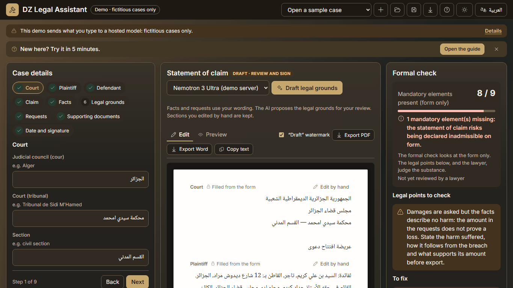
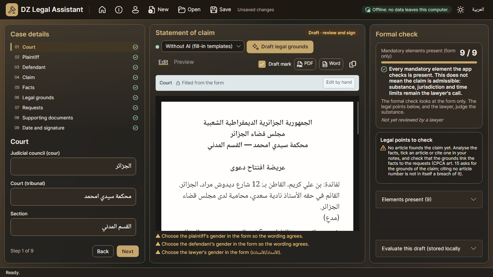
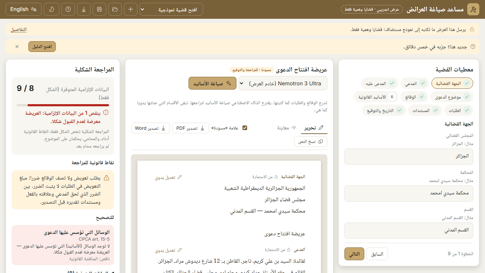
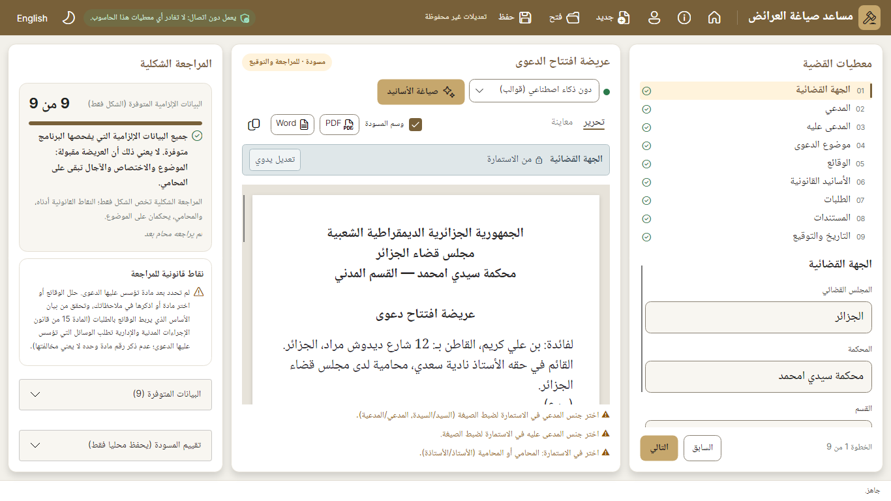

# Website, phase 3b: the demo's first screen shows the product, and a five-minute guide for the judges

Branch `fable/website`, on top of the default branch's phase-3 merge (59e83d7). Built and checked locally on 2 November 2026. Behaviour that keeps the lawyer safe is untouched: export blockers, AI-authorship marks, review before export, the recovery copy and the demo's warnings. Nothing loads from the internet at run time.

## 1. The demo's first screen shows the product

At 1366×768 and 1920×1080, in both languages and both themes, the three panels (case details, the statement of claim, the formal check) are on screen on load, with the formal check's score in view. The screenshots `app-<ar|en>-<light|dark>-<WxH>.png` sit next to the desktop's workbench at the same size, `desktop-workbench-<ar|en>-<light|dark>-<W>.png` (rendered by the headless UI tests with `DZLEGAL_SCREENSHOTS`).

| Demo at 1366×768 | Desktop at 1366×768 |
|---|---|
|  |  |
|  |  |

- **The guide is compact:** one slim bar above the workbench ("New here? Try it in 5 minutes." with "Open the guide"), and the five steps open as an overlay card like the desktop's tour (the tour surface, radius 16, its shadow, the gold numbers, the "AI" tags). Every step, text and "Go to…" button is kept; a "Go to…" button closes the card and moves the form. Escape and "Hide" close it; dismissing the bar with × is remembered for the visit (session storage), and the "Guide" button in the top bar always reopens the card.
- **The demo's warnings stay visible:** the "Demo · fictitious cases only" chip stays in the bar, and one line stays on screen at all times: "This demo sends what you type to a hosted model: fictitious cases only." with "Details", which opens the full disclosure paragraphs and "Clear this browser's copy", wording unchanged, one click away.
- **The "AI is not configured" notice and the recovery banner** are untouched and appear where they did.

## 2. The top bar fits in one row at 1366 px

Below 1440 px (and above the phone layout) the secondary commands (New, Open, Save, Download for Windows, Guide) show as icons with their label as tooltip and for the screen reader, and the document-type label beside the title gives way, as on the desktop at this width. The sample picker, the theme and the language stay as they were. At 1920 px the labels are back. On phones the bar still folds behind "More".

## 3. "Test it in 5 minutes" on the website

- **Where:** `/en/try/` and `/ar/try/`, linked next to "Try the live demo" in the hero, first in the header and in the footer; the compact form (the five titles and what to click) sits on the home right under the hero, and both come from the same component.
- **Five steps**, each with what to click, what should happen, how long it takes and why it matters for a lawyer. Every button label on the page is the demo's own: the website reads `Strings.resx`, `WebText.cs` and the sample file at build time (`site/scripts/strings.mjs`), so the guide and the demo cannot disagree on a name.
- **The demo's guide describes the same steps** with the same labels; its texts were aligned with the website (`WebText.cs`: the title "Try it in 5 minutes", step 1 opens "Unpaid loan", step 3 says nothing is used before "Yes, this is the claim type", step 5 is export before and after the review).
- **Practical note:** the first visit can take up to a minute (`docs/WEB-DEMO.md`); fictitious data only; AI calls limited to 60 per browser session and 150 per network address an hour (`src/DzLegal.Web/appsettings.json`).
- **One Playwright test follows the guide** (`site/tests/guide.spec.ts`) with the labels taken from the same generated string table, against a demo instance whose AI is a local stand-in model (`site/tests/mock-model.mjs`, a small server speaking the chat-completions protocol and answering each prompt in the shape the parsers expect). Nothing leaves the machine and no credit is spent. It checks the first screen (the three panels and the score in view, the disclosure line, the invitation, no card open), then: the sample opens at 8 / 9 with nine steps and the paper; clearing the domicile gives 7 / 9 and a red card naming art. 15-3; "Analyse the facts" shows the reading and the question, nothing ticked until "Yes, this is the claim type", then ticked articles; "Draft legal grounds" writes the section with the AI mark and the review box; "Export PDF" is refused before the tick with the "cannot be exported" notice and downloads a PDF after it.
- **Figures and claims with sources:** 8 s per case for the online model's fact reading (`docs/HIDDEN-SET.md`, 31 October 2026 run); the wake-up minute and the hourly limits as above. The hosted model's drafting time has no published measurement, and the page says so instead of promising one.

**One difference from the brief, found by the test.** Step 2 as briefed said that clearing the defendant's address blocks export. The app does not do that: the formal check is advisory (the lawyer decides), export is blocked only by an unreviewed AI section, an unfilled «(...)» or over-long text, and those blockers stay exactly as they are. Both guides therefore say: the score drops to 7 / 9, the red card cites art. 15-3, export still works and the card stays until the address is back. The test asserts exactly that (a PDF downloads in that state, with no blocker notice).

## 4. The sun icon

The theme button shows a sun on the dark theme and a moon on the light one, from the same Fluent UI System Icons set (MIT) already bundled: the sun's path data was added to `IconPaths.cs`.

## Arabic strings for Khouloud

The guide's Arabic strings (new in this phase) are listed at the end, in one table, as for the phase-2 pages. The demo's own guide strings changed in `WebText.cs` (`GuideTitle`, `GuideInvite`, `GuideOpen`, `DisclosureLine`, `Details`, `Guide1Title`, `Guide1`, `Guide2`, `Guide3`, `Guide5Title`, `Guide5`) and are in that file beside their English.

## Checks

| Check | Result |
|---|---|
| `dotnet build -c Release` (whole solution) | 0 warnings, 0 errors |
| `dotnet test -c Release` | all green: Storage 18, Documents 6, FormEngine 67, Drafting 399, Web 73, Law 116, App 305 (984 in all). One finding on the way: the desktop test `WaitingWorkflowTests.ClosingTheAppFreesTheLocalModelsMemoryAndAServerThatHangsDoesNotHoldItUp` fails while my local demo instances and the stand-in model are listening on this laptop, and passes the moment they are stopped (twice confirmed); the App project's 305 tests were therefore run alone with nothing else running |
| `npm run build` (prebuild checks, postbuild check-dist) | 14 pages, clean |
| Playwright `site.spec.ts` + `axe.spec.ts` | 44 passed, 1 skipped (the fallback test). New in `site.spec.ts`: the guide waits behind its invitation and opens as the tour card with two AI tags; the disclosure line stays on screen and "Details" reveals the full wording and "Clear this browser's copy"; dismissing the invitation survives a reload. axe: 0 violations on the 14 pages in both themes and on the demo's first screen in both themes (one `heading-order` finding on the new page fixed on the way) |
| Playwright `guide.spec.ts` against the stand-in model (`GUIDE_BASE_URL`) | 1 passed: the five steps as the website says |
| `docker build` (local, through the ECR mirror of `node:22-alpine`, base images cached) | 217 s, success; the image answered `/healthz` with `"site": true`, `/en/try/` and `/app?lang=ar` with 200 on a spare port |
| Lighthouse 13.6 (Edge, simulated mobile and desktop) on `/ar/try/`, `/en/try/` and the two homes | The guide page: 100 on all four categories, mobile and desktop, both languages (LCP 1.1 s mobile). The homes with the new section: unchanged from phase 2 (mobile 96 Arabic, 98 English; desktop 100 and 99; accessibility, best practices and SEO 100). Table in `lighthouse-summary.md`; the mobile HTML reports beside it |

## Screenshots

- `app-<ar|en>-<light|dark>-<WxH>.png`: the demo's first screen at 390×844, 1366×768 and 1920×1080.
- `desktop-workbench-<ar|en>-<light|dark>-<W>.png`: the desktop app's workbench at 1366 and 1920, from the headless UI tests.
- `try-<ar|en>-<light|dark>-<WxH>.jpg`: the guide page at 390×844 and 1366×768, full page; `home-<ar|en>-<light|dark>-1366x768.jpg`: the home with the compact guide under the hero.

## Files changed outside `site/`

- `src/DzLegal.Web/Components/Pages/Home.razor` (the bar's labels, the disclosure, the invitation, the overlay card), `Home.razor.cs` (`showGuide` closed on load, `showInvite`, `OpenGuide`, `DismissInvite`, focus on the card), `Services/WebText.cs` (the guide's texts, `GuideInvite`, `GuideOpen`, `DisclosureLine`, `Details`), `wwwroot/app.css` (the disclosure, the invitation, the overlay card, the compact bar below 1440 px), `wwwroot/dzlegal.js` (`sessionGet`/`sessionSet`; `isNarrow` removed), `Components/Parts/IconPaths.cs` (the sun).
- `Dockerfile` (the Node stage copies `WebText.cs` and the samples for the string export).
- `docs/WEB-DEMO.md` (the guide page and the guide test named).
- README unchanged.

## The Arabic strings of the guide, for Khouloud

| Key | Arabic |
|---|---|
| `nav.try` | جرّبه في خمس دقائق |
| `meta.try.description` | خمس خطوات لتجربة مساعد صياغة العرائض في العرض التجريبي: افتح قضية نموذجية، شاهد المراجعة الشكلية، حلّل الوقائع، صغ الأسانيد، وصدّر قبل المراجعة وبعدها. |
| `try.eyebrow` | للمحكّمين والمراجعين |
| `try.title` | جرّبه في خمس دقائق |
| `try.lead` | خمس خطوات في العرض التجريبي، مع ما تضغطه، وما ينبغي أن تراه، ولماذا يهم المحامي. يشغّل العرض الشاشات نفسها التي في التطبيق المكتبي بنموذج مستضاف: بيانات وهمية فقط. |
| `try.full` | الدليل الكامل |
| `try.click` | اضغط |
| `try.expect` | ما ستراه |
| `try.time` | المدة |
| `try.why` | لماذا يهم المحامي |
| `try.step1.title` | افتح القضية النموذجية {0} |
| `try.step1.click` | في الشريط العلوي، افتح {0} واختر {1}. |
| `try.step1.expect` | تمتلئ الخطوات التسع في {0}، وتظهر العريضة على الورق تحت {1}، وتعرض {2} النتيجة 8 / 9: كل البيانات موجودة ما عدا الأسانيد القانونية التي لم تُصغ بعد. |
| `try.step1.time` | ثوانٍ قليلة. لا يُرسل شيء إلى الذكاء الاصطناعي. |
| `try.step1.why` | الاستمارة والورقة والمراجعة شيء واحد: كل بيان يفرضه القانون يُتابَع من أول حرف تكتبه. |
| `try.step2.title` | امسح موطن المدعى عليه |
| `try.step2.click` | افتح خطوة المدعى عليه (أو اضغط {0} في الشريط العلوي ثم {1})، وامسح خانة الموطن، ثم انظر إلى {2}. |
| `try.step2.expect` | تنخفض النتيجة إلى 7 / 9، وتسمّي بطاقة حمراء موطن المدعى عليه وتذكر المادة 15-3 من قانون الإجراءات المدنية والإدارية. لا تمنع المراجعة الشكلية {0}: القرار للمحامي، والبطاقة تبقى حتى يعود الموطن. أعده: تعود النتيجة إلى 8 / 9. |
| `try.step2.time` | أقل من دقيقة. دون ذكاء اصطناعي. |
| `try.step2.why` | عريضة ينقصها بيان إلزامي واحد قد يُحكم بعدم قبولها شكلاً قبل أن ينظر فيها أي قاضٍ. هذه المراجعة برمجة لا ذكاء اصطناعي، وتعمل كذلك دون اتصال. |
| `try.step3.title` | {0} |
| `try.step3.click` | افتح خطوة الأسانيد القانونية ({0} في الدليل) واضغط {1}. |
| `try.step3.expect` | قراءة الذكاء الاصطناعي للوقائع (العلاقة القانونية، والالتزام المخل به، والمطلوب) والسؤال «هل هذا هو نوع الدعوى؟». لا يُؤشَّر على شيء قبل أن تضغط {0}؛ عندها تُؤشَّر المواد التي تقوم عليها هذه الدعوى، كل مادة بنصها الرسمي ومصدرها. |
| `try.step3.time` | في جولة المجموعة المخفية بتاريخ 31 أكتوبر 2026، قرأ النموذج الإلكتروني القضية في 8 ثوانٍ في المتوسط؛ وتعرض لوحة النشاط مؤقتاً. |
| `try.step3.why` | المحامي هو من يؤكد التكييف القانوني قبل أن تُستعمل أي مادة. |
| `try.step4.title` | {0} |
| `try.step4.click` | تحت {0}، اضغط {1}. |
| `try.step4.expect` | يُكتب قسم الأسانيد القانونية: يقتبس البرنامج قاعدة كل مادة مؤشَّر عليها من النص الرسمي، ويكتب الذكاء الاصطناعي كيف تنطبق على الوقائع. يحمل القسم العلامة {0} ومربع {1} تحته. الفقرات التي تخفق في الفحوص (رقم غير وارد في الوقائع، أو قانون لم يقدمه المحامي) تُعلَّم أو تُحذف، وتبيّن ملاحظة كهرمانية ما حدث. |
| `try.step4.time` | تعرض لوحة النشاط الوقت المنقضي. لا يوجد قياس منشور لمدة صياغة النموذج المستضاف، فلا نَعِد هنا بشيء. |
| `try.step4.why` | القاعدة من النص الرسمي والذكاء الاصطناعي يطبّقها فقط؛ والمحامي يراجع كل سطر كتبه الذكاء الاصطناعي. |
| `try.step5.title` | صدّر قبل المراجعة وبعدها |
| `try.step5.click` | اضغط {0} قبل التأشير على المربع. ثم أشّر على {1} واضغط {0} من جديد. |
| `try.step5.expect` | أولاً، تعرض قائمة {0} القسم الذي كتبه الذكاء الاصطناعي ولم يُراجَع، ولا يُنزَّل شيء. بعد التأشير، يُنزَّل ملف PDF (و{1} يعمل بالطريقة نفسها)؛ وتعرض {2} الصفحات أولاً إن شئت. |
| `try.step5.time` | ثوانٍ قليلة. |
| `try.step5.why` | لا تخرج عريضة من التطبيق وفيها قسم من الذكاء الاصطناعي لم يُراجَع: المحامي هو من يوقّع. |
| `try.note.title` | قبل أن تبدأ |
| `try.note.1` | قد تستغرق الزيارة الأولى دقيقة: يستيقظ الخادم المجاني عند الطلب، وتقول الصفحة ذلك أثناء التحميل. |
| `try.note.2` | بيانات وهمية فقط. ما تكتبه يُرسل إلى نموذج مستضاف؛ والقضايا النموذجية الأربع مختلقة. |
| `try.note.3` | استدعاءات الذكاء الاصطناعي محدودة: 60 لكل جلسة متصفح و150 لكل عنوان شبكة في الساعة. المراجعة الشكلية والتحرير والتصدير غير محدودة. |
| `try.same` | دليل العرض نفسه ({0} في شريطه العلوي) يصف الخطوات الخمس نفسها بأسماء الأزرار نفسها. |

40 strings. The labels inside the texts ({0}, {1}…) are the demo's own button names, inserted at build time.

