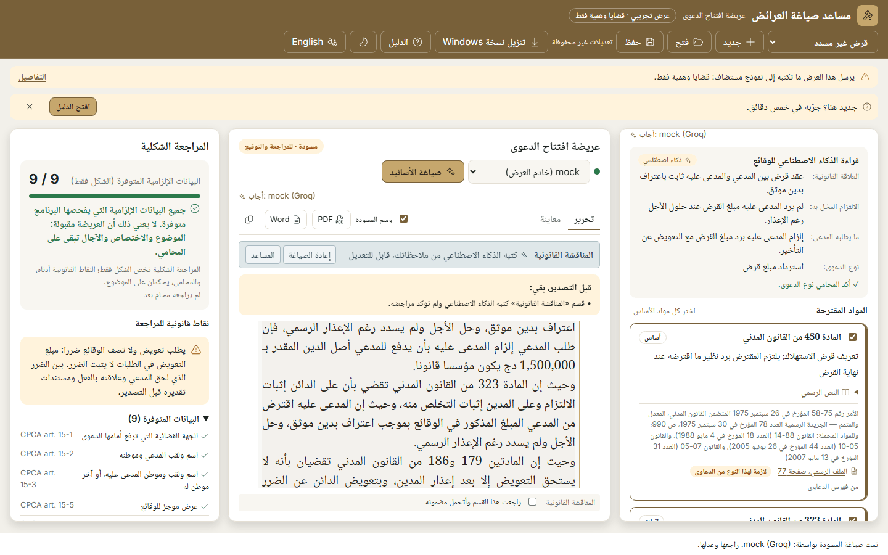
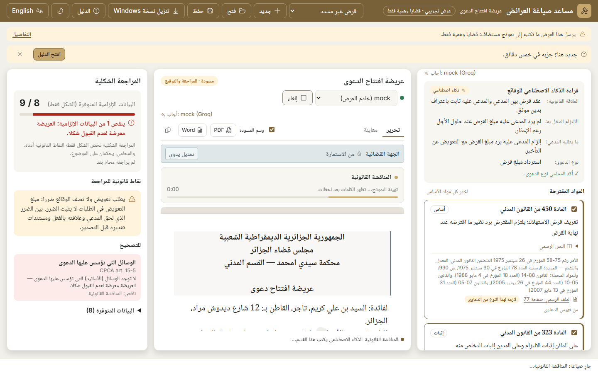
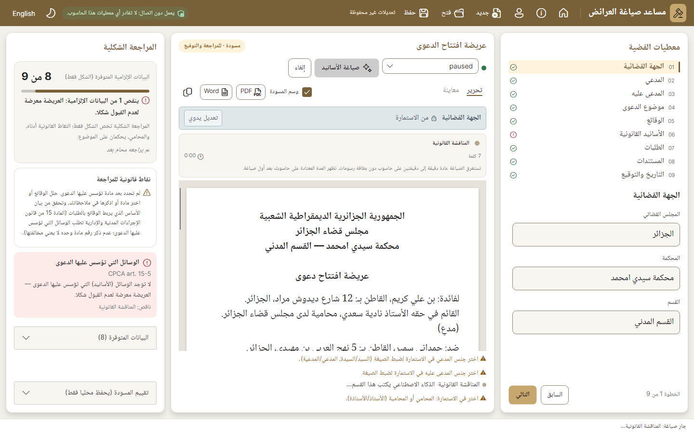
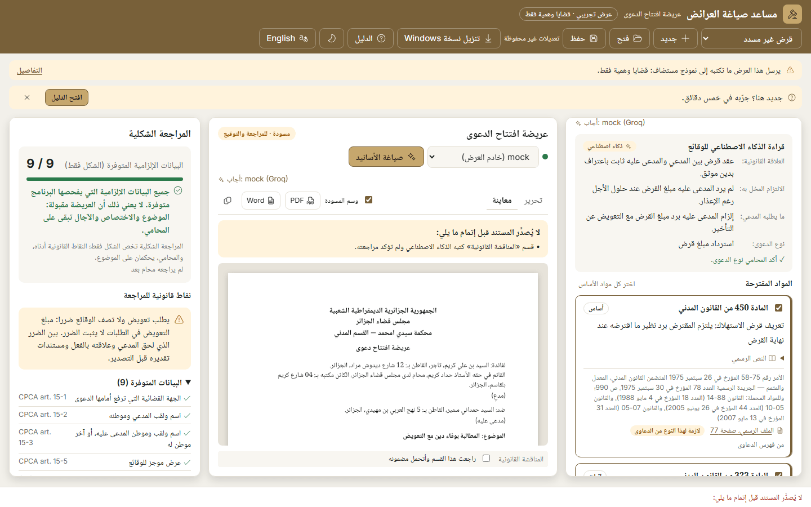
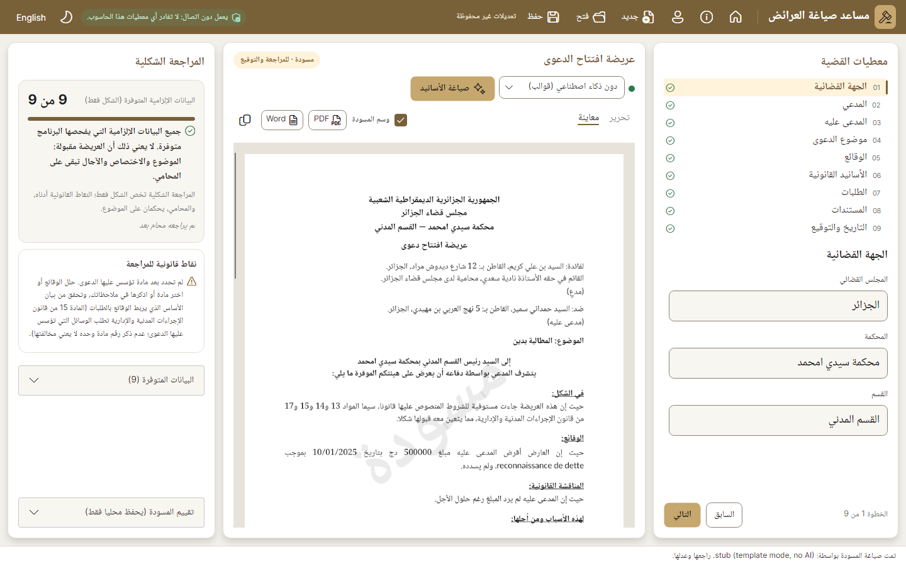
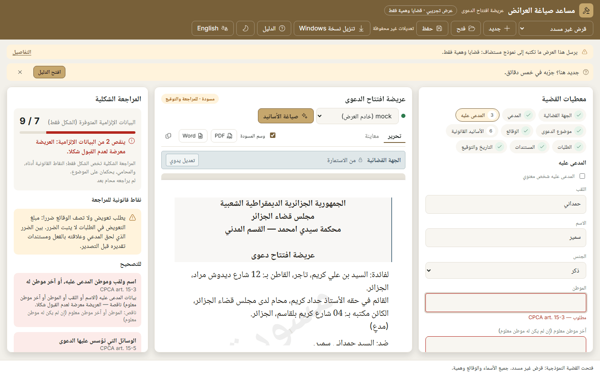
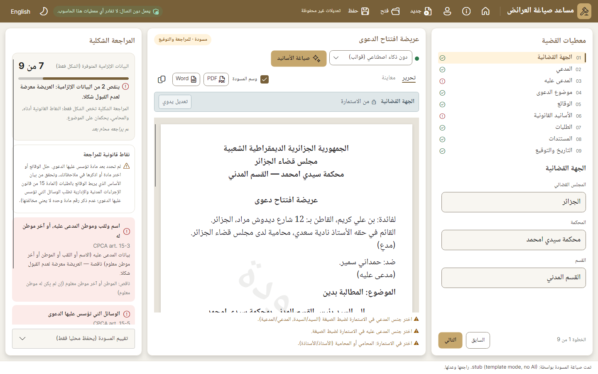

# Website, phase 3c: the demo's workbench, screen by screen like the desktop's

Branch `fable/website`, on top of the default branch's phase-3b merge (6ac1ae5). Checked locally on 2 November 2026. Behaviour that keeps the lawyer safe is untouched: export blockers, AI-authorship marks, review before export, the recovery copy and the demo's warnings. Nothing loads from the internet at run time. README unchanged.

This report grows with the phase: **checkpoint 1 is A and B** (the draft paper and the draft panel's toolbar), pushed first because judging ends on 7 November; C to F follow in the same folder.

## How the desktop references were made

`DZLEGAL_SCREENSHOTS=<folder> dotnet test -c Release tests/DzLegal.App.Tests` wrote 116 frames. The ones used here are copied beside the demo's as `desktop-<state>.png` (1440×900: `review`, `preview`, `grounds`, `writing`, `missing`, `activity`, `assistant`, `requests`, `unsaved`, and `ar`/`en`/`dark` variants) and `desktop-first-<ar|en>-<light|dark>-<1366|1920>.png` (the workbench test's first screen). The demo's states were captured with `site/tests/states.mjs` against an instance wired to the stand-in model (`site/tests/mock-model.mjs --slow 120`, so the writing state is visible), in both languages and both themes at 1440×900 (`demo-<state>-<lang>-<theme>-1440x900.png`), plus the first screen at 1366 and 1920 (`app-<lang>-<theme>-<WxH>.png`). No credit was spent.

## Checkpoint 1: A, the draft paper, and B, the draft panel's toolbar

| State | Demo (1440×900) | Desktop |
|---|---|---|
| The drafted grounds with the review box |  |  |
| Drafting in progress |  |  |
| Preview |  |  |
| A missing element |  |  |

**A. The paper.**
1. One continuous document, as on the desktop: the paper is an A4 sheet (794 px wide, 1123 px tall at least, the desktop's margins, which narrow with the window as the desktop's do), the Arabic text at the desktop's 20.5 px with its 31 px line height and ink colour, the sections laid out from the form definition exactly as the desktop converts it (centred and bold header lines and title, justified facts and grounds, the end-aligned date and signature block, the spacing before each section), and the underlined headings (في الشكل:، الوقائع:، المناقشة القانونية:…) where the definition prints them.
2. The per-section label rows are gone. One strip above the paper (the desktop's "field tools", in its own colours) shows the **selected** section: its name, its origin ("From the form", the AI mark, "Edited by hand") and its actions (Edit by hand, Restore, Undo, Redraft, Assistant, and the redraft confirmation). Clicking or focusing a section selects it, with the desktop's light side line and a faint highlight; the first section is selected on load. Editing works exactly as before: the same text boxes, the same commands. The one C# addition is the selected section's id (`selectedSectionId` in `Home.razor.cs`).
3. Safeguards, kept visible: every AI-written section carries, in the paper itself, a gold side line and the "AI" tag at its corner (the desktop marks the origin only in the strip; the paper mark stays as the brief asked). The "I have reviewed this section and take responsibility for it" box moved to where the desktop keeps it: the list docked under the paper, visible whatever the selection and the paper's scrolling, and it works as before (the guide test ticks it there).
4. The «مسودة» watermark shows in Edit whenever "Draft mark" is ticked, with the desktop's size (110 px bold), angle (−35°), opacity (8 %) and position (300 px from the top); in Preview the pages come from the same PDF engine as the desktop's, watermark included. Checked in both themes: the paper is always light, so the watermark is the same in both.
5. The paper frame: the grey canvas (`--paper-canvas`), the sheet's shadow (`0 2 10 rgb(0 0 0 / 0.15)`), and the canvas is now the scroll area, the panel keeping its height, as the desktop's `ScrollViewer` does. On wide screens the three panels fill the window and scroll inside, as the desktop's do; on phones the page still scrolls as a whole.
6. The notes under the paper: the review rows (the AI sections to tick), the review notes (gender wording, unverified numbers, removed paragraphs) and the "being written" row sit in one list under the paper, as on the desktop, at most 150 px tall and scrolling. The "Before exporting, still to do:" box sits above the paper in both Edit and Preview.
7. Preview: the same PDF pages as the desktop (centred bold headings, underlined section headings, justified text, the watermark), on the canvas, 860 px wide at most, with the "Rendering…" chip.

**B. The toolbar.**
1. One row: "Edit" and "Preview" as underlined text tabs; the "Draft mark" checkbox (the desktop's `WatermarkShort` string); compact "PDF" and "Word" buttons with the file-type icons (the PDF glyph added to the icon table from the bundled Fluent set); copy as an icon button with a tooltip. "Export PDF" and "Export Word" stay the tooltips and the accessible names, so the guides and the guide test still find them by those names.
2. The engine picker has the desktop's status dot (green when the engine can answer, red otherwise; the status text as tooltip) and the "Draft legal grounds" button the desktop's size and its hint as tooltip.
3. The "Draft · review and sign" badge sits at the far end of the title row.
4. The "Answered by: …" line stays under the engine row.

**A finding on the way.** Once a panel scrolls inside a bounded height, Chrome let the clickable finding cards of the formal check collapse onto each other when the panel was a CSS grid; the side panels are now flex columns whose cards keep their height. Visible in both themes before the fix, gone after (`demo-missing-*`).

## Checks (checkpoint 1)

| Check | Result |
|---|---|
| `dotnet build -c Release` (whole solution) | 0 warnings, 0 errors |
| `dotnet test -c Release` | all green: Storage 18, Documents 6, FormEngine 67, Drafting 399, Web 73, Law 116, App 305 (984 in all), run with the local demo instances stopped (see the phase-3b note) |
| `npm run build` | 14 pages, clean (the site is unchanged in this checkpoint) |
| Playwright `site.spec.ts` + `axe.spec.ts` | 44 passed, 1 skipped (the fallback test); axe 0 violations on the 14 pages and on the demo's first screen in both themes |
| Playwright `guide.spec.ts` against the stand-in model | 1 passed, with the stand-in streaming slowly. The test's selectors followed the restructure: the review box is read in the list under the paper (`.review-list .reviewed`), the AI mark in the paper (`.section.ai`), and the origin text in the strip after selecting that section; it checks the same five steps and the same results |
| `docker build` (local, through the ECR mirror of `node:22-alpine`, base images cached) | 203 s, success; the image answered `/healthz` and `/app?lang=ar` on a spare port |

## Remaining differences after checkpoint 1

| Difference | Why / when |
|---|---|
| Case details: step pills instead of the numbered list; "e.g." lines under the labels; smaller inputs | Part C, next push |
| Formal check: "9 / 9" string, red/green progress bar, amber block for the legal points, plain expander | Part D, next push |
| App bar order: the demo chip, the sample picker, Download and Guide sit between the brand and New/Open/Save; the language is an icon button with text | Part E, next push |
| Type and spacing of the panels | Part F, next push |
| The desktop's "Evaluate this draft" card, the Home, Help and Profile buttons, the offline chip | Desktop-only: the demo has no profile, no local files and no offline engine; the disclosure line and the demo chip take the chip's place |
| The AI mark in the paper (gold line + "AI" tag) | Demo-only by the brief: the desktop marks the origin only in the strip and the review list |
| The demo's extras: the disclosure line, the invitation, the sample picker, Download for Windows, Guide, "Answered by" | Demo-only, kept by the brief |
