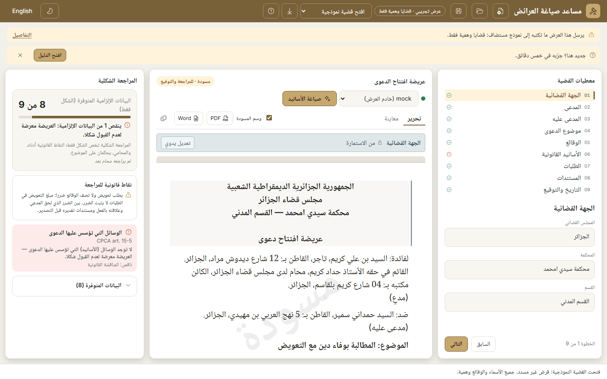
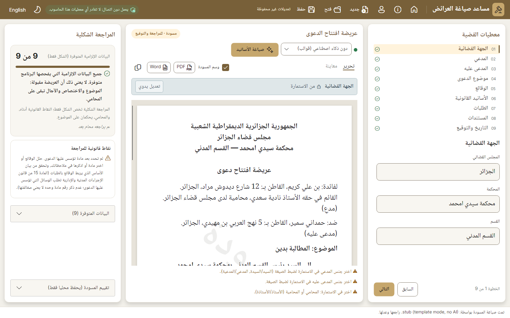
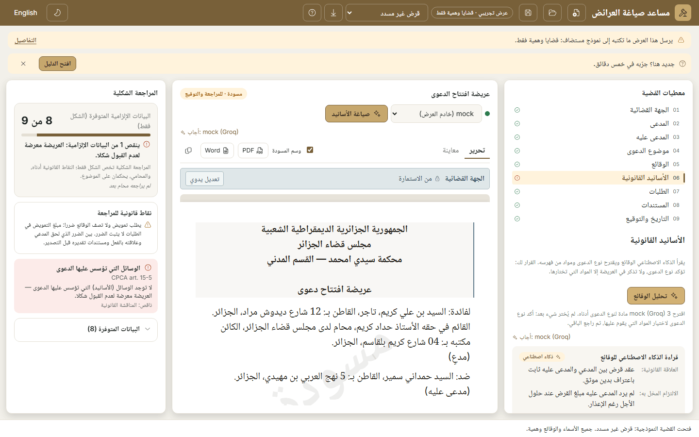
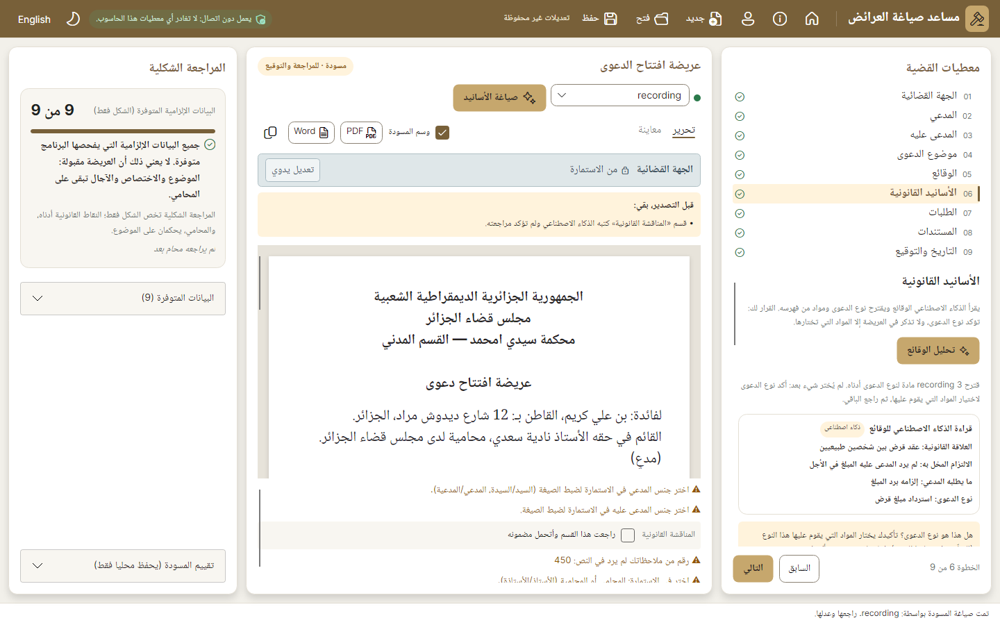
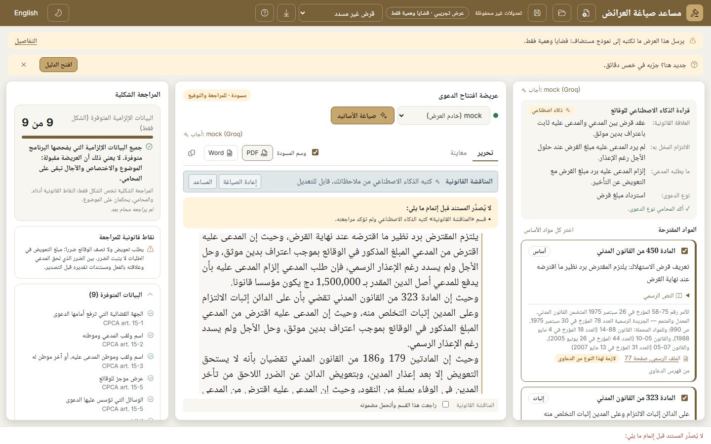

# Website, phase 3c: the demo's workbench, screen by screen like the desktop's

Branch `fable/website`, on top of the default branch's phase-3b merge (6ac1ae5). Checked locally on 2 November 2026. Behaviour that keeps the lawyer safe is untouched: export blockers, AI-authorship marks, review before export, the recovery copy and the demo's warnings. Nothing loads from the internet at run time. README unchanged.

This report grows with the phase: **checkpoint 1 is A and B** (the draft paper and the draft panel's toolbar), pushed first because judging ends on 7 November; C to F follow in the same folder.

## How the desktop references were made

`DZLEGAL_SCREENSHOTS=<folder> dotnet test -c Release tests/DzLegal.App.Tests` wrote 116 frames. The ones used here are copied beside the demo's as `desktop-<state>.png` (1440×900: `review`, `preview`, `grounds`, `writing`, `missing`, `activity`, `assistant`, `requests`, `unsaved`, and `ar`/`en`/`dark` variants) and `desktop-first-<ar|en>-<light|dark>-<1366|1920>.png` (the workbench test's first screen). The demo's states were captured with `site/tests/states.mjs` against an instance wired to the stand-in model (`site/tests/mock-model.mjs --slow 120`, so the writing state is visible), in both languages and both themes at 1440×900 (`demo-<state>-<lang>-<theme>-1440x900.png`), plus the first screen at 1366 and 1920 (`app-<lang>-<theme>-<WxH>.png`). No credit was spent.

## Checkpoint 1: A, the draft paper, and B, the draft panel's toolbar

| State | Demo (1440×900) | Desktop |
|---|---|---|
| The drafted grounds with the review box |  |  |
| Drafting in progress |  |  |
| Preview |  |  |
| A missing element |  |  |

**A. The paper.**
1. One continuous document, as on the desktop: the paper is an A4 sheet (794 px wide, 1123 px tall at least, the desktop's margins, which narrow with the window as the desktop's do), the Arabic text at the desktop's 20.5 px with its 31 px line height and ink colour, the sections laid out from the form definition exactly as the desktop converts it (centred and bold header lines and title, justified facts and grounds, the end-aligned date and signature block, the spacing before each section), and the underlined headings (في الشكل:، الوقائع:، المناقشة القانونية:…) where the definition prints them.
2. The per-section label rows are gone. One strip above the paper (the desktop's "field tools", in its own colours) shows the **selected** section: its name, its origin ("From the form", the AI mark, "Edited by hand") and its actions (Edit by hand, Restore, Undo, Redraft, Assistant, and the redraft confirmation). Clicking or focusing a section selects it, with the desktop's light side line and a faint highlight; the first section is selected on load. Editing works exactly as before: the same text boxes, the same commands. The one C# addition is the selected section's id (`selectedSectionId` in `Home.razor.cs`).
3. Safeguards, kept visible: every AI-written section carries, in the paper itself, a gold side line and the "AI" tag at its corner (the desktop marks the origin only in the strip; the paper mark stays as the brief asked). The "I have reviewed this section and take responsibility for it" box moved to where the desktop keeps it: the list docked under the paper, visible whatever the selection and the paper's scrolling, and it works as before (the guide test ticks it there).
4. The «مسودة» watermark shows in Edit whenever "Draft mark" is ticked, with the desktop's size (110 px bold), angle (−35°), opacity (8 %) and position (300 px from the top); in Preview the pages come from the same PDF engine as the desktop's, watermark included. Checked in both themes: the paper is always light, so the watermark is the same in both.
5. The paper frame: the grey canvas (`--paper-canvas`), the sheet's shadow (`0 2 10 rgb(0 0 0 / 0.15)`), and the canvas is now the scroll area, the panel keeping its height, as the desktop's `ScrollViewer` does. On wide screens the three panels fill the window and scroll inside, as the desktop's do; on phones the page still scrolls as a whole.
6. The notes under the paper: the review rows (the AI sections to tick), the review notes (gender wording, unverified numbers, removed paragraphs) and the "being written" row sit in one list under the paper, as on the desktop, at most 150 px tall and scrolling. The "Before exporting, still to do:" box sits above the paper in both Edit and Preview.
7. Preview: the same PDF pages as the desktop (centred bold headings, underlined section headings, justified text, the watermark), on the canvas, 860 px wide at most, with the "Rendering…" chip.

**B. The toolbar.**
1. One row: "Edit" and "Preview" as underlined text tabs; the "Draft mark" checkbox (the desktop's `WatermarkShort` string); compact "PDF" and "Word" buttons with the file-type icons (the PDF glyph added to the icon table from the bundled Fluent set); copy as an icon button with a tooltip. "Export PDF" and "Export Word" stay the tooltips and the accessible names, so the guides and the guide test still find them by those names.
2. The engine picker has the desktop's status dot (green when the engine can answer, red otherwise; the status text as tooltip) and the "Draft legal grounds" button the desktop's size and its hint as tooltip.
3. The "Draft · review and sign" badge sits at the far end of the title row.
4. The "Answered by: …" line stays under the engine row.

**A finding on the way.** Once a panel scrolls inside a bounded height, Chrome let the clickable finding cards of the formal check collapse onto each other when the panel was a CSS grid; the side panels are now flex columns whose cards keep their height. Visible in both themes before the fix, gone after (`demo-missing-*`).

## Checks (checkpoint 1)

| Check | Result |
|---|---|
| `dotnet build -c Release` (whole solution) | 0 warnings, 0 errors |
| `dotnet test -c Release` | all green: Storage 18, Documents 6, FormEngine 67, Drafting 399, Web 73, Law 116, App 305 (984 in all), run with the local demo instances stopped (see the phase-3b note) |
| `npm run build` | 14 pages, clean (the site is unchanged in this checkpoint) |
| Playwright `site.spec.ts` + `axe.spec.ts` | 44 passed, 1 skipped (the fallback test); axe 0 violations on the 14 pages and on the demo's first screen in both themes |
| Playwright `guide.spec.ts` against the stand-in model | 1 passed, with the stand-in streaming slowly. The test's selectors followed the restructure: the review box is read in the list under the paper (`.review-list .reviewed`), the AI mark in the paper (`.section.ai`), and the origin text in the strip after selecting that section; it checks the same five steps and the same results |
| `docker build` (local, through the ECR mirror of `node:22-alpine`, base images cached) | 203 s, success; the image answered `/healthz` and `/app?lang=ar` on a spare port |

## Checkpoint 2: C to F

| State | Demo (1440×900) | Desktop |
|---|---|---|
| The first screen |  |  |
| A missing element (the defendant's domicile cleared) |  |  |
| The AI proposal |  |  |
| Export blocked |  |  |

The first screen at 1366 and 1920: `app-<lang>-<theme>-<WxH>.png` beside `desktop-first-<lang>-<theme>-<W>.png`; every state in English and in dark: the same names with `en` and `dark`.

**C. Case details.**
1. The nine steps are the desktop's numbered list, 01 to 09, in one column at most 290 px tall: the number in small muted type, the step name, and at the end the status circle (✓ in green when complete, the red ! when something is missing, the amber ! for a warning); the current step on the accent background with the 3 px gold bar at its start. The missing mark now shows as soon as an element is missing, as the desktop's does (the demo used to wait until the step had been visited). The step number is part of the row, as on the desktop; the old "6" badge on the grounds pill is gone with the pills.
2. Fields at the desktop's size: 40 px inputs with radius 8 on the alt surface, the hairline border, 15 px Naskh for the Arabic; the labels in 12 px muted type; the example ("e.g. Alger") moved from a line under the label into the empty box, as the desktop's watermark does; the step title at 18 px.
3. "Step 1 of 9 · Back · Next" is docked at the bottom of the panel, Back outlined and Next gold, as on the desktop.

**D. Formal check.**
1. The score is the desktop's own string from `Strings.resx` («9 من 9», "9 / 9", `ScoreText`), at 22 px bold, in the score card on the alt surface.
2. The progress bar fills in the accent colour.
3. Missing elements are the desktop's pink cards: the red ! icon with the title, "CPCA art. 15-3", the explanation and the "Missing:" line; a warning is the same card in amber. The "To fix" heading went with them: the desktop has none.
4. "Legal points to check" is a bordered card on the surface, the title at 14 px and the points at 12 px with the amber warning icon.
5. "Elements present (9)" is the desktop's expander card with a chevron that turns when open; each element with its green ✓ and its article. The desktop-only "Evaluate this draft" card is not in the demo.

**E. App bar.**
1. In the desktop's order: the brand, then New (the DocumentAdd glyph, added from the bundled set), Open and Save with the save state beside them; at the far end the theme button and the language as plain text ("English" / «العربية»).
2. The demo's items sit between the two groups: the "Demo · fictitious cases only" chip, the sample picker, Download for Windows and Guide. The bar fits one row at 1366 and 1440 in both languages: up to 1600 px the secondary commands (New, Open, Save, Download, Guide) show as icons with their label as tooltip and for the screen reader, and the document type beside the title gives way; at 1920 the labels are back. On phones the two groups fold behind "More" as before.

**F. Type and spacing.** The desktop's sizes: body 14 px, panel titles 15 px semibold, the selected step's title 18 px, captions 12 px, cards padded 12 (bordered) and 14 (score) and 16 (panels), 10 px gaps inside the panels, 12 px between them; the columns are the desktop's 390 / flexible / 330 (360 / flexible / 300 under 1280 px, two columns under 1100, tabs on phones).

## Checks (final)

| Check | Result |
|---|---|
| `dotnet build -c Release` (whole solution) | 0 warnings, 0 errors |
| `dotnet test -c Release` | all green: Storage 18, Documents 6, FormEngine 67, Drafting 399, Web 73, Law 116, App 305 (984 in all), run with the local demo instances stopped |
| `npm run build` | 14 pages, clean (the site is unchanged in this phase) |
| Playwright `site.spec.ts` + `axe.spec.ts` | 44 passed, 1 skipped (the fallback test); axe 0 violations on the 14 pages and on the demo's first screen in both themes (the restructured findings cards had lost their darker muted shade for a moment; axe caught it, fixed) |
| Playwright `guide.spec.ts` against the stand-in model | 1 passed. Its selectors followed the draft panel's restructure (the review box in the list under the paper, the AI mark in the paper, the origin in the strip); the steps and the results it checks are the same |
| `docker build` (local, through the ECR mirror of `node:22-alpine`, base images cached) | 201 s, success; the image answered `/healthz` and `/app?lang=en` on a spare port |

## Every visible difference that remains, and why

| Difference | Why |
|---|---|
| The desktop's Home, Help and Profile buttons in the bar; the offline chip; the "Evaluate this draft" card; the sample banner | Desktop-only: the demo has no profile, no local files, no offline engine and no desktop sample tour; the demo chip and the disclosure line take the chip's place |
| The demo's extras: the chip, the disclosure line with "Details", the invitation and its overlay, the sample picker, Download for Windows, Guide, "Answered by", the "AI is not configured" notice, the recovery banner, "Clear this browser's copy" | Demo-only, kept by the brief |
| At 1440 px the desktop shows New, Open and Save with their labels; the demo shows icons up to 1600 px | The demo's five extra items share the row; with labels the bar would wrap at 1440. At 1920 the labels are back |
| The AI-written section carries a gold line and an "AI" tag in the paper | Asked by the brief; the desktop marks the origin only in the strip and the review list |
| The paper's left-edge section line is drawn at the inline start (the right edge in Arabic); the desktop draws it at the left in both languages | The web paper is a right-to-left document; the line sits where the reading starts. Same colours, same width |
| The paper's text area is narrower on a 1366 window | The desktop gives its middle column 586 px there too, but its sheet margins narrow further ("tight" window); the demo narrows them at 1280 and keeps the A4 sheet otherwise |
| The preview pages render at the same size as the desktop's (860 px at most) but the desktop's window is 1440 wide in the reference | Screen size only |
| The step list's warning mark uses the amber ! and the missing mark the red !, both the Fluent ErrorCircle glyph as on the desktop; the demo's status bar and notices keep their wording | Same as the desktop |
| On a phone the demo keeps its tabs (Case, Draft, Checks) and the page scrolls as a whole | The desktop has no phone layout |

## Files changed

- `src/DzLegal.Web/Components/Pages/Home.razor` (the bar, the step list, the draft panel, the formal check), `Home.razor.cs` (the selected section), `Components/Parts/SectionEditor.razor` (the paper section), `Components/Parts/FieldEditor.razor` (the example as watermark), `Components/Parts/IconPaths.cs` (the PDF, DocumentAdd and chevron glyphs), `wwwroot/app.css`.
- `site/tests/guide.spec.ts` (selectors), `site/tests/mock-model.mjs` (`--slow`), `site/tests/states.mjs` (new: the state captures).
- README unchanged. No string changed in `WebText.cs` or the resources.
